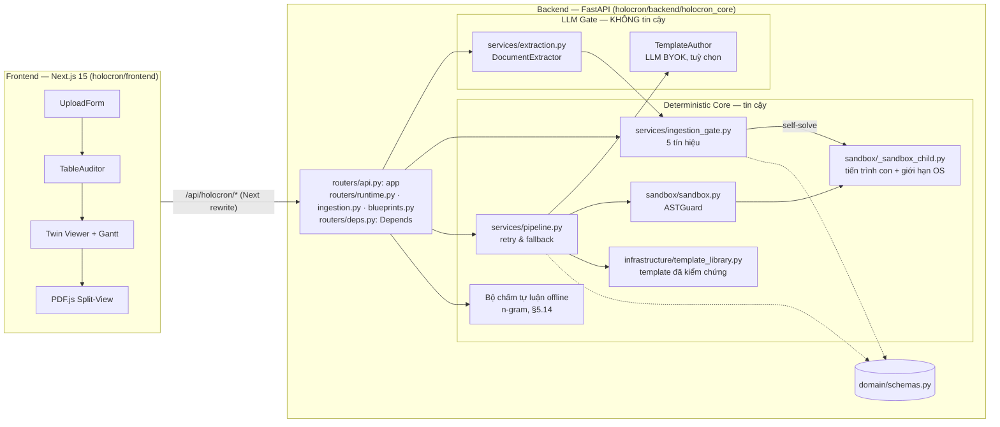

# Holocron — Technical Specification & PRD

| Trường | Giá trị |
|---|---|
| Trạng thái | **v0.7, bổ sung 2026-10-28 (môn học và blueprint lý thuyết, theo code đã triển khai)** (vẫn v0.7): ghi contract môn học và blueprint slot lý thuyết đã triển khai, mỗi chỗ sửa ghi "(duyệt 2026-10-28)": §6.8 môn học (câu 1) và `POST/GET /v1/blueprints` chỉ slot lý thuyết (câu 2; `item_ids` khác rỗng ⇒ 422, câu 15) đã triển khai; câu lý thuyết vào `TwinBatch` theo phương án (b) của câu 14 (union theo `question_kind`, không đổi `examples/`): `TheorySlot` (§5.9), `TheoryTwin` và `TwinBatch.twins` union, không có `TheoryTrace` (§5.11), seed R6 và dấu vân tay thay thế cho slot lý thuyết (§6.3). §4 bước 5 và §17 D8 sửa khớp; nợ ghi ở ADR-004 (ARCH-002…ARCH-008). Shape (a) cũ của §5.9/§5.11/§6.3 giữ nguyên dưới nhãn "mục tiêu sau 29/10 (nợ ADR-004)". `review_status = AUTO_PASS` của câu lý thuyết ghi theo code, duyệt 2026-10-28 (câu 24). §0 không đổi. **v0.7, bổ sung 2026-10-28** (vẫn v0.7): kiểm `Host` và token đã triển khai ở nhánh `feat/api-capabilities-host-token` (PR #81) bằng middleware ASGI `LocalAccessMiddleware` chạy trước routing, bao cả file tĩnh của chế độ portable; sửa cho khớp code ở §6.0, §13.1, §17 D13; thêm hành vi token sai dạng (fail-closed) ở §6.0, §11.2 là "đề xuất, chờ duyệt (câu 22, 2026-10-28)"; quy tắc "biến rỗng/toàn khoảng trắng coi như chưa đặt" ở §11.2 giữ nguyên, đang chờ câu 21; `RuntimeInfo` thêm `app_version`, `commit`, `log_dir` (§5.12, §6.4, §14; duyệt 2026-10-28, quyết định người dùng câu 7; đã triển khai (nhánh feat/api-runtime-build-info, duyệt 2026-10-28)); §0 không đổi. **v0.7, bổ sung 2026-10-27** (vẫn v0.7): ghi log file của bản portable ở §14 (2026-10-28; đã triển khai, PR #80), kèm nợ PKG-003 ở ADR-004; ghi ngoại lệ GEOS LGPL-2.1 (liên kết động) cho bản zip portable đủ có RapidOCR (Q4, duyệt 2026-10-27; ADR-008). Thêm contract chế độ portable, backend phục vụ frontend tĩnh qua `HOLOCRON_WEB_DIR` (§6.0, §11.2): đã triển khai (#69, #71, #72); tên biến duyệt 2026-10-27 (Q8); Q1 chọn (a), chưa triển khai. Bỏ tên nhà cung cấp mặc định cũ khỏi spec (PR #61), mỗi chỗ sửa ghi "(duyệt 2026-10-27)" khi đổi hành vi: LLM chỉ bật khi đặt tường minh đủ `HOLOCRON_LLM_BASE_URL`, `HOLOCRON_LLM_API_KEY`, `HOLOCRON_LLM_MODEL_EXTRACT`; thiếu thì khả năng cần LLM báo `llm_not_configured` với `detail_vi` cố định nêu đủ ba biến, endpoint cần LLM trả 409 `CapabilityError` và không gọi mạng (§11.2, §17 D12); ADR-006, ADR-007, ADR-008 thêm dòng "Sửa đổi 2026-10-27", trạng thái không đổi; §0 không đổi. **v0.7, bổ sung 2026-10-26 (đợt hai chiều, người dùng trả lời lúc ~13:40)** (vẫn v0.7): spec v0.7 là contract mục tiêu, không phải phạm vi MVP; phạm vi MVP-1 (26–29/10, chốt 2026-10-26) ở §1.5 và lịch mới ở §16 (hạn nộp hackathon Chủ nhật 8/11/2026). Ghi các quyết định câu 19, mỗi chỗ sửa ghi "(duyệt 2026-10-26)": tham số bộ chấm tự luận (4 âm tiết, 0.5·bigram + 0.5·trigram, ngưỡng 0.5) là giá trị ban đầu, hiệu chỉnh sau trên dữ liệu thật; bỏ n-gram thuộc `term` và thêm `term` vào câu chữ I4 ở §0 (D11(b)); sửa câu chữ cơ chế I3 ở §0 cho các ý của câu ESSAY (D11(c)); giữ tên `matched_count`/`total_points`; danh sách mã `CapabilityReason` và mặc định `HOLOCRON_LLM_MODEL_AUTHOR = HOLOCRON_LLM_MODEL_EXTRACT` (D7); các lớp K1–K7 của §10.1, kèm điều kiện có ≥ 3 ví dụ có đáp án trích từ tài liệu làm đối chứng độc lập (D6). §0 chỉ đổi đúng câu chữ D11(b)(c). Cùng đợt sửa theo review: luật so xung đột `theory_mcq4_v3` chỉ được duyệt hướng, chi tiết chờ duyệt câu 1b (§5.11, ADR-007); giới hạn `topic_keys` và route `/vault` trở về "đề xuất (chờ duyệt)" (§4, §5.8, §6.6, §17 D8); `source_doc_ids` là việc để sau (§5.9); luật loại nhãn `llm_data_recipient` chỉ so với biến khác rỗng (§5.12); điểm OCR chỉ định dạng hiển thị (§4, §5.7). **v0.7, bổ sung 2026-10-26 chiều** (vẫn v0.7; spec chưa có quy ước số phiên bản phụ kiểu v0.7.1): ghi các quyết định người dùng duyệt chiều 2026-10-26, mỗi chỗ sửa ghi "(duyệt 2026-10-26 chiều)": cột cơ chế I1 ở §0 (đóng D14; phần còn lại của §0 không đổi); hướng luật "đúng một đáp án" của bộ sinh câu lý thuyết: so trên dãy token chữ/số, theo khái niệm ở cả ba dạng, `GENERATOR_VERSION = "theory_mcq4_v3"` (§5.11, ADR-007; chi tiết chờ duyệt câu 1b); `TwinBatchRequest.format` chỉ ghi đè slot tính toán, `ESSAY` ⇒ 422 (§5.6, §6.3); `ExamBlueprint.source_exam_doc_id` cho phép null (§5.9); kiểm `Origin` cho request ghi và danh sách `Host` (§6.0, §13.1); kho in-memory ghi file PDF gốc vào thư mục tạm (§5.13); 503 khi app đang tắt (§6.0); tài liệu `failed` vẫn chuyển được sang `confirmed`, 409 cho tài liệu chưa có `chapter_code`, quy tắc `engine`/`conf` của dòng đã sửa và dòng gõ thêm, nhập lại khác `chapter_code` (§5.7, §6.5); `linked_chunk_ids` tính lại theo môn (§5.8, §12.1; giới hạn `topic_keys` ghi theo code là đề xuất, chờ duyệt, §17 D8); `RuntimeInfo` thêm chế độ lưu trữ và bên nhận dữ liệu LLM (§5.12, §11.2); route frontend theo code (§4; route `/vault` theo nhánh F2, chờ duyệt); ADR-006 mục 2 sửa theo `chapter_code` của form (§17 D9); sổ nợ ADR-004; phương án B của `docs/tauri-spike-plan.md`. Chi tiết chỉ được duyệt hướng ghi "đề xuất (chi tiết), chờ duyệt". **v0.7, bổ sung 2026-10-26** (vẫn v0.7): ghi các quyết định người dùng duyệt lúc 00:25 ngày 2026-10-26, mỗi chỗ sửa ghi "(duyệt 2026-10-26)": phần còn chờ của D8 gồm `TheorySlotSpec` kèm `format`, `theory_slots`, các field nullable của `BlueprintSlot` và `ReviewTicket.topic_key` (§5.9, §5.11); field form bắt buộc `chapter_code` của tài liệu nhập và nhãn ban đầu của chunk (§5.7, §5.8, §5.13, §6.5, §12.1); quy tắc sửa dòng và xác nhận trang (§5.7, §6.5); dạng câu lý thuyết do RNG tất định chọn (§5.11, ADR-007 mục 2); §0 không đổi. `chapter_code` theo form từng lệch ADR-006 mục 2 (LLM đề xuất theo heading); ADR-006 mục 2 đã sửa theo đợt duyệt 2026-10-26 chiều (§17 D9). **v0.7** (2026-10-25, tối): ghi các quyết định người dùng duyệt tối 2026-10-25, mỗi chỗ sửa ghi "(duyệt 2026-10-25)": câu chữ I1, I3, I4 ở §0 (bộ tính điểm chấm câu trả lời ngoài sandbox, "artifact lời giải theo `kind`" thay "Gantt", các ý của câu ESSAY, tái lập của bộ chấm); nhãn "đề xuất" thành "đã duyệt" cho `CapabilityError`, `LLM_UPSTREAM_ERROR`, quy ước `HOLOCRON_LLM_*`, token và header `X-Holocron-Token`, endpoint chấm tự luận và model `Subject` có `exam_format` (duyệt 2026-10-25, brief người dùng), hướng chấm bằng độ phủ n-gram âm tiết (bigram, trigram) báo "khớp x/y ý" (§5.12, §5.14, §6.0, §6.9, §11.2, §13.1); `HOLOCRON_DATA_DIR` không đặt thì dùng kho in-memory (§5.13, §11.2); `LOW_TEXT_SCORE` (§5.7); dual-pass không đặt `temperature` (§7.1); `page_source` cho item đến từ PDF (§5.4, §6.5, §7.4); mã lỗi của kho SQLite, gồm 503 chỉ khi kho bận (§6.0, §6.4); field của câu lý thuyết trong luồng twin (§5.9, §5.11). Cùng đợt ghi §16 và §17 D6–D14 (mỗi mục tách phần đã quyết và phần còn chờ duyệt); ADR-004…008 được sửa câu chữ, trạng thái không đổi. Các mục sau vẫn là "đề xuất (chờ duyệt)": danh sách mã `CapabilityReason`, `mock_extractor`, mặc định `HOLOCRON_LLM_MODEL_AUTHOR = HOLOCRON_LLM_MODEL_EXTRACT`, các tham số số học của bộ chấm (tách ý tối thiểu 4 âm tiết, trọng số 0.5/0.5, ngưỡng khớp ý 0.5; đề xuất, chưa hiệu chỉnh), tên field `matched_count` và câu chữ `text_score = null` khi trang failed do `PAGE_TIMEOUT` (§5.7, §5.12, §5.14, §11.2, §17 D7, D8); NHÁP các lớp kiểm chứng template ứng viên (§10.1, D6); dòng test cưỡng chế ở CLAUDE.md §9 cho ngoại lệ I1 và quy tắc ESSAY của I3 (§17 D11); câu hỏi mở D14 về câu chữ cơ chế I1 ở §0. **v0.6** (2026-10-25): ghi các quyết định người dùng chốt ngày 2026-10-24/25: mục tiêu sản phẩm (§1.2); `format` thêm `ESSAY` và `exam_format` theo môn (§1.5, §5.14, §6.8); chấm tự luận offline bằng n-gram, "MVP nếu còn thời gian" (§1.5, §5.14, §6.9); LLM là tuỳ chọn, chế độ khả năng thay quy tắc 503 (§5.12, §6.0, §11.4); adapter LLM qua gateway của ban tổ chức (§11.2, §11.5, §13.1); R10 chọn (c) (§8.1); kiểm Host luôn bật, token theo `HOLOCRON_REQUIRE_TOKEN` (§13.1); lịch lát cắt dọc (§16). 14 trong 15 điểm "đề xuất (chờ duyệt)" của v0.5 được duyệt 2026-10-25; điểm "503 khi thiếu key" bị thay (§17 D7). Phần mới vượt ra ngoài quyết định đã duyệt ghi "đề xuất (chờ duyệt)"; chỗ lệch ADR ghi "đã duyệt 2026-10-25, chờ sửa ADR-00x". **v0.5** (2026-10-24, Đợt 2b): thêm contract cho bộ nhập PDF, Knowledge Vault, blueprint và lưu trữ SQLite theo ADR-005…008 (§5.7–§5.13, §6.5–§6.7, §7.4); so khớp I3 sau chuẩn hoá NFC (§0, đã duyệt 2026-10-24); 7 điểm của ADR-008 mục 8–14 và R6 được duyệt 2026-10-24. Phần nào của các mục mới vượt ra ngoài ADR đã *Chấp nhận* thì ghi "đề xuất (chờ duyệt)". Các mục mới mô tả contract mục tiêu; code chưa triển khai trừ khi ghi "đã triển khai". **v0.4** (2026-10-23): chốt §1, câu chữ I2 và I4 ở §0 cho câu lý thuyết (ADR-007) và §13.1; cập nhật 2026-10-24: ba môn demo và §1.6, engine OCR theo ADR-008, R6 (§6.3, §10, §17). Thay đổi contract PHẢI qua PR sửa tài liệu này trước. |
| Phạm vi | Contract mục tiêu; phạm vi MVP-1 (26–29/10, chốt 2026-10-26) hẹp hơn, xem §1.5. MVP đa môn cho sinh viên tự ôn luyện: nhập PDF tài liệu và đề của môn bất kỳ (bộ nhập theo tầng, có màn hình xem lại) · Knowledge Vault · Ingestion Gate · câu tính toán do sandbox tính · câu lý thuyết có trích dẫn nguyên văn · desktop app Tauri. Ba môn demo: Kỹ thuật vi xử lý (ARM Assembly), Xác suất thống kê, Triết học Mác–Lênin (§1.5). CPU Scheduling (Round Robin, SJF) chỉ còn là fixture kiểm thử và walkthrough |
| Thiết kế đa môn | ADR-005 (pipeline câu hỏi không phụ thuộc topic), ADR-006 (Knowledge Vault đa môn), ADR-007 (câu lý thuyết và chấm câu trả lời), ADR-008 (bộ nhập PDF theo tầng). Cả bốn ADR ở trạng thái *Chấp nhận* (2026-10-23); engine OCR của ADR-008 chốt ngày 2026-10-24. Contract của các ADR này được viết vào §5.7–§5.13, §6.5–§6.7 và §7.4 ngày 2026-10-24 (Đợt 2b); code và `types/holocron.ts` cập nhật ở nhánh triển khai. Quyết định ngày 2026-10-25 từng lệch câu chữ của ADR-006, ADR-007 và ADR-008 ở ba chỗ: nhà cung cấp LLM (nhà cung cấp mặc định cũ thành nhà cung cấp do cấu hình quyết định, LLM tuỳ chọn), chấm tự luận offline trong MVP, và pdfplumber đã duyệt. Câu chữ ba ADR đã được sửa theo các quyết định này (duyệt 2026-10-25, §17 D9); trạng thái ADR không đổi. |
| Nguồn chân lý code | `holocron/backend/holocron_core/` (Pydantic v2) · `holocron/frontend/src/types/holocron.ts` (TypeScript, khớp 1:1) |
| Tài liệu liên quan | `docs/adr/`, `.claude/CLAUDE.md`, `holocron/backend/examples/*.json`, `docs/tauri-spike-plan.md` (kế hoạch spike đóng gói Tauri) |
| Quy ước | **PHẢI / KHÔNG ĐƯỢC / NÊN / CÓ THỂ** theo nghĩa RFC 2119 (MUST / MUST NOT / SHOULD / MAY) |

## Mục lục

0. [Tóm tắt & bất biến](#0-tóm-tắt--bất-biến)
1. [Bài toán, người dùng & phạm vi](#1-bài-toán-người-dùng--phạm-vi)
2. [Thuật ngữ](#2-thuật-ngữ)
3. [Kiến trúc](#3-kiến-trúc)
4. [User Flow Frontend ↔ Backend](#4-user-flow-frontend--backend)
5. [Data Contracts](#5-data-contracts)
6. [API Contracts](#6-api-contracts)
7. [Ingestion Gate](#7-ingestion-gate)
8. [Executable Template Contract](#8-executable-template-contract)
9. [Sandbox Runtime](#9-sandbox-runtime)
10. [Retry Budget & Fallback](#10-retry-budget--fallback)
11. [LLM Gate & cấu hình BYOK](#11-llm-gate--cấu-hình-byok)
12. [Knowledge Vault & trích dẫn 1-chạm](#12-knowledge-vault--trích-dẫn-1-chạm)
13. [Bảo mật & Threat Model](#13-bảo-mật--threat-model)
14. [Quan sát hệ thống](#14-quan-sát-hệ-thống)
15. [Kiểm thử & Định nghĩa "Done"](#15-kiểm-thử--định-nghĩa-done)
16. [Lộ trình](#16-lộ-trình)
17. [Rủi ro & quyết định](#17-rủi-ro--quyết-định)
18. [Phụ lục](#18-phụ-lục)

---

## 0. Tóm tắt & bất biến

Holocron sinh **câu hỏi song sinh (Twin Questions)** có kiểm chứng từ tài liệu học và đề thi cũ của môn học bất kỳ, để sinh viên tự ôn luyện. Câu tính toán được: mọi con số do code chạy trong sandbox cô lập tính ra (**Deterministic Core**). Câu lý thuyết: đáp án là trích dẫn nguyên văn từ **Knowledge Vault**. Dữ liệu đọc từ PDF hoặc ảnh luôn được con người xem lại và xác nhận trước khi dùng (**Ingestion Gate** và màn hình xem lại của bộ nhập PDF).

Năm bất biến sau PHẢI đúng ở mọi phiên bản; vi phạm bất kỳ bất biến nào là lỗi chặn release:

| ID | Bất biến | Cơ chế cưỡng chế |
|---|---|---|
| **I1** | Không con số nào do LLM tự viết. Đáp án đúng, mọi phương án nhiễu và artifact lời giải theo `kind` đến từ `solve()` / `make_distractors()` chạy trong Sandbox (duyệt 2026-10-25, ADR-005 bước 3). Bộ tính điểm chấm câu trả lời của người học (ví dụ `matched_count`/`total_points` của chấm tự luận offline) thuộc Deterministic Core và được tính bằng code ngoài sandbox; ngoại lệ này CHỈ áp dụng cho kết quả chấm câu trả lời của người học, KHÔNG áp dụng cho bất kỳ con số nào trong nội dung câu hỏi, đáp án hay lời giải (duyệt 2026-10-25). | LLM chỉ được sinh *mã template*; `TwinQuestion` câu tính toán chỉ được dựng từ `SandboxResult` (§9, §10); câu lý thuyết chỉ được dựng từ cặp khái niệm đã xác nhận qua bộ sinh tất định (`TheoryTrace`, ADR-007), không chứa con số do LLM viết (duyệt 2026-10-26 chiều). |
| **I2** | Mỗi phương án sai của MCQ4 ánh xạ đúng một `misconception_code` đã khai báo trước: trong template với câu tính toán, hoặc trong danh sách mã cố định `THEORY_MISCONCEPTIONS` của bộ sinh với câu lý thuyết (ADR-007). | Validator `TwinQuestion._format_rules`; `build_twin` ném `ValueError` khi gặp mã lạ → retry (§10); bộ sinh câu lý thuyết chỉ gán mã thuộc `THEORY_MISCONCEPTIONS`, có test cưỡng chế. |
| **I3** | Mọi câu hỏi có `Citation` với `verbatim_quote` là chuỗi con của `raw_text` chunk gốc. Phép so khớp đưa cả hai chuỗi về Unicode NFC rồi gộp khoảng trắng, sau đó mới kiểm chuỗi con; chỉ hai chuỗi tương đương chính tắc (canonical equivalence) mới được coi là khớp (đã duyệt 2026-10-24). | Validator `KnowledgeChunk._consistency`; `Citation` sinh từ `KnowledgeChunk.to_citation()`. Cùng quy tắc so khớp áp dụng cho `ConceptPair.definition_quote` (ADR-007, §5.8) và bằng chứng verdict của `AnswerJudge` (sau MVP). Các ý của câu ESSAY là chuỗi con của `definition_quote` theo cùng quy tắc so khớp: đưa cả hai chuỗi về NFC rồi gộp khoảng trắng, sau đó mới kiểm chuỗi con (duyệt 2026-10-25; câu chữ sửa, duyệt 2026-10-26, §17 D11(c)). |
| **I4** | Câu tính toán: `(template_sha256, seed)` ⇒ cùng đề, cùng đáp án, cùng thứ tự phương án, cùng artifact lời giải theo `kind` (duyệt 2026-10-25, ADR-005 bước 3). Câu lý thuyết: `(generator_version, pool_sha256, seed)` ⇒ cùng đề, cùng đáp án, cùng thứ tự phương án, trong đó `pool_sha256` là sha256 của các cặp khái niệm đã xác nhận cùng `subject_code` với slot (cách tính ở ADR-007 mục 2); dữ liệu của môn khác không làm đổi câu hỏi của môn này. Chấm tự luận offline: cùng `grader_version`, ngưỡng, `term`, các ý và câu trả lời (NFC) ⇒ cùng kết quả (duyệt 2026-10-25; thêm `term`, duyệt 2026-10-26, §17 D11(b)). | `random.Random(seed)` trong template; trộn phương án bằng `random.Random(f"{sha256}:{seed}")`; bộ sinh câu lý thuyết chỉ dùng `random.Random(f"{generator_version}:{pool_sha256}:{seed}")`; test cho thấy cùng nội dung nhập ở dạng NFC hay NFD cho cùng `pool_sha256`, và thêm cặp ở môn khác không làm đổi `pool_sha256` của môn này; walkthrough sinh `examples/*.json` (gồm ví dụ câu lý thuyết) giống từng byte. |
| **I5** | Không đề nào vào pipeline tính toán khi Gate còn issue `BLOCKING` chưa được con người xử lý. | `POST …/approve` trả 409; Frontend vô hiệu nút duyệt (`canApprove`); `POST /v1/blueprints` chỉ nhận item `approved=true`. |

## 1. Bài toán, người dùng & phạm vi

### 1.1 Bài toán
Sinh viên tự ôn thi thường gặp ba vấn đề:
- **Đáp số sai.** Hỏi chatbot bài tính toán (lập lịch CPU, xác suất, mạch điện…) thường nhận đáp số sai vì LLM tính nhẩm.
- **Lý thuyết không có nguồn.** Câu trả lời lý thuyết của chatbot không dẫn về slide hay giáo trình của chính môn mình học, nên không kiểm chứng được và đôi khi là bịa.
- **Tài liệu khó đọc bằng máy.** Tài liệu và đề cũ thường là PDF scan hoặc ảnh chụp mờ. OCR/VLM đọc sai một chữ số là sai cả lời giải mà không ai phát hiện, còn tiếng Việt dễ bị đọc sai dấu.

Bài toán xuất phát từ hoàn cảnh của chính người làm dự án và các bạn sinh viên cùng cảnh.

### 1.2 Người dùng mục tiêu
- **Duy nhất:** sinh viên tự học và ôn luyện các môn mình đang học, bằng tài liệu của chính môn đó (slide, giáo trình, đề thi cũ). Phạm vi không giới hạn ở một trường hay một ngành.
- Một máy, một người dùng. API key của LLM là **tuỳ chọn** (§11.4): không có key, app vẫn chạy offline các luồng chính; key, nếu có, do người dùng tự cấu hình (BYOK).
- **Người dùng đầu tiên** là chính người làm dự án, sinh viên năm 3, dùng app để ôn thi thật (đã duyệt 2026-10-25). Vì vậy MVP phải ổn định đủ cho việc ôn thật, không chỉ chạy được trong buổi demo.
- **Không phải người dùng:** giảng viên, nhà trường, trung tâm luyện thi. Sản phẩm không có chức năng ra đề cho lớp, quản lý lớp hay chấm bài cho người khác.

**Mục tiêu sản phẩm (đã duyệt 2026-10-25):**
- Desktop app Tauri chạy local cho sinh viên tự ôn (§1.4).
- Ở hackathon: nổi bật so với các sản phẩm khác, nhờ con số do sandbox tính (I1), trích dẫn nguyên văn (I3) và con người xác nhận dữ liệu đọc từ tài liệu (I5).
- Sau hackathon: phát triển thành app riêng. Thiết kế PHẢI mở rộng được theo hai trục, nhiều môn và nhiều dạng câu hỏi, mà không rẽ nhánh theo môn trong code (CLAUDE.md §1): môn mới đi qua dữ liệu (Vault, template, `subjects`), dạng câu mới đi qua trường phân biệt `format` và `question_kind` (§5.14).

### 1.3 Giải pháp
- **Một bộ nhập PDF theo tầng** (§1.5, ADR-008) dùng chung cho tài liệu học và đề thi; mọi kết quả tách đều qua **màn hình xem lại và sửa** trước khi lưu.
- **Knowledge Vault** lưu tài liệu học thành các chunk có trích dẫn nguyên văn (I3), gắn nhãn môn, chương, khái niệm (ADR-006).
- **Hai nhóm câu hỏi** (§1.5): câu tính toán do template chạy trong sandbox tính mọi con số (I1, I2, I4); câu lý thuyết lấy đáp án là trích dẫn nguyên văn từ Vault (I3). Không đủ căn cứ thì đưa vào `review_tickets`, không bịa.
- **Ba hình thức trả lời** (`format`, §5.14): trắc nghiệm `MCQ4`, câu trả lời số `NUMERICAL`, tự luận `ESSAY` (MVP nếu còn thời gian). Câu tự luận được chấm offline bằng code, chỉ báo khớp bao nhiêu ý, không cho điểm tuyệt đối.
- **Con người xác nhận dữ liệu trước khi tính** (I5): đề chỉ vào pipeline sau khi Gate hết issue BLOCKING.
- LLM là tuỳ chọn (§11.4). Khi có, LLM chỉ đọc, gắn nhãn, đề xuất và viết mã; mọi đầu ra của LLM đi qua một cổng kiểm (§3.3, ADR-001).

### 1.4 Nền tảng & tech stack
**Nền tảng:** desktop app chạy local, đóng gói bằng **Tauri**; backend Python chạy như tiến trình sidecar. Windows và Linux là nền tảng hạng nhất, mọi test PHẢI xanh trên cả hai. Webapp localhost hiện tại (Next.js dev server + uvicorn) chỉ là bước trung gian để phát triển. Backend chỉ nghe `127.0.0.1` (§13.1). Bản MVP-1 (chốt 2026-10-26) chưa dùng Tauri: đóng gói thành zip portable cho Windows (§1.5); Tauri chuyển sang 3–6/11 (§16).

**Tiêu chí chọn:** API LLM hiện có là key do ban tổ chức cấp, đi qua một gateway kiểu OpenAI, model `claude-haiku-5-5` (đã duyệt 2026-10-25; trước đó spec ghi một nhà cung cấp mặc định khác). Nhà cung cấp là cấu hình, đổi được; không nhà cung cấp nào là mặc định bắt buộc (§11.2). Các thành phần còn lại chọn theo tiêu chí tốt nhất hiện có cho đúng việc nó làm trong code.

| Thành phần | Lựa chọn | Lý do (gắn với cách code dùng) |
|---|---|---|
| Backend | Python ≥ 3.12, FastAPI | `Depends` + `Protocol` cho phép thay VLM/LLM/kho bằng stub trong test qua `app.dependency_overrides`, không gọi mạng (§3.2); OpenAPI tự sinh ở `/docs` |
| Model dữ liệu | Pydantic v2 | Validator cưỡng chế bất biến ngay ở biên hệ thống: I2 trong `TwinQuestion._format_rules`, I3 trong `KnowledgeChunk._consistency`; `model_json_schema()` là nguồn cho kiểu TypeScript (Phụ lục B) |
| Sandbox | Tiến trình con Python + ASTGuard + giới hạn OS | ADR-002: chạy được trên cả Windows (Job Object) và Linux (RLIMIT), không cần WASM |
| Frontend | Next.js 15 App Router, TypeScript strict | Rewrite `/api/holocron/*` về backend cùng origin nên không cần CORS (§6.0); `types/holocron.ts` khớp 1:1 với Pydantic |
| Desktop | Tauri | Đóng gói frontend và backend sidecar thành app cài trên máy; dùng WebView có sẵn của hệ điều hành nên bộ cài nhỏ hơn Electron |
| Lưu trữ | SQLite (kế hoạch; hiện in-memory) | Một file cục bộ, không cần server; optimistic locking nguyên tử bằng `UPDATE … WHERE version = :expected` (BE-003, §6.2). Dùng `sqlite3` của thư viện chuẩn thay SQLAlchemy, không thêm dependency (D5, đã duyệt 2026-10-25, §5.13) |
| LLM văn bản | **Tuỳ chọn** (§11.4). Endpoint bất kỳ theo giao thức OpenAI Chat Completions; hiện là gateway của ban tổ chức, model `claude-haiku-5-5` (§11.5) | Đề xuất nhãn môn/chương/dạng câu/mức nhận thức, đề xuất cặp khái niệm–định nghĩa, viết template. **Chỉ xử lý văn bản.** Địa chỉ và tên model là cấu hình `HOLOCRON_LLM_*` (§11.2). Có thể trỏ tới model chạy local qua `HOLOCRON_LLM_BASE_URL` (tuỳ chọn, MVP chưa làm) |
| VLM | Tuỳ chọn, BYOK, nhà cung cấp bất kỳ tương thích OpenAI nhận `image_url`. **Đang park** (2026-10-25) | Chưa kiểm gateway của ban tổ chức có nhận ảnh hay không (R4). VLM chỉ dùng cho trang có độ tin cậy thấp hoặc có hình vẽ. **Không có VLM, app vẫn chạy đủ luồng** nhờ tầng 1–3 của bộ nhập và màn hình xem lại; với PDF scan, điều này cần Tesseract và `vie.traineddata` do người dùng tự cài (G5, ADR-008 mục 8) |
| Bộ nhập PDF | Theo ADR-008: pypdfium2 (tầng 1); tầng 2 dùng Tesseract `vie` làm engine chính, gọi binary do người dùng tự cài qua subprocess, và RapidOCR + onnxruntime chỉ làm lượt đọc thứ hai để đối chiếu token số và mã (chốt 2026-10-24 sau phép đo CER trên scan giả lập); tầng 3 dùng `pdfplumber==0.11.10` (MIT), kéo theo `pdfminer.six==20260107` (MIT), đã duyệt 2026-10-25 (giấy phép kiểm trên PyPI cùng ngày; ADR-008 mục 1 đã sửa theo, duyệt 2026-10-25), chỉ thêm vào `pyproject.toml` khi làm tầng 3 | Thư viện đọc PDF và OCR chạy offline, giấy phép tương thích MIT (không GPL/AGPL; không dùng wheel `tesserocr` vì kèm thư viện LGPL/GPL), xử lý file không tin cậy trong tiến trình con có giới hạn. Ngoại lệ LGPL liên kết động của câu "không GPL/AGPL" này (duyệt 2026-10-27, Q4): chỉ bản zip portable Windows đủ (có RapidOCR, `build_portable.py --ocr full`) sẽ phân phối `geos*.dll` (GEOS 3.14.1, LGPL-2.1) do `shapely==2.2.0` (phụ thuộc bắc cầu của `rapidocr`) đóng kèm; bản lite không có GEOS. Điều kiện bắt buộc: kèm toàn văn LGPL-2.1 và mã nguồn GEOS đúng phiên bản (`licenses/geos-3.14.1.tar.bz2`, SHA-256 ghim); `THIRD_PARTY_NOTICES` của zip ghi DLL do delvewheel đổi tên và sửa bảng import (bản đã sửa đổi); build dừng nếu GEOS nằm ngoài `shapely.libs/` hoặc phiên bản shapely không có ánh xạ GEOS; `opencv_videoio_ffmpeg*.dll` (LGPL) bị bỏ khỏi zip. Điều kiện cưỡng chế ở `scripts/build_portable.py` (nhánh P4, chưa merge). Không đổi việc loại `tesserocr` |
| Công cụ chất lượng | ruff, mypy `--strict`, pytest; Biome, Vitest | Một bộ cổng chạy ở cả pre-commit và CI (ADR-004) |

### 1.5 Phạm vi MVP

**MVP-1 (chốt 2026-10-26).** Spec v0.7 là contract mục tiêu, không phải phạm vi MVP. MVP-1 là mục tiêu duy nhất tới hết 29/10/2026. Hạn nộp hackathon là Chủ nhật 8/11/2026; lịch sau MVP-1 ở §16.
- **Sản phẩm:** bản Windows dạng zip portable, chạy offline, không cần API key.
- **Luồng:** tạo môn → nhập PDF (lớp chữ + OCR) → xem lại trang → xác nhận vào Vault → xác nhận cặp khái niệm → sinh câu MCQ4 lý thuyết tất định → làm bài → xem đáp án kèm trích dẫn nguyên văn và số trang → lịch sử làm bài và ôn lại câu sai.
- **Lịch sử làm bài:** contract là đề xuất riêng, chờ duyệt. Đúng/sai và mọi con số do backend tính (I1).
- **Đóng gói:** Python embeddable (giấy phép PSF); backend phục vụ frontend tĩnh và tự mở trình duyệt. Người dùng tự cài Tesseract theo hướng dẫn. Không dùng PyInstaller. Tauri chuyển sang 3–6/11. Launcher đặt `HOLOCRON_DATA_DIR` để lưu SQLite (lịch sử làm bài cần lưu bền; yêu cầu người dùng 2026-10-26: "bảng lượt làm bài trong SQLite") (§5.13, §11.2).
- **Blueprint:** MVP-1 chỉ làm luồng slot lý thuyết (`theory_slots`), cùng các endpoint GET blueprint (§6.7). Giữ `POST /v1/blueprints` làm đường tạo blueprint cho slot lý thuyết (duyệt 2026-10-28, câu 2). `BlueprintCreate` vẫn có `item_ids` (§5.9) nhưng `item_ids` khác rỗng ⇒ 422 "Blueprint có câu tính toán chưa được hỗ trợ trong bản này", trước mọi lần ghi (duyệt 2026-10-28, câu 15; chỉ áp cho đường blueprint này, luồng sinh câu song sinh có tính toán `POST /v1/blueprints/{id}/twins` giữ nguyên). Kiểm I5 cho `item_ids` (mỗi item PHẢI `approved=true` và không `non_cloneable`, ngược lại 409, §6.7 bước 2 của contract mục tiêu) là mục tiêu sau 29/10, vì MVP-1 chưa nhận item nào ở đường này.
- **Sau MVP-1:** câu tính toán, tầng 3 (bảng) (suy ra từ phạm vi MVP-1 chỉ gồm lớp chữ + OCR), tự luận (essay), `capabilities`, kiểm `Origin`, `RuntimeInfo` mở rộng.
- Xếp mục tiêu G1–G6 vào sau MVP-1: suy ra, chờ người dùng xác nhận. G5, G6 (chạy không VLM, không LLM) là yêu cầu của chính MVP-1 (offline, không cần key). Tiêu chí xong của MVP-1 là luồng nêu ở mục MVP-1.

**Đa môn.** App nhận PDF của môn bất kỳ. Code KHÔNG ĐƯỢC rẽ nhánh theo môn hay topic (CLAUDE.md §1); tri thức riêng của dạng bài nằm trong template và dữ liệu. CPU Scheduling (RR/SJF) chỉ còn là fixture kiểm thử và walkthrough `examples/`, không phải môn demo hay phạm vi.

**Hai nhóm câu hỏi:**

| Nhóm | Đáp án đến từ | Bất biến chính | Khi không đủ căn cứ |
|---|---|---|---|
| Câu tính toán được | `solve()`/`make_distractors()` chạy trong sandbox; template đã kiểm chứng, hoặc template ứng viên do LLM viết rồi được kiểm chứng và người duyệt (§8, §10) | I1, I2, I4, I5 | `ReviewTicket` |
| Câu lý thuyết | Trích dẫn nguyên văn từ chunk trong Vault. Câu MCQ4 sinh tất định từ các cặp khái niệm–trích dẫn đã được người dùng xác nhận (cặp do LLM đề xuất nếu có LLM, hoặc người dùng tự bôi trong chunk), gồm ba dạng: ghép khái niệm, điền khuyết, chọn định nghĩa đúng với phương án nhiễu cùng chương (ADR-007). Câu tự luận "Trình bày khái niệm X" (MVP nếu còn thời gian, §5.14). LLM không soạn câu | I2, I3, I4 | `ReviewTicket`, không bịa |

Nhóm câu (`question_kind`, ADR-005 mục 1) nói **câu hỏi lấy từ đâu** và giữ nguyên hai giá trị `computational`, `theory`. **Hình thức trả lời** là trường riêng `format` (đã duyệt 2026-10-25, §5.14):

| `format` | Người học trả lời | Dùng với | Ai chấm |
|---|---|---|---|
| `MCQ4` | Chọn một trong 4 phương án | `computational`, `theory` | Code so khoá đã chọn với `correct_key` |
| `NUMERICAL` | Nhập một số | `computational` | Code so với `numerical_answer` trong dung sai |
| `ESSAY` | Viết đoạn văn | `theory`, chỉ dạng "Trình bày khái niệm X" trong MVP | Code chấm offline bằng độ phủ n-gram, báo "khớp x/y ý" (§5.14); `AnswerJudge` bằng LLM là nâng cấp tuỳ chọn sau MVP |

**Hình thức thi theo môn (đã duyệt 2026-10-25).** Mỗi môn có `exam_format ∈ {mcq, essay, mixed}`, vì năm 1–2 đa số môn thi trắc nghiệm, còn năm 3 đa số thi tự luận. `exam_format` chỉ là mặc định cho hình thức của slot lý thuyết và để UI hiển thị (§5.14, §6.8). **Không có quy tắc hạ tự luận xuống trắc nghiệm:** code KHÔNG ĐƯỢC tự đổi slot `ESSAY` thành `MCQ4`; khi chấm tự luận chưa khả dụng, người dùng tự chọn hình thức của từng slot.

**Tự luận trong MVP (đã duyệt 2026-10-25, ADR-007 mục 5a; "MVP nếu còn thời gian").** Lịch chốt 2026-10-26: tự luận không thuộc MVP-1, làm trong 30/10–2/11 (§16); thay mốc "trước hết ngày 29/10" của bản 2026-10-25. Bản đang chạy chưa có phần tự luận thì capability `essay_grading_offline` báo `not_implemented` (§11.4).
- **Phạm vi:** chỉ dạng "Trình bày khái niệm X". Đáp án tham chiếu là `definition_quote` của một `ConceptPair` đã xác nhận (ADR-007), nên giữ I3 với so khớp NFC.
- **Chấm offline**, không cần LLM, thuộc Deterministic Core ("bộ tính điểm", CLAUDE.md §2.1): độ phủ n-gram âm tiết (bigram, trigram) sau chuẩn hoá NFC, theo từng ý tách từ `definition_quote`.
- **Hiển thị:** "khớp x/y ý" và danh sách ý còn thiếu. KHÔNG có điểm số tuyệt đối.
- **Giới hạn phải ghi trên UI:** người học diễn đạt khác với tài liệu (đồng nghĩa, đổi trật tự, viết tắt) có thể bị chấm sót ý. Kết quả là gợi ý để tự đối chiếu với trích dẫn, không phải điểm thi.
- **Khi có LLM:** `AnswerJudge` (ADR-007 mục 5) là nâng cấp tuỳ chọn sau MVP; điểm và kết luận vẫn do code tính.

**Bộ nhập PDF theo tầng** (ADR-008), dùng chung cho tài liệu học (đi vào Vault) và đề thi (đi vào Ingestion Gate, blueprint, twin):
1. Tầng 1: đọc lớp chữ có sẵn của PDF số.
2. Tầng 2: OCR cho trang không có chữ (PDF scan), hỗ trợ tốt tiếng Việt có dấu.
3. Tầng 3: tách bố cục cho bảng và công thức.
4. Tầng 4: VLM tuỳ chọn, người dùng tự nhập key, chỉ dùng cho trang có độ tin cậy thấp hoặc có hình vẽ. Đang park (2026-10-25) vì chưa kiểm gateway hiện có nhận ảnh hay không (R4).

Phân loại (môn, chương, dạng câu, mức nhận thức) do LLM đề xuất trên văn bản đã tách khi có cấu hình LLM, không dùng VLM; không có LLM thì người dùng nhập hoặc giữ giá trị mặc định (§5.4, §11.4). Luôn có màn hình xem lại và sửa trước khi lưu, vì OCR và VLM có thể đọc sai số liệu. Không tự train model.

**Môn demo.** Bộ tài liệu demo PHẢI có ít nhất **một PDF scan** và **một PDF có bảng** lấy từ tài liệu thật, để luồng OCR (tầng 2) và tầng 3 được thử trên dữ liệu thật; người làm dự án cung cấp các file này. Phần còn lại có thể do nhóm tự soạn. Tài liệu thật có thể có bản quyền nên chỉ giữ cục bộ trong `eval_data/` (đã nằm trong `.gitignore`), không commit (CLAUDE.md §6); repo chỉ chứa file mẫu tự tạo.

| Môn | Vai trò trong demo |
|---|---|
| Kỹ thuật vi xử lý (viễn thông, ARM Assembly; đề cương khoa Kỹ thuật Điện, Điện tử) | Câu tính toán: giá trị thanh ghi và cờ N, Z, C, V của CPSR sau một đoạn lệnh. Cần template mới, có test tái lập I4 và property test ≥ 100 seed (§8.4, CLAUDE.md §9) trước khi vào kho template đã kiểm chứng. Lời giải cần artifact dạng bảng (thanh ghi, cờ CPSR, ô nhớ) theo ADR-005 |
| Xác suất thống kê | Môn có công thức: câu tính toán bằng template do LLM viết (bậc ứng viên rồi người duyệt), cùng câu lý thuyết về định nghĩa và công thức |
| Triết học Mác–Lênin | Môn lý thuyết thuần: chỉ có câu lý thuyết từ Vault |

Quyết định ngày 2026-10-24: Kỹ thuật vi xử lý thay Hệ điều hành làm môn demo. Template Vi xử lý chưa có, nên đây là rủi ro mới cho G1 (R10, §17). CPU Scheduling (RR, SJF) chỉ còn là fixture kiểm thử và walkthrough `examples/`; hai template đã kiểm chứng của nó vẫn giữ nguyên (§8.4). Hệ điều hành là môn mở rộng sau MVP (§1.6).

**Mục tiêu MVP** (xếp sau MVP-1: suy ra, chờ người dùng xác nhận; G5, G6 (chạy không VLM, không LLM) là yêu cầu của chính MVP-1 (offline, không cần key); xem mục MVP-1 ở trên):
- **G1.** Với mỗi môn demo, luồng chạy end-to-end trên máy người dùng: nhập PDF → xem lại và sửa → Vault và đề đã duyệt → blueprint → twin có trích dẫn.
- **G2.** Tính đúng: mọi con số hiển thị đến từ sandbox (I1); mọi câu lý thuyết có trích dẫn nguyên văn (I3); không đủ căn cứ thì vào `review_tickets`.
- **G3.** Hiệu năng: sinh một twin tính toán p95 ≤ 3 s, không tính thời gian LLM viết template; Gate phản hồi sau mỗi lần sửa ô p95 ≤ 500 ms. Ngưỡng thời gian cho bộ nhập PDF chốt sau khi đo (ADR-008).
- **G4.** Tái lập: chạy lại cùng `(template_sha256, seed)` cho kết quả giống từng byte (trừ `twin_id`, `generated_at`, `sandbox_duration_ms`).
- **G5.** Không có VLM, app vẫn chạy đủ luồng G1. Với PDF scan, điều này cần Tesseract và `vie.traineddata` do người dùng tự cài (ADR-008 mục 8).
- **G6.** Không có LLM, app vẫn chạy offline lát cắt dọc ở §16 (PDF → Vault → câu lý thuyết MCQ → màn luyện tập); nhãn và cặp khái niệm do người dùng nhập. Tính năng nào cần LLM thì báo không khả dụng qua `RuntimeInfo.capabilities` (§5.12, §11.4), không làm hỏng phần còn lại (đã duyệt 2026-10-25).

**Phi mục tiêu (MVP):**
- **`AnswerJudge` chấm tự luận bằng LLM: sau MVP.** Cần bộ câu trả lời mẫu có nhãn để đo độ đúng, chưa làm kịp trong thời hạn hackathon. CLAUDE.md §2.1 giữ chỗ cho `AnswerJudge` trong kiến trúc; thiết kế ở ADR-007 mục 5.
- **Chấm tự luận offline bằng n-gram: MVP nếu còn thời gian** (đã duyệt 2026-10-25, ADR-007 mục 5a). Chỉ dạng "Trình bày khái niệm X", chỉ báo "khớp x/y ý" (§5.14). Không thuộc MVP-1; lịch 30/10–2/11 (chốt 2026-10-26, §16).
- Tự train hoặc fine-tune model.
- Bắt buộc có VLM; nhận dạng chữ viết tay (lịch 3–6/11 chỉ có thử chữ viết tay ở mức thử nghiệm, chốt 2026-10-26, §16).
- Trích dẫn bằng bounding-box pixel (dùng `page_number` + `verbatim_quote`, ADR-003).
- Đa người dùng, đăng nhập, đồng bộ đám mây, bản web công khai, ứng dụng mobile.
- Người dùng sửa template (D1). Câu phụ thuộc hình vẽ vẫn gắn `non_cloneable`.

**Ràng buộc:**
- Local-first: không phụ thuộc dịch vụ trả phí nào. API LLM/VLM là tuỳ chọn, do người dùng tự cấu hình; khi dùng, dữ liệu rời máy theo §13.1.
- Lưu trữ: in-memory hiện tại → SQLite bằng `sqlite3` của thư viện chuẩn (thiết kế ở §5.13; D5 đã duyệt 2026-10-25).

### 1.6 Tầm nhìn sau MVP
Ghi chú theo yêu cầu người dùng (2026-10-24): sau MVP, dự án sẽ cố gắng làm tiếp các phần đã bị cắt khỏi MVP, liệt kê dưới đây. Lịch chốt 2026-10-26: MVP-1 xong hết 29/10; phần sau MVP-1 làm từ 30/10 tới hạn nộp hackathon Chủ nhật 8/11/2026 theo §16; phần không kịp trước hạn nộp làm sau hackathon.

- `AnswerJudge` chấm câu trả lời tự luận theo rubric: LLM trả verdict từng ý kèm bằng chứng, code tính điểm (CLAUDE.md §2.1, ADR-007). Đây là nâng cấp tuỳ chọn của bộ chấm offline (§5.14), chỉ chạy khi có cấu hình LLM.
- Chấm tự luận offline bằng n-gram (§5.14), nếu không làm kịp trong MVP; các dạng tự luận khác "Trình bày khái niệm X" (so sánh, giải thích, nêu ví dụ), mỗi dạng cần rubric neo vào trích dẫn nguyên văn.
- Đáp án nhiều giá trị dạng bản ghi cho câu `NUMERICAL` (R10 phương án (a), §8.1), qua một ADR riêng.
- Trỏ `HOLOCRON_LLM_BASE_URL` tới model chạy local trên máy người dùng (tuỳ chọn; giao thức OpenAI nên không cần đổi contract, §11.2).
- Tìm kiếm ngữ nghĩa trong Vault bằng embedding chạy offline, bổ sung cho tìm kiếm từ khoá.
- Thêm dạng bài tính toán qua kho template đã kiểm chứng.
- Sandbox lớp L4 (nsjail/seccomp trên Linux, AppContainer trên Windows) và bản macOS.
- **Frontend (duyệt 2026-10-26 chiều, §4):** render PDF bằng pdfjs (ảnh trang ở màn xem lại của bộ nhập, mở trích dẫn đúng trang và tô `verbatim_quote`, §5.7, §12.2). MVP xem lại theo văn bản từng dòng và hiện trích dẫn dạng quote kèm số trang. Lịch sử lượt làm bài từng được xếp ở đây (duyệt 2026-10-26 chiều); quyết định chốt 2026-10-26 đưa lịch sử làm bài và ôn lại câu sai vào MVP-1 (§1.5).
- **Giải thích đáp án bằng LLM (chốt 2026-10-26, lịch 30/10–2/11, §16):** TUỲ CHỌN, chỉ chạy khi người dùng tự thêm key; mỗi giải thích neo vào trích dẫn nguyên văn (I3); kết quả được lưu lại, không gọi LLM lại cho cùng câu. Thiết kế chờ duyệt.
- **Đọc lại trang `failed` (duyệt 2026-10-26 chiều, §5.7, §6.5).** MVP không có thao tác đọc lại một trang; người dùng xoá tài liệu rồi nhập lại.
- **DOCX.** Bộ nhập tài liệu của MVP chỉ nhận PDF. Tài liệu demo Vi xử lý có bản `.docx`, nhưng bản PDF là đủ cho MVP.
- **Hệ điều hành** là môn mở rộng khi có tài liệu, tận dụng hai template RR/SJF đã kiểm chứng. Không xoá template hay `examples/`.
- **Tầng OCR**, các phần bị lùi theo quyết định engine ngày 2026-10-24 (ADR-008 mục 8–10):
  - đóng gói Tesseract cùng app, kèm kiểm giấy phép của bản build (MVP yêu cầu người dùng tự cài);
  - Docling như một worker tuỳ chọn, tải về riêng (ADR-008, mục "Đánh đổi Docling");
  - nhận dạng công thức trên trang scan khi không có VLM;
  - xác minh trên dữ liệu thật các ngưỡng còn "chưa xác minh": chữ viết tay, CER văn bản giữa hai lượt đọc.
- **Tầm nhìn dài hạn:**
  - Hỗ trợ mọi môn.
  - Bộ nhập đọc được hầu hết định dạng (PDF, DOCX, PPTX, ảnh), đi qua cùng `Protocol` của ADR-008. Mỗi định dạng mới cần ADR và dependency được duyệt.
  - LLM phân tích tài liệu, học dạng bài bằng cách viết template rồi qua kiểm chứng (§8, §10), và đề xuất câu hỏi qua cổng kiểm. Mỗi ý neo vào trích dẫn nguyên văn (I3); mọi con số do sandbox tính (I1). LLM soạn câu lý thuyết cần một ADR mới (MVP sinh câu lý thuyết tất định, ADR-007).
  - Không tự train hay fine-tune model.

## 2. Thuật ngữ

| Thuật ngữ | Định nghĩa |
|---|---|
| Ingestion Item | Một câu hỏi đọc từ trang đề, gồm stem, 4 phương án, bảng dữ liệu (2 lượt đọc) và `GateReport` |
| Dual-pass | Hai lượt trích xuất độc lập trên cùng trang (khác prompt; không đặt nhiệt độ, duyệt 2026-10-25, §7.1); lệch nhau ở ô nào thì ô đó nghi đọc sai |
| Gate Issue | Phát hiện của Ingestion Gate; gắn toạ độ `(row, col)` khi thuộc một ô |
| CPUSchedulingProblem | Đề CPU Scheduling đã chuẩn hoá từ bảng qua Gate — đầu vào duy nhất cho `solve()` hiện nay. Bị xoá theo ADR-005 bước 2, thay bằng `params` đã qua `input_schema` (§5.10) |
| Exam Blueprint | Ma trận đề: danh sách slot (dạng câu, topic, archetype phương án nhiễu) dựng từ các item đã duyệt và slot lý thuyết theo chương (§5.9) |
| Page Extraction | Kết quả đọc một trang PDF của bộ nhập theo tầng: các dòng, điểm tin cậy, cờ trang, đối chiếu chéo và lý do cần xem kỹ (§5.7, ADR-008) |
| Cross-check | Đối chiếu token số và mã giữa lượt đọc chính (Tesseract) và lượt đọc thứ hai (RapidOCR) của cùng trang (ADR-008 mục 11) |
| Concept Pair | Cặp khái niệm – trích dẫn định nghĩa nguyên văn trong một chunk; nguyên liệu của câu lý thuyết khi đã được người dùng xác nhận (§5.8, ADR-007) |
| `question_kind` | Nhóm câu hỏi, tức câu hỏi lấy từ đâu: `computational` (sandbox tính) hoặc `theory` (sinh tất định từ Vault) (ADR-005 mục 1) |
| `format` | Hình thức trả lời: `MCQ4`, `NUMERICAL` hoặc `ESSAY` (§1.5, §5.14). Độc lập với `question_kind` |
| `exam_format` | Hình thức thi của một môn: `mcq`, `essay` hoặc `mixed`; chỉ là mặc định cho slot lý thuyết và để UI hiển thị (§5.14, §6.8) |
| Ý (essay point) | Một đoạn cắt nguyên văn từ `definition_quote` theo dấu câu, đơn vị để chấm tự luận offline (§5.14) |
| Capability | Một khả năng của app (OCR, sinh câu lý thuyết, đề xuất cặp khái niệm bằng LLM…) kèm `available` và lý do; `GET /v1/runtime` trả danh sách này (§5.12, §11.4) |
| Executable Template | Script Python tuân thủ hợp đồng §8, do LLM sinh hoặc pre-computed đã kiểm chứng |
| Twin Question | Câu hỏi đẳng cấu sinh từ template + seed |
| Misconception | Lỗi nhận thức có mã (`RR_TREATED_AS_FCFS`…); mỗi phương án nhiễu hiện thành *badge* trên UI |
| Gantt Segment | Một đoạn CPU chạy một tiến trình trong `[start, end)`; do sandbox sinh. Theo ADR-005 bước 3, sơ đồ Gantt là một `TimelineArtifact` (§5.11); I1 và I4 nói "artifact lời giải theo `kind`" thay cho "Gantt" (duyệt 2026-10-25) |
| BYOK | Bring Your Own Key: người dùng tự cấu hình API key cho LLM tương thích OpenAI. Key là tuỳ chọn (§11.4); key hiện có do ban tổ chức cấp, đi qua gateway của ban tổ chức (§11.5) |

## 3. Kiến trúc

### 3.1 Sơ đồ thành phần



### 3.2 Phân tầng & quy tắc phụ thuộc

| Tầng | Package | Được import | KHÔNG ĐƯỢC import |
|---|---|---|---|
| Domain | `domain/` | thư viện chuẩn, `pydantic` | mọi tầng khác |
| Sandbox | `sandbox/` | `domain/` (gián tiếp qua kiểu), thư viện chuẩn | `services/`, `routers/`, mạng |
| Services | `services/` | `domain/`, `sandbox/`, `infrastructure/` | `routers/`, `fastapi` |
| Infrastructure | `infrastructure/` | `domain/` | `services/`, `routers/` |
| Routers | `routers/` | tất cả tầng dưới | — |

Phụ thuộc bên ngoài (VLM, LLM, storage) PHẢI đi qua `Protocol` (`DocumentExtractor`, `TemplateAuthor`, `TemplateRegistry`, `CitationProvider`; sẽ thêm `PdfReader` theo ADR-008 mục 2, các repository lưu trữ ở §5.13 và `ChatCompletionClient` cho adapter LLM ở §11.5) và được cấp qua `Depends` hoặc tham số, để test thay được mà không gọi mạng.

### 3.3 Ranh giới tin cậy
- **Không tin cậy:** file người dùng tải lên; mọi output VLM (bảng, stem, phương án); mọi output LLM, kể cả mã template; câu trả lời tự luận người học gõ vào (chỉ là văn bản để so n-gram, §5.14, không bao giờ được thực thi hay gửi tới LLM khi chưa có `AnswerJudge`).
- **Tin cậy:** `domain/schemas.py`, ASTGuard, sandbox runner, template `precomputed_verified`, dữ liệu ô có `verified_by_human=true`.
- Dữ liệu không tin cậy PHẢI đi qua ít nhất một cổng tin cậy trước khi ảnh hưởng tới con số hiển thị: bảng → Ingestion Gate; mã template → ASTGuard + sandbox + validator `TwinQuestion`.

## 4. User Flow Frontend ↔ Backend

```mermaid
sequenceDiagram
  actor U as Sinh viên
  participant FE as Frontend (Next.js)
  participant API as FastAPI
  participant EX as DocumentExtractor
  participant G as Ingestion Gate
  participant SB as Sandbox
  U->>FE: Chọn ảnh/PDF đề + dạng bài (+ quantum)
  FE->>API: POST /v1/ingestion/upload (multipart)
  API->>API: sniff magic bytes, sha256 → document_id
  API->>EX: extract() — lượt A & lượt B
  EX-->>API: DualPassExtraction
  API->>G: table → CPUSchedulingProblem
  G->>SB: self-solve (params_override)
  SB-->>G: SandboxResult
  G-->>API: GateReport (5 tín hiệu)
  API-->>FE: 201 UploadResponse
  FE->>U: Bảng; ô BLOCKING viền đỏ nhấp nháy
  loop đến khi không còn BLOCKING
    U->>FE: Click ô, sửa hoặc chọn giá trị từ lượt đọc kia
    FE->>API: PATCH /v1/ingestion/items/{id}/table (expected_version)
    API->>G: apply_patches + chạy lại Gate & self-solve
    API-->>FE: 200 IngestionItem (version+1)
  end
  U->>FE: Approve & Run Simulation
  FE->>API: POST /v1/ingestion/items/{id}/approve
  API-->>FE: 200 (approved=true)
  FE->>API: POST /v1/blueprints {theory_slots}  (bản này: item_ids khác rỗng ⇒ 422; mục tiêu sau 29/10: {item_ids})
  API-->>FE: 201 ExamBlueprint
  FE->>API: POST /v1/blueprints/{id}/twins {count: 3}
  API->>SB: template × seed (retry & fallback)
  API-->>FE: 201 TwinBatch (TwinQuestion[] kèm gantt)
  FE->>U: Gantt + 3 Twin + badge misconception + trích dẫn 1-chạm
```

| Bước | Màn hình / hành động | Endpoint | Trạng thái UI khi thành công | Xử lý lỗi trên UI |
|---|---|---|---|---|
| 1 | `/ingestion` (không có query) — chọn file, dạng bài, quantum tuỳ chọn | `POST /v1/ingestion/upload` | Chuyển tới `/ingestion?item={item_id}` | 400/413/415/422 hiện ngay dưới form, giữ nguyên lựa chọn |
| 2 | `/ingestion?item={item_id}` — tải item | `GET /v1/ingestion/items/{id}` | Hiện stem, phương án, kết quả tự giải, `TableAuditor` | 404 → thông báo + link về trang tải lên |
| 3 | Sửa ô (Enter lưu, Esc huỷ, hoặc chọn giá trị từ `alternatives`) | `PATCH …/table` | Bảng cập nhật, issue tính lại, `version` tăng | 409 → tải lại item mới nhất và báo người dùng sửa lại; 422 → hiện lỗi tại ô |
| 4 | Nút **Approve & Run Simulation** (chỉ bật khi không còn BLOCKING) | `POST …/approve` | Nhãn "Đã duyệt", khoá sửa bảng | 400 (non-cloneable) / 409 (còn BLOCKING) → hiện chi tiết |
| 5 | Tạo blueprint. Bản này (duyệt 2026-10-28): chỉ slot lý thuyết (`theory_slots`); `item_ids` khác rỗng ⇒ 422 "Blueprint có câu tính toán chưa được hỗ trợ trong bản này". Mục tiêu sau 29/10 (nợ ADR-004): tạo từ item đã duyệt | `POST /v1/blueprints` | Lưu `blueprint_id` | 422 (body sai, `item_ids` khác rỗng, `source_chunk_id` sai); 409 `CapabilityError` (slot `ESSAY`). Mục tiêu sau 29/10: 409 nếu có item chưa duyệt |
| 6 | `/twins?blueprint={blueprint_id}` — sinh 3 Twin | `POST /v1/blueprints/{id}/twins` | Câu hỏi + artifact lời giải + badge | `review_tickets` không rỗng → hiện slot cần xem lại thủ công |
| 7 | Click trích dẫn | — | MVP: hiện `verbatim_quote` dạng trích dẫn kèm `doc_id` và `page_number`. Mở slide đúng trang và highlight bằng pdfjs là sau MVP (duyệt 2026-10-26 chiều, §1.6, §12.2) | — |

Bước 1–4 đã triển khai ở Tuần 2. Bước 5–7 là contract chốt, triển khai ở Tuần 2 Ngày 3–4 (§16). Bước 5 dùng contract `BlueprintCreate` mới ở §5.9 và §6.7.

**Route của frontend (theo code trên develop; danh sách route chưa có quyết định riêng).** ID của bản ghi đi qua query string, không dùng route động, để build được ở chế độ static export (`docs/tauri-spike-plan.md`, phương án B). Các route `/ingestion/{item_id}` và `/blueprints/{blueprint_id}` của bản trước không còn.

| Route | Màn hình | Nguồn trong code |
|---|---|---|
| `/` | Màn chạy lần đầu: khả năng của máy này (`GET /v1/runtime`, §5.12) và bước tiếp theo | `src/app/page.tsx`, `components/start/StartScreen.tsx` |
| `/ingestion`, `/ingestion?item=…` | Không có `item`: form tải đề (§6.1). Có `item`: kiểm duyệt một ingestion item (bước 2–4) | `src/app/ingestion/page.tsx`, `components/ingestion/` |
| `/twins`, `/twins?blueprint=…` | Không có `blueprint`: ô nhập mã bộ đề. Có `blueprint`: sinh và xem twin (bước 6) | `src/app/twins/page.tsx`, `components/twins/TwinsView.tsx` |
| `/practice` | Màn luyện tập của lát cắt dọc: chọn môn, tạo đề từ cặp khái niệm đã xác nhận, làm từng câu | `src/app/practice/page.tsx`, `components/practice/` |
| `/vault?subject=&doc=&page=&tab=` | Knowledge Vault: `subject` là môn đang xem (mọi truy vấn Vault lọc theo môn, §6.6); `doc` (tài liệu), `page` (trang) và `tab` (tab đang mở) giữ vị trí xem để mở lại đúng chỗ | `src/app/vault/page.tsx`, `src/lib/vault.ts` (`tab` là `documents` hoặc `chunks`, mặc định `documents`). Có trong code từ PR #48 (đã merge vào develop); người dùng chưa duyệt riêng danh sách route (đề xuất, §17 D8) |

Sau MVP (§1.6): render PDF bằng pdfjs (ảnh trang ở màn xem lại, mở trích dẫn đúng trang). Lịch sử làm bài và ôn lại câu sai thuộc MVP-1 (chốt 2026-10-26, §1.5); route và contract của chúng là đề xuất riêng, chờ duyệt.

**Luồng nhập tài liệu bằng bộ nhập PDF (contract §6.5, chưa triển khai):** chọn PDF, `subject_code` và `chapter_code` (một file = một chương, duyệt 2026-10-26) → `POST /v1/documents` (202) → hỏi trạng thái bằng `GET /v1/documents/{id}` cho tới khi hết trang `pending` → xem lại từng trang (`GET …/pages/{page_number}`), sửa dòng (`PATCH …/lines`) → xác nhận trang hoặc cả tài liệu. Ở màn xem lại, điểm OCR do backend trả chỉ được định dạng để hiển thị, không tính lại (duyệt 2026-10-26 chiều, §5.7). Tài liệu học đã xác nhận được cắt chunk vào Vault (§6.6); trang đề đã xác nhận được tạo thành `IngestionItem` và đi tiếp qua bước 2–4 ở trên (§7.4).

**Lát cắt dọc ưu tiên (đã duyệt 2026-10-25, §16):** PDF tài liệu học → Vault → câu lý thuyết MCQ → màn luyện tập. Các bước: nhập và xác nhận PDF (§6.5) → xác nhận cặp khái niệm, do LLM đề xuất nếu có, hoặc người dùng tự bôi (§6.6) → `POST /v1/blueprints` chỉ có `theory_slots` (§6.7) → `POST …/twins` → màn luyện tập. Màn luyện tập cho người học chọn phương án rồi mới hiện đáp án, trích dẫn và badge misconception; đúng hay sai là phép so khoá đã chọn với `correct_key` do backend trả, frontend không tính số nào (I1). Lát cắt này không cần sandbox, template hay LLM. Câu tự luận (nếu làm, §6.9) dùng cùng màn: người học gõ câu trả lời → `POST /v1/twins/{twin_id}/essay-grade` → hiện "khớp x/y ý" và các ý còn thiếu.

## 5. Data Contracts

Nguồn chân lý là Pydantic; khối mã ở §5.1–§5.6 phản ánh đúng code ở commit chốt spec. Kiểu TypeScript tương ứng nằm trong `holocron/frontend/src/types/holocron.ts` với tên field snake_case giữ nguyên. Field Python `X | None` có default `None` luôn có mặt trong JSON response với giá trị `null`.

**Contract theo ADR-005…008 (§5.7–§5.13, viết 2026-10-24).** Các mục này mô tả contract mục tiêu. Model đã có trong code được chép nguyên văn; chỗ khác code ghi rõ "đổi theo ADR-00x" (đã duyệt cùng ADR) hoặc "đề xuất (chờ duyệt)" (vượt ra ngoài ADR). Mọi model mới kế thừa `StrictModel` (`extra="forbid"`, cắt khoảng trắng). Mỗi field ghi nguồn dữ liệu trong comment: *code* (tính tất định), *sandbox* (I1), *người dùng*, *LLM đề xuất* (luôn qua một cổng kiểm), hoặc *engine đọc* (pypdfium2, Tesseract, RapidOCR, VLM).

**Duyệt ngày 2026-10-25.** 14 trong 15 điểm từng ghi "đề xuất (chờ duyệt)" ở v0.5 đã được duyệt và đổi nhãn tại chỗ thành "đã duyệt 2026-10-25"; danh sách ở §17 D7. Điểm thứ 15 ("503 khi thiếu key LLM") bị thay bằng chế độ khả năng (§11.4). Khi một khối được duyệt, các ghi chú "đề xuất" nội dòng bên trong khối đó cũng được duyệt. Ghi chú "đề xuất" nội dòng nằm ngoài các khối này vẫn chờ duyệt (§17 D8). Phần viết mới ở v0.6 ghi rõ "đã duyệt 2026-10-25" hoặc "đề xuất (chờ duyệt)". Ở v0.7, các điểm người dùng duyệt tối 2026-10-25 được đổi nhãn tại chỗ, ghi "(duyệt 2026-10-25)" hoặc "đã duyệt 2026-10-25"; phần còn lại giữ nhãn cũ (§17 D7, D8). Đợt duyệt 00:25 ngày 2026-10-26 đổi nhãn tại chỗ, ghi "(duyệt 2026-10-26)"; danh sách ở §17 D8. Đợt duyệt chiều 2026-10-26 ghi "(duyệt 2026-10-26 chiều)"; chỗ người dùng chỉ duyệt hướng và spec phải thêm chi tiết thì ghi "đề xuất (chi tiết), chờ duyệt"; danh sách ở §17 D8.

**Đánh số trang (đã duyệt 2026-10-25).** Mọi contract (API, JSON, SQLite) dùng `page_number` ≥ 1: `ExtractedTable`, `Citation`, `KnowledgeChunk`, `PageExtraction`, `IngestionItem`. `page_index` 0-based của pypdfium2 chỉ dùng bên trong worker đọc PDF; quy đổi `page_number = page_index + 1` tại ranh giới worker (ADR-008 mục 3, mục 13).

### 5.1 `ProcessItem` & `CPUSchedulingProblem` (`domain/schemas.py`)

```python
class SchedulingAlgorithm(str, Enum):
    RR = "RR"
    SJF = "SJF"

class ProcessItem(StrictModel):            # extra="forbid", strip whitespace
    name: str = Field(min_length=1, max_length=32)
    arrival_time: int = Field(ge=0, le=200)
    burst_time: int = Field(ge=1, le=100)

class CPUSchedulingProblem(StrictModel):
    algorithm: SchedulingAlgorithm
    processes: list[ProcessItem] = Field(min_length=1, max_length=10)
    quantum: int | None = Field(default=None, ge=1, le=20)
    def to_template_params(self) -> dict[str, list[str] | list[int] | int]: ...
```

- RR PHẢI có `quantum`; SJF KHÔNG ĐƯỢC có `quantum`.
- Tên tiến trình PHẢI duy nhất (so sánh không phân biệt hoa thường, đã chuẩn hoá khoảng trắng).
- `to_template_params()` trả `{"names", "arrivals", "bursts"}` và thêm `"quantum"` khi có — đúng dạng `params` mà template §8 nhận.

### 5.2 Bảng trích xuất (`services/ingestion_gate.py`)

```python
class ExtractedCell(BaseModel):
    row: int = Field(ge=0)
    col: int = Field(ge=0)
    text: str
    confidence: float = Field(ge=0.0, le=1.0)
    verified_by_human: bool = False

class ExtractedTable(BaseModel):
    table_id: str
    page_number: int = Field(ge=1)
    version: int = Field(default=1, ge=1)     # tăng 1 sau mỗi PATCH
    headers: list[str]
    cells: list[ExtractedCell]                # toạ độ duy nhất, col < len(headers)
```

### 5.3 `GateIssue` (vai trò *CellIssue*) & `GateReport`

Model mang tên `GateIssue` vì không phải issue nào cũng thuộc một ô: `LATEX_UNBALANCED` và `SELF_SOLVE_MISMATCH` có `row = col = null`. Issue cấp ô (vai trò *CellIssue*) là issue có cả `row` và `col` khác `null`; Frontend PHẢI dùng cặp này để tô ô.

```python
class Severity(str, Enum):
    INFO = "info"; WARNING = "warning"; BLOCKING = "blocking"

class GateIssue(BaseModel):
    code: Literal["DUAL_PASS_MISMATCH", "LOW_CONFIDENCE", "HEADER_MISMATCH", "NOT_A_NUMBER",
                  "OUT_OF_RANGE", "DUPLICATE_LABEL", "MISSING_CELL", "NOT_IN_TEXT_LAYER",
                  "SELF_SOLVE_MISMATCH", "LATEX_UNBALANCED",
                  "CROSS_CHECK_UNAVAILABLE"]       # thêm theo ADR-008 mục 11; chưa có trong code (§7.4)
    severity: Severity
    message_vi: str
    row: int | None = None
    col: int | None = None
    alternatives: list[str] = []              # các giá trị hai lượt đọc ra (DUAL_PASS_MISMATCH)

class GateStatus(str, Enum):
    AUTO_PASS = "AUTO_PASS"; NEEDS_REVIEW = "NEEDS_REVIEW"; BLOCKED = "BLOCKED"

class GateReport(BaseModel):
    table_id: str
    table_version: int                        # = ExtractedTable.version tại thời điểm tính
    status: GateStatus                        # BLOCKED nếu có ≥1 BLOCKING; NEEDS_REVIEW nếu chỉ có WARNING
    issues: list[GateIssue]
```

### 5.4 Tài liệu tải lên & Ingestion Item

```python
MediaType = Literal["image/png", "image/jpeg", "image/webp", "application/pdf"]

class UploadedDocument(BaseModel):           # frozen
    document_id: str                         # "doc_" + sha256[:16] — cùng nội dung ⇒ cùng id
    sha256: str
    filename: str
    media_type: MediaType                    # xác định bằng magic bytes, không theo Content-Type
    size_bytes: int
    uploaded_at: datetime

class SolverInputs(BaseModel):               # extra="allow"
    quantum: int | None = None               # gt=0; gửi null tường minh ⇒ 422

class IngestionItem(BaseModel):
    item_id: str
    source_doc_id: str
    page_number: int
    topic_key: str
    stem_latex: str
    options: dict[OptionKey, str]
    table_primary: ExtractedTable            # lượt A; mọi PATCH áp lên bảng này
    table_secondary: ExtractedTable | None   # lượt B; dùng cho DUAL_PASS_MISMATCH
    page_text_layer: str | None
    solver_inputs: SolverInputs
    non_cloneable: bool
    non_cloneable_reason: str | None
    problem: CPUSchedulingProblem | None     # null khi bảng chưa chuẩn hoá được
    self_solve: SelfSolveResult | None
    report: GateReport | None
    audits: list[PatchAudit]
    approved: bool

class UploadResponse(BaseModel):
    document: UploadedDocument
    item: IngestionItem                      # item.report là GateReport của lần quét đầu
```

**Thay đổi đã lên kế hoạch cho `IngestionItem` (chưa có trong code):**
- Đổi theo ADR-005 bước 2: `problem: CPUSchedulingProblem | None` thay bằng `params: dict[str, Any] | None` (nguồn: *code*, chuyển bảng và `solver_inputs` qua `input_schema` của template đã kiểm chứng, §5.10; `null` khi chưa chuyển được). `SolverInputs.quantum` thay bằng các tham số vô hướng khai báo trong `input_schema.scalars`; `solver_inputs` thành `dict[str, int | float]` được kiểm theo `input_schema`. Form field `quantum` của §6.1 bị bỏ cùng bước này.
- Đã duyệt 2026-10-25: `cross_check: Literal["ok", "mismatch", "unavailable", "not_applicable"] | None = None` (nguồn: *code*, chép từ `PageExtraction.cross_check.status` khi item được tạo từ trang PDF, §7.4). `null` với item tạo qua §6.1 hoặc `POST /v1/ingestion/items`, nên hành vi Gate của các luồng đó không đổi.
- Quyết định (a), duyệt 2026-10-25: bắt buộc truyền `page_source` khi nối API bộ nhập tài liệu với Ingestion Gate, cho mọi item đến từ trang PDF (§6.5, §7.4).
  - Cơ chế bắt buộc (đề xuất, suy ra từ quyết định (a)): model nội bộ mà service dùng để tạo item từ một trang PDF (sau `POST …/pages/{page_number}/items`, §6.5; không phải `PageItemCreate`, vì người dùng không gửi field này) có field `page_source: TierUsed` **không có giá trị mặc định**, nên thiếu `page_source` là lỗi kiểu (mypy `--strict`) và lỗi validate của Pydantic, không chỉ là quy ước. Nguồn: *code*, chép từ `PageExtraction.tier_used` của trang tạo item (§5.7).
  - Field trên `IngestionItem` (đề xuất, suy ra từ quyết định (a)): `page_source: TierUsed | None = None`. Item tạo qua §6.1 hoặc `POST /v1/ingestion/items` có `page_source = null`.
  - Validator (đề xuất, suy ra từ quyết định (a)): `page_source` khác `null` và khác `"text_layer"` mà `cross_check = null` thì code đặt `cross_check = "unavailable"`, để item đến từ trang không dùng lớp chữ không bao giờ bỏ qua cảnh báo đối chiếu chéo vì thiếu trạng thái. `cross_check = null` giữ nghĩa cũ (item không đến từ PDF).
- Đã duyệt 2026-10-25: `labels: ItemLabels` cho các nhãn mà `POST /v1/blueprints` cần (§5.9), sửa qua `PATCH /v1/ingestion/items/{id}/labels` (§6.7):

```python
class ItemLabels(StrictModel):
    subject_code: str | None = Field(default=None, pattern=r"^[A-Z]{2,6}[0-9]{2,4}$")
        # người dùng; mặc định chép từ DocumentMeta.subject_code khi item đến từ bộ nhập (§6.5)
    chapter_code: str | None = Field(default=None, pattern=r"^ch[0-9]{1,2}(\.[0-9]{1,2})?$")
        # LLM đề xuất trên văn bản trang (khi có LLM, §11.4), hoặc chép từ chunk Vault mà VaultCitationProvider chọn cho topic_key; người dùng sửa
    cognitive_level: CognitiveLevel = CognitiveLevel.APPLY
        # LLM đề xuất khi có LLM; mặc định "apply" khi không có; người dùng sửa
    mapping_confidence: float = Field(default=0.0, ge=0.0, le=1.0)
        # độ tin cậy LLM trả cho chapter_code/cognitive_level; = 1.0 khi người dùng đã xác nhận hoặc tự nhập
    confirmed_by_human: bool = False
```

### 5.5 `TwinQuestion` (`domain/schemas.py`)

```python
class TwinQuestion(StrictModel):
    twin_id: str
    blueprint_id: str
    slot_index: int
    template_id: str
    topic_key: str
    seed: int                                # 0 ≤ seed < 2**63
    format: QuestionFormat                   # MCQ4 | NUMERICAL
    stem: str                                # Markdown + LaTeX do render_stem() sinh
    options: dict[OptionKey, str] | None     # MCQ4: đủ A–D, 4 nội dung khác nhau
    correct_key: OptionKey | None
    numerical_answer: NumericalAnswer | None # NUMERICAL: bắt buộc
    distractor_to_misconception_map: dict[OptionKey, MisconceptionRef]   # badge trên UI
    solution_explanation_vi: str
    citation: Citation
    trace: GenerationTrace                   # sandbox_duration_ms, llm_attempts, seed_rerolls, template_sha256, provenance
    review_status: ReviewStatus
    generated_at: datetime
    gantt: list[GanttSegment]                # BỔ SUNG T2-N3 — xem §5.6
```

Quy tắc MCQ4: `correct_key ∉ distractor_to_misconception_map` và map phủ đúng 3 phương án còn lại (I2). NUMERICAL: không có `options`/`correct_key`, bắt buộc `numerical_answer.tolerance_abs`.

Thay đổi theo ADR-005 (`question_kind`, `artifacts` thay `gantt`) và ADR-007 (câu lý thuyết) ở §5.11. `QuestionFormat` thêm `ESSAY` và `TwinQuestion` thêm field `essay` (đã duyệt 2026-10-25; chi tiết đề xuất ở §5.14).

### 5.6 Bổ sung chốt cho Tuần 2 Ngày 3 (`GanttSegment`, `TwinQuestion.gantt`, `TwinBatchRequest` và `TwinBatch` đã có trong code)

```python
class GanttSegment(StrictModel):
    process: str = Field(min_length=1, max_length=32)   # trùng ProcessItem.name
    start: int = Field(ge=0)
    end: int                                            # PHẢI > start

class TwinBatchRequest(BaseModel):
    count: int = Field(default=3, ge=1, le=10)
    format: QuestionFormat = QuestionFormat.MCQ4
    base_seed: int | None = Field(default=None, ge=0, lt=2**63)

class TwinBatch(BaseModel):
    blueprint_id: str
    base_seed: int
    twins: list[TwinQuestion]
    review_tickets: list[ReviewTicket]       # slot không sinh được (services/pipeline.py)
```

- `TwinQuestion.gantt` có default `[]`; với topic CPU Scheduling PHẢI không rỗng. Các segment PHẢI sắp theo `start`, không chồng lấn; khoảng CPU rảnh không có segment.
- `gantt` PHẢI lấy từ khoá `"gantt"` của `solve()` (§8.1), KHÔNG ĐƯỢC tính lại ngoài sandbox (I1).
- Khi thêm vào code, `holocron/frontend/src/types/holocron.ts` PHẢI cập nhật trong cùng PR.
- `BlueprintCreate` bản v0.3 (chỉ có `item_ids`) được thay bằng bản ở §5.9. `GanttSegment` và `TwinQuestion.gantt` bị thay bằng `artifacts` theo ADR-005 bước 3 (§5.11). Đã duyệt 2026-10-25 cho `TwinBatch`: thêm `batch_id` và `created_at` để đọc lại batch (§6.7).
- `TwinBatchRequest.format` (duyệt 2026-10-26 chiều): chỉ ghi đè hình thức của slot tính toán và chỉ nhận `MCQ4` hoặc `NUMERICAL`; gửi `ESSAY` trả 422. Hình thức của slot lý thuyết lấy từ `TheorySlotSpec.format` (§5.9, §5.14), không bị `format` của request ghi đè.

### 5.7 Bộ nhập PDF: `PageExtraction` (ADR-008 mục 13)

Nguồn: worker đọc PDF (ADR-008 mục 3) trả JSON theo từng trang; tiến trình cha validate bằng các model dưới đây. Ngưỡng là cấu hình (ADR-008 mục 12): `TEXT_LAYER_MIN=0.85`, `TEXT_SCORE_MIN=0.80`, `OCR_SCORE_MIN=0.80`, `LINE_CONF_MIN=0.70`, `COVERAGE_MIN=0.85`, `FIGURE_INK_MIN=0.10`, `CROSS_LINE_CER_WARN=0.05`. Cùng model cấu hình có `OCR_CHARSET_ALLOWED_MISSING` (mặc định `Ỵ`, `ỵ`; duyệt 2026-10-25, ADR-008 mục 14): danh sách chữ tiếng Việt được phép thiếu trong unicharset của engine chính, kèm cảnh báo. Danh sách chỉ được chứa các chữ hiếm đã duyệt (hiện `Ỵ`, `ỵ`); mở rộng danh sách cần người dùng duyệt riêng. Đây là field có giá trị mặc định ở `infrastructure/`, không phải biến môi trường (ADR-008 mục 12). Không có ràng buộc `TEXT_LAYER_MIN ≥ TEXT_SCORE_MIN` giữa hai ngưỡng (duyệt 2026-10-25): cấu hình được phép đặt `TEXT_LAYER_MIN` thấp hơn `TEXT_SCORE_MIN`, khi đó trang dùng lớp chữ với `text_score` nằm giữa hai ngưỡng nhận lý do `LOW_TEXT_SCORE`.

```python
LineEngine = Literal["text_layer", "tesseract", "vlm", "human"]
    # engine cho ra `text` của dòng; "human": dòng người dùng gõ thêm qua PATCH …/lines (§6.5) (duyệt 2026-10-26
    # chiều). Dòng người dùng sửa GIỮ engine gốc, không đổi thành "human"; dòng đã sửa được nhận biết qua
    # edited_by_human (duyệt 2026-10-26 chiều). Trang failed không sửa được trong MVP (duyệt 2026-10-26)
TierUsed = Literal["text_layer", "ocr", "layout", "vlm"] # tầng 1, 2, 3, 4 (ADR-008 mục 6, 9)
LineFlag = Literal["LOW_LINE_CONF", "TOKEN_MISMATCH", "HIGH_LINE_CER"]
ReviewReason = Literal[
    "LOW_TEXT_SCORE",           # trang dùng lớp chữ mà text_score < TEXT_SCORE_MIN (mục 6; duyệt 2026-10-25)
    "LOW_OCR_SCORE",            # ocr_score < OCR_SCORE_MIN (mục 6)
    "LOW_LINE_COVERAGE",        # coverage_ratio < COVERAGE_MIN (mục 10)
    "HIGH_INK_OUTSIDE_TEXT",    # không có lượt thứ hai và ink_outside_text_ratio ≥ FIGURE_INK_MIN (mục 10)
    "FIGURE_ON_SCAN",           # has_figure trên trang OCR (mục 9)
    "FORMULA_ON_SCAN",          # has_formula trên trang OCR (mục 9)
    "TIER3_UNAVAILABLE",        # trang lẽ ra lên tầng 3 nhưng tầng 3 chưa có (mục 9)
    "LOW_CONF_LINES",           # có dòng conf < LINE_CONF_MIN, nghi chữ viết tay hoặc chữ mờ (mục 10)
    "TOKEN_MISMATCH",           # cross_check.status = "mismatch" (mục 11)
    "CROSS_CHECK_UNAVAILABLE",  # trang OCR không có lượt đọc thứ hai (mục 11)
    "HIGH_PAGE_CER",            # CER văn bản giữa hai lượt ≥ 0.15; ngưỡng chưa xác minh (mục 11)
    "OCR_ENGINE_MISSING",       # thiếu Tesseract/vie.traineddata, trang đã được đọc bằng VLM (mục 8)
]
FailureReason = Literal["PAGE_TIMEOUT", "PAGE_ERROR", "OCR_ENGINE_MISSING", "TOO_MANY_LINES"]
# TOO_MANY_LINES (duyệt 2026-10-28, câu 18 (a)): trang có số dòng có chữ vượt giới hạn trang của Vault (5000, §5.13)
# được ghi `failed` ngay lúc đọc, lines rỗng (code: `_within_vault_lines`); các trang khác xác nhận bình thường.

class ExtractedLine(StrictModel):
    line_index: int = Field(ge=0)                 # code: thứ tự đọc trong trang, 0-based như ExtractedCell.row
    text: str = Field(max_length=2000)            # engine đọc, chuẩn hoá NFC; người dùng sửa qua §6.5
    bbox: tuple[float, float, float, float] | None
        # engine đọc; (x0, y0, x1, y1) chia theo khổ trang, ∈ [0, 1], gốc trên-trái (đề xuất); null với dòng người dùng gõ thêm
    conf: float = Field(ge=0.0, le=1.0)           # Tesseract: trung bình cột conf/100 của các từ, trọng số theo số ký tự;
                                                  # text_layer: = text_score của trang (đề xuất); vlm: 0.0 (VLM không trả điểm, đề xuất);
                                                  # dòng gõ thêm (engine "human"): 1.0 (duyệt 2026-10-26 chiều).
                                                  # Dòng người dùng sửa GIỮ conf gốc của engine, không ghi đè thành 1.0
                                                  # (duyệt 2026-10-26 chiều). Dòng edited_by_human = true không tính là
                                                  # conf thấp, bất kể conf (duyệt 2026-10-26, §6.5)
    engine: LineEngine
    flags: list[LineFlag] = []                    # code
    edited_by_human: bool = False
        # code: true sau khi người dùng sửa dòng qua PATCH …/lines (§6.5), và true với dòng gõ thêm (duyệt 2026-10-26 chiều)

class TokenMismatch(StrictModel):
    line_index: int = Field(ge=0)
    primary_value: str                            # token của lượt chính (regex 0x[0-9A-F]+|#?-?\d+, NFC)
    secondary_value: str | None                   # token RapidOCR ghép theo bbox; null khi lượt thứ hai không có token ở đó

class CrossCheck(StrictModel):
    status: Literal["ok", "mismatch", "unavailable", "not_applicable"]
        # code. "not_applicable" (đề xuất): trang đọc bằng lớp chữ (tầng 1), không có OCR để đối chiếu
    secondary_engine: Literal["rapidocr"] | None  # cấu hình HOLOCRON_PDF_OCR_SECONDARY; null khi unavailable/not_applicable
    mismatches: list[TokenMismatch] = []          # không rỗng ⇔ status = "mismatch"

class PageExtraction(StrictModel):
    document_id: str = Field(pattern=r"^doc_[0-9a-f]{16}$")
    page_number: int = Field(ge=1)                # = page_index + 1
    version: int = Field(default=1, ge=1)         # code: tăng 1 mỗi lần sửa dòng (optimistic locking)
    status: Literal["pending", "ok", "needs_review", "failed"]
        # code. "pending" (đề xuất): chưa đọc xong; needs_review ⇔ review_reasons không rỗng
    tier_used: TierUsed | None                    # code (mục 6, 9); null khi pending hoặc failed
    text_score: float | None = Field(ge=0.0, le=1.0)
        # tầng 1 (mục 6); null khi pending. "null khi trang failed do PAGE_TIMEOUT": mô tả hành vi code hiện tại,
        # đề xuất sửa câu chữ, chờ duyệt
    ocr_score: float | None = Field(default=None, ge=0.0, le=1.0) # tầng 2; null khi trang không OCR
    coverage_ratio: float | None = Field(default=None, ge=0.0, le=1.0)
        # min(n_chính, n_phụ) / max(n_chính, n_phụ), n là số dòng; null khi không có lượt thứ hai (đã duyệt 2026-10-24)
    ink_outside_text_ratio: float | None = Field(default=None, ge=0.0, le=1.0)
        # mẫu số: tổng điểm ảnh mực sau nhị phân hoá (đã duyệt 2026-10-24); null khi trang không OCR
    has_figure: bool = False                      # code: cờ trang (ADR-008 mục 6, 9)
    has_table: bool = False                       # code: cờ trang; KHÔNG lấy thẳng từ pdfplumber.find_tables (ghi chú tầng 3 dưới đây)
    has_formula: bool = False                     # code: cờ trang (ADR-008 mục 6, 9)
    lines: list[ExtractedLine] = []               # trang OCR: text từ lượt chính; RapidOCR chỉ góp token để đối chiếu
    tables: list[ExtractedTable] = []             # đề xuất: bảng của tầng 3 (§5.2); rỗng khi tầng 3 chưa có
    cross_check: CrossCheck
    review_reasons: list[ReviewReason] = []       # code; sắp theo thứ tự khai báo, không trùng
    failure_reason: FailureReason | None = None   # bắt buộc khi status = "failed", ngược lại null
    confirmed: bool = False                       # người dùng (§6.5)
    confirmed_at: datetime | None = None
```

- Validator: `status = "needs_review"` ⇔ `review_reasons` không rỗng và trang chưa `failed`; `failure_reason` có giá trị ⇔ `status = "failed"`; `line_index` liên tục `0..n-1`; mỗi `TokenMismatch.line_index` trỏ tới một dòng có cờ `TOKEN_MISMATCH`.
- Trang `failed` vì `OCR_ENGINE_MISSING`: màn hình xem lại hiện hướng dẫn cài Tesseract và `vie.traineddata` (ADR-008 mục 8). Trang `failed` (mọi `failure_reason`) không sửa và không xác nhận được trong MVP (duyệt 2026-10-26, §6.5): người dùng nhập lại file, tức xoá tài liệu (`DELETE /v1/documents/{document_id}`) rồi tải lên lại, vì tải lên cùng nội dung khi tài liệu còn trả bản ghi cũ mà không đọc lại (§6.5 bước 3). Thao tác "đọc lại trang" thay cho việc nhập lại cả file là việc sau MVP (duyệt 2026-10-26 chiều, §1.6).
- Màn hình xem lại cần đúng các dữ liệu trên: ảnh trang (render phía client bằng pdfjs từ file gốc; sau MVP, duyệt 2026-10-26 chiều, §1.6: MVP chỉ hiện văn bản theo dòng, chưa có ảnh trang), `lines[].bbox` để đặt dòng lên ảnh, `flags` và `review_reasons` để tô, `cross_check.mismatches` để hiện hai giá trị. Frontend không tự tính điểm hay ngưỡng nào. Điểm OCR (`text_score`, `ocr_score`, `coverage_ratio`, `conf` của dòng): frontend chỉ định dạng giá trị backend trả để hiển thị, không tính lại (duyệt 2026-10-26 chiều).
- **Ghi chú cho tầng 3 (đo ngày 2026-10-25 trên slide PDF thật):** `pdfplumber.find_tables` báo bảng ở hầu như mọi trang slide, vì khung viền của slide bị nhận nhầm là bảng. Vì vậy `has_table` PHẢI lọc thêm, không lấy thẳng kết quả `find_tables`. Cách lọc (đề xuất, chờ duyệt): bỏ bảng có đúng một ô, và bỏ bảng có khung bao phủ phần lớn diện tích trang; chỉ bật cờ khi bảng còn lại có ít nhất 2 hàng và 2 cột chứa chữ, đồng thời khớp với lưới toạ độ chữ của tầng 1–2 (ADR-008 mục 6). Ngưỡng là cấu hình (ADR-008 mục 12), hiệu chỉnh trên cùng bộ slide đã đo.

**Tài liệu đã nhập** (đã duyệt 2026-10-25; mở rộng `DocumentMeta` ở §5.8):

```python
class PageSummary(StrictModel):
    page_number: int = Field(ge=1)
    status: Literal["pending", "ok", "needs_review", "failed"]
    tier_used: TierUsed | None
    review_reasons: list[ReviewReason]
    confirmed: bool

class DocumentImport(StrictModel):
    meta: DocumentMeta                            # §5.8
    filename: str = Field(min_length=1, max_length=255)   # người dùng (tên file tải lên)
    size_bytes: int = Field(ge=1)
    output_language: Literal["vi", "en"] = "vi"   # người dùng (CLAUDE.md §4.3); giá trị "en" là đề xuất
    chapter_code: str = Field(pattern=r"^ch[0-9]{1,2}(\.[0-9]{1,2})?$")
        # người dùng: field form bắt buộc của POST /v1/documents (§6.5); một file = một chương (duyệt 2026-10-26).
        # Chunk sinh ra khi xác nhận dùng giá trị này (§6.5). Đặt field ở DocumentImport (không ở DocumentMeta,
        # vì DocumentMeta dùng chung với upload đề §6.1): đề xuất, chờ duyệt. Đề cương ôn tập trải nhiều chương vẫn
        # nhận một chapter_code cho cả file; chấp nhận cho MVP (duyệt 2026-10-26 chiều), người dùng sửa chương của
        # từng chunk qua PATCH /v1/vault/chunks/{id}/labels (§6.6)
    status: Literal["processing", "review", "confirmed", "failed"]
        # code: processing khi còn trang pending; review khi đọc xong; confirmed khi mọi trang có văn bản đã xác nhận;
        # failed khi worker không mở lại được tài liệu sau khi đã nhận (hiếm, vì §6.5 thử mở trước khi trả 202).
        # Tài liệu failed vẫn chuyển sang confirmed khi mọi trang có văn bản đã xác nhận (duyệt 2026-10-26 chiều;
        # quy tắc chốt trạng thái dưới đây)
    pages: list[PageSummary]                      # đủ page_count phần tử, theo page_number tăng dần
```

**Chốt trạng thái tài liệu (duyệt 2026-10-26 chiều).** Bước chốt trạng thái (settle) chạy sau mỗi lần xác nhận trang hoặc xác nhận cả tài liệu (§6.5), và chạy cả ở đường `failed` (khi `status` vừa thành `failed` vì worker không mở lại được tài liệu), không chỉ ở đường đọc xong bình thường (`review`):
- Mọi trang có văn bản đã xác nhận ⇒ `status = "confirmed"`, kể cả khi `status` trước đó là `failed`; tài liệu khác `past_exam` khi đó được cắt chunk vào Vault (§6.5 "Xác nhận", §12.1).
- Trang "có văn bản" là trang không `failed` và có ít nhất một dòng có chữ (dòng có chữ = `text` sau khi bỏ khoảng trắng đầu/cuối khác rỗng; dòng chỉ gồm khoảng trắng coi như không có văn bản; theo code `_has_text`, PR #83) (suy ra từ điều kiện 409 "trang không có dòng nào có văn bản" của `POST …/confirm`, §6.5); trang `failed` không có văn bản để xác nhận nên không chặn việc chốt.
- Đề xuất (chi tiết), chờ duyệt: tài liệu không có trang nào có văn bản (ví dụ mọi trang `failed`) KHÔNG chuyển sang `confirmed`, vì không có gì để cắt chunk; nó giữ `review` hoặc `failed`, người dùng xoá rồi nhập lại.

**Tài liệu nhập trước khi có `chapter_code` (duyệt 2026-10-26 chiều).** Bản ghi nhập qua §6.5 trước khi có field form `chapter_code` có `documents.chapter_code = null` trong kho, nên không dựng được `DocumentImport` (field bắt buộc). Với các bản ghi này, `GET /v1/documents/{document_id}`, `POST /v1/documents` cùng nội dung, `POST …/pages/{page_number}/confirm` và `POST /v1/documents/{document_id}/confirm` trả 409 (§6.5). `DELETE /v1/documents/{document_id}` vẫn chạy để người dùng xoá rồi nhập lại. `detail` (đề xuất (chi tiết), chờ duyệt): chuỗi cố định "Tài liệu được nhập trước khi có chapter_code; hãy xoá tài liệu rồi nhập lại".

### 5.8 Knowledge Vault (ADR-006, ADR-007)

`Citation`, `DocumentMeta`, `KnowledgeChunk` đã có trong `domain/schemas.py`; chép nguyên văn, kèm thay đổi:

```python
class Citation(StrictModel):                     # frozen
    doc_id: str = Field(min_length=3, max_length=128)
    page_number: int = Field(ge=1)
    verbatim_quote: str = Field(min_length=8, max_length=600)   # validator gộp khoảng trắng
    chunk_id: str | None = None

class SourceKind(str, Enum):
    TEXTBOOK = "textbook"; LECTURE_SLIDES = "lecture_slides"; PAST_EXAM = "past_exam"; LAB_MANUAL = "lab_manual"
    STUDY_GUIDE = "study_guide"                  # đề xuất: đề cương ôn tập (danh sách câu hỏi không có đáp án)

class DocumentMeta(StrictModel):
    doc_id: str = Field(min_length=3, max_length=128)       # code: "doc_" + sha256[:16], như UploadedDocument
    subject_code: str = Field(pattern=r"^[A-Z]{2,6}[0-9]{2,4}$")   # người dùng (form của §6.5)
    title: str = Field(min_length=1, max_length=300)        # người dùng; mặc định tên file bỏ đuôi
    source_kind: SourceKind                                 # người dùng
    sha256: str = Field(pattern=r"^[0-9a-f]{64}$")          # code
    page_count: int = Field(ge=1)                           # pypdfium2, ở bước thử mở của §6.5
    has_text_layer: bool                                    # code: true khi ≥ 1 trang dùng tầng 1
        # đề xuất: đổi thành bool | None, null khi còn trang pending
    uploaded_at: datetime = Field(default_factory=_utcnow)

class KnowledgeChunk(StrictModel):
    chunk_id: str = Field(default_factory=lambda: _new_id("chk"))   # code
    doc_id: str = Field(min_length=3, max_length=128)
    subject_code: str = Field(pattern=r"^[A-Z]{2,6}[0-9]{2,4}$")   # chép từ DocumentMeta
    chapter_code: str = Field(pattern=r"^ch[0-9]{1,2}(\.[0-9]{1,2})?$")
        # code: chép từ DocumentImport.chapter_code (người dùng nhập ở form §6.5) khi cắt chunk; người dùng sửa qua
        # PATCH /v1/vault/chunks/{id}/labels (§6.6) (duyệt 2026-10-26; ADR-006 mục 2 đã sửa theo, duyệt 2026-10-26
        # chiều, §17 D9). LLM (nếu có) chỉ đề xuất đổi chương cho từng chunk, người dùng xác nhận
    page_number: int = Field(ge=1)
    page_end: int | None = Field(default=None, ge=1)
    raw_text: str = Field(min_length=1)          # code: văn bản người dùng đã xác nhận ở §6.5, cắt theo §12.1
    verbatim_quote: str = Field(min_length=8, max_length=600)
        # LLM đề xuất câu tiêu biểu; không có key thì code lấy câu đầu tiên đủ 8 ký tự (đề xuất). Luôn qua kiểm I3
    category: ChunkCategory
        # code: mặc định THEORY khi cắt chunk từ tài liệu xác nhận ở §6.5 (duyệt 2026-10-26); người dùng sửa qua
        # PATCH …/labels (§6.6); LLM có thể đề xuất khi có key (§6.5 "Xác nhận")
    tags: list[str] = []                         # code: #theory / #practice_example theo category
    topic_keys: list[str] = []
        # code: [] khi cắt chunk (duyệt 2026-10-26); người dùng đặt qua PATCH …/labels (§6.6); LLM có thể đề xuất
        # khi có key (§6.5 "Xác nhận"). Validator: mỗi khoá khớp TOPIC_KEY_PATTERN; danh sách được sắp và bỏ trùng.
        # Giới hạn ở biên vào: đề xuất (chờ duyệt), ghi theo code hiện có; xem ghi chú dưới khối mã
    linked_chunk_ids: list[str] = []             # code (§12.1)
    token_count: int = Field(ge=1)               # code
    embedding_model: str | None = None           # luôn null trong MVP (ADR-006 mục 4)
    label_status: Literal["proposed", "confirmed"] = "proposed"
        # code: trạng thái xác nhận nhãn (field duyệt 2026-10-26 chiều, §17 D8). Chunk mới cắt ở §6.5 nhận
        # "proposed"; PATCH …/labels đặt "confirmed" (quy tắc duyệt 2026-10-26)
    mapping_confidence: float | None = Field(default=None, ge=0.0, le=1.0)   # đề xuất: độ tin cậy LLM trả cho nhãn
    version: int = Field(default=1, ge=1)        # đề xuất: optimistic locking khi sửa nhãn (§6.6)
```

- **Giới hạn `topic_keys` (đề xuất (chờ duyệt), ghi theo code hiện có; §17 D8):** mỗi khoá khớp `TOPIC_KEY_PATTERN = ^[a-z0-9_]+(\.[a-z0-9_]+){2,}$` (`domain/schemas.py`) và dài tối đa `MAX_TOPIC_KEY_CHARS = 128` ký tự; mỗi danh sách tối đa `MAX_TOPIC_KEYS = 32` khoá (`domain/vault.py`, kiểu `TopicKey`). Hai giới hạn độ dài và số lượng được cưỡng chế ở biên vào: `ConfirmedDocumentText.topic_keys` (`domain/vault.py`), body `PATCH /v1/vault/chunks/{chunk_id}/labels` (`ChunkLabelsPatch.topic_keys`, `routers/vault.py`) và tham số lặp `topic_key` của `GET /v1/vault/chunks` và `GET /v1/vault/search` (§6.6). Vượt giới hạn ⇒ 422. Bản thân `KnowledgeChunk.topic_keys` (`domain/schemas.py`) chỉ kiểm mẫu, sắp và bỏ trùng, chưa kiểm hai giới hạn này.
- **I3 (đã duyệt 2026-10-24):** `KnowledgeChunk._consistency` kiểm `verbatim_quote` là chuỗi con của `raw_text` sau khi đưa cả hai về NFC rồi gộp khoảng trắng. Code hiện chỉ gộp khoảng trắng; phần NFC thêm cùng test `test_chunk_accepts_quote_in_nfd_against_nfc_text` (`tests/test_schemas_and_gate.py`). `test_chunk_rejects_quote_not_in_text` vẫn phải xanh mà không sửa.
- Đề xuất: `VaultCitationProvider` chỉ dùng chunk có `label_status = "confirmed"`, vì `topic_keys` quyết định chunk nào được trích dẫn.

**Cặp khái niệm** (ADR-007 mục 1; tên field theo ADR, phần còn lại là đề xuất):

```python
class ConceptPairStatus(str, Enum):
    PROPOSED = "proposed"; CONFIRMED = "confirmed"; REJECTED = "rejected"

class ConceptPair(StrictModel):
    pair_id: str = Field(default_factory=lambda: _new_id("cp"))   # code
    chunk_id: str                                # chunk chứa trích dẫn
    subject_code: str = Field(pattern=r"^[A-Z]{2,6}[0-9]{2,4}$")   # chép từ chunk
    chapter_code: str = Field(pattern=r"^ch[0-9]{1,2}(\.[0-9]{1,2})?$")   # chép từ chunk
    term: str = Field(min_length=1, max_length=120)             # LLM đề xuất (khi có LLM) hoặc người dùng nhập; người dùng sửa được
    definition_quote: str = Field(min_length=8, max_length=600)
        # LLM đề xuất hoặc người dùng bôi trong chunk; PHẢI là chuỗi con của chunk.raw_text (NFC + gộp khoảng trắng, I3)
    term_spans: list[tuple[int, int]] = []       # code: vị trí term trong definition_quote (NFC) để che bằng ____
    status: ConceptPairStatus
    proposed_by: Literal["llm", "user"]
    mapping_confidence: float | None = Field(default=None, ge=0.0, le=1.0)   # LLM; null khi người dùng tự tạo
    version: int = Field(default=1, ge=1)        # code: optimistic locking
    created_at: datetime
    confirmed_at: datetime | None = None
```

- Cặp có trích dẫn không khớp nguyên văn bị loại ngay ở service, không lưu và không hiện cho người dùng (ADR-007 mục 1 bước 2).
- Chỉ cặp `confirmed` vào nhóm ứng viên và vào `pool_sha256` (ADR-007 mục 2). Sửa `term` hay `definition_quote` của cặp đã xác nhận làm đổi `pool_sha256`, nên câu lý thuyết sinh sau đó đổi theo; twin đã sinh giữ nguyên (trích dẫn là bản chụp, ADR-006 mục 7).

**`CitationProvider.citation_for` (đổi interface nội bộ, đã duyệt 2026-10-25).** ADR-006 mục 6 yêu cầu chọn chunk cùng `subject_code` với blueprint, nhưng chữ ký hiện tại `citation_for(self, slot: BlueprintSlot)` không có `subject_code`. Chữ ký mới: `citation_for(self, subject_code: str, slot: BlueprintSlot) -> Citation | None`. Đây là `Protocol` trong `services/twin_batch.py`, không đổi API. Người dùng đồng ý (CLAUDE.md §7) cho đúng một thay đổi ở test sẵn có, với ba điều kiện:
- chỉ sửa chữ ký của stub `FixedCitations` trong `tests/test_twin_batch.py`, không đổi assertion nào;
- thay đổi đó nằm trong một commit riêng;
- thêm test mới cho việc lọc theo môn: chunk của môn khác không bao giờ được chọn làm trích dẫn, kể cả khi `topic_keys` khớp.

Slot lý thuyết không gọi `CitationProvider`: trích dẫn là `definition_quote` của cặp đúng (ADR-006 mục 6).

### 5.9 Blueprint và `question_kind` (ADR-005 mục 1; F11)

Model đã có trong `domain/schemas.py`; chép nguyên văn, kèm thay đổi và nguồn của từng field khi blueprint được dựng bởi `POST /v1/blueprints` (§6.7).

**Hai lớp contract (duyệt 2026-10-28, quyết định 14(b)):** các khối `BlueprintSlot`, `ExamBlueprint` bên dưới (có `question_kind`, `slots: list[BlueprintSlot]`, slot lý thuyết là một `BlueprintSlot` với các field nullable) là **mục tiêu sau 29/10 (nợ ADR-004)**. Bản đã triển khai ở nhánh B5a là "Contract đã triển khai" ngay sau `ExamBlueprint`: slot lý thuyết là model riêng `TheorySlot`, `ExamBlueprint.slots` là union của `BlueprintSlot` (tính toán, giữ nguyên để `examples/` không đổi) và `TheorySlot`.

```python
class DistractorArchetype(StrictModel):
    misconception_code: str = Field(pattern=MISCONCEPTION_CODE_PATTERN)   # mã trong QuestionTemplate.misconceptions
    description: str = Field(min_length=5, max_length=400)               # = MisconceptionSpec.label_vi
    observed_option_key: OptionKey | None = None
    observed_option_text: str | None = None
    reproduction_confidence: float = Field(ge=0.0, le=1.0)

class SelfSolveResult(StrictModel):
    status: Literal["MATCHED", "NO_MATCH", "AMBIGUOUS", "SKIPPED"]
    solved_answer_display: str | None = None
    matched_option_key: OptionKey | None = None
    solver_confidence: float = Field(ge=0.0, le=1.0)
    supporting_citations: list[Citation] = []
    solver_template_id: str | None = None

class BlueprintSlot(StrictModel):
    slot_index: int = Field(ge=1)                # code: theo thứ tự item_ids rồi theory_slots, từ 1
    source_page_number: int = Field(ge=1)        # item.page_number
        # đổi thành int | None (duyệt 2026-10-26); slot lý thuyết lấy page_number của source_chunk_id, không có thì null
    format: QuestionFormat                       # item: MCQ4 (item luôn có 4 phương án); lý thuyết: TheorySlotSpec.format (MCQ4 hoặc ESSAY, §5.14)
    chapter_code: str = Field(pattern=r"^ch[0-9]{1,2}(\.[0-9]{1,2})?$")
        # item: item.labels.chapter_code; lý thuyết: TheorySlotSpec.chapter_code (người dùng)
    topic_key: str = Field(pattern=TOPIC_KEY_PATTERN)
        # item.topic_key. Đổi thành str | None, null với slot lý thuyết (duyệt 2026-10-26)
    cognitive_level: CognitiveLevel
        # item: item.labels.cognitive_level (LLM đề xuất, người dùng xác nhận; mặc định "apply" khi không có key);
        # lý thuyết: TheorySlotSpec.cognitive_level (mặc định "remember", ADR-007 Hệ quả)
    question_kind: Literal["computational", "theory"]   # đổi theo ADR-005 mục 1, thay is_computational (duyệt 2026-10-25)
        # code: item_ids ⇒ "computational", theory_slots ⇒ "theory" (phần trỏ tới theory_slots: duyệt 2026-10-26, §17 D8)
    non_cloneable: bool = False                  # item.non_cloneable (luôn false vì §6.7 trả 409 nếu true)
    non_cloneable_reason: str | None = None
    distractor_archetypes: list[DistractorArchetype] = Field(default_factory=list, max_length=3)
        # item: sandbox + code, xem dưới; lý thuyết: [] (mã lấy từ THEORY_MISCONCEPTIONS lúc sinh, I2)
    self_solve: SelfSolveResult                  # item.self_solve (MATCHED vì item đã duyệt)
        # đổi thành SelfSolveResult | None, null với slot lý thuyết (duyệt 2026-10-26)
    mapping_confidence: float = Field(ge=0.0, le=1.0)
        # item: item.labels.mapping_confidence; lý thuyết: 1.0 (người dùng chọn chương)
    review_status: ReviewStatus = ReviewStatus.NEEDS_REVIEW
        # đề xuất: APPROVED với slot từ item đã duyệt; NEEDS_REVIEW với slot lý thuyết

class ExamBlueprint(StrictModel):
    blueprint_id: str = Field(default_factory=lambda: _new_id("bp"))
    source_exam_doc_id: str | None = Field(default=None, min_length=3, max_length=128)
        # đổi thành str | None (duyệt 2026-10-26 chiều). Đề xuất đổi sang source_doc_ids: list[str] không bị bỏ,
        # chỉ để sau (quyết định (3) ngày 2026-10-26).
        # Validator: null chỉ khi BlueprintCreate.item_ids rỗng, tức blueprint không có slot question_kind =
        # "computational" (duyệt 2026-10-26 chiều). Nguồn khi có item (đề xuất (chi tiết), chờ duyệt): code chép
        # source_doc_id của item đầu tiên trong item_ids; blueprint chỉ có theory_slots thì null
    subject_code: str = Field(pattern=r"^[A-Z]{2,6}[0-9]{2,4}$")   # BlueprintCreate.subject_code
    total_questions: int = Field(ge=1, le=200)   # code: = len(slots)
    duration_minutes: int | None = Field(default=None, ge=5, le=300)   # BlueprintCreate.duration_minutes
    slots: list[BlueprintSlot]
    created_at: datetime
    # computed: chapter_distribution, format_distribution, cloneable_ratio, mean_mapping_confidence (code)
```

**Contract đã triển khai (duyệt 2026-10-28; `domain/schemas.py`):**

```python
class TheorySlot(StrictModel):                   # model riêng, thay BlueprintSlot.question_kind = "theory" (nợ ADR-004)
    slot_index: int = Field(ge=1)                # code: thứ tự theory_slots trong request, từ 1
    is_computational: Literal[False] = False     # code: khoá phân biệt với BlueprintSlot trong ExamBlueprint.slots
    question_kind: Literal["theory"] = "theory"  # code
    chapter_code: str = Field(pattern=CHAPTER_CODE_PATTERN)   # TheorySlotSpec.chapter_code (người dùng)
    source_chunk_id: str | None = Field(default=None, min_length=1, max_length=128)
        # TheorySlotSpec.source_chunk_id (người dùng). Field ngoài §5.9 cũ (nợ ADR-004): bản (a) mục tiêu không lưu chunk gợi ý trên slot
    format: QuestionFormat                       # TheorySlotSpec.format; null ⇒ code lấy từ Subject.exam_format (§5.14); chỉ MCQ4 hoặc ESSAY
    topic_key: str | None = None                 # code: luôn null với slot lý thuyết
    cognitive_level: CognitiveLevel = CognitiveLevel.REMEMBER   # TheorySlotSpec.cognitive_level; chỉ remember hoặc understand
    non_cloneable: Literal[False] = False        # code
    mapping_confidence: float = Field(default=1.0, ge=0.0, le=1.0)   # code: 1.0 (người dùng chọn chương)
    review_status: ReviewStatus = ReviewStatus.NEEDS_REVIEW          # code
    # KHÔNG có source_page_number, self_solve, distractor_archetypes (khác §5.9 mục tiêu)

ExamBlueprintSlot = Annotated[
    Annotated[BlueprintSlot, Tag("computational")] | Annotated[TheorySlot, Tag("theory")],
    Discriminator(_slot_kind),                   # question_kind == "theory" ⇒ "theory"; còn lại (thiếu field, hoặc slot cũ is_computational = false) ⇒ "computational" (BlueprintSlot)
]
# ExamBlueprint.slots: list[ExamBlueprintSlot]; các field còn lại như khối ExamBlueprint ở trên
```

- `BlueprintSlot` (đã triển khai) vẫn là slot tính toán với `is_computational: bool`, `source_page_number` bắt buộc, `topic_key` và `self_solve` bắt buộc; KHÔNG có `question_kind`. Khác §5.9 mục tiêu ở bốn điểm đều là nợ ADR-004 (xem mục "Nợ" tương ứng ở ADR-004): `question_kind` ở `BlueprintSlot`, field nullable, `TheorySlot` riêng, `source_chunk_id`.
- `ExamBlueprint.source_exam_doc_id: str | None` (duyệt 2026-10-26 chiều) và validator "null chỉ khi không có slot `BlueprintSlot`" đã có trong code. Blueprint dựng bởi `POST /v1/blueprints` (§6.7) luôn có `source_exam_doc_id = null`, vì chỉ nhận slot lý thuyết.
- `total_questions = len(slots)`; `slot_index` liên tục 1..N; các computed field (`chapter_distribution`, `format_distribution`, `cloneable_ratio`, `mean_mapping_confidence`) do code tính từ `slots`, đọc `chapter_code`, `format`, `non_cloneable`, `mapping_confidence` chung của hai kiểu slot.
- `BlueprintSummary {blueprint_id, subject_code, total_questions, created_at, batch_count}` (§6.7): `batch_count` do code đếm số batch twin đã lưu của blueprint.
- `BlueprintCreate` và `TheorySlotSpec` đã triển khai đúng như khối ở dưới (§5.9): `item_ids` ≤ 50 và không trùng, `theory_slots` ≤ 50, `item_ids` và `theory_slots` không cùng rỗng.

- **Chuyển `is_computational` sang `question_kind` (ADR-005 mục 1):** `is_computational=True` ⇔ `question_kind="computational"`, `False` ⇔ `"theory"`. Không có dữ liệu lưu lâu dài cần chuyển (store in-memory). `examples/exam_blueprint_sample.json` đổi field này khi triển khai; đây là thay đổi có chủ đích, duyệt qua `git diff examples/`.
- Validator mới: `computational` ⇒ có `topic_key` và `self_solve`, `format ∈ {MCQ4, NUMERICAL}`; `theory` ⇒ `format ∈ {MCQ4, ESSAY}` (`ESSAY` thêm ngày 2026-10-25, §5.14), `distractor_archetypes = []`.
- **`distractor_archetypes` của slot tính toán (đề xuất):** self-solve chạy `make_distractors()` trong sandbox trên `params` của item (đã có trong `SandboxResult.distractors`). Với mỗi trong 3 misconception của template, code so `value` của phương án nhiễu với số đầu tiên trong từng phương án sai của đề gốc, cùng dung sai như self-solve (§7.2 S5). Khớp đúng một phương án thì ghi `observed_option_key`/`observed_option_text` và `reproduction_confidence = 1.0`; không khớp thì để `null` và `0.0`. Code chỉ so sánh, không tính số (I1).

```python
class TheorySlotSpec(StrictModel):               # duyệt 2026-10-26 (§17 D8; lát cắt dọc ở §16 cần model này)
    chapter_code: str = Field(pattern=r"^ch[0-9]{1,2}(\.[0-9]{1,2})?$")   # người dùng
    cognitive_level: Literal["remember", "understand"] = "remember"        # người dùng
    source_chunk_id: str | None = None           # người dùng: chunk gợi ý slot, ví dụ một câu trong đề cương
    format: Literal["MCQ4", "ESSAY"] | None = None
        # người dùng chọn (field duyệt 2026-10-26, §5.14). Quy tắc khi null (đề xuất, chờ duyệt, §6.7 bước 5):
        # code lấy mặc định từ Subject.exam_format (mcq → MCQ4, essay → ESSAY, mixed → MCQ4).
        # Code không bao giờ đổi ESSAY thành MCQ4

class BlueprintCreate(StrictModel):              # thay bản v0.3 ở §5.6
    subject_code: str = Field(pattern=r"^[A-Z]{2,6}[0-9]{2,4}$")   # người dùng; PHẢI khớp labels.subject_code của mọi item
    item_ids: list[str] = Field(default_factory=list, max_length=50)       # mọi item PHẢI approved, không non_cloneable (I5)
    theory_slots: list[TheorySlotSpec] = Field(default_factory=list, max_length=50)   # người dùng; duyệt 2026-10-26 (§17 D8)
    duration_minutes: int | None = Field(default=None, ge=5, le=300)
    # validator: item_ids không trùng; item_ids và theory_slots không cùng rỗng
```

**Đề cương làm nguồn blueprint (đã duyệt 2026-10-25).** Đề cương Vi xử lý là danh sách 56 câu hỏi không có đáp án, nên không phải đề thi (không qua Gate, không có phương án để self-solve). Cách làm: nhập đề cương như một tài liệu Vault với `source_kind = "study_guide"` (§6.5). Mỗi câu trong đề cương nằm trong một chunk; người dùng có thể chọn chunk đó làm `TheorySlotSpec.source_chunk_id`, và `chapter_code` của slot mặc định lấy từ chunk. Câu hỏi sinh ra vẫn đến từ cặp khái niệm đã xác nhận cùng chương (ADR-007); văn bản câu trong đề cương chỉ là gợi ý slot, không thành đáp án.

### 5.10 Template: `QuestionTemplate` và `input_schema` (ADR-005 mục 2, 5)

Phần đã có trong `domain/schemas.py` (chép nguyên văn):

```python
class TemplateVariable(StrictModel):
    name: str = Field(pattern=r"^[a-z][a-z0-9_]{0,31}$")
    kind: Literal["int", "float", "list_int", "choice_int", "str"]
    min_value: float | None = None
    max_value: float | None = None
    length_min: int | None = Field(default=None, ge=1)
    length_max: int | None = Field(default=None, ge=1)
    choices: list[int] | None = None
    description: str = Field(min_length=3, max_length=300)

class TemplateAssertion(StrictModel):
    assert_id: str = Field(pattern=r"^[A-Z][A-Z0-9_]{2,47}$")
    purpose: AssertionPurpose                   # validity | tie_breaking | non_degeneracy | distinctness
    description: str = Field(min_length=5, max_length=300)   # thông điệp tiếng Việt khi assert VALIDITY_* lỗi (ADR-005 Hệ quả)

class AnswerSpec(StrictModel):
    unit: str | None = Field(default=None, max_length=16)
    decimals: int = Field(ge=0, le=6)
    tolerance_abs: float = Field(ge=0.0)
    min_option_gap: float = Field(gt=0.0)

class MisconceptionSpec(StrictModel):
    misconception_code: str = Field(pattern=MISCONCEPTION_CODE_PATTERN)
    label_vi: str = Field(min_length=3, max_length=120)
    explanation_vi: str = Field(min_length=10, max_length=600)

class QuestionTemplate(StrictModel):
    template_id: str
    topic_key: str = Field(pattern=TOPIC_KEY_PATTERN)
    version: int = Field(default=1, ge=1)
    runtime: Literal["python3.12"] = "python3.12"
    provenance: TemplateProvenance              # llm_generated | precomputed_verified
    generator_source: str = Field(min_length=50, max_length=20_000)
    entrypoints: tuple[str, ...]                # 5 hàm của §8.1
    solve_signature: Literal["def solve(params: dict) -> dict"]
    variables: list[TemplateVariable] = Field(min_length=1)
    assertions: list[TemplateAssertion] = Field(min_length=1)
    answer: AnswerSpec
    misconceptions: list[MisconceptionSpec] = Field(min_length=3, max_length=3)
    theory_chunk_ids: list[str] = []            # không còn dùng để tìm trích dẫn (ADR-006 mục 6); đề xuất: xoá ở ADR-005 bước 1
    created_at: datetime
    # computed: source_sha256 = sha256(generator_source) (code) — chính là template_sha256 của I4
    input_schema: InputSchema                   # đổi theo ADR-005 mục 2
    required_artifacts: list[Literal["timeline", "table"]] = []   # đổi theo ADR-005 mục 4
```

Phần thêm theo ADR-005 (tên `name`, `kind`, miền giá trị, `header_aliases` theo ADR; `max_rows` đã duyệt 2026-10-24; field còn lại là đề xuất):

```python
class InputColumn(StrictModel):
    name: str = Field(pattern=r"^[a-z][a-z0-9_]{0,31}$")   # khoá trong params; duy nhất trong cả input_schema
    kind: Literal["label", "int", "float"]
    min_value: float | None = None              # miền kiểm ở Gate S3 (OUT_OF_RANGE)
    max_value: float | None = None
    header_aliases: list[str] = Field(min_length=1)   # so sau chuẩn hoá trim, gộp khoảng trắng, lower (HEADER_MISMATCH)
    unique: bool = False                        # đề xuất: true ⇒ DUPLICATE_LABEL khi trùng (thay luật gắn cứng cho cột tên tiến trình)

class InputTable(StrictModel):
    columns: list[InputColumn] = Field(min_length=1)
    min_rows: int = Field(default=1, ge=1)      # đề xuất
    max_rows: int = Field(ge=1)                 # thay MAX_PROCESSES (đã duyệt 2026-10-24)

class InputScalar(StrictModel):
    name: str = Field(pattern=r"^[a-z][a-z0-9_]{0,31}$")   # khoá trong params, ví dụ "quantum"
    kind: Literal["int", "float"]
    min_value: float | None = None
    max_value: float | None = None
    label_vi: str = Field(min_length=1, max_length=80)     # đề xuất: nhãn cho form sinh từ input_schema (ADR-005 mục 6)

class InputSchema(StrictModel):
    tables: list[InputTable] = Field(default_factory=list, max_length=1)
        # đề xuất: tối đa 1 bảng trong MVP, vì IngestionItem chỉ có một table_primary
    scalars: list[InputScalar] = []
```

- **Chuyển bảng thành `params` (một hàm chung, ADR-005 mục 2):** mỗi cột thành `params[column.name]` là danh sách giá trị theo thứ tự dòng (`label` → `str`, `int` → `int`, `float` → `float`); mỗi tham số vô hướng thành `params[scalar.name]`. Luật riêng của dạng bài (RR cần `quantum`, SJF không có `quantum`) nằm trong `validate()` dạng `assert` có nhãn `VALIDITY_*`, chạy trong sandbox (ADR-005 mục 3).
- **Giữ hành vi I5 của `tests/test_input_limits.py`:** template RR khai báo `max_rows = 10`, các cột `names` (`unique = true`), `arrivals` (0–200), `bursts` (1–100) và scalar `quantum` (1–20). Bảng vượt `max_rows` sinh `OUT_OF_RANGE` (BLOCKING) và self-solve `SKIPPED` mà không thêm `NOT_A_NUMBER`, đúng như hiện nay.
- Metadata (`variables`, `assertions`, `answer`, `misconceptions`, `input_schema`, `required_artifacts`) nằm trong file `.json` đi kèm file `.py` trong `infrastructure/templates/` (ADR-005 mục 5).

### 5.11 Câu hỏi đầu ra: `TwinQuestion`, artifact, trace, `ReviewTicket`, `PatchAudit`

Đã có trong code (chép nguyên văn):

```python
class MisconceptionRef(StrictModel):
    misconception_code: str = Field(pattern=MISCONCEPTION_CODE_PATTERN)
    label_vi: str = Field(min_length=3, max_length=120)
    rationale_vi: str = Field(min_length=10, max_length=600)
    # đã duyệt 2026-10-25: citation: Citation | None = None — câu lý thuyết: trích dẫn định nghĩa của khái niệm ứng với
    # phương án nhiễu (ADR-007 mục 1; nguồn: code, Citation dựng từ cặp khái niệm đó, verbatim_quote = definition_quote);
    # null với câu tính toán

class NumericalAnswer(StrictModel):              # sandbox: solve()["value"], AnswerSpec
    value: float
    tolerance_abs: float = Field(ge=0.0)
    unit: str | None = None
    decimals: int = Field(ge=0, le=6)

class GenerationTrace(StrictModel):              # code hiện tại; chỉ cho câu tính toán
    sandbox_duration_ms: int = Field(ge=0)
    llm_attempts: int = Field(ge=0, le=3)
    seed_rerolls: int = Field(ge=0)
    template_sha256: str = Field(pattern=r"^[0-9a-f]{64}$")
    provenance: TemplateProvenance

# services/pipeline.py
class AttemptLog(BaseModel):
    attempt: int
    provenance: TemplateProvenance
    template_sha256: str | None
    outcome: str
    seeds_tried: int
    assertion_histogram: dict[str, int] = {}
    feedback_sent: list[str] = []

class ReviewTicket(BaseModel):
    blueprint_id: str
    slot_index: int
    topic_key: str                               # đổi thành str | None, null với slot lý thuyết (duyệt 2026-10-26)
    reason: str                                  # tiếng Việt, do code ghi
    attempts: list[AttemptLog]

# services/ingestion_gate.py
class PatchAudit(BaseModel):
    table_id: str
    from_version: int
    to_version: int
    editor_id: str
    changes: list[dict[str, Any]]                # [{row, col, old, new}]
    at: datetime
```

- Đề xuất: `PatchAudit.changes` thành `list[PatchChange]` với `PatchChange {row: int, col: int, old: str | None, new: str}`, để đúng CLAUDE.md §4.1 (không dùng `dict` trần qua ranh giới). JSON không đổi; `types/holocron.ts` đã có `PatchChange`.
- `ReviewTicket`, `AttemptLog`, `PatchAudit`, `TwinBatch` và `IngestionItem` hiện nằm ở `services/` và `routers/`. Repository SQLite ở `infrastructure/` (§5.13) không được import hai tầng đó (CLAUDE.md §2.2), nên các model này PHẢI chuyển về `domain/` trước.

**Artifact lời giải (đổi theo ADR-005 mục 4, bước 3):**

```python
class TimelineSegment(StrictModel):              # sandbox
    label: str = Field(min_length=1, max_length=32)
    start: int = Field(ge=0)
    end: int                                     # > start

class TimelineArtifact(StrictModel):
    kind: Literal["timeline"]
    caption_vi: str | None = Field(default=None, max_length=120)   # đề xuất
    segments: list[TimelineSegment] = Field(min_length=1)          # sắp theo start, không chồng lấn

class TableArtifact(StrictModel):
    kind: Literal["table"]
    caption_vi: str | None = Field(default=None, max_length=120)   # đề xuất: phân biệt nhiều bảng (thanh ghi, CPSR, ô nhớ)
    headers: list[str] = Field(min_length=1)
    rows: list[list[str]]                        # chuỗi hiển thị do sandbox sinh; mỗi dòng đúng len(headers) ô

SolutionArtifact = Annotated[TimelineArtifact | TableArtifact, Field(discriminator="kind")]
```

- Nguồn: khoá `"artifacts"` của `solve()` (§8.1), kiểm kiểu theo `kind` trong sandbox (thay `_gantt_ok`). `build_twin` kiểm template trả đủ các `kind` trong `required_artifacts`. Frontend chọn component theo `kind`, không tự tính (I1).

**`TwinQuestion` sau ADR-005 và ADR-007:**

```python
class TwinQuestion(StrictModel):
    # giữ nguyên: twin_id, blueprint_id, slot_index, seed, format, stem, options, correct_key,
    #             numerical_answer, distractor_to_misconception_map, solution_explanation_vi,
    #             citation, review_status, generated_at
    question_kind: Literal["computational", "theory"]   # ADR-005 mục 1
    template_id: str | None                      # đã duyệt 2026-10-25: null với câu lý thuyết; câu tính toán: template đã chạy
    topic_key: str | None                        # đã duyệt 2026-10-25: null với câu lý thuyết; câu tính toán: slot.topic_key
    artifacts: list[SolutionArtifact] = []       # ADR-005 bước 3, thay gantt và validator rẽ nhánh theo topic_key
    trace: GenerationTrace                       # union theo kind (đã duyệt 2026-10-25), xem dưới
    essay: EssaySpec | None = None               # code; bắt buộc ⇔ format = ESSAY (§5.14; field đã duyệt 2026-10-25, chi tiết đề xuất)
```

- Câu lý thuyết MCQ4 (ADR-007): `artifacts = []`; `stem`, `options`, `solution_explanation_vi` do code ghép từ `term` và `definition_quote` của các cặp đã xác nhận, LLM không soạn; `citation` là trích dẫn của cặp đúng; mỗi phương án nhiễu mang mã thuộc `THEORY_MISCONCEPTIONS` (I2). Đề xuất: `solution_explanation_vi` là định nghĩa nguyên văn của cặp đúng.
- **Dạng câu lý thuyết MCQ4 (duyệt 2026-10-26):** dạng câu (ghép khái niệm, điền khuyết, chọn định nghĩa đúng; ADR-007 mục 1) do chính RNG tất định `random.Random(f"{generator_version}:{pool_sha256}:{seed}")` chọn trong các dạng khả thi của pool, nên bộ ba I4 hiện có `(generator_version, pool_sha256, seed)` đủ để tái lập câu, kể cả dạng câu; không thêm field nào vào `TheoryTrace`. Đổi luật chọn dạng thì tăng `generator_version` (ADR-007 mục 2). Đề xuất, chờ duyệt: (a) thứ tự rút là dạng trước, cặp sau; (b) danh sách dạng khả thi giữ thứ tự khai báo cố định (ghép khái niệm, điền khuyết, chọn định nghĩa đúng), một dạng là khả thi khi pool có ít nhất một cặp sinh được câu dạng đó theo điều kiện ở ADR-007 mục 1; (c) không dạng nào khả thi thì slot vào `ReviewTicket` với lý do "không đủ căn cứ trong Vault". Câu `ESSAY` chỉ có một dạng (§5.14), không qua bước chọn dạng.
- **Luật "đúng một đáp án" của câu lý thuyết MCQ4 (ADR-007 mục 1):** bộ sinh loại khỏi phương án nhiễu mọi cặp mà phương án của nó cũng là một đáp án đúng (trích dẫn lồng với trích dẫn đáp án, hoặc phép điền thử vào chỗ `____` khớp một trích dẫn của nhóm ứng viên, như mô tả ở ADR-007 mục 1).
  - **Đã duyệt hướng (2026-10-26, quyết định (1)):** so xung đột trên dãy token chữ/số; xét theo khái niệm (mọi cặp của khái niệm); áp ở cả ba dạng (ghép khái niệm, điền khuyết, chọn định nghĩa đúng); đổi luật thì tăng `GENERATOR_VERSION` thành `"theory_mcq4_v3"`. Mỗi ca đã lọt ở v2 (ngoặc kép bao thuật ngữ, gạch nối khác loại, ký hiệu đầu dòng, soft hyphen, dạng chọn định nghĩa chỉ so một cặp neo) có test riêng; nhánh triển khai báo tỉ lệ slot thành `ReviewTicket` trước và sau khi đổi luật.
  - **Chi tiết: chờ duyệt, xem câu 1b** (danh sách câu hỏi chờ người dùng). Gồm: luật token thay luật ký tự của v2 hay cộng thêm vào; xử lý ký tự định dạng (Unicode `Cf`); xử lý dãy token rỗng; khoá dùng để xác định "cùng khái niệm". Nhánh triển khai không chốt các điểm này trước khi câu 1b được trả lời.
  - **Gói khuyến nghị của câu 1b (đề xuất, chờ duyệt):** (a) xung đột khi luật token HOẶC luật ký tự của v2 báo xung đột (chặt hơn v2, giữ mọi ca v2 đã bắt); (b) khoá khái niệm giữ `_option_key` của code hiện tại, để "C" khác "C#"; (c) token là dãy liên tiếp các ký tự thuộc nhóm Unicode `L*`, `N*`, `M*`; (d) soft hyphen U+00AD và U+200C, U+200D, U+2060, U+FEFF bị bỏ mà không tách token; U+200B và mọi ký tự khác tách token; (e) dãy token rỗng (thuật ngữ chỉ có ký hiệu) thì chỉ dùng luật ký tự; (f) cho phép đổi đích danh các test ghim v2 ở `tests/test_theory_generator.py`. Lý do không so token đơn thuần: trích dẫn bôi lẹm giữa từ (ví dụ "ông gian…") vẫn qua I3, và chữ không có khoảng cách giữa các từ, so token đơn thuần bắt kém hơn luật ký tự v2 ở các ca này.
  - Luật chỉ đọc dữ liệu đã nằm trong `pool_sha256` (I4), như v2. Đổi luật làm đổi câu sinh ra với cùng `pool_sha256` và `seed`, nên tăng `generator_version` (ADR-007 mục 2); `examples/` sinh câu lý thuyết đổi theo, duyệt qua `git diff examples/`. Code hiện tại vẫn là `theory_mcq4_v2` cho tới khi nhánh triển khai luật mới được merge. Lưu ý cho nhánh triển khai: `tests/test_theory_generator.py` (file cưỡng chế I2 và I4, CLAUDE.md §9) có assertion ghim chuỗi `"theory_mcq4_v2"` và ghim luật v2; đổi các assertion đó là sửa test sẵn có, cần người dùng đồng ý riêng trước khi làm (CLAUDE.md §7); các test I2/I4 khác của file PHẢI xanh mà không sửa.
- Câu lý thuyết `ESSAY`: quy tắc riêng ở §5.14.
- **Trace (đã duyệt 2026-10-25; ADR-007 Hệ quả để mở contract này):**

```python
class ComputationalTrace(StrictModel):
    kind: Literal["computational"]
    sandbox_duration_ms: int = Field(ge=0)
    llm_attempts: int = Field(ge=0, le=3)
    seed_rerolls: int = Field(ge=0)
    template_sha256: str = Field(pattern=r"^[0-9a-f]{64}$")
    provenance: TemplateProvenance

class TheoryTrace(StrictModel):
    kind: Literal["theory"]
    generator_version: str = Field(min_length=1, max_length=32)
    pool_sha256: str = Field(pattern=r"^[0-9a-f]{64}$")   # cách tính ở ADR-007 mục 2
    seed_rerolls: int = Field(ge=0)

GenerationTrace = Annotated[ComputationalTrace | TheoryTrace, Field(discriminator="kind")]
```

  Hệ quả: `trace` trong `examples/*.json` có thêm `"kind"`; duyệt qua `git diff examples/`.

- **Nối câu lý thuyết vào luồng twin (duyệt 2026-10-25):** `TwinQuestion.template_id` và `topic_key` cho phép `null` (câu lý thuyết); `trace` của câu lý thuyết là `TheoryTrace`; `MisconceptionRef.citation`; `BlueprintSlot.question_kind` thay `is_computational` (§5.9). Walkthrough được sinh thêm ví dụ câu lý thuyết trong `examples/`, cũng phải giống từng byte (I4).

**Contract đã triển khai cho câu lý thuyết trong `TwinBatch` (duyệt 2026-10-28, quyết định 14(b)).** Các khối `TwinQuestion` (có `question_kind`, `template_id`/`topic_key` nullable, `trace` union) và `TheoryTrace` ở trên là **mục tiêu sau 29/10 (nợ ADR-004)**; chuyển sang phương án (a) làm đổi model, pipeline và `examples/`. Bản đã triển khai (`domain/twins.py`, `domain/theory.py`) không đổi `TwinQuestion` và `GenerationTrace`:

```python
class TheoryQuestion(StrictModel):               # domain/theory.py; không id, không thời điểm (I4)
    question_kind: Literal["theory"] = "theory"
    form: TheoryQuestionForm                     # code: RNG của (generator_version, pool_sha256, seed) chọn dạng (xem trên)
    subject_code: str                            # slot/blueprint
    chapter_code: str                            # TheorySlot.chapter_code
    seed: int = Field(ge=0, lt=SEED_SPACE)       # code: theory_seed(base_seed, k, j), §6.3
    generator_version: str                       # code (hằng của bộ sinh)
    pool_sha256: str = Field(pattern=r"^[0-9a-f]{64}$")   # code: ADR-007 mục 2
    stem: str; options: dict[OptionKey, str]; correct_key: OptionKey   # code ghép từ term và definition_quote của cặp khái niệm confirmed
    distractor_to_misconception_map: dict[OptionKey, MisconceptionRef]  # mã thuộc THEORY_MISCONCEPTIONS (I2)
    distractor_citations: dict[OptionKey, Citation]                     # code: definition_quote của khái niệm ứng với phương án nhiễu (I3)
    solution_explanation_vi: str
    citation: Citation                           # trích dẫn nguyên văn của cặp đúng (I3)

class TheoryTwin(StrictModel):                   # domain/twins.py
    question_kind: Literal["theory"] = "theory"  # khoá phân biệt
    twin_id: str                                 # code: "twin_" + id sinh khi tạo
    blueprint_id: str                            # blueprint
    slot_index: int = Field(ge=1)                # TheorySlot.slot_index
    format: Literal["MCQ4"] = "MCQ4"             # code; slot ESSAY chưa sinh được (vào review_tickets, §6.9)
    question: TheoryQuestion                     # bọc câu; bộ ba I4 (generator_version, pool_sha256, seed) nằm trong question
    review_status: ReviewStatus                  # code: AUTO_PASS (duyệt 2026-10-28, câu 24)
    generated_at: datetime                       # code

BatchTwin = Annotated[
    Annotated[TwinQuestion, Tag("computational")] | Annotated[TheoryTwin, Tag("theory")],
    Discriminator(_twin_kind),                   # question_kind == "theory" ⇒ "theory"; còn lại ⇒ "computational" (TwinQuestion không có question_kind)
]

class TwinBatch(BaseModel):
    batch_id: str = Field(pattern=BATCH_ID_PATTERN)   # code (đã duyệt 2026-10-25, §6.7)
    blueprint_id: str
    base_seed: int                               # TwinBatchRequest.base_seed hoặc mặc định theo blueprint_id (§6.3)
    twins: list[BatchTwin]                       # union theo question_kind; thay list[TwinQuestion]
    review_tickets: list[ReviewTicket]
    created_at: datetime                         # code: đồng hồ của request
```

- `ReviewTicket.topic_key: str | None` đã có trong code: null với slot lý thuyết (duyệt 2026-10-26, nay đã triển khai). Câu lý thuyết thiếu căn cứ trong Vault, slot `ESSAY` chưa sinh được, hay hết dải seed mà vẫn trùng ⇒ một `ReviewTicket` mỗi slot, `attempts = []`. Hai trường hợp Vault không nhất quán cũng thành `ReviewTicket` (theo code, PR B5a+F4, 2026-10-28; người dùng chưa duyệt riêng, là sửa lỗi 500 theo review, shape không đổi): cặp khái niệm trong pool ứng viên của môn mà chunk nguồn không còn ⇒ lý do `THEORY_MISSING_CHUNK_REASON`, không sinh twin; trích dẫn không còn khớp nguyên văn chunk (`QuoteMismatchError`) ⇒ lý do `THEORY_QUOTE_MISMATCH_REASON`, giữ các twin đã sinh của slot (chi tiết §6.3).
- **Khác contract mục tiêu (nợ ADR-004):** không có `TheoryTrace` (bộ ba I4 nằm trong `TheoryQuestion`, không phải `trace`); `TheoryTwin` bọc `TheoryQuestion` thay vì `TwinQuestion` mang `question_kind = "theory"`; `TheoryTwin` không có `numerical_answer`, `artifacts`, `essay`, `template_id`, `topic_key`.
- `review_status` của `TheoryTwin` là `AUTO_PASS`: duyệt 2026-10-28 (câu 24) (spec chưa quy định giá trị này cho câu lý thuyết; slot lý thuyết mặc định `NEEDS_REVIEW` ở `TheorySlot` là field khác, của slot).
- Frontend chọn component theo `question_kind` của phần tử trong `twins`; `types/holocron.ts` khớp 1:1 (§2.3 CLAUDE.md).

### 5.12 `RuntimeInfo` (F17; định nghĩa `demo_mode` đã duyệt 2026-10-23; chế độ khả năng đã duyệt 2026-10-25, §11.4)

```python
CapabilityName = Literal[
    "ocr",                          # tầng 2 của bộ nhập: Tesseract + vie.traineddata đủ chữ (ADR-008 mục 8, mục 14 test 1)
    "ocr_cross_check",              # lượt đọc thứ hai RapidOCR (ADR-008 mục 11)
    "vault_search",                 # tìm BM25 trong Vault (ADR-006 mục 4; FTS5 hoặc BM25 tự cài)
    "theory_generation",            # sinh câu lý thuyết tất định từ cặp đã xác nhận (ADR-007)
    "concept_pair_llm_proposal",    # LLM đề xuất cặp khái niệm (§6.6)
    "essay_grading_offline",        # chấm tự luận bằng n-gram (§5.14)
    "essay_grading_llm",            # AnswerJudge (ADR-007 mục 5; sau MVP)
    "template_authoring_llm",       # TemplateAuthor viết template ứng viên (§10, §11.3)
    "vlm",                          # tầng 4 và dual-pass VLM (§11.2; đang park)
    # Ba tên dưới (đề xuất, chờ duyệt (2026-10-29); nguồn yêu cầu: design-handoff/README.md mục 9): khả năng chờ backend của UI mới,
    # mặc định available = false, reason = "not_implemented"; ADR-004 mục "Khả năng chờ backend (UI mới)"
    "concept_auto_proposal",        # đề xuất khái niệm tự động, không cần LLM: thuật ngữ + trích dẫn nguyên văn + số trang (đề xuất, chờ duyệt (2026-10-29))
    "line_review_queue",            # hàng đợi duyệt theo dòng nghi ngờ; khi làm thật cần ADR I5 riêng (đề xuất, chờ duyệt (2026-10-29))
    "page_progress_eta",            # tiến độ theo trang và thời gian còn lại cho từng tài liệu đang đọc (đề xuất, chờ duyệt (2026-10-29))
]
CapabilityReason = Literal[        # danh sách mã lý do: duyệt 2026-10-26 (§17 D7); khái niệm "khả năng kèm lý do" đã duyệt 2026-10-25
    "llm_not_configured",           # thiếu HOLOCRON_LLM_BASE_URL, HOLOCRON_LLM_API_KEY hoặc HOLOCRON_LLM_MODEL_EXTRACT (§11.2)
    "vlm_not_configured",           # thiếu một trong ba biến HOLOCRON_VLM_*
    "ocr_engine_missing",           # không chạy được binary Tesseract
    "ocr_language_missing",         # thiếu vie.traineddata hoặc unicharset thiếu chữ tiếng Việt ngoài OCR_CHARSET_ALLOWED_MISSING (ADR-008 mục 14)
    "secondary_ocr_disabled",       # HOLOCRON_PDF_OCR_SECONDARY rỗng
    "not_implemented",              # code của khả năng này chưa có trong bản đang chạy
]

class Capability(StrictModel):
    name: CapabilityName            # code
    available: bool                 # code: kiểm lúc khởi động (cấu hình, binary, unicharset); không gọi mạng
    reason: CapabilityReason | None # code; null ⇔ available = true
    detail_vi: str | None           # code: câu cố định theo reason, ví dụ hướng dẫn cài Tesseract; KHÔNG chứa giá trị biến,
                                    # key, tên model hay địa chỉ endpoint

class RuntimeInfo(BaseModel):       # routers/; không lộ key, tên model hay endpoint
    demo_mode: bool         # đổi: = not llm_configured ("thiếu key LLM", đã duyệt 2026-10-23). Code hiện: extractor đang chạy là Mock
    llm_configured: bool    # code: đủ ba biến LLM bắt buộc ở §11.2 (đã duyệt 2026-10-25; code hiện chỉ cần HOLOCRON_LLM_API_KEY)
    vlm_configured: bool    # code: đủ ba biến HOLOCRON_VLM_*
    mock_extractor: bool    # code (đề xuất, chờ duyệt; §17 D8): upload đề (§6.1) đang dùng MockDualPassExtractor, tức dữ liệu mẫu, không đọc file thật
    capabilities: list[Capability]   # code: đủ 12 phần tử (9 tên duyệt 2026-10-25 + 3 tên đề xuất, chờ duyệt (2026-10-29)), theo thứ tự khai báo của CapabilityName; ba tên mới luôn available = false, reason = "not_implemented" với mọi cấu hình, vì không nằm trong IMPLEMENTED_CAPABILITIES, LLM_CAPABILITIES, VLM_CAPABILITIES
    # Hai field dưới: hướng duyệt 2026-10-26 chiều; tên, kiểu và nguồn là đề xuất (chi tiết), chờ duyệt
    storage_mode: Literal["sqlite", "memory"]
        # code: theo kho thực sự đang chạy (kho SQLite ⇒ "sqlite", kho in-memory ⇒ "memory"), không chỉ theo việc
        # biến HOLOCRON_DATA_DIR có được đặt hay không (§5.13). KHÔNG chứa đường dẫn thư mục dữ liệu
    llm_data_recipient: str | None = Field(default=None, min_length=1, max_length=80)
        # người dùng: nhãn bên nhận dữ liệu gửi LLM, đọc từ biến môi trường mới HOLOCRON_LLM_DATA_RECIPIENT (§11.2),
        # ví dụ "Gateway của ban tổ chức hackathon". null khi biến chưa đặt, khi llm_configured = false (không dữ liệu
        # nào rời máy, G6), hoặc khi giá trị bị loại theo quy tắc dưới đây
    # Ba field dưới: duyệt 2026-10-28 (quyết định người dùng câu 7); đã chốt tên, kiểu và nguồn; đã triển khai (nhánh feat/api-runtime-build-info, duyệt 2026-10-28)
    app_version: str
        # code: đọc `version` từ file build của gói (§14); thiếu hoặc hỏng ⇒ version của gói đã cài, không có thì "dev"
    commit: str
        # code: đọc `commit` từ file build của gói (§14); thiếu hoặc hỏng ⇒ "unknown"
    log_dir: str | None
        # code: đọc biến môi trường HOLOCRON_LOG_DIR do launcher quản lý (§11.2, §14); null khi biến không được đặt (không chạy qua launcher hoặc launcher không mở được file log)
```

- **`storage_mode` và `llm_data_recipient` (hướng duyệt 2026-10-26 chiều; chi tiết là đề xuất (chi tiết), chờ duyệt):**
  - Quy tắc "không lộ key, tên model hay endpoint" của `RuntimeInfo` giữ nguyên. `llm_data_recipient` là nhãn do người dùng tự đặt, không suy ra từ `HOLOCRON_LLM_BASE_URL` hay tên model.
  - Code chuẩn hoá giá trị biến (bỏ khoảng trắng hai đầu; rỗng ⇒ chưa đặt, như §11.2) rồi loại (coi như chưa đặt, trả `null`, ghi cảnh báo chỉ nêu tên biến) khi giá trị: dài hơn 80 ký tự; chứa ký tự điều khiển; chứa `://`; hoặc chứa, không phân biệt hoa thường, giá trị của `HOLOCRON_LLM_API_KEY`, `HOLOCRON_LLM_MODEL_EXTRACT`, `HOLOCRON_LLM_MODEL_AUTHOR` hay tên máy (host) của `HOLOCRON_LLM_BASE_URL`. Phép so "chứa" chỉ dùng các giá trị khác rỗng sau chuẩn hoá: biến chưa đặt hoặc rỗng (ví dụ `HOLOCRON_LLM_MODEL_AUTHOR` không đặt), hay URL không tách được tên máy, thì bỏ qua giá trị đó, vì chuỗi rỗng là chuỗi con của mọi chuỗi và sẽ làm mọi nhãn bị loại. Nhờ vậy response không bao giờ lặp lại key, tên model hay địa chỉ endpoint, kể cả khi người dùng gõ nhầm.
  - Đọc một lần lúc khởi động cùng cấu hình LLM (§11.4), không gọi mạng.
  - Frontend: `storage_mode = "memory"` ⇒ thông báo ở màn chạy lần đầu (`/`) và trang nhập tài liệu rằng dữ liệu mất khi tắt app (đặt `HOLOCRON_DATA_DIR` để lưu lại); màn hình cấu hình và mọi nút gửi dữ liệu tới LLM hiện `llm_data_recipient`, hoặc câu cố định "endpoint LLM đã cấu hình (chưa đặt tên bên nhận)" khi `null` và `llm_configured = true` (§13.1).
  - `types/holocron.ts` cập nhật cùng PR thêm hai field (CLAUDE.md §2.3); test ở `tests/test_runtime_capabilities.py` (§15) thêm trường hợp giá trị bị loại.
- **`app_version`, `commit`, `log_dir` (duyệt 2026-10-28):** `app_version` và `commit` đến từ file build của gói (§14); khi file thiếu hoặc hỏng, `app_version` lùi về version của gói đã cài (không có thì "dev") và `commit` là "unknown"; không bao giờ làm lỗi endpoint. `log_dir` là đường dẫn thư mục log launcher đang ghi (§14), `null` khi không chạy qua launcher. Ba field không chứa key, tên model hay endpoint nên không vi phạm quy tắc của `RuntimeInfo`; riêng `log_dir` là đường dẫn máy cục bộ (lưu ý khi hiển thị). `types/holocron.ts` cập nhật cùng PR thêm ba field (CLAUDE.md §2.3).
- **Bỏ `ocr_available`** (đề xuất v0.5, chưa có trong code): thông tin này nay là phần tử `name = "ocr"` của `capabilities` (đề xuất, chờ duyệt).
- Một khả năng có thể `available = true` mà vẫn chạy ở mức thấp hơn, ví dụ `vault_search` dùng BM25 tự cài khi SQLite thiếu FTS5 (§5.13). Mức này không phải lý do không khả dụng nên không có `reason`.
- Ma trận khả năng ↔ điều kiện ↔ endpoint bị ảnh hưởng ở §11.4.

Frontend PHẢI hiển thị:
- Mỗi khả năng `available = false`: thông báo ở đúng màn hình dùng khả năng đó, kèm `detail_vi`; nút gọi endpoint cần khả năng đó bị vô hiệu. Không chặn các màn hình khác (G6).
- `demo_mode = true`: băng thông báo trên mọi trang, nói rõ chưa cấu hình LLM, nên nhãn (môn, chương, mức nhận thức) và cặp khái niệm phải nhập tay, và câu tính toán chỉ dùng template đã kiểm chứng. Đề xuất (chờ duyệt, §17 D10): đổi chữ "chế độ demo" trên UI thành "chạy offline, không có LLM", vì từ 2026-10-25 thiếu LLM là cách dùng bình thường chứ không phải bản demo.
- `mock_extractor = true` (đề xuất, chờ duyệt; §17 D8): nhãn ở trang tải đề và trang item, nói rõ bảng và phương án là dữ liệu mẫu, không đọc từ file vừa tải.
- Khả năng `ocr` có `available = false`: cảnh báo ở trang nhập tài liệu rằng trang scan sẽ `failed` (VLM đang park), kèm hướng dẫn cài Tesseract và `vie.traineddata`.

### 5.13 Lưu trữ SQLite (F14; BE-003)

Toàn bộ mục này đã duyệt 2026-10-25, trừ bảng `subjects` (đề xuất, chờ duyệt, thêm ở v0.6) và cột `documents.chapter_code` (thêm 2026-10-26; tên cột và cách lưu là đề xuất, chờ duyệt). Mục tiêu: thay `IngestionStore` in-memory mà không thêm dependency.

- **Thư viện:** `sqlite3` của thư viện chuẩn, không SQLAlchemy (D5, đã duyệt 2026-10-25; comment TODO trong `routers/ingestion.py` (trước khi tách router ở PR #37: `routers/api.py`) vẫn ghi SQLAlchemy và sửa cùng nhánh SQLite, §17 D5). Mỗi kết nối bật `PRAGMA foreign_keys = ON`, `journal_mode = WAL`, `busy_timeout = 5000`; ghi trong `BEGIN IMMEDIATE`.
- **Vị trí file:** `HOLOCRON_DATA_DIR/holocron.sqlite3`; file gốc giữ ở `HOLOCRON_DATA_DIR/files/<sha256>.pdf` (ADR-006 mục 8). **Không đặt `HOLOCRON_DATA_DIR` thì backend dùng kho in-memory** (duyệt 2026-10-25; thay mặc định `%LOCALAPPDATA%\Holocron` / `$XDG_DATA_HOME/holocron` của v0.6): không có file SQLite, dữ liệu mất khi tắt app. Riêng file PDF gốc của bộ nhập (§6.5) vẫn được ghi tạm ra đĩa, vì worker đọc PDF chỉ mở được file trên đĩa (CLAUDE.md §2.2, ADR-008 mục 3) (duyệt 2026-10-26 chiều; thay câu "không ghi gì ra đĩa" của bản 2026-10-25):
  - File nằm trong một thư mục tạm riêng của tiến trình, đặt trong thư mục tạm của hệ điều hành, tên có tiền tố theo pid (`holocron_files_p<pid>_*`, `infrastructure/storage/original_files.py`).
  - Thư mục đó bị xoá khi tắt app.
  - Lần khởi động sau xoá các thư mục `holocron_files_p<pid>_*` còn sót của tiến trình đã chết (tắt đột ngột, hoặc xoá lỗi trên Windows); không đụng thư mục của tiến trình còn sống.

  Bản đóng gói (zip MVP-1, sau này Tauri) luôn đặt biến này qua launcher, bằng thư mục dữ liệu app (§1.5). Test dùng `:memory:` hoặc thư mục tạm.
- **Migration:** bảng `schema_version(version INTEGER PRIMARY KEY, applied_at TEXT NOT NULL)`; script SQL thuần `NNNN_<tên>.sql` trong `infrastructure/storage/migrations/` (khai báo package-data). Khi khởi động, chạy lần lượt các script có số lớn hơn version hiện tại, mỗi script trong một giao dịch kèm dòng `schema_version`. Không hỗ trợ hạ version: DB mới hơn code thì từ chối khởi động với thông điệp rõ.
- **Optimistic locking (BE-003):** mọi bảng sửa được có cột `version INTEGER NOT NULL DEFAULT 1`. Ghi bằng `UPDATE … SET …, version = version + 1 WHERE <khoá> = ? AND version = ?`; `rowcount = 0` mà bản ghi vẫn tồn tại ⇒ 409. Với `ingestion_items`, `version` bằng `table_primary.version` (§6.2).
- **Interface:** `IngestionStore` được thay bằng các repository sau `Protocol` (CLAUDE.md §2.2), cấp qua `Depends`: `DocumentRepository`, `VaultRepository`, `IngestionRepository`, `BlueprintRepository`, `TwinBatchRepository`, `TemplateRepository`, và `SubjectRepository` (đề xuất, cho bảng `subjects`). Bản in-memory giữ lại cho test và dùng khi không đặt `HOLOCRON_DATA_DIR` (duyệt 2026-10-25); bản SQLite ở `infrastructure/storage/`.

| Bảng | Khoá chính | Cột chính | Quan hệ | Index |
|---|---|---|---|---|
| `subjects` (đã triển khai, duyệt 2026-10-28; §5.14; migration `0003_subjects.sql`) | `subject_code` | `display_name`, `exam_format` (`mcq` \| `essay` \| `mixed`, CHECK), `created_at`, `updated_at`, `version` (≥ 1, mặc định 1) | Các bảng khác giữ `subject_code` dạng chuỗi, không khoá ngoại tới bảng này, để nhập tài liệu không phụ thuộc thứ tự tạo môn. Migration điền sẵn mỗi `subject_code` đã có ở `documents`, `chunks`, `concept_pairs`, `blueprints` thành một môn tạo ngầm (`display_name = subject_code`, `exam_format = mixed`) | — |
| `documents` | `document_id` (`doc_` + sha256[:16]) | `sha256` UNIQUE, `filename`, `media_type`, `size_bytes`, `subject_code` (null với upload đề §6.1), `chapter_code` (null với upload đề §6.1; lưu `chapter_code` của tài liệu nhập đã duyệt 2026-10-26, tên cột và việc lưu thành cột riêng của bảng này là đề xuất, chờ duyệt), `title`, `source_kind`, `output_language`, `page_count`, `has_text_layer`, `status`, `uploaded_at`, `version` | — | `(subject_code, uploaded_at)` |
| `pages` | `(document_id, page_number)` | `status`, `extraction_json` (`PageExtraction`), `confirmed`, `updated_at`, `version` | `document_id` → `documents` ON DELETE CASCADE | `(document_id, status)` |
| `page_audits` | `audit_id` INTEGER AUTOINCREMENT | `document_id`, `page_number`, `from_version`, `to_version`, `editor_id`, `changes_json`, `at` | `(document_id, page_number)` → `pages` ON DELETE CASCADE | `(document_id, page_number, audit_id)` |
| `chunks` | `chunk_id` | `document_id`, `subject_code`, `chapter_code`, `category`, `page_number`, `page_end`, `raw_text`, `verbatim_quote`, `tags_json`, `linked_chunk_ids_json`, `token_count`, `label_status`, `mapping_confidence`, `version` | `document_id` → `documents` ON DELETE CASCADE | `(subject_code, chapter_code)`, `(document_id, page_number)` |
| `chunk_topics` | `(chunk_id, topic_key)` | — | `chunk_id` → `chunks` ON DELETE CASCADE | `(topic_key)` |
| `chunks_fts` (FTS5) | rowid | `body` (văn bản qua bước 1–3 của ADR-006 mục 5), `chunk_id` UNINDEXED, `subject_code` UNINDEXED; `tokenize = 'unicode61 remove_diacritics 0'` (ADR-006) | repository ghi cùng giao dịch với `chunks` | FTS5 |
| `chunks_fts_nodiac` (FTS5) | rowid | như trên, `tokenize = 'unicode61 remove_diacritics 2'`; chỉ dùng khi chỉ mục chính không trả kết quả (ADR-006 mục 5) | như trên | FTS5 |
| `concept_pairs` | `pair_id` | `chunk_id`, `subject_code`, `chapter_code`, `term`, `definition_quote`, `term_spans_json`, `status`, `proposed_by`, `mapping_confidence`, `created_at`, `confirmed_at`, `version` | `chunk_id` → `chunks` ON DELETE CASCADE | `(subject_code, status, chapter_code)` |
| `ingestion_items` | `item_id` | `source_doc_id`, `page_number`, `topic_key`, `approved`, `non_cloneable`, `item_json` (`IngestionItem` trừ `audits`), `updated_at`, `version` | `source_doc_id` → `documents` ON DELETE RESTRICT | `(source_doc_id, page_number)` |
| `patch_audits` | `audit_id` INTEGER AUTOINCREMENT | `item_id`, `from_version`, `to_version`, `editor_id`, `changes_json`, `at` | `item_id` → `ingestion_items` ON DELETE CASCADE | `(item_id, audit_id)` |
| `blueprints` | `blueprint_id` | `subject_code`, `blueprint_json` (`ExamBlueprint`), `created_at`, `version` | — | `(subject_code, created_at)` |
| `blueprint_items` | `(blueprint_id, slot_index)` | `item_id` | `blueprint_id` → `blueprints` ON DELETE CASCADE; `item_id` → `ingestion_items` ON DELETE RESTRICT | `(item_id)` |
| `twin_batches` | `batch_id` | `blueprint_id`, `base_seed` (INTEGER, < 2^63 nên vừa INTEGER 64 bit có dấu), `request_json`, `body_digest`, `idempotency_key`, `created_at` | `blueprint_id` → `blueprints` ON DELETE CASCADE | UNIQUE `(blueprint_id, idempotency_key)` WHERE `idempotency_key IS NOT NULL`; `(blueprint_id, created_at)` |
| `twins` | `twin_id` | `batch_id`, `slot_index`, `ordinal`, `twin_json` (`TwinQuestion`) | `batch_id` → `twin_batches` ON DELETE CASCADE | `(batch_id, slot_index, ordinal)` |
| `review_tickets` | `ticket_id` INTEGER AUTOINCREMENT | `batch_id`, `slot_index`, `ticket_json` (`ReviewTicket`) | `batch_id` → `twin_batches` ON DELETE CASCADE | `(batch_id, slot_index)` |
| `templates` | `template_id` | `topic_key`, `tier` (`candidate` \| `verified`), `provenance`, `source_sha256` UNIQUE, `generator_source`, `metadata_json`, `verification_json`, `approved_by`, `approved_at`, `created_at`, `version` | — | `(topic_key, tier)` |

- Cột `*_json` chứa `model_dump_json()` của model Pydantic tương ứng và được validate lại khi đọc; cột tách riêng chỉ để lọc và làm khoá.
- **Idempotency 24 h (§6.3):** tra `(blueprint_id, idempotency_key)` với `created_at` trong 24 h. Bản ghi hết hạn được đặt `idempotency_key = NULL` trong cùng giao dịch trước khi ghi bản ghi mới, để giữ index UNIQUE.
- **Kiểm FTS5:** khi khởi động, đọc `PRAGMA compile_options`; thiếu `ENABLE_FTS5` thì dùng BM25 tự cài trên cùng bộ token (ADR-006 mục 4), không lỗi.
- **Kết quả chấm tự luận** (§5.14) không được lưu trong MVP (đề xuất, chờ duyệt): chấm lại cùng câu trả lời cho cùng kết quả (tái lập của bộ chấm, §5.14), nên không cần bảng riêng. Lịch sử làm bài và ôn lại câu sai thuộc MVP-1 (chốt 2026-10-26, §1.5); bảng lưu và contract của nó là đề xuất riêng, chờ duyệt, chưa có trong bảng trên.
- **`templates`:** chỉ lưu template do LLM viết lúc chạy (bậc *ứng viên*, và bậc *đã kiểm chứng* khi người dùng duyệt trong app). Template trong `infrastructure/templates/` của repo vẫn nạp từ file, không chép vào DB, và vẫn là nguồn duy nhất của fallback `precomputed_verified` (§10). Các lớp kiểm chứng mà một template ứng viên phải qua trước khi người dùng duyệt: K1–K7 ở §10.1 (duyệt 2026-10-26, kèm điều kiện; §17 D6).
- **Mã lỗi của kho SQLite** (duyệt 2026-10-25, §6.0, §6.4): tranh ghi (`rowcount = 0` khi so version) ⇒ 409; khoá ngoại `ingestion_items.source_doc_id` không trỏ tới tài liệu có thật ⇒ 422; kho bận hoặc bị khoá sau khi hết số lần thử ⇒ 503.

### 5.14 Hình thức trả lời, môn học và chấm tự luận offline (quyết định 2026-10-25)

**Đã duyệt 2026-10-25:** `ESSAY` trong `QuestionFormat`; `question_kind` giữ `{computational, theory}`; `exam_format ∈ {mcq, essay, mixed}` theo môn; phạm vi "Trình bày khái niệm X" với đáp án tham chiếu là `definition_quote` của cặp đã xác nhận; chấm offline bằng độ phủ n-gram âm tiết (bigram, trigram) sau NFC; hiển thị "khớp x/y ý" và các ý còn thiếu, không có điểm tuyệt đối, kèm ghi rõ giới hạn: người học diễn đạt khác tài liệu thì có thể bị chấm sót ý; các field `matched_points`, `missing_points`, `total_points`, `ngram_coverage` theo từng ý, `grader_version`; cùng đầu vào thì cùng kết quả. **Duyệt thêm (tối 2026-10-25):** model `Subject` có `exam_format` (nơi lưu `exam_format`) và endpoint chấm `POST /v1/twins/{twin_id}/essay-grade` (§6.9) (duyệt 2026-10-25, brief người dùng). **Duyệt 2026-10-26:** giữ tên field `matched_count` và `total_points`; các tham số số học của bộ chấm làm giá trị ban đầu, hiệu chỉnh sau trên dữ liệu thật bằng script đánh giá opt-in: tối thiểu 4 âm tiết mỗi ý (`ESSAY_POINT_MIN_SYLLABLES`), trọng số bigram/trigram 0.5/0.5, ngưỡng khớp ý 0.5; bỏ n-gram thuộc tên khái niệm (`term`) khỏi phần chấm (bước 2 dưới đây), kèm thêm `term` vào câu chữ I4 ở §0 (§17 D11(b)). **Đề xuất (chờ duyệt):** mọi phần khác của mục này, gồm tên các model còn lại (`ExamFormat`, `EssayPoint`, `EssaySpec`, `NgramCoverage`, `EssayPointResult`, `EssayGradingThresholds`, `EssayGradeResult`), các quy tắc tách ý ngoài số âm tiết tối thiểu, tách thêm ý dài tại dấu phẩy (`ESSAY_POINT_MAX_SYLLABLES`), phép tính bằng `Fraction`, `ESSAY_ANSWER_MAX_CHARS`. Toàn bộ phần tự luận là "MVP nếu còn thời gian" (§1.5); lịch chốt 2026-10-26: không thuộc MVP-1, làm 30/10–2/11 (§16).

```python
class QuestionFormat(str, Enum):                 # domain/schemas.py
    MCQ4 = "MCQ4"; NUMERICAL = "NUMERICAL"
    ESSAY = "ESSAY"                              # thêm 2026-10-25

class ExamFormat(str, Enum):                     # giá trị đã duyệt; tên enum đề xuất
    MCQ = "mcq"; ESSAY = "essay"; MIXED = "mixed"

class Subject(StrictModel):                      # đã duyệt 2026-10-25: nơi lưu exam_format; bảng subjects (§5.13) và API (§6.8) đã triển khai (duyệt 2026-10-28)
    subject_code: str = Field(pattern=r"^[A-Z]{2,6}[0-9]{2,4}$")   # người dùng
    display_name: str = Field(min_length=1, max_length=200)        # người dùng; mặc định = subject_code khi tạo ngầm
    exam_format: ExamFormat = ExamFormat.MIXED   # người dùng; mặc định mixed khi tạo ngầm
    version: int = Field(default=1, ge=1)        # code: optimistic locking
    created_at: datetime                         # code
    updated_at: datetime                         # code
```

- **Đã triển khai (duyệt 2026-10-28):** `Subject` đúng như khối trên (`domain/schemas.py`; `display_name` ≤ 200 ký tự; `ExamFormat.default_theory_format()` cho mặc định `TheorySlotSpec.format`: `mcq` và `mixed` → `MCQ4`, `essay` → `ESSAY`). Môn tạo ngầm trong cùng giao dịch với bản ghi chính (tài liệu hay blueprint).
- **Tạo môn:** người dùng tạo qua §6.8, hoặc code tạo ngầm khi `POST /v1/documents` hay `POST /v1/blueprints` gặp `subject_code` chưa có (`display_name = subject_code`, `exam_format = mixed`).
- **`exam_format` chỉ có hai tác dụng:** làm mặc định cho `TheorySlotSpec.format` khi trường này null (`mcq` → `MCQ4`, `essay` → `ESSAY`, `mixed` → `MCQ4`), và để UI hiển thị. `exam_format` là dữ liệu do người dùng đặt cho môn, không phải tên môn cố định, nên không trái CLAUDE.md §1. Code KHÔNG ĐƯỢC tự đổi `ESSAY` thành `MCQ4`. Đổi `exam_format` không làm đổi blueprint hay twin đã tạo.

**Câu tự luận "Trình bày khái niệm X"** (`TwinQuestion.format = ESSAY`):

```python
class EssayPoint(StrictModel):
    point_index: int = Field(ge=0)               # code: thứ tự trong definition_quote, liên tục từ 0
    text: str = Field(min_length=1, max_length=600)
        # code: lát cắt liên tục definition_quote[start:end] (NFC) theo quy tắc tách ý dưới đây;
        # PHẢI là chuỗi con của definition_quote sau NFC + gộp khoảng trắng (cùng quy tắc so khớp với I3)
    syllable_count: int = Field(ge=1)            # code: số token âm tiết của text

class EssaySpec(StrictModel):                    # TwinQuestion.essay
    essay_kind: Literal["define_concept"]        # code; MVP chỉ có dạng "Trình bày khái niệm X"
    pair_id: str                                 # code: cặp đã xác nhận, chọn bằng random.Random(f"{generator_version}:{pool_sha256}:{seed}")
    term: str                                    # chép từ ConceptPair.term
    points: list[EssayPoint] = Field(min_length=1, max_length=40)   # code: tách từ ConceptPair.definition_quote
    splitter_version: str = Field(min_length=1, max_length=32)      # code: phiên bản quy tắc tách ý
```

- `question_kind = "theory"`; `options`, `correct_key`, `numerical_answer` là `null`; `distractor_to_misconception_map = {}`; `artifacts = []`; `trace` là `TheoryTrace`.
- `stem` do code ghép từ mẫu cố định, ví dụ "Trình bày khái niệm «`term`».", theo ngôn ngữ người dùng chọn (CLAUDE.md §4.3). LLM không soạn câu.
- `citation` là trích dẫn của cặp; `solution_explanation_vi` là `definition_quote` nguyên văn, vì đáp án mẫu là trích dẫn, không phải văn bản diễn đạt lại (CLAUDE.md §2.1).
- **Validator:** `TwinQuestion._format_rules` thêm nhánh `ESSAY` theo các luật trên, và kiểm mọi `essay.points[].text` là chuỗi con của `citation.verbatim_quote` theo đúng quy tắc so khớp của I3 ở §0: đưa cả hai chuỗi về NFC rồi gộp khoảng trắng, sau đó mới kiểm chuỗi con. Validator này đang cưỡng chế I2, nên các test I2 sẵn có PHẢI xanh mà không sửa (CLAUDE.md §9).
- **Nguồn đề:** slot `ESSAY` cần ít nhất một cặp đã xác nhận cùng `subject_code` và `chapter_code` với slot; không có thì `ReviewTicket` với lý do "không đủ căn cứ trong Vault" (ADR-007 mục 1).
- **Tái lập (I4, câu chữ hiện hành cho câu lý thuyết):** cùng `(generator_version, pool_sha256, seed)` ⇒ cùng cặp, cùng `stem`, cùng `points`. Dấu vân tay R6 (§6.3): `generator_version`, dạng câu `"essay_define_concept"` và `[pair_id]`.

**Tách ý từ `definition_quote` (đề xuất, chờ duyệt. Đã duyệt 2026-10-25: các ý tách nguyên văn từ `definition_quote` và là chuỗi con theo quy tắc so khớp I3 ở §0. Đã duyệt 2026-10-26: `ESSAY_POINT_MIN_SYLLABLES = 4` làm giá trị ban đầu):**
1. Đưa `definition_quote` về NFC. Ranh giới ý là các dấu `.` `;` `:` `!` `?` `…` khi theo sau là khoảng trắng hoặc hết chuỗi (nên `3.14` không bị cắt), xuống dòng, và đầu mục liệt kê ở đầu dòng (`•`, `-`, `+`, `*`, `a)`, `1.`, `1)`).
2. Mỗi đoạn là một lát cắt liên tục của chuỗi gốc, bỏ khoảng trắng và dấu câu ở hai đầu. Đoạn rỗng bị bỏ.
3. Đoạn có ít hơn `ESSAY_POINT_MIN_SYLLABLES` âm tiết được gộp với đoạn đứng trước (đoạn đầu tiên thì gộp với đoạn sau). Gộp hai đoạn kề nhau cho ra lát cắt từ đầu đoạn trước tới cuối đoạn sau, nên kết quả vẫn là chuỗi con. Lặp tới khi không còn đoạn ngắn hoặc chỉ còn một đoạn.
4. Đoạn dài hơn `ESSAY_POINT_MAX_SYLLABLES` âm tiết được tách thêm tại dấu phẩy, chỉ khi mọi phần sau khi tách vẫn đủ số âm tiết tối thiểu.
5. Đếm âm tiết bằng hàm tách token dùng chung với Vault (ADR-006 mục 5: NFC, chuẩn hoá vị trí dấu thanh, `casefold`, tách `\w+`).

**Chấm offline (đã duyệt 2026-10-25: độ phủ n-gram âm tiết bigram và trigram sau NFC ở bước 1 và 3, so từng ý để báo "khớp x/y ý" ở bước 4, không điểm tuyệt đối, chạy offline ở bước 5; đã duyệt 2026-10-26: bước 2 (bỏ n-gram thuộc `term`, §17 D11(b)), trọng số và ngưỡng ở bước 3–4 làm giá trị ban đầu, hiệu chỉnh sau; đề xuất (chờ duyệt): phép tính bằng `Fraction` ở bước 4):**
1. Câu trả lời của người học được đưa về NFC rồi tách token bằng cùng hàm ở bước 5 trên. `A₂`, `A₃` là tập bigram và trigram liên tiếp của toàn bộ câu trả lời.
2. Với mỗi ý `p`: `B_p`, `T_p` là tập bigram, trigram của ý. Bỏ các n-gram mà mọi token đều thuộc token của `term`, vì thân câu đã cho sẵn `term`; nếu bỏ xong mà `B_p` rỗng thì giữ tập gốc.
3. `bigram = |B_p ∩ A₂| / |B_p|`; `trigram = |T_p ∩ A₃| / |T_p|`, hoặc bằng `bigram` khi `T_p` rỗng; `combined = ESSAY_BIGRAM_WEIGHT · bigram + ESSAY_TRIGRAM_WEIGHT · trigram`.
4. Ý khớp ⇔ `combined ≥ ESSAY_POINT_MATCH_MIN`. Mọi phép tính và so ngưỡng dùng `fractions.Fraction` (ngưỡng đọc từ chuỗi thập phân), để kết quả không phụ thuộc làm tròn số thực; giá trị trả về là `round(float(x), 4)`.
5. Code thuộc Deterministic Core, chạy trong tiến trình backend, chỉ dùng thư viện chuẩn; không gọi LLM, không gọi mạng. Đây là bộ tính điểm của CLAUDE.md §2.1, không phải template, nên không chạy trong sandbox; I1 ở §0 cho phép đúng ngoại lệ này cho kết quả chấm câu trả lời của người học (duyệt 2026-10-25).

| Ngưỡng (field của model cấu hình ở `infrastructure/`, không phải biến môi trường; đề xuất) | Mặc định | Ghi chú |
|---|---|---|
| `ESSAY_POINT_MIN_SYLLABLES` | 4 | Ý ngắn hơn bị gộp. Giá trị ban đầu, duyệt 2026-10-26; **chưa hiệu chỉnh**, hiệu chỉnh sau trên dữ liệu thật |
| `ESSAY_POINT_MAX_SYLLABLES` | 40 | Ý dài hơn được tách tại dấu phẩy (đề xuất) |
| `ESSAY_BIGRAM_WEIGHT` / `ESSAY_TRIGRAM_WEIGHT` | 0.5 / 0.5 | Tổng PHẢI bằng 1. Giá trị ban đầu, duyệt 2026-10-26; **chưa hiệu chỉnh** |
| `ESSAY_POINT_MATCH_MIN` | 0.5 | Giá trị ban đầu, duyệt 2026-10-26; **chưa hiệu chỉnh**. Hiệu chỉnh bằng script đánh giá opt-in trên bộ câu trả lời tự viết (CLAUDE.md §2.2) |
| `ESSAY_ANSWER_MAX_CHARS` | 5000 | Câu trả lời dài hơn trả 422 |

**Kết quả chấm:**

```python
class NgramCoverage(StrictModel):                # code
    bigram: float = Field(ge=0.0, le=1.0)
    trigram: float = Field(ge=0.0, le=1.0)
    combined: float = Field(ge=0.0, le=1.0)

class EssayPointResult(StrictModel):
    point_index: int = Field(ge=0)               # chép từ EssayPoint
    text: str                                    # chép từ EssayPoint (nguyên văn tài liệu)
    ngram_coverage: NgramCoverage                # code

class EssayGradingThresholds(StrictModel):       # code: chép giá trị cấu hình lúc chấm
    point_min_syllables: int
    point_max_syllables: int
    bigram_weight: float
    trigram_weight: float
    point_match_min: float

class EssayGradeResult(StrictModel):
    twin_id: str                                 # đường dẫn request
    grader: Literal["offline_ngram"]             # code; "llm_judge" thêm khi có AnswerJudge (sau MVP)
    grader_version: str = Field(min_length=1, max_length=32)   # code: phiên bản bộ tách token, n-gram và công thức
    thresholds: EssayGradingThresholds           # code
    total_points: int = Field(ge=1)              # code: = len(TwinQuestion.essay.points); tên field giữ (duyệt 2026-10-26)
    matched_count: int = Field(ge=0)             # code: = len(matched_points), để frontend không tự đếm (I1); tên field giữ (duyệt 2026-10-26)
    matched_points: list[EssayPointResult]       # code: point_index tăng dần
    missing_points: list[EssayPointResult]       # code: point_index tăng dần
    answer_sha256: str = Field(pattern=r"^[0-9a-f]{64}$")   # code: sha256 UTF-8 của câu trả lời sau NFC; không lưu văn bản
    citation: Citation                           # chép TwinQuestion.citation để UI hiện trích dẫn đối chiếu
    # validator: matched_count + len(missing_points) = total_points; point_index của hai danh sách
    # không trùng và phủ đúng 0..total_points-1
```

- **Tái lập ("cùng đầu vào thì cùng kết quả" đã duyệt 2026-10-25):** cùng `grader_version`, `thresholds`, `essay.term`, `essay.points` và câu trả lời (sau NFC) ⇒ `EssayGradeResult` giống từng byte (`model_dump_json`). Câu trả lời gõ ở dạng NFC hay NFD cho cùng kết quả. Model không có field thời gian để giữ tính chất này. `essay.term` có trong danh sách đầu vào vì bước 2 của phần chấm bỏ các n-gram thuộc `term`; câu chữ I4 ở §0 đã thêm `term` (duyệt 2026-10-26, §17 D11(b)).
- **Hiển thị (đã duyệt 2026-10-25):** "Khớp `matched_count`/`total_points` ý", danh sách `missing_points` (nguyên văn tài liệu) và trích dẫn `citation`. KHÔNG hiển thị `ngram_coverage` như điểm, KHÔNG quy ra thang điểm. UI PHẢI ghi giới hạn, ví dụ: "Chấm theo mức trùng từ với tài liệu. Nếu bạn diễn đạt khác, ý đúng vẫn có thể bị tính là thiếu; hãy tự đối chiếu với trích dẫn."
- **Nâng cấp khi có LLM (sau MVP):** `AnswerJudge` (ADR-007 mục 5) trả verdict từng ý kèm bằng chứng; code kiểm bằng chứng (NFC, chuỗi con) rồi tính `matched_points`/`missing_points` cùng dạng kết quả trên với `grader = "llm_judge"`. LLM không trả điểm.
- **Vị trí code (đề xuất):** hàm tách token dùng chung đặt ở `domain/` (chỉ thư viện chuẩn), bộ tách ý và bộ chấm ở `services/`.

## 6. API Contracts

### 6.0 Quy ước chung
- Base URL backend: `http://127.0.0.1:8000`. Frontend gọi `/api/holocron/*`, được Next.js rewrite sang backend (cùng origin, không cần CORS). Bản desktop dùng phương án B của `docs/tauri-spike-plan.md` (duyệt 2026-10-26 chiều): backend FastAPI phục vụ luôn thư mục `out/` của Next static export, nên trang và API cùng origin `http://127.0.0.1:<port>`, vẫn không cần CORS. Phương án A (URL tuyệt đối + CORS) chỉ là dự phòng; dùng nó thì phải sửa quy ước "không cần CORS" này qua PR sửa spec.
- **Chế độ portable** (tên `HOLOCRON_WEB_DIR`, `HOLOCRON_STATIC_EXPORT`, `build:static`: tên duyệt 2026-10-27 (Q8); đã triển khai). Build bằng `npm run build:static` (base API `/`, không dữ liệu mẫu). Đặt `HOLOCRON_WEB_DIR` (§11.2) thì backend phục vụ thư mục export ở `/` và frontend gọi `/v1/...` cùng origin, không qua rewrite `/api/holocron/*`. Backend chèn `window.__HOLOCRON_RUNTIME__ = {"apiBase": "/"}` vào mọi file `.html` (gồm `404.html`) ngay sau thẻ mở `<head>` đầu tiên; file HTML không phải UTF-8 hợp lệ hoặc không có thẻ `<head>` thì trả nguyên văn, không chèn (HTML không phải UTF-8 có `Content-Type: text/html`, không kèm `charset`). `Cache-Control` theo code: HTML `no-store` (không `ETag`, không 304/206); `_next/static/*` khi 200 là `public, max-age=31536000, immutable`; file `*.txt` (payload RSC) `no-store`; file khác `no-cache`. Hành vi API giữ nguyên khi bật: đường dẫn thuộc `/v1`, `/docs`, `/redoc`, `/openapi.json` không bao giờ phục vụ file, không khớp route ⇒ 404 JSON `{"detail": "Not Found"}` như cũ; 405 kèm `Allow` và redirect dấu `/` cuối của API không đổi. Ngoài các tiền tố đó: method khác GET/HEAD ⇒ 405 kèm `Allow: GET, HEAD`; đường dẫn lạ ⇒ `404.html` với mã 404 (nếu có file); `/vault` redirect sang `/vault/` giữ query string. Token: Q1 chọn (a) (duyệt 2026-10-27, CHƯA triển khai; packaging-plan §2.3): khi đặt `HOLOCRON_WEB_DIR`, middleware miễn token cho GET/HEAD có path KHÔNG thuộc `/v1`, `/docs`, `/redoc`, `/openapi.json`; Host vẫn kiểm cho mọi request, kể cả file tĩnh (HTML, `_next/static/*`, `404.html`): middleware `LocalAccessMiddleware` chạy trước routing nên bao cả phần phục vụ web (đã triển khai ở nhánh `feat/api-capabilities-host-token`, chưa merge; §13.1); token sẽ được chèn vào `window.__HOLOCRON_RUNTIME__` (hiện chỉ có `apiBase`). Cho tới khi nhánh triển khai sửa §13.1, §13.1 (gồm dòng "mọi request PHẢI mang token") vẫn là contract hiện hành; bản portable hiện không đặt `HOLOCRON_REQUIRE_TOKEN`. Code hiện tại chưa có phần miễn token cho file tĩnh: khi đặt token thì middleware đòi token cho cả file tĩnh.
- **Đề xuất, chờ duyệt (câu 22, 2026-10-28): token sai dạng.** `HOLOCRON_REQUIRE_TOKEN` có giá trị khác rỗng nhưng không hợp lệ (có ký tự ngoài ASCII in được U+0020–U+007E, hoặc khoảng trắng đầu/cuối) KHÔNG làm app dừng lúc khởi động; mọi request (kể cả file tĩnh) nhận 403 với `detail` cố định chỉ nêu tên biến, không nêu giá trị (code: "Yêu cầu bị từ chối: biến môi trường HOLOCRON_REQUIRE_TOKEN không hợp lệ"), tức fail-closed. Thứ tự kiểm: `Host` trước, rồi cấu hình token, rồi token. Chi tiết đối chiếu §11.2, §13.1.
- Payload JSON UTF-8, field snake_case. Thời gian ISO-8601 UTC.
- Lỗi luôn có dạng FastAPI `{"detail": ...}`, trong đó `detail` là một trong: chuỗi tiếng Việt; danh sách lỗi validate `[{loc, msg, type}]` (422); `{"message", "issues": [...]}` (409 khi approve còn BLOCKING); `CapabilityError` (409 khi thiếu khả năng, đã duyệt 2026-10-25, xem dưới); hoặc `{"code": "LLM_UPSTREAM_ERROR", "message"}` (502 khi gọi LLM lỗi, đã duyệt 2026-10-25, xem dưới).
- **Mọi endpoint chạy được khi không có LLM, trừ endpoint thực sự cần LLM** (đã duyệt 2026-10-25, §11.4). Quy tắc "503 khi thiếu key" của v0.5 bị bỏ. Endpoint cần một khả năng đang không khả dụng trả mã và `detail` dưới đây (mã và dạng `detail` đã duyệt 2026-10-25):

```python
class CapabilityError(StrictModel):              # đã duyệt 2026-10-25: detail của 409 khi thiếu khả năng
    code: Literal["CAPABILITY_UNAVAILABLE"]      # code
    capability: CapabilityName                   # code (§5.12)
    reason: CapabilityReason                     # code (§5.12; danh sách mã duyệt 2026-10-26, §17 D7)
    message: str                                 # code: câu tiếng Việt cố định, nêu tên biến cần đặt nếu có; không nêu giá trị
```

  Lý do chọn 409 thay vì 503: request hợp lệ và backend vẫn chạy bình thường; thứ thiếu là trạng thái cấu hình của app, không tự hết sau một lúc như 503 ngụ ý, và 503 dễ khiến client tự thử lại.

| Mã | Nghĩa trong Holocron |
|---|---|
| 200 / 201 | Thành công / tạo mới |
| 202 | Đã nhận tài liệu, đang đọc bất đồng bộ (`POST /v1/documents`, §6.5) |
| 204 | Đã xoá (`DELETE /v1/documents/{id}`, §6.5) |
| 400 | Yêu cầu hợp lệ về cú pháp nhưng vi phạm trạng thái nghiệp vụ (file rỗng; approve item non-cloneable; gắn non-cloneable cho item đã duyệt) |
| 403 | Đã duyệt 2026-10-25 (§13.1): `Host` không thuộc danh sách cho phép, hoặc thiếu/sai token khi đã đặt `HOLOCRON_REQUIRE_TOKEN`. Hướng duyệt 2026-10-26 chiều (§13.1; chi tiết là đề xuất (chi tiết), chờ duyệt): request ghi (`POST`, `PUT`, `PATCH`, `DELETE`) có `Origin` không thuộc danh sách origin cho phép. `detail` là chuỗi cố định, không lặp lại token hay header đã gửi |
| 404 | Không tìm thấy item / blueprint / batch / tài liệu / trang / chunk / cặp khái niệm / môn / twin |
| 409 | Xung đột trạng thái: `expected_version` lệch; sửa item đã duyệt; approve khi còn BLOCKING; blueprint chứa item chưa duyệt; sửa trang đã xác nhận hoặc đang đọc; xoá tài liệu còn được item tham chiếu; endpoint cần một khả năng đang không khả dụng (`CapabilityError`, đã duyệt 2026-10-25); với kho SQLite: tranh ghi (optimistic locking, `rowcount = 0`) ở `PATCH …/stem`, `POST …/non-cloneable`, `POST …/approve` (duyệt 2026-10-25, §6.4) |
| 413 | File vượt giới hạn của luồng: 10 MiB cho upload đề (§6.1); 50 MiB cho nhập tài liệu (§6.5, ADR-008 mục 4) |
| 415 | Định dạng file không hỗ trợ, hoặc `Content-Type` khai báo không khớp nội dung |
| 422 | Lỗi validate dữ liệu (kể cả `quantum` null/ngoài miền, topic chưa hỗ trợ); PDF có mật khẩu, không mở được hoặc quá 300 trang (§6.5); chỉ với kho SQLite: `source_doc_id` không tồn tại khi tạo item (`POST /v1/ingestion/items`, khoá ngoại ở §5.13; duyệt 2026-10-25) |
| 502 | Đã duyệt 2026-10-25: LLM đã cấu hình nhưng gọi lỗi sau khi hết số lần thử của adapter (timeout, gateway từ chối, JSON không hợp lệ; §11.5). `detail = {"code": "LLM_UPSTREAM_ERROR", "message"}`; không lộ địa chỉ endpoint, tên model hay nội dung phản hồi |
| 503 | Duyệt 2026-10-25: khi kho SQLite bận hoặc bị khoá (`database is locked`) sau khi hết số lần thử của repository (§5.13). `detail` là chuỗi tiếng Việt cố định (đề xuất); số lần thử là cấu hình của repository, chưa chốt. Không áp dụng cho kho in-memory. Quyết định câu 3, duyệt 2026-10-28 (thay mục "503 cho app đang tắt hoặc hàng đợi đóng" duyệt 2026-10-26 chiều): 503 chỉ dành cho phụ thuộc ngoài (kho bận). Bộ nhập tài liệu chưa khởi tạo, đang tắt hoặc hàng đợi nội bộ đã đóng ⇒ GIỮ 500 với `detail = IMPORT_UNAVAILABLE_DETAIL` ("Bộ nhập tài liệu đang dừng (app đang tắt); hãy gửi lại sau khi khởi động lại"; `services/document_import.py`), áp cho `POST /v1/documents`, `PATCH …/lines`, `POST …/pages/{page_number}/confirm`, `POST …/confirm` và `DELETE /v1/documents/{document_id}` (§6.5; theo code `routers/documents.py`) |

Quy tắc "503 khi thiếu key LLM" của v0.5 đã bị bỏ ngày 2026-10-25: thiếu LLM luôn là 409 `CapabilityError`, không bao giờ là 503. Holocron chỉ dùng 503 cho trường hợp kho SQLite bận (duyệt 2026-10-25), ở bảng trên; đó là trạng thái tạm thời nên client được phép thử lại. Hàng đợi nhập tài liệu nội bộ đóng không dùng 503 mà giữ 500 (câu 3, duyệt 2026-10-28).

Giới hạn upload theo luồng (đã duyệt 2026-10-25; không đổi hành vi hiện có): upload đề qua Gate (§6.1) giữ 10 MiB cho ảnh và PDF đề; bộ nhập tài liệu (§6.5) nhận PDF tới 50 MiB và 300 trang theo ADR-008. Hai luồng có endpoint, hằng giới hạn và mã lỗi riêng; `tests/test_input_limits.py` và `tests/test_upload.py` tiếp tục khoá hành vi của §6.1.

### 6.1 `POST /v1/ingestion/upload` — đã triển khai

Nhận file đề, chạy trích xuất dual-pass và Ingestion Gate, trả `document_id` cùng `GateReport`. Giới hạn 10 MiB của endpoint này giữ nguyên; tài liệu học và PDF nhiều trang đi qua bộ nhập ở §6.5 (50 MiB, 300 trang).

**Request** `multipart/form-data`:

| Field | Kiểu | Bắt buộc | Ràng buộc |
|---|---|---|---|
| `file` | file | có | PNG, JPEG, WebP hoặc PDF (nhận diện bằng magic bytes); 1 byte – 10 MiB |
| `topic_key` | string | có | khớp `^[a-z0-9_]+(\.[a-z0-9_]+){2,}$`; extractor phải hỗ trợ |
| `quantum` | int | không | 1–20; nếu có thì ghi đè quantum đọc được từ đề |

**Xử lý (PHẢI theo đúng thứ tự):**
1. Đọc tối đa 10 MiB + 1 byte; vượt → 413. Rỗng → 400.
2. Xác định `media_type` bằng magic bytes; không nhận diện được → 415. `Content-Type` khai báo khác `media_type` (trừ rỗng hoặc `application/octet-stream`) → 415.
3. `document_id = "doc_" + sha256(content)[:16]`; lưu idempotent (tải lại cùng file giữ bản ghi đầu).
4. `DocumentExtractor.extract()` trả hai lượt đọc; topic chưa hỗ trợ → 422.
5. Tạo `IngestionItem` mới (mỗi lần upload một `item_id`), chuẩn hoá bảng thành `CPUSchedulingProblem`, self-solve bằng template đã kiểm chứng, tính `GateReport`.

**Response** `201 UploadResponse` (rút gọn):

```json
{
  "document": {"document_id": "doc_5158ccdeb93a5397", "media_type": "image/png", "size_bytes": 72, "...": "..."},
  "item": {
    "item_id": "ing_2b96221bc584",
    "problem": {"algorithm": "RR", "quantum": 4, "processes": [{"name": "P1", "arrival_time": 0, "burst_time": 2}]},
    "self_solve": {"status": "NO_MATCH", "solved_answer_display": "4.60 ms", "...": "..."},
    "report": {
      "table_id": "tbl_5158ccdeb93a", "table_version": 1, "status": "BLOCKED",
      "issues": [
        {"code": "LOW_CONFIDENCE", "severity": "warning", "row": 1, "col": 2, "alternatives": [], "message_vi": "Độ tin cậy 0.61 < 0.85."},
        {"code": "DUAL_PASS_MISMATCH", "severity": "blocking", "row": 1, "col": 2, "alternatives": ["8", "9"], "message_vi": "Hai lượt đọc VLM cho kết quả khác nhau."},
        {"code": "SELF_SOLVE_MISMATCH", "severity": "blocking", "row": null, "col": null, "alternatives": [], "message_vi": "AI tự giải ra … không khớp đúng một phương án …"}
      ]
    },
    "approved": false
  }
}
```

**Extractor:** Tuần 2 dùng `MockDualPassExtractor` — tất định, không gọi mạng, trả đề RR mẫu với lượt A đọc nhầm burst của P2 (`"8"`, confidence 0.61) và lượt B đọc đúng (`"9"`). Tuần 3 thay bằng adapter VLM (§11) qua `app.dependency_overrides[get_extractor]` / cấu hình, router không đổi.

### 6.2 `PATCH /v1/ingestion/items/{item_id}/table` — đã triển khai

Người dùng sửa ô bảng, có optimistic locking.

**Request** `application/json`:

```json
{"editor_id": "local_user", "expected_version": 1, "patches": [{"row": 1, "col": 2, "new_text": "9"}]}
```

| Field | Ràng buộc |
|---|---|
| `editor_id` | chuỗi, ghi vào `PatchAudit` |
| `expected_version` | ≥ 1; PHẢI bằng `table_primary.version` hiện tại |
| `patches` | ≥ 1 phần tử; `new_text` ≤ 64 ký tự; `col` < số header |

**Ngữ nghĩa:**
- Ô được sửa nhận `confidence = 1.0`, `verified_by_human = true`; ô đã xác nhận được bỏ qua kiểm tra `LOW_CONFIDENCE` và `DUAL_PASS_MISMATCH`, nhưng vẫn qua kiểm tra schema (`NOT_A_NUMBER`, `OUT_OF_RANGE`…).
- `table_primary.version` tăng đúng 1 cho mỗi request (không phụ thuộc số ô).
- Ghi một `PatchAudit {from_version, to_version, editor_id, changes: [{row, col, old, new}], at}`.
- Chuẩn hoá lại `problem`, chạy lại self-solve và `GateReport` trước khi trả về.

**Response:** `200 IngestionItem`. **Lỗi:** 404; 409 khi item đã duyệt hoặc `expected_version` lệch (body nêu version hiện tại — client PHẢI tải lại item rồi mới sửa tiếp); 422 khi body sai hoặc cột không tồn tại.

**Giới hạn đã biết:** store in-memory không đảm bảo nguyên tử giữa bước so version và bước ghi. Khi chuyển sang SQLite (Tuần 4) PHẢI so-và-ghi trong một câu `UPDATE … WHERE version = :expected` (BE-003). Bản v0.4 ghi dùng `version_id_col` của SQLAlchemy; từ 2026-10-25 (D5, đã duyệt) câu `UPDATE` này được viết thẳng bằng `sqlite3` của thư viện chuẩn (§5.13).

### 6.3 `POST /v1/blueprints/{blueprint_id}/twins` — contract chốt, triển khai T2-N3

Kích hoạt sandbox sinh bộ Twin Questions cho mọi slot của blueprint.

**Tiền đề:** `POST /v1/blueprints` với `BlueprintCreate` (§5.9) → `201 ExamBlueprint` (§6.7). Mọi item PHẢI `approved=true` và không `non_cloneable` (ngược lại 409). Mỗi item thành một `BlueprintSlot` tính toán; mỗi `TheorySlotSpec` thành một slot lý thuyết. Nguồn của từng field ở §5.9.

**Request** `application/json` — `TwinBatchRequest`:

```json
{"count": 3, "format": "MCQ4", "base_seed": 20260419}
```

- `count` 1–10, mặc định 3 (số Twin cho mỗi slot).
- `base_seed` không gửi ⇒ server dùng `int(sha256(blueprint_id)[:15], 16)` để kết quả tái lập được (I4).
- Header `Idempotency-Key` (tuỳ chọn): cùng key + cùng body trong 24 h PHẢI trả lại đúng `TwinBatch` đã sinh, không chạy lại sandbox.

**Xử lý:** slot lý thuyết đi qua bộ sinh tất định của ADR-007, không gọi sandbox hay `CitationProvider`. `format` của request chỉ ghi đè slot tính toán và chỉ nhận `MCQ4` hoặc `NUMERICAL` (gửi `ESSAY` ⇒ 422); slot lý thuyết giữ `format` của slot (`MCQ4` hoặc `ESSAY`, §5.14) (duyệt 2026-10-26 chiều, §5.6). Với mỗi slot tính toán và mỗi `k ∈ [0, count)`, gọi `produce_twin` với seed gốc của twin k là `seed_k = (base_seed + k·7919·40) mod SEED_SPACE`, trong đó `SEED_SPACE = 2**63` (§10). Mỗi twin nhận `gantt` từ `solve()`; `distractor_to_misconception_map` là nguồn duy nhất cho badge misconception trên UI. Slot không sinh được ⇒ một `ReviewTicket` trong `review_tickets`, không làm hỏng cả batch.

**Tách dải seed và loại câu trùng (R6, phương án B, người dùng chọn ngày 2026-10-23):**
- Các lần re-roll của twin k dùng `(seed_k + j·7919) mod SEED_SPACE`, với `j ∈ [0, 40)` (ngân sách re-roll ở §10). Bước giữa hai twin là `7919·40`, đúng bằng độ dài một dải, nên dải seed của các twin không chồng nhau.
- **Dấu vân tay của câu** (đã duyệt 2026-10-24): `sha256` của JSON chính tắc gồm `template_id` và `params` (kết quả `generate_params()` trả về từ sandbox), serialize bằng `json.dumps({"template_id": …, "params": …}, sort_keys=True, ensure_ascii=False, separators=(",", ":"))` rồi mã hoá UTF-8. Phạm vi so trùng (đã duyệt 2026-10-24): mọi twin đã sinh trong cùng batch.
- **Câu lý thuyết (đã duyệt 2026-10-25):** dùng cùng cách chia dải seed; dấu vân tay là `sha256` của JSON chính tắc gồm `generator_version`, dạng câu và danh sách `pair_id` theo thứ tự phương án (câu `ESSAY`: một `pair_id`, §5.14).
- **Đã triển khai cho slot lý thuyết MCQ4 (duyệt 2026-10-28, quyết định 14(b); `services/twin_batch.py`):** twin k có `seed_k = (base_seed + k·7919·40) mod SEED_SPACE`, lần thử `j ∈ [0, 40)` dùng `(seed_k + j·7919) mod SEED_SPACE` (R6 đúng như trên). Bộ sinh không lộ `pair_id`, nên dấu vân tay thay thế là `sha256` của JSON chính tắc (`sort_keys=True, ensure_ascii=False, separators=(",", ":")`, UTF-8) gồm `generator_version`, `form`, bốn phương án theo thứ tự A–D và `citation.chunk_id` của đáp án đúng (thay cho "danh sách `pair_id`"; nợ ADR-004; vân tay này coi hai câu cùng đáp án và cùng bốn phương án là trùng, nhưng không phân biệt hai cặp khái niệm khác nhau cùng chunk và cùng văn bản phương án). Phạm vi so trùng: mọi câu lý thuyết đã sinh trong cùng batch. Câu trùng ⇒ thử j tiếp theo; hết dải ⇒ `ReviewTicket`, không sinh câu trùng. **Vault không nhất quán (theo code, PR B5a+F4, 2026-10-28; người dùng chưa duyệt riêng, là sửa lỗi 500 theo review, shape không đổi):** (1) cặp khái niệm trong pool ứng viên của môn mà chunk nguồn không còn ⇒ slot thành `ReviewTicket` với lý do `THEORY_MISSING_CHUNK_REASON` (chuỗi cố định: "Vault không nhất quán: có cặp khái niệm đã xác nhận của môn mà đoạn tài liệu nguồn không còn trong kho; cần đối soát lại Vault rồi sinh lại"), không sinh twin; (2) trích dẫn không còn khớp nguyên văn chunk (`QuoteMismatchError`, I3) ⇒ `ReviewTicket` với lý do `THEORY_QUOTE_MISMATCH_REASON` (chuỗi cố định: "Vault không nhất quán: trích dẫn của một cặp khái niệm không còn khớp nguyên văn đoạn tài liệu nguồn (I3); cần đối soát lại Vault rồi sinh lại"), giữ các twin đã sinh của slot. Ticket không chép topic, `chunk_id` hay trích dẫn. Các slot khác vẫn sinh; `POST …/twins` không trả 500 vì các trường hợp này. **Slot tính toán giữ stride cũ** `base_seed + k·7919` (R6 chưa áp cho slot tính toán, xem "Vấn đề đã biết" dưới).
- Câu có dấu vân tay trùng với một twin đã sinh thì re-roll tiếp trong dải của twin đó (j tiếp theo). Câu trùng không tính là `ill_posed` và không trừ lượt LLM. Hết dải mà vẫn trùng thì ghi lý do vào `review_tickets`, KHÔNG ĐƯỢC sinh câu trùng.
- **Ảnh hưởng tới I4:** cùng `(template_sha256, seed)` vẫn cho cùng câu. Cùng `(blueprint, base_seed)` vẫn cho cùng batch, nhưng batch khác với trước khi sửa. Twin k = 0 không đổi seed, nên `examples/` chỉ đổi nếu walkthrough sinh từ hai twin trở lên; việc này phải được xác nhận ở PR sửa R6. Số đo ở "Vấn đề đã biết" dưới đây là mốc so sánh trước và sau khi sửa.

**Response:** `201 TwinBatch`:

```json
{
  "blueprint_id": "bp_os_midterm_2025_de2",
  "base_seed": 20260419,
  "twins": [{
    "twin_id": "twin_…", "slot_index": 1, "format": "MCQ4", "seed": 20268338,
    "stem": "Cho các tiến trình sau … $q = 3$ ms …",
    "options": {"A": "11.25 ms", "B": "6.25 ms", "C": "2.25 ms", "D": "4.50 ms"},
    "correct_key": "B",
    "distractor_to_misconception_map": {
      "A": {"misconception_code": "WAIT_CONFUSED_WITH_TURNAROUND", "label_vi": "…", "rationale_vi": "…"},
      "C": {"misconception_code": "WAIT_EQUALS_FIRST_RESPONSE", "label_vi": "…", "rationale_vi": "…"},
      "D": {"misconception_code": "RR_TREATED_AS_FCFS", "label_vi": "…", "rationale_vi": "…"}
    },
    "gantt": [{"process": "P1", "start": 0, "end": 3}, {"process": "P2", "start": 3, "end": 6}],
    "solution_explanation_vi": "Gantt: … WT trung bình = 25/4 = 6.25 ms.",
    "citation": {"doc_id": "doc_os_lecture05_cpu_scheduling", "page_number": 14, "verbatim_quote": "…", "chunk_id": "chk_os05_rr_definition"},
    "trace": {"sandbox_duration_ms": 42, "llm_attempts": 1, "seed_rerolls": 1, "template_sha256": "8aa7…", "provenance": "llm_generated"},
    "review_status": "AUTO_PASS"
  }],
  "review_tickets": []
}
```

**Lỗi:** 404 blueprint; 409 blueprint chứa item mất trạng thái duyệt; 422 body sai (kể cả `format = "ESSAY"`, duyệt 2026-10-26 chiều). Lỗi template/sandbox KHÔNG trả 5xx — chúng đi vào `review_tickets`.

**Trạng thái triển khai (`routers/blueprints.py`, `services/twin_batch.py`; trước khi tách router ở PR #37 endpoint nằm trong `routers/api.py`):**
- `POST /v1/blueprints/{id}/twins` đã triển khai theo đúng các điểm trên (trừ R6 cho slot tính toán). Slot lý thuyết MCQ4 đã nối vào luồng này (duyệt 2026-10-28; `twins` là union theo `question_kind`, §5.11; mọi batch được lưu, kể cả khi không có `Idempotency-Key`). `POST /v1/blueprints` đã triển khai nhưng chỉ cho slot lý thuyết (§6.7, duyệt 2026-10-28); blueprint có slot tính toán vẫn nạp được qua `IngestionStore.save_blueprint(blueprint, item_ids)` (dùng trong test) và luồng sinh twin tính toán giữ nguyên.
- `TwinBatchRequest.format` chỉ nhận `MCQ4` hoặc `NUMERICAL` (`ESSAY` ⇒ 422) và chỉ ghi đè slot tính toán: đã có trong code.
- 409 kiểm mọi item gắn với blueprint (`item_ids` lưu ở store): thiếu, chưa `approved` hoặc `non_cloneable` đều là 409 (I5).
- `Idempotency-Key` có phạm vi theo `blueprint_id`; cùng key và cùng body (so sánh sau khi áp giá trị mặc định) trong 24 h trả lại đúng batch cũ, không chạy lại sandbox. Cùng key nhưng khác body được coi là request mới và không ghi đè bản ghi cũ (spec chưa định nghĩa trường hợp này).
- `format` của request chỉ ghi đè slot tính toán và trả 422 với `ESSAY` (duyệt 2026-10-26 chiều); code đã đổi cùng nhánh nối câu lý thuyết vào luồng twin (duyệt 2026-10-28).
- Mỗi slot không sinh được cho ra tối đa một `ReviewTicket`. Phụ thuộc ngoài đi qua `Protocol`: `CitationProvider` (mặc định `NoCitationProvider`, chưa có Knowledge Vault ⇒ mọi slot vào `review_tickets` với lý do thiếu nguồn trích dẫn) và `TemplateAuthor` (mặc định `UnconfiguredTemplateAuthor`, chưa có adapter LLM ⇒ pipeline rơi về template pre-computed, twin `AUTO_FALLBACK`).
- **Vấn đề đã biết (đã quyết định cách sửa, chưa sửa trong code):** code hiện vẫn dùng `base_seed + k·7919` cho twin k. Bước giữa các twin (`k·7919`) trùng bước re-roll seed (`7919`, §10), nên các twin trong cùng batch thường trùng seed và trùng đề. Cách sửa là phương án B ở trên. Đo lại ngày 2026-10-23 trên `develop` (`799ef72`): 30 batch × 3 twin, mỗi batch một slot template RR (author và nguồn trích dẫn giả lập như `tests/test_twin_batch.py`), `base_seed` mặc định theo `blueprint_id` `bp_measure_0` … `bp_measure_29`. Kết quả: 29/30 batch có seed trùng, 16/30 batch cả 3 twin cùng một seed; 74/90 twin trùng seed với ít nhất một twin khác trong batch, chỉ còn 45/90 twin khác nhau. Xem R6 ở §17.

### 6.4 Các endpoint khác (đã triển khai)

| Method | Path | Mô tả | Lỗi chính |
|---|---|---|---|
| POST | `/v1/ingestion/items` | Tạo item từ JSON kết quả VLM (dùng cho tích hợp/test) | 422 (kể cả `source_doc_id` không tồn tại, chỉ với kho SQLite; duyệt 2026-10-25) |
| GET | `/v1/ingestion/items/{id}` | Lấy item | 404 |
| PATCH | `/v1/ingestion/items/{id}/stem` | Sửa LaTeX stem (≥ 10 ký tự), chạy lại Gate | 404, 409 (đã duyệt; với kho SQLite, cả khi tranh ghi, duyệt 2026-10-25) |
| POST | `/v1/ingestion/items/{id}/non-cloneable` | Gắn cờ câu phụ thuộc hình vẽ (`reason` 5–300 ký tự) | 400 (đã duyệt), 404, 409 (tranh ghi, chỉ với kho SQLite; duyệt 2026-10-25) |
| POST | `/v1/ingestion/items/{id}/approve` | Duyệt | 400 (non-cloneable), 409 (còn BLOCKING; với kho SQLite, cả khi tranh ghi, duyệt 2026-10-25), 404 |
| PATCH | `/v1/ingestion/items/{id}/labels` | **Chưa triển khai, đã duyệt 2026-10-25 (§6.7):** sửa và xác nhận `ItemLabels` | 404, 422 |
| GET | `/v1/runtime` | Trạng thái chạy cho UI: `{"demo_mode", "llm_configured", "vlm_configured"}` (chỉ boolean; contract mới thêm `app_version`, `commit`, `log_dir` theo §5.12, duyệt 2026-10-28; không lộ khoá API, tên model hay endpoint). Code hiện: `demo_mode` đúng theo extractor đang chạy. Contract mới ở §5.12: `demo_mode` = thiếu LLM (đã duyệt 2026-10-23), thêm `capabilities` (đã duyệt 2026-10-25) và `mock_extractor` (đề xuất, chờ duyệt, §17 D8); thêm chế độ lưu trữ và bên nhận dữ liệu LLM (hướng duyệt 2026-10-26 chiều; field `storage_mode`, `llm_data_recipient` là đề xuất (chi tiết), chờ duyệt); làm cùng F17 | — |

Với kho SQLite, mọi endpoint ghi ở bảng trên còn có thể trả 503 khi kho bận hoặc bị khoá sau khi hết số lần thử (§6.0; duyệt 2026-10-25).

### 6.5 Bộ nhập tài liệu PDF (ADR-008) — contract, chưa triển khai

Tên và đường dẫn endpoint ở mục này đã duyệt 2026-10-25. MVP chỉ nhận PDF (§1.6).

**Đọc bất đồng bộ (đã duyệt 2026-10-25).** Tầng 2 tốn 2–7 s/trang (ADR-008, "Kết quả đo"), nên tài liệu 300 trang có thể mất hàng chục phút; request đồng bộ sẽ quá timeout và khoá UI. Phương án đơn giản nhất cho app local: hàng đợi FIFO trong tiến trình backend, đọc một tài liệu mỗi lúc, mỗi trang qua worker có giới hạn (ADR-008 mục 3); client hỏi trạng thái bằng `GET` (khuyến nghị 1–2 s một lần). Không dùng WebSocket hay SSE, không thêm dependency. Khi backend khởi động lại, trang `pending` được xếp lại hàng đợi từ file gốc đã lưu (cần SQLite, §5.13); với store in-memory, tài liệu đang đọc bị mất.

#### `POST /v1/documents`

**Request** `multipart/form-data`:

| Field | Kiểu | Bắt buộc | Ràng buộc |
|---|---|---|---|
| `file` | file | có | PDF (magic bytes `%PDF-`); 1 byte – 50 MiB; tên file ≤ 255 ký tự |
| `subject_code` | string | có | `^[A-Z]{2,6}[0-9]{2,4}$` |
| `source_kind` | string | có | giá trị của `SourceKind` (§5.8) |
| `chapter_code` | string | có | `^ch[0-9]{1,2}(\.[0-9]{1,2})?$`, cùng mẫu với `KnowledgeChunk.chapter_code` (§5.8). Một file = một chương (duyệt 2026-10-26); lưu vào `DocumentImport.chapter_code` (§5.7) |
| `output_language` | string | không | `vi` (mặc định) hoặc `en` |
| `title` | string | không | 1–300 ký tự; mặc định tên file bỏ đuôi |

**Xử lý (PHẢI theo đúng thứ tự):**
1. Đọc tối đa 50 MiB + 1 byte; vượt → 413. Rỗng → 400. Tên file quá 255 ký tự → 422.
2. Magic bytes khác `%PDF-` → 415 (ảnh đề đi qua §6.1). `Content-Type` khai báo khác `application/pdf` (trừ rỗng hoặc `application/octet-stream`) → 415.
3. `document_id = "doc_" + sha256(content)[:16]`. Nếu tài liệu cùng nội dung đã được nhập qua §6.5: cùng `subject_code` → `200 DocumentImport` hiện có, không đọc lại; khác `subject_code` → 409 (đề xuất). Bản ghi chỉ do §6.1 tạo (chưa có `subject_code`) được bổ sung thông tin và đọc như tài liệu mới. Cùng nội dung, cùng `subject_code` nhưng khác `chapter_code` → 409 (duyệt 2026-10-26 chiều); muốn đổi chương thì sửa nhãn chunk (§6.6) hoặc xoá rồi nhập lại. `detail` của 409 này (`CHAPTER_CONFLICT`, duyệt 2026-10-28): "Tài liệu này đã được nhập cho một chương khác của môn này; muốn đổi chương thì sửa nhãn chunk hoặc xoá tài liệu rồi nhập lại". Bản ghi cùng nội dung nhập trước khi có `chapter_code` (`chapter_code` null) → 409 (duyệt 2026-10-26 chiều, §5.7).
4. Thử mở trong worker (timeout 5 s, như tầng 1): cần mật khẩu để mở → 422 "PDF có mật khẩu" (không thử phá); không mở được hoặc quá hạn → 422 "không mở được tài liệu"; quá 300 trang → 422. PDF chỉ có mật khẩu chủ vẫn được nhận (ADR-008 mục 4).
5. Tạo ngầm môn `subject_code` nếu chưa có (§5.14, đề xuất). Lưu file gốc (§5.13), tạo `page_count` trang `pending`, xếp hàng đợi, trả `202 DocumentImport` (`status = "processing"`) kèm header `Location: /v1/documents/{document_id}`. App đang tắt hoặc hàng đợi nội bộ đã đóng → giữ 500 với `detail = IMPORT_UNAVAILABLE_DETAIL`, không tạo bản ghi (giữ 500, câu 3, duyệt 2026-10-28, §6.0).

**Đọc từng trang (ADR-008 mục 3, 6, 8, 9):** tầng 1 (timeout 5 s); tầng 2 khi `text_score < TEXT_LAYER_MIN` (timeout 30 s); cờ trang chọn tầng 3 hoặc 4. Trang quá hạn hoặc lỗi thành `failed` (`PAGE_TIMEOUT`, `PAGE_ERROR`); trang có số dòng có chữ vượt giới hạn trang của Vault (5000) thành `failed` (`TOO_MANY_LINES`, `lines` rỗng; duyệt 2026-10-28); các trang khác vẫn đọc tiếp. Render tối đa 300 DPI và 25 megapixel mỗi trang.

**Bất biến:** file là đầu vào không tin cậy, chỉ được mở trong worker có giới hạn (CLAUDE.md §2.2, ADR-008 mục 3). Không văn bản nào vào Vault hay Gate trước khi người dùng xác nhận (ADR-008 mục 7); I3 và I5 được kiểm sau bước này.

#### Đọc trạng thái và kết quả

| Method | Path | Response | Lỗi |
|---|---|---|---|
| GET | `/v1/documents?subject_code=` | `200 list[DocumentSummary]`, mới nhất trước; không phân trang (app một người dùng) | 422 (`subject_code` sai mẫu) |
| GET | `/v1/documents/{document_id}` | `200 DocumentImport` (§5.7), dùng để hỏi trạng thái | 404; 409 khi tài liệu nhập trước khi có `chapter_code` (`chapter_code` null; duyệt 2026-10-26 chiều, §5.7) |
| GET | `/v1/documents/{document_id}/pages/{page_number}` | `200 PageExtraction` (§5.7) | 404 (tài liệu không có, hoặc `page_number` ngoài `1..page_count`) |

```python
class DocumentSummary(StrictModel):              # đề xuất
    meta: DocumentMeta
    status: Literal["processing", "review", "confirmed", "failed"]
    pages_pending: int; pages_needs_review: int; pages_failed: int; pages_confirmed: int   # code: đếm từ pages
```

#### `PATCH /v1/documents/{document_id}/pages/{page_number}/lines`

Sửa văn bản của một trang trước khi xác nhận.

```json
{"editor_id": "local_user", "expected_version": 2,
 "edits": [{"line_index": 3, "text": "MOV R0, #0x1F"}], "appended_lines": []}
```

| Field | Ràng buộc |
|---|---|
| `expected_version` | PHẢI bằng `PageExtraction.version` hiện tại |
| `edits` | `line_index` phải tồn tại, không trùng; `text` ≤ 2000 ký tự; `text` rỗng hoặc chỉ gồm khoảng trắng nghĩa là dòng không vào văn bản xác nhận (dòng có chữ: xem định nghĩa ở §5.7; theo code, PR #83) |
| `appended_lines` | ≤ 500 dòng, mỗi dòng ≤ 2000 ký tự; thêm vào cuối trang với `engine = "human"`, `bbox = null`, `edited_by_human = true`, `conf = 1.0` (duyệt 2026-10-26 chiều) |
| — | `edits` và `appended_lines` không cùng rỗng |

**Ngữ nghĩa:** văn bản được chuẩn hoá NFC. Dòng được sửa nhận `edited_by_human = true` (duyệt 2026-10-26), xoá `flags`, và các `TokenMismatch` của dòng đó bị bỏ khỏi `cross_check`. Code tính lại `cross_check.status`, `review_reasons` và `status`; `version` tăng đúng 1. Dòng được sửa giữ nguyên `engine` và `conf` gốc của engine (không đổi thành `"human"`, không ghi đè `conf = 1.0`) (duyệt 2026-10-26 chiều). Quy tắc tính lại `review_reasons` dưới đây dựa vào `edited_by_human`. Ghi một `PageEditAudit` (đề xuất): `{document_id, page_number, from_version, to_version, editor_id, changes: [{line_index, old, new}], at}`.

**Tính lại `review_reasons` sau khi sửa thành công (duyệt 2026-10-26):**
- Bỏ `TOKEN_MISMATCH` khi `cross_check.mismatches` không còn phần tử nào (không còn token lệch).
- Bỏ `LOW_CONF_LINES` khi không còn dòng nào có `conf < LINE_CONF_MIN`; dòng có `edited_by_human = true` không tính là dòng conf thấp, bất kể `conf` ("dòng người dùng sửa không tính conf thấp"). Dòng gõ thêm cũng không tính, vì có `edited_by_human = true` và `conf = 1.0` (duyệt 2026-10-26 chiều). Dòng đã sửa giữ `conf` cũ của engine (duyệt 2026-10-26 chiều), nên `conf` vẫn cho biết engine đọc dòng đó chắc đến đâu.
- Các lý do cấp trang khác (`LOW_TEXT_SCORE`, `LOW_OCR_SCORE`, `LOW_LINE_COVERAGE`, `HIGH_INK_OUTSIDE_TEXT`, `FIGURE_ON_SCAN`, `FORMULA_ON_SCAN`, `TIER3_UNAVAILABLE`, `CROSS_CHECK_UNAVAILABLE`, `HIGH_PAGE_CER`, `OCR_ENGINE_MISSING`) giữ nguyên.
- `status` tính lại từ `review_reasons` theo validator ở §5.7: rỗng ⇒ `ok`, không rỗng ⇒ `needs_review`.

**Response:** `200 PageExtraction`. **Lỗi:** 404; 409 khi `expected_version` lệch, trang còn `pending`, trang `failed` (không sửa được trong MVP, người dùng nhập lại file theo §5.7; duyệt 2026-10-26) hoặc đã xác nhận; 409 `SETTLE_PENDING_DETAIL` ("Văn bản của tài liệu đã vào Knowledge Vault nhưng tài liệu chưa hoàn tất xác nhận; hãy gọi lại xác nhận tài liệu, không sửa thêm được") khi Vault đã có chunk của tài liệu mà tài liệu chưa `confirmed` (duyệt 2026-10-28); 422 khi body sai, `line_index` không tồn tại, hoặc trang sau sửa vượt 5000 dòng (`MAX_PAGE_LINES`; theo code `apply_line_edits`, tổng số dòng hiện có cộng `appended_lines` tính mọi dòng, kể cả dòng rỗng; PR #83). Bộ nhập chưa sẵn sàng: 500 như §6.0.

#### Xác nhận

| Method | Path | Body | Ngữ nghĩa | Lỗi |
|---|---|---|---|---|
| POST | `/v1/documents/{document_id}/pages/{page_number}/confirm` | `{editor_id, expected_version}` | Nhận trang `ok` và `needs_review`; với trang `needs_review`, xác nhận nghĩa là người dùng đã xem lại (duyệt 2026-10-26). `confirmed = true`, ghi `confirmed_at`; trả `200 PageExtraction`. Gọi lại trên trang đã xác nhận trả 200, không đổi gì | 404; 409 khi trang `pending`, trang `failed` (duyệt 2026-10-26), version lệch, trang không có dòng nào có văn bản, hoặc tài liệu nhập trước khi có `chapter_code` (duyệt 2026-10-26 chiều, §5.7); 409 `SETTLE_PENDING_DETAIL` khi Vault đã có chunk của tài liệu mà tài liệu chưa `confirmed` (duyệt 2026-10-28); 422 khi trang vượt giới hạn trang của Vault (tối đa 5000 dòng có văn bản, mỗi dòng tối đa 2000 ký tự; nay chỉ là kiểm tra phòng thủ vì trang quá nhiều dòng đã thành `failed` lúc đọc, `TOO_MANY_LINES`; duyệt 2026-10-28) |
| POST | `/v1/documents/{document_id}/confirm` | `{editor_id}` | Xác nhận mọi trang `ok` chưa xác nhận; trả `200 DocumentImport`. Xác nhận theo lô chỉ nhận trang `ok` (duyệt 2026-10-26, theo ADR-008 mục 7): trang `needs_review` phải được xác nhận từng trang; trang `failed` không xác nhận được | 404; 409 khi còn trang `pending`, hoặc tài liệu nhập trước khi có `chapter_code` (duyệt 2026-10-26 chiều, §5.7); 409 `SETTLE_PENDING_DETAIL` khi còn trang cần xác nhận mà Vault đã có chunk của tài liệu và tài liệu chưa `confirmed` (nếu không còn trang nào cần xác nhận thì chỉ chạy lại bước chốt, §5.7); trang vượt giới hạn trang của Vault bị bỏ qua (không 422; code ghi cảnh báo vào log), trang `failed` do `TOO_MANY_LINES` không chặn việc chốt và các trang còn lại xác nhận như thường (duyệt 2026-10-28) |

- MVP không có bỏ xác nhận (đề xuất); muốn đọc lại thì xoá tài liệu và nhập lại. Đọc lại riêng một trang `failed` là việc sau MVP (duyệt 2026-10-26 chiều, §1.6).
- Khi mọi trang có văn bản đều đã xác nhận, `DocumentImport.status = "confirmed"`, kể cả khi tài liệu đang `failed`; bước chốt trạng thái chạy cả ở đường `failed` (duyệt 2026-10-26 chiều, quy tắc ở §5.7 "Chốt trạng thái tài liệu"). Tài liệu có `source_kind` khác `past_exam` khi đó được cắt chunk vào Vault (§12.1), rồi LLM đề xuất nhãn và cặp khái niệm nếu đã có key (§6.6). Đề xuất: tài liệu `past_exam` không cắt chunk; trang đã xác nhận được dùng để tạo item (dưới đây).
- **Nhãn ban đầu của chunk (duyệt 2026-10-26):** mọi chunk cắt từ tài liệu nhận `chapter_code = DocumentImport.chapter_code` (form ở trên), `category = THEORY`, `topic_keys = []`, `label_status = "proposed"`. Người dùng xác nhận hoặc sửa nhãn bằng `PATCH /v1/vault/chunks/{chunk_id}/labels` (§6.6), sau đó `label_status = "confirmed"`.

#### `POST /v1/documents/{document_id}/pages/{page_number}/items` (đã duyệt 2026-10-25)

Tạo `IngestionItem` từ một trang đề đã xác nhận, để đi tiếp qua Gate (§7.4).

```python
class PageItemCreate(StrictModel):
    topic_key: str = Field(pattern=TOPIC_KEY_PATTERN)   # người dùng chọn trong các topic có template đã kiểm chứng
    stem_latex: str = Field(min_length=10)              # người dùng chọn hoặc dán từ các dòng đã xác nhận
    options: dict[OptionKey, str]                       # như trên; MVP chưa có LLM tách đề
    table_id: str | None = None                         # một phần tử của PageExtraction.tables; null khi đề không có bảng
    solver_inputs: dict[str, int | float] = {}          # tham số vô hướng theo input_schema (§5.10)
```

Code (không phải người dùng) đặt `page_source = PageExtraction.tier_used` và `cross_check = PageExtraction.cross_check.status` cho item mới. Bắt buộc truyền `page_source` cho item đến từ PDF (quyết định (a), duyệt 2026-10-25); cơ chế bắt buộc bằng field không có mặc định, và validator đặt `cross_check = "unavailable"` khi `page_source` khác `"text_layer"` mà thiếu trạng thái đối chiếu, là đề xuất suy ra từ quyết định (a) (§5.4, §7.4).

**Response:** `201 IngestionItem`. **Lỗi:** 404 (tài liệu, trang hoặc `table_id`); 409 khi trang chưa xác nhận; 422 khi body sai hoặc topic chưa có template đã kiểm chứng.

#### `DELETE /v1/documents/{document_id}`

Xoá trang, chunk, chỉ mục tìm kiếm, cặp khái niệm và file gốc (ADR-006 mục 7). Twin đã sinh giữ trích dẫn vì trích dẫn là bản chụp. **Response:** 204. **Lỗi:** 404; 409 khi tài liệu đang `processing` hoặc còn `IngestionItem` tham chiếu (đề xuất).

### 6.6 Knowledge Vault (ADR-006, ADR-007) — contract, chưa triển khai

Tên và đường dẫn endpoint đã duyệt 2026-10-25. Mọi truy vấn bắt buộc lọc theo `subject_code` (ADR-006 mục 4). Mọi endpoint của mục này chạy offline, trừ `POST /v1/vault/concept-pairs/propose` (cần khả năng `concept_pair_llm_proposal`, §11.4).

| Method | Path | Request | Response | Lỗi |
|---|---|---|---|---|
| GET | `/v1/vault/chunks` | query `subject_code` (bắt buộc), `chapter_code`, `topic_key` (lặp được; chunk có ít nhất một khoá khớp), `label_status`, `offset` ≥ 0 (mặc định 0), `limit` 1–200 (mặc định 50) | `200 {"total": int, "chunks": list[KnowledgeChunk]}`, sắp theo `(doc_id, page_number, chunk_id)` | 422 |
| GET | `/v1/vault/search` | query `q` (1–200 ký tự), `subject_code` (bắt buộc), `topic_key` (lặp được), `limit` 1–50 (mặc định 20) | `200 list[SearchHit]` | 422 |
| PATCH | `/v1/vault/chunks/{chunk_id}/labels` | `{editor_id, expected_version, chapter_code?, category?, topic_keys?}` | `200 KnowledgeChunk` với `label_status = "confirmed"` | 404, 409 (version), 422 |

```python
class SearchHit(StrictModel):                    # đề xuất
    chunk: KnowledgeChunk
    score: float                                 # code: BM25; chỉ để xếp hạng, UI không cần hiển thị
    index: Literal["primary", "no_diacritics"]   # chỉ mục không dấu chỉ dùng khi chỉ mục chính rỗng (ADR-006 mục 5)
```

- **Tìm kiếm (ADR-006 mục 4–5):** truy vấn và văn bản chunk qua cùng hàm tách từ theo âm tiết (NFC, chuẩn hoá vị trí dấu thanh, `casefold`). Xếp theo BM25 giảm dần; hoà điểm thì theo `chunk_id`. Kết quả tất định.
- `PATCH …/labels` chỉ sửa nhãn; `raw_text` và `verbatim_quote` không sửa được ở đây vì văn bản đã được xác nhận ở §6.5. Sau khi sửa, `linked_chunk_ids` của mọi chunk cùng môn được tính lại mà không tăng `version` của chunk khác (duyệt 2026-10-26 chiều, §12.1). Giới hạn `topic_keys` của body và của tham số `topic_key`: tối đa 32 khoá, mỗi khoá ≤ 128 ký tự, khớp `TOPIC_KEY_PATTERN` (đề xuất (chờ duyệt), ghi theo code hiện có, §5.8, §17 D8).

**Cặp khái niệm (ADR-007 mục 1, 3):**

| Method | Path | Request | Response | Lỗi |
|---|---|---|---|---|
| POST | `/v1/vault/concept-pairs/propose` | `{subject_code, chunk_ids}` (1–20 chunk, cùng môn) | `200 {"pairs": list[ConceptPair], "rejected_count": int}`; cặp mới ở trạng thái `proposed` | 404 (chunk), 422, 409 `CapabilityError` khi `concept_pair_llm_proposal` không khả dụng (§6.0, thay 503), 502 `LLM_UPSTREAM_ERROR` |
| POST | `/v1/vault/concept-pairs` | `{editor_id, chunk_id, term, definition_quote}`: người dùng tự tạo bằng cách bôi đoạn trong chunk | `201 ConceptPair` với `proposed_by = "user"`, `status = "confirmed"` | 404, 422 (trích dẫn không khớp nguyên văn) |
| GET | `/v1/vault/concept-pairs` | query `subject_code` (bắt buộc), `chapter_code`, `status` | `200 list[ConceptPair]`, sắp theo `(chapter_code, term, pair_id)` | 422 |
| POST | `/v1/vault/concept-pairs/{pair_id}/confirm` | `{editor_id, expected_version, term?, definition_quote?}`; sửa rồi xác nhận | `200 ConceptPair` (`confirmed`) | 404, 409 (version), 422 (trích dẫn không khớp) |
| POST | `/v1/vault/concept-pairs/{pair_id}/reject` | `{editor_id, expected_version}` | `200 ConceptPair` (`rejected`) | 404, 409 |

- **Bất biến I3:** mọi `definition_quote`, do LLM đề xuất hay người dùng bôi, PHẢI là chuỗi con của `raw_text` của chunk sau khi đưa cả hai về NFC và gộp khoảng trắng. Đề xuất của LLM không khớp thì bị loại và chỉ được đếm trong `rejected_count`; trích dẫn người dùng nhập không khớp thì trả 422.
- **I4 (ADR-007 mục 2):** chỉ cặp `confirmed` cùng `subject_code` với slot vào `pool_sha256`. Xác nhận, sửa hay từ chối một cặp làm đổi câu lý thuyết sinh sau đó của đúng môn đó, không đổi môn khác.
- `propose` chạy đồng bộ, tối đa 20 chunk mỗi request, mỗi lần gọi LLM có timeout `HOLOCRON_LLM_TIMEOUT_S`. Dữ liệu rời máy: văn bản chunk gửi tới endpoint LLM đã cấu hình, hiện là gateway của ban tổ chức (§13.1).

### 6.7 Blueprint và batch twin (F11, F18) — `POST/GET /v1/blueprints` chỉ slot lý thuyết đã triển khai (duyệt 2026-10-28); phần còn lại là contract, chưa triển khai

#### `POST /v1/blueprints`

**Đã triển khai (duyệt 2026-10-28, câu 2 và 15; `routers/blueprints.py`): chỉ slot lý thuyết.** **Request** `BlueprintCreate` (§5.9). **Xử lý, theo thứ tự lỗi của code:**
1. Body sai (kể cả `item_ids` trùng, hai danh sách cùng rỗng, quá 50 phần tử, `format` ngoài `MCQ4`/`ESSAY`) → 422 (FastAPI).
2. `item_ids` khác rỗng → 422, `detail = "Blueprint có câu tính toán chưa được hỗ trợ trong bản này"`, trước mọi lần ghi và trước mọi kiểm khác. Không có 409 theo item ở đường này (bước 2–3 của contract mục tiêu dưới đây chưa chạy).
3. Mỗi `TheorySlotSpec.source_chunk_id` (nếu có) phải là chunk có thật, cùng `subject_code` của request và cùng `chapter_code` với slot, ngược lại → 422, `detail` nối các lỗi bằng `"; "`, mỗi lỗi nêu `theory_slots[i]`. Việc buộc chunk cùng `chapter_code` với slot là duyệt 2026-10-28 (câu 25) (§5.9 mục tiêu chỉ nói `chapter_code` của slot mặc định lấy từ chunk).
4. `format` null thì lấy mặc định từ `exam_format` của môn (môn chưa có ⇒ `mixed` ⇒ `MCQ4`, §5.14); code không bao giờ đổi `ESSAY` sang `MCQ4`.
5. Có slot `ESSAY` mà khả năng `essay_grading_offline` không khả dụng → 409 `CapabilityError`.
6. Lưu blueprint (môn chưa có thì tạo ngầm trong cùng giao dịch), trả `201 ExamBlueprint` với header `Location: /v1/blueprints/{blueprint_id}`. `source_exam_doc_id = null`; `slots` toàn `TheorySlot` (§5.9, "Contract đã triển khai").
- `GET /v1/blueprints?subject_code=`: `200 list[BlueprintSummary]`, mới nhất trước (`created_at` rồi `blueprint_id` giảm dần), có `batch_count` (§5.9); `subject_code` sai mẫu → 422; không phân trang. `GET /v1/blueprints/{blueprint_id}`: `200 ExamBlueprint`, 404 `"không tìm thấy blueprint"`.
- **Mọi batch twin được lưu** qua `TwinBatchRepository.save_batch` (kể cả khi không có `Idempotency-Key`; §6.3), nên `batch_count` đếm cả batch không có khoá.
- `GET /v1/blueprints/{blueprint_id}/twins` và `GET …/twins/{batch_id}` (F18, bảng dưới) CHƯA triển khai ở B5a.

**Contract mục tiêu sau 29/10 (nợ ADR-004; shape (a) của quyết định 14), còn hiệu lực cho phần `item_ids`.** **Request** `BlueprintCreate` (§5.9). **Xử lý (theo thứ tự):**
1. Body sai → 422.
2. Mỗi `item_id`: không tồn tại, chưa `approved` hoặc `non_cloneable` → 409, liệt kê các item lỗi (I5; cùng luật với §6.3).
3. Item có `labels.subject_code` khác `subject_code` của request, hoặc chưa có `labels.chapter_code` → 422, liệt kê item cần bổ sung nhãn (đề xuất).
4. `TheorySlotSpec.source_chunk_id` không tồn tại hoặc khác môn → 422.
5. Đề xuất (chờ duyệt, §5.14): tạo ngầm môn nếu chưa có; `TheorySlotSpec.format` null thì lấy mặc định từ `exam_format`. Có slot `ESSAY` mà khả năng `essay_grading_offline` không khả dụng → 409 `CapabilityError`; code không tự đổi slot đó sang `MCQ4`.
6. Dựng slot theo nguồn ở §5.9; `source_exam_doc_id = null` khi `item_ids` rỗng (duyệt 2026-10-26 chiều, §5.9). Với slot tính toán, chạy lại self-solve trong sandbox trên `params` đã duyệt để lấy `distractors` cho `distractor_archetypes` (I1: code chỉ so sánh).
7. Lưu blueprint kèm danh sách `item_ids` (để §6.3 kiểm lại I5), trả `201 ExamBlueprint` với header `Location: /v1/blueprints/{blueprint_id}`.

**Giới hạn:** ≤ 50 item và ≤ 50 slot lý thuyết mỗi blueprint. **Bất biến:** I5 (chỉ item đã duyệt, không non-cloneable); I1 (`distractor_archetypes` lấy từ sandbox).

#### `PATCH /v1/ingestion/items/{item_id}/labels` (đã duyệt 2026-10-25)

```json
{"editor_id": "local_user", "subject_code": "ET4010", "chapter_code": "ch3", "cognitive_level": "apply"}
```

Đặt các field có trong body vào `IngestionItem.labels`, rồi đặt `confirmed_by_human = true` và `mapping_confidence = 1.0`. Nhãn không ảnh hưởng số liệu hay Gate, nên được sửa cả sau khi item đã duyệt. Khi item được tạo và đã có cấu hình LLM, LLM đề xuất `chapter_code` và `cognitive_level` trên văn bản đề; lỗi hoặc không có LLM thì giữ mặc định (§5.4), không trả lỗi. **Response:** `200 IngestionItem`. **Lỗi:** 404, 422.

#### Đọc blueprint và batch (F18)

| Method | Path | Response | Lỗi |
|---|---|---|---|
| GET | `/v1/blueprints?subject_code=` | `200 list[BlueprintSummary]`, mới nhất trước; không phân trang (đề xuất) | 422 |
| GET | `/v1/blueprints/{blueprint_id}` | `200 ExamBlueprint` | 404 |
| GET | `/v1/blueprints/{blueprint_id}/twins` | `200 list[TwinBatchSummary]`, mới nhất trước | 404 (blueprint) |
| GET | `/v1/blueprints/{blueprint_id}/twins/{batch_id}` | `200 TwinBatch` | 404 (blueprint hoặc batch không có, hoặc batch thuộc blueprint khác) |

```python
class BlueprintSummary(StrictModel):             # đã triển khai (duyệt 2026-10-28)
    blueprint_id: str
    subject_code: str
    total_questions: int
    created_at: datetime
    batch_count: int                             # code: số batch đã sinh

class TwinBatch(BaseModel):                      # đã duyệt 2026-10-25: thêm batch_id và created_at vào model hiện có (§5.6)
    batch_id: str = Field(pattern=r"^tb_[0-9a-f]{16}$")   # code: sinh khi tạo batch; phát lại theo Idempotency-Key trả đúng id cũ
    blueprint_id: str
    base_seed: int
    twins: list[TwinQuestion]                    # đã triển khai: list[BatchTwin], union theo question_kind (§5.11, duyệt 2026-10-28)
    review_tickets: list[ReviewTicket]
    created_at: datetime

class TwinBatchSummary(StrictModel):             # đề xuất
    batch_id: str
    base_seed: int
    count: int                                   # TwinBatchRequest.count
    format: QuestionFormat                       # TwinBatchRequest.format
    twin_count: int                              # code: len(twins)
    review_ticket_count: int                     # code: len(review_tickets)
    created_at: datetime
```

- Các GET chỉ đọc kết quả đã lưu và không chạy sandbox. Twin trả về đã được sinh dưới I5 ở thời điểm `POST …/twins`.

### 6.8 Môn học và `exam_format` (§5.14) — đã triển khai (duyệt 2026-10-28)

Nhu cầu "mỗi môn có `exam_format`, kèm endpoint đọc và sửa" đã duyệt 2026-10-25; model `Subject` (§5.14) đã duyệt tối 2026-10-25; đường dẫn, body và mã lỗi dưới đây đã duyệt và triển khai (duyệt 2026-10-28, câu 1; `routers/subjects.py`). Mọi endpoint chạy offline. Chuỗi `detail` theo code: 404 `"không tìm thấy môn học"`; 409 khi tạo trùng `"môn học đã có"`; 409 khi `expected_version` lệch (nội dung do repository). `subject_code` thiếu `display_name` ⇒ dùng `subject_code`; `exam_format` mặc định `mixed`. `PATCH` không có cả `display_name` lẫn `exam_format` ⇒ 422.

| Method | Path | Request | Response | Lỗi |
|---|---|---|---|---|
| GET | `/v1/subjects` | — | `200 list[Subject]`, sắp theo `subject_code` | — |
| GET | `/v1/subjects/{subject_code}` | — | `200 Subject` | 404; 422 (`subject_code` sai mẫu) |
| POST | `/v1/subjects` | `{subject_code, display_name?, exam_format?}` | `201 Subject`, header `Location` | 409 (môn đã có, kể cả môn tạo ngầm); 422 |
| PATCH | `/v1/subjects/{subject_code}` | `{editor_id, expected_version, display_name?, exam_format?}`; ít nhất một trong hai field sửa | `200 Subject`, `version` tăng 1 | 404; 409 (version lệch); 422 |

- Đổi `exam_format` chỉ đổi mặc định cho blueprint tạo sau đó; blueprint và twin đã có giữ nguyên (§5.14).
- Không có `DELETE` trong MVP: xoá môn cần quyết định số phận của tài liệu, Vault và blueprint cùng môn.

### 6.9 Câu tự luận: sinh và chấm (§5.14) — MVP nếu còn thời gian (lịch 30/10–2/11, sau MVP-1), chưa triển khai

Contract đã duyệt 2026-10-25 ở mức field (§5.14); đường dẫn `POST /v1/twins/{twin_id}/essay-grade` đã duyệt tối 2026-10-25; mã lỗi là đề xuất (chờ duyệt). Cả hai bước chạy offline, không cần LLM. Khi khả năng `essay_grading_offline` không khả dụng (kể cả vì phần tự luận bị chuyển sang sau MVP), các endpoint dưới đây trả 409 `CapabilityError` (§6.0).

**Sinh câu.** Câu tự luận đi cùng đường với câu lý thuyết MCQ4, không có endpoint riêng, để mọi hình thức câu dùng chung blueprint, batch, I5 và R6:
1. `POST /v1/blueprints` (§6.7) với slot lý thuyết `format = "ESSAY"`, hoặc `format` null trong môn có `exam_format = essay`:

```json
{"subject_code": "PHI1006", "theory_slots": [{"chapter_code": "ch2", "cognitive_level": "understand", "format": "ESSAY"}]}
```

2. `POST /v1/blueprints/{blueprint_id}/twins` (§6.3), body `TwinBatchRequest` như hiện nay (`format` của request không ảnh hưởng slot lý thuyết). Response `201 TwinBatch`; mỗi twin của slot `ESSAY` có dạng (rút gọn):

```json
{
  "twin_id": "twin_…", "slot_index": 1, "format": "ESSAY", "question_kind": "theory",
  "stem": "Trình bày khái niệm «vật chất».",
  "options": null, "correct_key": null, "numerical_answer": null, "distractor_to_misconception_map": {},
  "essay": {
    "essay_kind": "define_concept", "pair_id": "cp_…", "term": "vật chất", "splitter_version": "1",
    "points": [
      {"point_index": 0, "text": "…đoạn nguyên văn thứ nhất của definition_quote…", "syllable_count": 14},
      {"point_index": 1, "text": "…đoạn nguyên văn thứ hai…", "syllable_count": 9}
    ]
  },
  "solution_explanation_vi": "…definition_quote nguyên văn…",
  "citation": {"doc_id": "doc_…", "page_number": 12, "verbatim_quote": "…definition_quote…", "chunk_id": "chk_…"},
  "trace": {"kind": "theory", "generator_version": "1", "pool_sha256": "…", "seed_rerolls": 0},
  "review_status": "AUTO_PASS"
}
```

   Response chứa sẵn các ý và đáp án mẫu, giống `correct_key` của câu MCQ4. Màn luyện tập PHẢI ẩn `essay.points`, `solution_explanation_vi` và `citation` cho tới khi người học nộp câu trả lời. Đây là app một người dùng để tự ôn, nên không cần giấu đáp án ở phía server.

**Chấm.** `POST /v1/twins/{twin_id}/essay-grade`

```python
class EssayGradeRequest(StrictModel):
    answer_text: str = Field(min_length=1)   # người học; độ dài tối đa kiểm theo cấu hình ESSAY_ANSWER_MAX_CHARS (mặc định 5000), không ghi cứng trong model; vượt ⇒ 422
```

- **Xử lý:** đọc twin đã lưu (§5.13 bảng `twins`; bản in-memory cần tra twin theo `twin_id`), kiểm `format = ESSAY`, chấm theo §5.14 trên `essay.points` đã lưu trong twin, không tách lại ý từ `definition_quote` hiện tại của cặp. Nhờ vậy sửa cặp khái niệm sau khi sinh câu không làm đổi kết quả chấm của twin cũ (trích dẫn là bản chụp, ADR-006 mục 7).
- **Response:** `200 EssayGradeResult` (§5.14). Không lưu câu trả lời hay kết quả (§5.13).
- **Lỗi:** 404 (twin); 422 (body sai, câu trả lời rỗng sau khi bỏ khoảng trắng, quá 5000 ký tự, hoặc twin không phải `ESSAY`); 409 `CapabilityError`.
- **Log** (§14): `twin_id`, `grader_version`, `total_points`, `matched_count`, độ dài câu trả lời; KHÔNG log văn bản câu trả lời.

## 7. Ingestion Gate

### 7.1 Trích xuất dual-pass
- Hai lượt PHẢI độc lập: khác prompt hệ thống (lượt B dùng prompt diễn đạt lại). Dual-pass KHÔNG đặt `temperature` (duyệt 2026-10-25): adapter không đặt `temperature` hay `top_p` tuỳ ý (§11.5), nên bỏ cách cũ "lượt A `temperature=0`, lượt B `temperature=0.4`". Mỗi ô có `confidence` ∈ [0, 1]. Dual-pass VLM đang park (2026-10-25, §11.5).
- Hai lượt PHẢI dùng cùng lưới `(row, col)`; ô một lượt không đọc được thì vắng mặt (sinh `MISSING_CELL` hoặc `DUAL_PASS_MISMATCH`).

### 7.2 Năm tín hiệu

| Tín hiệu | Mã issue | Điều kiện | Mức |
|---|---|---|---|
| S1 Dual-pass | `DUAL_PASS_MISMATCH` | Hai lượt khác nhau sau chuẩn hoá (trim, gộp khoảng trắng, lower) và ô chưa được con người xác nhận | BLOCKING |
| S2 Confidence | `LOW_CONFIDENCE` | `confidence < 0.85` và ô chưa xác nhận | WARNING |
| S3 Schema | `HEADER_MISMATCH` | Số cột sai (BLOCKING) / tên header không khớp alias (WARNING) | BLOCKING / WARNING |
| S3 Schema | `NOT_A_NUMBER`, `OUT_OF_RANGE`, `DUPLICATE_LABEL`, `MISSING_CELL` | Ô số không parse được (chấp nhận nhầm `O`→`0`); ngoài miền (arrival 0–200, burst 1–100); trùng tên tiến trình; thiếu ô | BLOCKING |
| S4 Text layer | `NOT_IN_TEXT_LAYER` | PDF có text layer nhưng số trong ô không xuất hiện trong text của trang | WARNING |
| S5 Self-solve | `SELF_SOLVE_MISMATCH` | Kết quả `solve()` trên bảng hiện tại khớp 0 hoặc ≥ 2 phương án (dung sai `max(tolerance_abs, 10^-decimals/2)`) | BLOCKING |
| Stem | `LATEX_UNBALANCED` | Số `$` không thoát bị lẻ, hoặc `{}` lệch | BLOCKING |
| S1' Cross-check (ADR-008 mục 11, chưa triển khai) | `CROSS_CHECK_UNAVAILABLE` | Item tạo từ trang PDF có `cross_check = "unavailable"`: mỗi ô số (cột `int`/`float` của `input_schema`) chưa được con người xác nhận | WARNING |

Đổi theo ADR-005 bước 1 (chưa triển khai): số cột, alias header, kiểu và miền giá trị của S3 lấy từ `input_schema` của template đã kiểm chứng (§5.10) thay cho `TABLE_SCHEMAS`; số dòng tối đa lấy từ `input_schema.tables[0].max_rows` thay cho `MAX_PROCESSES` (đã duyệt 2026-10-24); `DUPLICATE_LABEL` chỉ áp cho cột `unique` (đề xuất). Ví dụ "arrival 0–200, burst 1–100" ở bảng trên là miền của template RR.

Ngoài ra, bảng chưa chuẩn hoá được thành `CPUSchedulingProblem` (thiếu quantum, vi phạm miền…) sinh issue BLOCKING "Chưa thể tự giải" và `self_solve.status = SKIPPED`. Tương tự, `self_solve.status = SKIPPED` do sandbox lỗi/timeout/sai hợp đồng, hoặc topic chưa có template đã kiểm chứng, sinh issue BLOCKING dùng mã `SELF_SOLVE_MISMATCH` (không có mã mới) ⇒ không thể AUTO_PASS (I5). `POST /v1/ingestion/items` trả 422 với topic chưa hỗ trợ.

### 7.3 Trạng thái & hành động
- `BLOCKED` khi có ≥ 1 BLOCKING; `NEEDS_REVIEW` khi chỉ có WARNING; ngược lại `AUTO_PASS`.
- Approve được phép khi status khác `BLOCKED` và item không `non_cloneable` (I5). WARNING không chặn approve nhưng PHẢI hiển thị.
- Frontend: ô có issue BLOCKING PHẢI viền đỏ nhấp nháy (tắt animation khi `prefers-reduced-motion`, thay bằng viền nét đứt); ô WARNING viền cam; ô đã xác nhận viền xanh. Ô có `alternatives` PHẢI cho chọn nhanh một trong các giá trị.

### 7.4 Bảng từ bộ nhập PDF và đối chiếu chéo (ADR-008 mục 11) — chưa triển khai

Khi `IngestionItem` được tạo từ trang PDF đã xác nhận (§6.5), code dựng đầu vào của Gate như sau:

| Field của item | Nguồn |
|---|---|
| `source_doc_id`, `page_number` | `PageExtraction.document_id`, `PageExtraction.page_number` |
| `table_primary` | Bảng `table_id` trong `PageExtraction.tables`, lấy từ lượt đọc chính. `confidence` của ô là `conf` của từ tương ứng (Tesseract) hoặc `text_score` (lớp chữ). Ô nằm trên dòng người dùng đã sửa nhận `verified_by_human = true` (đề xuất) |
| `table_secondary` | Cùng lưới ô với `table_primary`, giá trị là token của lượt đọc thứ hai (RapidOCR) trong hộp toạ độ của ô, khi `cross_check.status` là `ok` hoặc `mismatch`; `null` khi `unavailable` hoặc `not_applicable` |
| `page_text_layer` | Văn bản các dòng khi `tier_used = "text_layer"`; ngược lại `null` |
| `cross_check` | `PageExtraction.cross_check.status` (đã duyệt 2026-10-25, §5.4); `"unavailable"` khi `page_source` khác `"text_layer"` mà thiếu trạng thái đối chiếu (validator đề xuất, suy ra từ quyết định (a), §5.4) |
| `page_source` | `PageExtraction.tier_used`; bắt buộc truyền với item đến từ PDF (quyết định (a), duyệt 2026-10-25, §5.4); kiểu `TierUsed` không có mặc định là đề xuất suy ra từ quyết định (a) |

Quy tắc:
- **Token lệch ⇒ `DUAL_PASS_MISMATCH`.** Vì `table_secondary` mang giá trị của lượt thứ hai, tín hiệu S1 sẵn có sinh `DUAL_PASS_MISMATCH` (BLOCKING) kèm `alternatives` là hai giá trị, không cần mã mới (ADR-008 mục 11). Ô đã được con người xác nhận được bỏ qua như hiện nay.
- **Không có lượt thứ hai ⇒ `CROSS_CHECK_UNAVAILABLE` (WARNING), và ô số không được AUTO_PASS.** Khi `cross_check = "unavailable"`, S1 im lặng vì `table_secondary = null`. Gate thêm một issue `CROSS_CHECK_UNAVAILABLE` cho mỗi ô số chưa được con người xác nhận (có `row`, `col` để tô ô). Vì có WARNING, trạng thái tối đa là `NEEDS_REVIEW`, không thể `AUTO_PASS`. Người dùng sửa hoặc xác nhận ô (PATCH §6.2 đặt `verified_by_human = true`) thì issue của ô đó hết. WARNING không chặn approve (§7.3).
- `cross_check = "not_applicable"` (trang đọc bằng lớp chữ) không sinh issue này; S4 `NOT_IN_TEXT_LAYER` vẫn áp dụng.
- Quy tắc chỉ áp cho item có `cross_check` khác `null`; `cross_check = null` giữ nghĩa cũ (item không đến từ PDF). Khi nối API bộ nhập tài liệu, item đến từ PDF luôn có `page_source` (quyết định (a), duyệt 2026-10-25), và `page_source` khác `"text_layer"` mà thiếu trạng thái đối chiếu thì được coi là `unavailable` (validator đề xuất, suy ra từ quyết định (a), §5.4), nên không lọt qua quy tắc này vì `null`. Item tạo qua §6.1 hoặc `POST /v1/ingestion/items` giữ nguyên hành vi; các test sẵn có của Gate (ví dụ `test_clean_table_has_no_issue`, `test_low_confidence_is_warning_only` trong `tests/test_gate_codes.py`, gọi `check_table` với `secondary = None`) PHẢI xanh mà không sửa.
- Test cưỡng chế: `test_numeric_token_mismatch_raises_dual_pass_mismatch` và `test_cross_check_unavailable_blocks_auto_pass` (`tests/test_pdf_ocr.py`, ADR-008 mục 14), thuộc dòng I5 ở CLAUDE.md §9.

## 8. Executable Template Contract

### 8.1 Entry points (top-level, bắt buộc)

```python
def generate_params(seed: int) -> Params           # chỉ dùng random.Random(seed)
def validate(params: Params) -> None               # chỉ gồm assert có nhãn
def solve(params: Params) -> dict                  # {"value", "display", "explanation_vi", "exact"?, "gantt"?}
def make_distractors(params: Params, solution: dict) -> list[dict]   # đúng 3 phần tử
def render_stem(params: Params) -> str             # Markdown + LaTeX
```

- Với topic CPU Scheduling, `params` có dạng `CPUSchedulingProblem.to_template_params()` và `solve()` PHẢI trả thêm `"gantt": [{"process": str, "start": int, "end": int}, …]` (bổ sung T2-N3).
- Mỗi distractor là `{"misconception_code", "value", "display", "rationale_vi"}`; `misconception_code` PHẢI thuộc 3 mã khai báo trong `QuestionTemplate.misconceptions`.
- Template chạy trong sandbox nên chỉ được import whitelist (§9.1) và chỉ dùng kiểu builtin trong annotation.
- Đổi theo ADR-005 bước 3 (chưa triển khai): khoá `"gantt"` thay bằng `"artifacts": [{"kind": "timeline" | "table", …}, …]` đúng dạng `SolutionArtifact` (§5.11); template khai báo `required_artifacts` và `input_schema` trong file `.json` đi kèm (§5.10). Sandbox kiểm kiểu artifact theo `kind`.

**Đáp án nhiều giá trị (R10) — đã chọn (c) cho MCQ4 ngày 2026-10-25; (a) để sau MVP qua một ADR riêng.** Câu Vi xử lý hỏi giá trị thanh ghi và bốn cờ N, Z, C, V của CPSR sau một đoạn lệnh, trong khi hợp đồng hiện tại chỉ có một `value` số. Ba phương án:

| | (a) `answer` đa hình: `numeric \| record` | (b) Mỗi câu hỏi một giá trị | (c) Mã hoá thành một số |
|---|---|---|---|
| Cách làm | `solve()` trả `"value"` là số hoặc bản ghi các giá trị có tên (`{"R0": 31, "N": 0, "Z": 0, "C": 1, "V": 0}`); `AnswerSpec` và `NumericalAnswer` thành discriminated union theo `kind` | `generate_params()` chọn một đích hỏi (một thanh ghi, hoặc một cờ); một đoạn lệnh sinh nhiều câu qua nhiều seed | `value` là số nguyên mã hoá, ví dụ `NZCV = N·8 + Z·4 + C·2 + V`, hoặc gộp cả thanh ghi; `display` là chuỗi dễ đọc do sandbox sinh (`"N=0 Z=0 C=1 V=0"`) |
| I1 | Giữ: mọi giá trị của bản ghi do sandbox tính | Giữ | Giữ |
| I2 | Giữ: mỗi phương án nhiễu là một bản ghi đầy đủ ứng với đúng một misconception | MCQ4 hỏi một cờ chỉ có 2 giá trị nên không đủ 4 phương án khác nhau; câu về cờ chỉ làm được dạng NUMERICAL, tức không có phương án nhiễu | Giữ: mỗi phương án nhiễu là một tổ hợp cờ ứng với một misconception (ví dụ hiểu sai cờ C khi trừ) |
| I4 | Giữ; cần quy tắc chính tắc khi serialize bản ghi để so tái lập và dấu vân tay R6 | Giữ | Giữ |
| Gate S5 (self-solve) | Phải so từng trường; cần cách đọc bản ghi từ văn bản phương án của đề gốc | Không đổi | `_first_number` lấy số đầu tiên của phương án (`"N=0 …"` cho ra 0), nên self-solve đối chiếu sai; cần cách so theo `display` hoặc template tự đọc phương án |
| `DISTINCT_*`, `min_option_gap` | Cần định nghĩa khoảng cách giữa hai bản ghi | Không đổi | Khoảng cách số không có nghĩa, chỉ dùng được như "khác nhau" |
| Frontend | Thêm cách hiển thị bản ghi và ô nhập nhiều giá trị cho NUMERICAL | Không đổi | Không đổi; dạng NUMERICAL bắt người học nhập số mã hoá, nên chỉ nên dùng MCQ4 |
| Thay đổi contract | Lớn: `AnswerSpec`, `NumericalAnswer`, `TwinQuestion`, `types/holocron.ts`; cần ADR | Không | Nhỏ (chỉ cách so ở S5) |

**Quyết định (đã duyệt 2026-10-25):** (c) cho MVP, giới hạn ở MCQ4, vì giữ nguyên I1, I2, I4 và frontend, không cần ADR, và không làm chậm ADR-005 bước 1–3. Câu Vi xử lý có đáp án mã hoá KHÔNG ĐƯỢC sinh ở dạng NUMERICAL. Sau MVP chuyển sang (a) qua một ADR riêng nếu cần câu NUMERICAL nhiều giá trị. (b) bị loại vì không đạt mục tiêu "giá trị thanh ghi và cờ" ở §1.5 cho MCQ4.

Hệ quả của (c), đề xuất (chờ duyệt):
- **Cách so ở S5:** `AnswerSpec` thêm `match_mode: Literal["numeric", "display"] = "numeric"`. Với `"display"`, self-solve so `solve()["display"]` với văn bản từng phương án của đề gốc sau chuẩn hoá NFC, gộp khoảng trắng và `casefold`, thay vì lấy số đầu tiên (`_first_number`). Template Vi xử lý khai báo `"display"` trong file `.json` (§5.10); code không rẽ nhánh theo topic. Cùng cách so dùng cho `distractor_archetypes` (§5.9).
- **`min_option_gap`:** đặt `1` cho đáp án mã hoá nguyên, nên "cách nhau ≥ 1" đúng nghĩa là "khác nhau"; assert `DISTINCT_*` của template vẫn bắt buộc.
- **Dấu vân tay R6 và I4** không đổi, vì `params` và `value` vẫn là kiểu builtin.

### 8.2 Quy tắc assert
- Mỗi `assert` PHẢI có nhãn thuộc một trong bốn nhóm: `VALIDITY_*`, `TIE_*`, `NONDEG_*`, `DISTINCT_*`.
- `TIE_*` loại trường hợp đáp án phụ thuộc quy ước. RR: tiến trình đến đúng lúc tiến trình khác hết quantum (`TIE_ARRIVAL_AT_PREEMPTION`). SJF: hai tiến trình sẵn sàng có cùng burst (`TIE_EQUAL_BURST_READY`).
- `DISTINCT_*` đảm bảo 4 giá trị sau làm tròn đôi một cách nhau ≥ `min_option_gap`.

### 8.3 Số học
- Mọi phép chia dùng `fractions.Fraction`; chỉ làm tròn ở bước hiển thị (`decimals`).

### 8.4 Template chuẩn
- RR: `infrastructure/templates/os_rr_avg_waiting.py` — misconception `RR_TREATED_AS_FCFS`, `WAIT_EQUALS_FIRST_RESPONSE`, `WAIT_CONFUSED_WITH_TURNAROUND`.
- SJF non-preemptive (T2-N3): `infrastructure/templates/os_sjf_avg_waiting.py` — misconception `SJF_IGNORES_ARRIVAL`, `SJF_COMPUTED_AS_SRTF`, `WAIT_CONFUSED_WITH_TURNAROUND`.
- Mỗi template PHẢI có bộ giải tham chiếu độc lập viết trong test và property test ≥ 100 seed (§15).

## 9. Sandbox Runtime

### 9.1 Phòng thủ nhiều lớp

| Lớp | Cơ chế | Chặn |
|---|---|---|
| L1 ASTGuard | Whitelist import `random, math, fractions, itertools, functools, collections, statistics`; cấm builtins nguy hiểm, thuộc tính `_*`, `gi_/cr_/ag_/f_/tb_/co_*`, `.format/.format_map/.mro`; cấm `class/try/with/raise/global/delete/async`; số mũ hằng 0–64; literal ≤ 2 000 ký tự; ≤ 6 000 node; mã ≤ 20 000 byte | `os`, `sys`, `subprocess`, socket, file I/O, introspection escape |
| L2 Runtime | Tiến trình con `python -S -s -P`; builtins rút gọn; `__import__` chỉ trả proxy module đã nạp sẵn, không lộ module con | Escape qua module graph |
| L3 OS limits | Unix: `RLIMIT_AS` 256 MiB, `RLIMIT_CPU` 2 s, `RLIMIT_FSIZE` 0, `RLIMIT_CORE` 0. Windows: Job Object giới hạn bộ nhớ tiến trình + CPU user-time, `KILL_ON_JOB_CLOSE`. Cả hai: wall-clock ≤ 2 s ở tiến trình cha, env tối thiểu (`PYTHONHASHSEED=0`, `PYTHONIOENCODING=utf-8`, `SYSTEMROOT` trên Windows), cwd tạm | Vòng lặp vô hạn, memory bomb, ghi file |
| L4 (Tuần 4, đóng gói desktop) | nsjail/seccomp trên Linux; AppContainer trên Windows; không mạng | Phần còn lại |

`resource`/`RLIMIT_*` chỉ được dùng sau kiểm tra `sys.platform != "win32"`. Dòng `exec` duy nhất trong `_sandbox_child.py` mang `# noqa: S102` đã được duyệt.

### 9.2 Kết quả
`ok | ast_rejected | assertion_failed | runtime_error | contract_error | timeout | memory_exceeded | crashed`. Chỉ `assertion_failed` là lỗi của bộ số (re-roll seed); còn lại là lỗi của mã.

### 9.3 Hiệu năng
Mỗi lần chạy spawn một tiến trình (~40–60 ms Linux, ~120–150 ms Windows). Tuần 3 NÊN dùng pool tiến trình dựng sẵn và chạy song song các seed để đạt G3.

## 10. Retry Budget & Fallback

| Ngân sách | Giá trị | Bị trừ khi |
|---|---|---|
| Seed re-roll / template | 40 | `assertion_failed` (không gọi LLM) |
| Lượt LLM / slot | 3 | lỗi mã; 0/40 seed hợp lệ (`ill_posed`); dựng `TwinQuestion` thất bại (`twin_assembly_failed`, ví dụ misconception lạ) |

Cây quyết định:
1. Slot `non_cloneable` ⇒ `ReviewTicket` ngay.
2. ≤ 3 lượt LLM; mỗi lượt re-roll ≤ 40 seed theo dãy tất định `(seed_k + j·7919) mod SEED_SPACE`, `j ∈ [0, 40)`, trong đó `seed_k` là seed gốc của twin k (§6.3, R6 phương án B). Câu trùng dấu vân tay với twin đã sinh cũng re-roll trong dải này, không tính là `ill_posed` (§6.3).
3. Hết lượt ⇒ template `precomputed_verified` cùng `topic_key` ⇒ twin `AUTO_FALLBACK`. Fallback cũng dựng twin lỗi ⇒ `ReviewTicket`, không crash.
4. Không có fallback ⇒ `ReviewTicket`, slot `NEEDS_REVIEW`.

Feedback gửi LLM (một dòng mỗi lỗi): `AST_REJECTED: dòng N: …`, `RUNTIME_ERROR (stage=…, line=…): …`, `ILL_POSED: 0/40 seed … Assert hay vi phạm nhất: …`, `TWIN_ASSEMBLY_FAILED: …`, `SCHEMA_INVALID: …`. LLM PHẢI được yêu cầu nới miền sinh biến, KHÔNG ĐƯỢC xoá assert.

### 10.1 Kiểm chứng template ứng viên do LLM viết (§17 D6) — duyệt 2026-10-26, kèm điều kiện

> **Duyệt 2026-10-26 (K1–K7), kèm điều kiện:** có ít nhất 3 ví dụ có đáp án trích từ tài liệu làm đối chứng độc lập (độc lập với bộ giải tham chiếu do LLM viết). Điều kiện này trả lời câu hỏi mở thứ nhất bên dưới. Cách lấy và đối chiếu ba ví dụ đó chưa được mô tả; chờ duyệt khi làm luồng câu tính toán (§16). Ba câu hỏi mở còn lại vẫn chờ người dùng. Mục này suy ra từ CLAUDE.md §2.1 (hai bậc *ứng viên* / *đã kiểm chứng*), §2.3 (quy tắc template chạy trong sandbox) và §9 (test tái lập I4 và property test ≥ 100 seed tương đương `tests/test_rr_template.py`), áp cho template mà `TemplateAuthor` viết lúc chạy (bảng `templates`, §5.13). Mọi số ở đây lấy từ các nguồn đó hoặc từ §15; không có ngưỡng mới.

Template ứng viên gồm mã template và **bộ giải tham chiếu** do LLM viết trong cùng lượt (CLAUDE.md §2.1). Template ứng viên lưu với `tier = "candidate"`; chỉ dùng để kiểm chứng và xem trước có nhãn "chưa duyệt", không sinh câu hỏi phát hành, không làm fallback. Nó lên `tier = "verified"` khi qua lần lượt các lớp sau; trượt một lớp thì dừng, ghi lý do vào `verification_json` và, nếu còn lượt, gửi feedback cho LLM theo §10.

| Lớp | Kiểm gì | Nguồn quy tắc |
|---|---|---|
| K1 Schema | Đầu ra parse được thành `QuestionTemplate` (§11.3), có `input_schema`, `required_artifacts`, đúng 3 `misconceptions`, `assertions` có nhãn thuộc 4 nhóm (§8.2) | §5.10, §8.2, §11.3 |
| K2 ASTGuard | Cả mã template **và** bộ giải tham chiếu qua ASTGuard: chỉ import whitelist (`random, math, fractions, itertools, functools, collections, statistics`), annotation chỉ dùng kiểu builtin (không `typing`, không tên `object`), không `class/try/with/raise` | CLAUDE.md §2.3; §9.1 của tài liệu này |
| K3 Hợp đồng sandbox | Đủ 5 entry point (§8.1); chạy trong sandbox; `solve()` trả đủ artifact theo `kind` đã khai báo; `make_distractors()` trả đúng 3 phương án mang 3 mã đã khai báo (I2); bộ giải tham chiếu cũng chỉ chạy trong sandbox | §8.1, §9, I1, I2 |
| K4 Tỉ lệ chấp nhận seed | Trên ≥ 100 seed, tỉ lệ seed qua `validate()` ≥ 10 %; không seed nào cho `timeout`, `memory_exceeded`, `crashed` | §15 ("Done" cho topic mới), `RELEASE_CHECKLIST.md` mục 6 |
| K5 Property test | Trên ≥ 100 seed hợp lệ, `solve()["value"]` của template khớp kết quả bộ giải tham chiếu trong dung sai `AnswerSpec`; 4 phương án đôi một cách nhau ≥ `min_option_gap`; `build_twin` dựng được `TwinQuestion` hợp lệ (validator I2) cho mọi seed đó | CLAUDE.md §9 (tương đương `tests/test_rr_template.py`), §8.2 |
| K6 Tái lập I4 | Chạy lại cùng `(template_sha256, seed)` trên cùng tập seed cho đầu ra giống từng byte (trừ `twin_id`, `generated_at`, `sandbox_duration_ms`) | I4, G4 |
| K7 Người duyệt | Người dùng xem kết quả K1–K6 và vài câu xem trước có nhãn "chưa duyệt", rồi duyệt; code ghi `approved_by`, `approved_at` | CLAUDE.md §2.1 |

Câu hỏi mở của bản nháp:
- (Đã trả lời 2026-10-26 bằng điều kiện duyệt ở đầu mục: ≥ 3 ví dụ có đáp án trích từ tài liệu làm đối chứng độc lập.) K5 so template với bộ giải tham chiếu **cùng do LLM viết**, nên hai bên có thể cùng sai một cách; CLAUDE.md §9 dùng bộ giải tham chiếu viết tay trong test. Có cần người dùng xem bộ giải tham chiếu ở K7 không, hay cần một tiêu chí độc lập khác?
- Đổi `generator_source` (sha256 khác) thì template phải qua lại K1–K7 từ đầu (đề xuất).
- Template `verified` trong DB có được làm fallback không: §5.13 hiện giữ fallback `precomputed_verified` chỉ từ `infrastructure/templates/` của repo, trong khi CLAUDE.md §2.1 nói "chỉ template đã kiểm chứng được dùng ... làm fallback" mà không phân biệt nguồn.
- Template viết lúc chạy không vào `infrastructure/templates/`, nên K4–K6 là bộ kiểm chạy trong app, không phải `pytest`; muốn đưa vào repo thì vẫn cần test theo CLAUDE.md §9.

## 11. LLM Gate & cấu hình BYOK

### 11.1 LLM được và không được làm gì

| Việc | LLM | Ghi chú |
|---|---|---|
| Đọc bảng/stem từ ảnh (VLM) | Được — output không tin cậy | Luôn qua Ingestion Gate |
| Viết mã Executable Template | Được — output không tin cậy | Luôn qua ASTGuard + sandbox + validator |
| Phân loại `topic_key`, gợi ý archetype phương án nhiễu | Được | Chỉ là nhãn, không phải số |
| Đề xuất nhãn chunk, `chapter_code`, `cognitive_level`, cặp khái niệm (§5.4, §5.8) | Được — output không tin cậy | Người dùng xác nhận; trích dẫn qua kiểm nguyên văn I3 |
| Chấm câu trả lời tự luận (§5.14) | Chỉ khi có `AnswerJudge` (sau MVP): trả verdict từng ý kèm bằng chứng | Không có LLM thì chấm offline bằng n-gram. Điểm và kết luận luôn do code tính (CLAUDE.md §2.1) |
| Tính bất kỳ con số nào hiển thị cho người dùng | **KHÔNG ĐƯỢC** | I1 |
| Viết lời giải chứa số | **KHÔNG ĐƯỢC** | Lời giải là `explanation_vi` do `solve()` sinh |

Mọi việc của LLM ở bảng trên là **tuỳ chọn** (đã duyệt 2026-10-25): thiếu LLM thì việc đó báo không khả dụng (§11.4) hoặc có cách làm offline thay thế, phần còn lại của app vẫn chạy.

### 11.2 Cấu hình (module `infrastructure/llm_config.py`, T2-N3)

| Biến môi trường | Mặc định | Ý nghĩa |
|---|---|---|
| `HOLOCRON_LLM_BASE_URL` | — (không có; đổi 2026-10-25) | Địa chỉ gốc kiểu OpenAI, **gồm cả phần version**, giống `base_url` của OpenAI SDK; adapter nối thêm `/chat/completions` (quy ước đã duyệt 2026-10-25). Ví dụ: `https://<gateway>/v1`; một gateway hay model local tương thích OpenAI cũng dùng được, chỉ là ví dụ, không phải mặc định |
| `HOLOCRON_LLM_API_KEY` | — | Key người dùng cấu hình (hiện là key ban tổ chức cấp); KHÔNG ĐƯỢC ghi log, KHÔNG ĐƯỢC trả về client |
| `HOLOCRON_LLM_MODEL_EXTRACT` | — (không có; đổi 2026-10-25) | Model cho đề xuất nhãn và cặp khái niệm. Ví dụ hiện dùng: `claude-haiku-5-5` qua gateway của ban tổ chức |
| `HOLOCRON_LLM_MODEL_AUTHOR` | = `HOLOCRON_LLM_MODEL_EXTRACT` (mặc định này duyệt 2026-10-26; §17 D7) | Model viết template |
| `HOLOCRON_VLM_BASE_URL` / `HOLOCRON_VLM_API_KEY` / `HOLOCRON_VLM_MODEL` | — | Model **có thị giác** cho dual-pass và tầng 4 (tương thích OpenAI, nhận `image_url`). Đang park: chưa kiểm gateway hiện có nhận ảnh hay không (R4) |
| `HOLOCRON_LLM_TIMEOUT_S` | `60` | Timeout mỗi request |
| `HOLOCRON_REQUIRE_TOKEN` | — (không yêu cầu token) | Đã duyệt 2026-10-25 (§13.1): đặt biến này thì mọi request PHẢI mang token trong header `X-Holocron-Token`; giá trị của biến chính là token, do Tauri sinh ngẫu nhiên mỗi lần khởi động và truyền cho sidecar (duyệt 2026-10-25). Độ dài và mã hoá (≥ 32 byte, base64url) là đề xuất. KHÔNG ĐƯỢC ghi log. Đề xuất, chờ duyệt (câu 22, 2026-10-28): giá trị khác rỗng nhưng sai dạng (ký tự ngoài ASCII in được, hoặc khoảng trắng đầu/cuối) không dừng app lúc khởi động; mọi request nhận 403 kèm `detail` cố định nêu cấu hình token không hợp lệ (fail-closed; §6.0, §13.1) |
| `HOLOCRON_PDF_OCR_PRIMARY` | `tesseract` | Engine chính của tầng 2. MVP chỉ nhận `tesseract` (đã duyệt 2026-10-24; ADR-008 mục 12); giá trị khác là `ConfigError` |
| `HOLOCRON_PDF_OCR_SECONDARY` | `rapidocr` | Lượt đọc thứ hai (model PP-OCRv6 small đóng sẵn trong wheel, đã duyệt 2026-10-24). Rỗng nghĩa là không có lượt thứ hai (`cross_check = unavailable`). Không được cùng họ model với lượt chính |
| `HOLOCRON_TESSERACT_CMD` | `tesseract` (tìm trong PATH) | Đường dẫn binary Tesseract do người dùng tự cài |
| `HOLOCRON_TESSDATA_DIR` | thư mục mặc định của bản cài Tesseract | Thư mục chứa `vie.traineddata`, truyền qua `--tessdata-dir` |
| `HOLOCRON_DATA_DIR` | — (không đặt ⇒ kho in-memory, duyệt 2026-10-25; file PDF gốc ghi tạm vào thư mục tạm của hệ điều hành, xoá khi tắt app, duyệt 2026-10-26 chiều, §5.13) | Đã duyệt 2026-10-25 (§5.13): thư mục chứa `holocron.sqlite3` và file gốc. Bản đóng gói (zip MVP-1, sau này Tauri) luôn đặt biến này qua launcher (§1.5) |
| `HOLOCRON_LOG_DIR` | — (không đặt ⇒ `RuntimeInfo.log_dir = null`) | Duyệt 2026-10-28 (§5.12, §14). Do launcher quản lý, người dùng KHÔNG đặt tay: launcher đặt biến này (đường dẫn thư mục log) khi mở được file log, và xoá biến khỏi môi trường tiến trình con khi không mở được. `GET /v1/runtime` đọc biến này cho `log_dir`. Không có trong `.env.example` |
| `HOLOCRON_LLM_DATA_RECIPIENT` | — (không đặt ⇒ `RuntimeInfo.llm_data_recipient = null`) | Hướng duyệt 2026-10-26 chiều; tên biến và quy tắc là đề xuất (chi tiết), chờ duyệt (§5.12): nhãn do người dùng đặt cho bên nhận dữ liệu gửi LLM, hiển thị trên UI (§13.1). Tối đa 80 ký tự; KHÔNG ĐƯỢC chứa URL, key hay tên model (giá trị vi phạm bị bỏ qua). Chưa có trong `.env.example` (file này sửa ở commit riêng sau khi PR triển khai merge) |
| `HOLOCRON_API_URL` | `http://127.0.0.1:8000` | Biến của frontend (`next.config.ts`, đã triển khai): địa chỉ backend cho rewrite `/api/holocron/*` |
| `HOLOCRON_STATIC_EXPORT` | — (không đặt ⇒ build thường, có rewrite) | Tên duyệt 2026-10-27 (Q8). Cờ build của frontend, không phải biến chạy của backend: `next.config.ts` chỉ bật `output: "export"` và `trailingSlash: true` (bỏ rewrite) khi giá trị đúng bằng `1`. `npm run build:static` (`scripts/build-static.mjs`) đặt cờ này cùng `NEXT_PUBLIC_HOLOCRON_API_BASE=/` và `NEXT_PUBLIC_HOLOCRON_MOCKS` rỗng. Đã triển khai |
| `HOLOCRON_WEB_DIR` | — (không đặt ⇒ backend không phục vụ web, hành vi như cũ) | Tên duyệt 2026-10-27 (Q8). Đã triển khai. Đặt ⇒ backend phục vụ thư mục export của frontend ở `/` (§6.0, "Chế độ portable"); đường dẫn tương đối tính theo thư mục làm việc hiện tại. Thư mục không tồn tại hoặc không có `index.html` đọc được ⇒ `ConfigError` lúc tạo app, thông điệp chỉ nêu tên biến, không nêu đường dẫn. Rỗng hoặc toàn khoảng trắng coi như chưa đặt |

- Tên model và địa chỉ endpoint là cấu hình, KHÔNG ĐƯỢC hard-code trong service. **Không có nhà cung cấp mặc định** (đã duyệt 2026-10-25): bỏ hai mặc định (địa chỉ endpoint và tên model) của nhà cung cấp mặc định cũ trong bản v0.5. Nhà cung cấp do cấu hình quyết định (hiện là gateway kiểu OpenAI của ban tổ chức, model `claude-haiku-5-5`). Contract hiện chỉ có một adapter kiểu OpenAI Chat Completions sau `Protocol` `ChatCompletionClient` (§11.5); một gateway hay server local tương thích OpenAI dùng được qua adapter này chỉ bằng cấu hình. Anthropic gốc (API không theo giao thức OpenAI) cần một adapter riêng cài cùng `Protocol`, chưa có. Code (`infrastructure/llm_config.py`, `LLM_REQUIRED_VARIABLES`) đã khớp: không có giá trị mặc định cho địa chỉ, key hay model; LLM chỉ bật khi người dùng đặt tường minh đủ `HOLOCRON_LLM_BASE_URL`, `HOLOCRON_LLM_API_KEY` và `HOLOCRON_LLM_MODEL_EXTRACT`. Các assert mặc định cũ trong `tests/test_llm_config.py` đã được sửa theo đồng ý của người dùng (duyệt 2026-10-25, CLAUDE.md §7, §17 D12).
- **LLM được coi là đã cấu hình** (đã duyệt 2026-10-25) khi đủ `HOLOCRON_LLM_BASE_URL`, `HOLOCRON_LLM_API_KEY` và `HOLOCRON_LLM_MODEL_EXTRACT`. Thiếu biến nào thì các khả năng cần LLM báo `available = false`, `reason = "llm_not_configured"`, `detail_vi` là câu cố định nêu tên đủ ba biến bắt buộc, không nêu giá trị (duyệt 2026-10-27; §5.12, §11.4), không phải lỗi khởi động; endpoint cần LLM trả 409 `CapabilityError`, không gọi mạng (duyệt 2026-10-27). Model local không cần key là việc sau MVP (§1.6).
- Ngưỡng của bộ nhập (`TEXT_LAYER_MIN=0.85`, `TEXT_SCORE_MIN`, `OCR_SCORE_MIN`, `LINE_CONF_MIN`, `COVERAGE_MIN`, `FIGURE_INK_MIN`, `CROSS_LINE_CER_WARN`) và danh sách `OCR_CHARSET_ALLOWED_MISSING` (mặc định `Ỵ`, `ỵ`, §5.7) là field có giá trị mặc định của model cấu hình ở `infrastructure/`, không phải biến môi trường (ADR-008 mục 12; tên `TEXT_LAYER_MIN` đã duyệt 2026-10-24).
- Biến đặt giá trị rỗng hoặc toàn khoảng trắng coi như chưa đặt; `HOLOCRON_LLM_TIMEOUT_S` không phải số dương hữu hạn là lỗi cấu hình (`ConfigError`, thông điệp chỉ nêu tên biến). Mẫu tất cả các biến ở `.env.example` (gốc repo; chỉ placeholder). Backend không tự đọc file `.env`; người dùng nạp biến vào shell trước khi chạy uvicorn.
- **Code hiện tại (`infrastructure/llm_config.py`):** khi thiếu cấu hình VLM (cần đủ ba biến `HOLOCRON_VLM_*`), hệ thống dùng `MockDualPassExtractor` và `GET /v1/runtime` trả `demo_mode = true`.
- **Contract mới (định nghĩa đã duyệt 2026-10-23; ghi vào contract 2026-10-24, §5.12; code đổi cùng F17):** theo G5 (§1.5), thiếu VLM không còn là chế độ demo vì bộ nhập PDF vẫn chạy đủ luồng bằng tầng 1–3. `demo_mode` = "thiếu LLM" (`llm_configured = false`; v0.5 ghi "`HOLOCRON_LLM_API_KEY` chưa đặt", đổi theo điều kiện đã cấu hình ở trên). Việc upload đề qua §6.1 đang dùng dữ liệu mẫu được báo riêng bằng `mock_extractor` (đề xuất, chờ duyệt; §17 D8), để UI không bỏ mất nhãn "dữ liệu mẫu" khi `demo_mode` đổi nghĩa.

### 11.3 Hợp đồng prompt viết template
System prompt gồm, theo thứ tự: (1) hợp đồng §8 nguyên văn; (2) danh sách import/builtin bị cấm của ASTGuard; (3) một ví dụ đầy đủ — chính file template RR; (4) slot cần sinh (`topic_key`, format, 3 `misconception_code` mục tiêu); (5) feedback lỗi của lượt trước theo định dạng §10. Output PHẢI là JSON khớp `QuestionTemplate` (không có trường `created_at`, `template_id`); JSON sai ⇒ `SCHEMA_INVALID` và trừ một lượt. Adapter không dựa vào `response_format` của nhà cung cấp để đảm bảo JSON (§11.5).

### 11.4 LLM là tuỳ chọn: chế độ khả năng (đã duyệt 2026-10-25)

Quy tắc "503 khi thiếu key" của v0.5 bị bỏ. Thay vào đó, `GET /v1/runtime` báo từng khả năng kèm `available` và lý do (§5.12). Chỉ endpoint thực sự cần một khả năng mới trả lỗi rõ ràng (409 `CapabilityError`, §6.0, mã đã duyệt 2026-10-25); mọi phần còn lại chạy offline. Cột "Khi không khả dụng" là đề xuất (chờ duyệt), trừ hành vi 409 `CapabilityError` không gọi mạng của khả năng cần LLM (dòng `concept_pair_llm_proposal`), đã duyệt 2026-10-27 (§11.2).

| Khả năng | Cần | Endpoint hoặc luồng bị ảnh hưởng | Khi không khả dụng |
|---|---|---|---|
| `ocr` | Tesseract + `vie.traineddata` đủ chữ | Trang scan trong `POST /v1/documents` (§6.5) | Trang scan thành `failed` (`OCR_ENGINE_MISSING`). Trang `failed` không sửa và không xác nhận được trong MVP (duyệt 2026-10-26, §5.7, §6.5): người dùng cài Tesseract và `vie.traineddata`, rồi xoá tài liệu và nhập lại. Trang có lớp chữ vẫn đọc ở tầng 1 |
| `ocr_cross_check` | RapidOCR, `HOLOCRON_PDF_OCR_SECONDARY` khác rỗng | Đối chiếu chéo trang OCR (§7.4) | `cross_check = unavailable` ⇒ WARNING `CROSS_CHECK_UNAVAILABLE`, ô số không AUTO_PASS |
| `vault_search` | Không gì ngoài code (FTS5 hoặc BM25 tự cài) | `GET /v1/vault/search` (§6.6) | Luôn khả dụng khi đã có code |
| `theory_generation` | Không gì ngoài code | Slot lý thuyết `MCQ4` trong `POST …/twins` | Luôn khả dụng khi đã có code; thiếu cặp đã xác nhận thì `ReviewTicket` như ADR-007 |
| `concept_pair_llm_proposal` | LLM đã cấu hình | `POST /v1/vault/concept-pairs/propose` (§6.6) | 409 `CapabilityError`, không gọi mạng (duyệt 2026-10-27); người dùng tự tạo cặp bằng `POST /v1/vault/concept-pairs` |
| `essay_grading_offline` | Không gì ngoài code; phần tự luận có trong bản đang chạy | Slot `ESSAY` ở `POST /v1/blueprints`, `POST /v1/twins/{id}/essay-grade` (§6.9) | 409 `CapabilityError` với `reason = "not_implemented"` nếu phần tự luận bị chuyển sang sau MVP |
| `essay_grading_llm` | LLM đã cấu hình và có `AnswerJudge` (sau MVP) | Chưa có endpoint | Luôn `not_implemented` trong MVP |
| `template_authoring_llm` | LLM đã cấu hình | Slot tính toán trong `POST …/twins` (§10) | Không trả lỗi: pipeline dùng template đã kiểm chứng làm fallback như hiện nay (`UnconfiguredTemplateAuthor`); không có fallback thì `ReviewTicket` |
| `concept_auto_proposal` (đề xuất, chờ duyệt (2026-10-29)) | Chưa có code; khi làm thật không cần LLM | Chưa có endpoint | Luôn `not_implemented` trong bản hiện tại. UI dùng chức năng hiện có: người dùng tự tạo khái niệm bằng bôi chọn trong trang (hoặc chip chọn câu), kèm một câu giải thích ngắn; không hiển thị dữ liệu giả |
| `line_review_queue` (đề xuất, chờ duyệt (2026-10-29)) | Chưa có code; khi làm thật cần ADR I5 riêng (CLAUDE.md §9) | Chưa có endpoint | Luôn `not_implemented`. UI dùng duyệt theo trang hiện có (§6.5), kèm một câu giải thích ngắn; không hiển thị dữ liệu giả |
| `page_progress_eta` (đề xuất, chờ duyệt (2026-10-29)) | Chưa có code | Chưa có endpoint | Luôn `not_implemented`. UI chỉ hiện "x/y trang" từ trạng thái tài liệu có sẵn, kèm một câu giải thích ngắn; không hiện thời gian còn lại |
| `vlm` | Đủ ba biến `HOLOCRON_VLM_*` | Tầng 4, dual-pass VLM của §6.1 | Trang "cần xem kỹ" vẫn chờ người dùng xem lại; §6.1 dùng `MockDualPassExtractor` (`mock_extractor = true`; field đề xuất, chờ duyệt, §17 D8) |

- Đề xuất nhãn bằng LLM (`chapter_code`, `cognitive_level`, nhãn chunk) không có khả năng riêng trong danh sách đã duyệt: thiếu LLM thì giữ mặc định và người dùng sửa, không trả lỗi (§5.4, §6.7). Đề xuất (chờ duyệt): thêm khả năng `label_suggestion_llm` để UI báo rõ (§17 D10).
- Khả năng được tính một lần lúc khởi động, từ cấu hình và kiểm tra cục bộ (binary, unicharset, FTS5); không gọi mạng để kiểm, nên LLM đã cấu hình mà gateway đang lỗi vẫn là `available = true` và lỗi lúc gọi trả 502 (§6.0).

### 11.5 Adapter LLM qua gateway (đã duyệt 2026-10-25)

Key hiện tại do ban tổ chức cấp, đi qua một gateway kiểu OpenAI, model `claude-haiku-5-5`. Nhà cung cấp do cấu hình quyết định, không có nhà cung cấp mặc định (duyệt 2026-10-25, §11.2). Adapter đặt ở `infrastructure/` sau `Protocol` `ChatCompletionClient` (tên đề xuất), cấp qua `Depends`; test thay bằng stub, không gọi mạng (CLAUDE.md §2.2). Contract hiện chỉ có một adapter, kiểu OpenAI Chat Completions; một gateway hay server local tương thích OpenAI dùng được qua adapter này chỉ bằng cấu hình. Anthropic gốc (API không theo giao thức OpenAI) cần một adapter riêng cài cùng `Protocol`, chưa có.

Adapter PHẢI:
- **Gửi header `User-Agent` riêng**, ví dụ `Holocron/<version>` (giá trị cụ thể là đề xuất). Gateway hiện tại chặn User-Agent mặc định của thư viện HTTP bằng 403 "error code: 1010".
- **Tự parse và kiểm JSON**, không tin `response_format`. Phản hồi được tách lấy khối JSON, parse bằng thư viện chuẩn, rồi validate bằng model Pydantic của đúng việc đang làm (ví dụ cặp khái niệm, §5.8; template, §11.3). Parse hoặc validate lỗi thì thử lại tối đa `LLM_JSON_RETRY_MAX` lần (đề xuất: 2; field của model cấu hình, không phải biến môi trường), hết lượt thì 502 (§6.0). Riêng việc viết template vẫn theo ngân sách §10 (`SCHEMA_INVALID` trừ một lượt).
- **Không đặt `temperature` hay `top_p` tuỳ ý.** Adapter không gửi hai tham số này, để model dùng giá trị mặc định của nhà cung cấp. Câu hỏi và đáp án không phụ thuộc tính tất định của LLM, vì mọi đầu ra đều qua cổng kiểm và người dùng xác nhận (§3.3). Dual-pass VLM ở §7.1 cũng không đặt nhiệt độ; hai lượt độc lập nhờ khác prompt (duyệt 2026-10-25).
- **Ghi số lần thử và tỉ lệ JSON lỗi** cho mỗi loại việc (§14). Không ghi nội dung prompt, phản hồi, key hay địa chỉ endpoint.

Ghi chú:
- **Dữ liệu gửi LLM đi qua gateway của ban tổ chức** (§13.1).
- **VLM bị park:** chưa kiểm gateway có nhận ảnh (`image_url`) hay không. Kiểm bằng script đánh giá opt-in (CLAUDE.md §2.2) trước khi bật lại tầng 4.
- **Model chạy local:** trỏ `HOLOCRON_LLM_BASE_URL` tới một server tương thích OpenAI trên máy người dùng. Tuỳ chọn; MVP chưa làm và chưa kiểm.

## 12. Knowledge Vault & trích dẫn 1-chạm

### 12.1 Bóc tách chunk
- Nguồn: chỉ văn bản người dùng đã xác nhận ở bộ nhập PDF (§6.5, ADR-006 mục 1). Code cắt chunk tất định; LLM không cắt chunk (ADR-006 mục 3).
- Cắt theo heading của slide/giáo trình; chunk dài hơn 450 token được tách tại ranh giới đoạn, chồng lấn 1 câu.
- Khi cắt, code đặt `category = THEORY` cho mọi chunk, `topic_keys = []` và `chapter_code` lấy từ tài liệu nhập (duyệt 2026-10-26, §6.5); code không tự phân loại nội dung. Tag `#theory` / `#practice_example` gắn tự động theo category (validator cưỡng chế).
- Tiêu chí gán `category` khi người dùng (hoặc LLM đề xuất, nếu có key) sửa nhãn qua `PATCH /v1/vault/chunks/{chunk_id}/labels` (§6.6): `THEORY` khi chunk chứa định nghĩa/định lý/công thức; `PRACTICE` khi chứa bảng số liệu hoặc lời giải ví dụ.
- `linked_chunk_ids`: chunk `PRACTICE` liên kết tới chunk `THEORY` có cùng `topic_keys` gần nhất về trang. Lúc cắt mọi chunk là `THEORY` với `topic_keys = []`, nên `linked_chunk_ids` khởi đầu rỗng. Tính lại khi nhãn đổi (duyệt 2026-10-26 chiều): sau mỗi `PATCH …/labels` thành công, code tính lại `linked_chunk_ids` cho mọi chunk cùng `subject_code` với chunk vừa sửa (không chỉ cùng `doc_id`), trong cùng giao dịch ghi. Việc tính lại KHÔNG tăng `version` của các chunk khác (chỉ chunk vừa sửa tăng `version`), để sửa nhãn một chunk không làm `expected_version` của chunk khác lệch. Với mỗi `topic_key` của chunk `PRACTICE`, chunk `THEORY` "gần nhất" xét lần lượt: cùng tài liệu trước tài liệu khác, khoảng cách trang nhỏ hơn, trang nhỏ hơn, `chunk_id` nhỏ hơn; danh sách sắp theo `chunk_id`, không trùng (`link_practice_chunks`, `domain/vault.py`). Chunk `THEORY` và chunk có `topic_keys = []` không liên kết.

### 12.2 Trích dẫn 1-chạm
- **MVP (duyệt 2026-10-26 chiều):** chưa render PDF; bấm trích dẫn hiện `verbatim_quote` dạng trích dẫn kèm `doc_id` và `page_number`. Hai gạch đầu dòng ngay dưới đây (pdfjs) là việc sau MVP (§1.6); gạch đầu dòng cuối (tài liệu gốc đã bị xoá) không đổi.
- Client gọi PDF.js `PDFFindController` với `query = verbatim_quote` trên đúng `page_number`; highlight trong Split-View.
- Không tìm thấy (ligature, gạch nối cuối dòng) ⇒ tìm theo 8 từ đầu của quote; vẫn không thấy ⇒ mở đúng trang và hiện quote dạng trích dẫn.
- Tài liệu gốc đã bị xoá ⇒ hiện quote dạng trích dẫn kèm thông báo "tài liệu gốc đã bị xoá" (ADR-006 mục 7).

### 12.3 Tìm kiếm và nguồn trích dẫn (ADR-006 mục 4–6)
- Tìm bằng BM25 trên token âm tiết, lọc theo `subject_code` (và `topic_keys` nếu có); SQLite FTS5 khi có, BM25 tự cài khi không (§5.13). Endpoint ở §6.6. Không dùng embedding trong MVP.
- `VaultCitationProvider` thay `NoCitationProvider`: slot tính toán lấy chunk `THEORY` cùng `subject_code` có `topic_keys` chứa `topic_key` của slot; hoà điểm thì chọn trang nhỏ nhất rồi `chunk_id` nhỏ nhất; không có thì `ReviewTicket` như hiện nay. Slot lý thuyết lấy trích dẫn từ cặp khái niệm đúng. Chữ ký `citation_for` thêm `subject_code` (đã duyệt 2026-10-25, §5.8).

## 13. Bảo mật & Threat Model

| STRIDE | Mối đe doạ | Biện pháp |
|---|---|---|
| Spoofing | File giả định dạng (đổi đuôi, sai `Content-Type`) | Nhận diện bằng magic bytes; khai báo lệch ⇒ 415 |
| Tampering | Prompt injection trong ảnh/PDF khiến LLM sinh template độc hại | ASTGuard + sandbox L1–L3; template không bao giờ chạy ngoài sandbox |
| Tampering | PDF độc hại khai thác parser hoặc OCR | Đọc trong worker riêng có giới hạn OS, timeout theo trang, không chạy JavaScript/XFA, Tesseract chỉ nhận ảnh PNG đã render (ADR-008 mục 3, 4, 8) |
| Tampering | VLM bị lừa bởi chữ ẩn trong ảnh, đọc sai số | Dual-pass + self-solve mismatch + con người xác nhận (I5) |
| Repudiation | Không biết ai sửa ô nào | `PatchAudit` cho mọi PATCH |
| Information disclosure | Lộ API key BYOK | Key chỉ ở biến môi trường backend; không log; không trả về client; Frontend không bao giờ giữ key |
| Information disclosure | Nội dung tài liệu học rời máy khi dùng LLM | LLM là tuỳ chọn (§11.4); khi dùng, dữ liệu đi qua gateway của ban tổ chức và UI nói rõ điều này (§13.1) |
| Spoofing | Trang web khác gọi API local (CSRF, DNS rebinding) | Kiểm `Host` luôn bật; kiểm `Origin` cho request ghi (hướng duyệt 2026-10-26 chiều); token khi đặt `HOLOCRON_REQUIRE_TOKEN` (§13.1) |
| Denial of service | File lớn; PDF nhiều trang; template vòng lặp vô hạn/memory bomb | Upload đề (§6.1): 10 MiB. Nhập tài liệu (§6.5): 50 MiB, 300 trang, 25 megapixel mỗi trang, timeout 5 s/30 s mỗi trang, RAM worker 2 GiB (ADR-008). Sandbox: wall-clock 2 s; RLIMIT/Job Object |
| Elevation of privilege | Escape sandbox qua introspection/module graph | Cấm thuộc tính `_*` và các tiền tố frame; proxy module không lộ module con; test bảo mật bắt buộc khi nới whitelist |

Backend PHẢI chỉ lắng nghe `127.0.0.1` trong bản local-first.

### 13.1 Mô hình bảo mật của app local
- **Không có đăng nhập.** App dành cho một người dùng trên một máy; ranh giới tin cậy là tài khoản hệ điều hành của người dùng. Mọi tiến trình chạy dưới tài khoản đó đều đọc được dữ liệu của app, và đây là rủi ro được chấp nhận.
- **API chỉ nghe `127.0.0.1`** (đã triển khai). App PHẢI chặn thêm hai đường tấn công từ trình duyệt: trang web độc hại gọi `http://127.0.0.1:<port>` (CSRF) và DNS rebinding. Biện pháp (đã duyệt 2026-10-25):
  - **Kiểm `Host` luôn bật**, ở mọi chế độ chạy (webapp localhost và Tauri): backend chỉ nhận `Host` là `127.0.0.1:<port>`, `localhost:<port>`, `[::1]:<port>`, hoặc ba tên máy đó không kèm cổng (`127.0.0.1`, `localhost`, `[::1]`), ngược lại trả 403 (§6.0) (thêm `[::1]` và dạng không kèm cổng cho khớp code, duyệt 2026-10-26 chiều). Kiểm bằng middleware ASGI `LocalAccessMiddleware` chạy trước routing và trước khi đọc body, nên áp cho mọi request: route API, `/openapi.json`, `/docs`, `/redoc`, path không tồn tại (404), method sai (405) và file tĩnh của chế độ portable. Danh sách host lấy từ provider `get_allowed_hosts`; middleware tra `app.dependency_overrides` trước khi gọi provider, nên test override như một dependency FastAPI bằng một fixture `autouse` trong `tests/conftest.py`, không sửa test sẵn có. Có `X-Forwarded-Host` (proxy rewrite của Next) thì mọi tên host trong đó cũng phải thuộc danh sách. `TestClient` của Starlette mặc định gửi `Host: testserver`, nhưng `testserver` KHÔNG được đưa vào danh sách cho phép mặc định (duyệt 2026-10-25, §17 D13).
  - **Token chỉ bắt buộc khi đặt `HOLOCRON_REQUIRE_TOKEN`** (chế độ chạy dưới Tauri, §11.2). Khi đó Tauri sinh token ngẫu nhiên mỗi lần khởi động, truyền cho sidecar qua biến này và cho WebView của app; mọi request PHẢI mang token trong header `X-Holocron-Token` (tên header đã duyệt 2026-10-25), so bằng phép so thời gian hằng (`hmac.compare_digest`); thiếu hoặc sai ⇒ 403. Token lấy từ provider `get_required_token` (cũng tra override như trên). **Đề xuất, chờ duyệt (câu 22, 2026-10-28):** token sai dạng (ký tự ngoài ASCII in được, hoặc khoảng trắng đầu/cuối) không dừng app lúc khởi động; mọi request nhận 403 kèm `detail` cố định nêu cấu hình token không hợp lệ, không nêu giá trị (fail-closed). Không đặt biến thì không yêu cầu token, như giai đoạn webapp hiện nay.
  - **Kiểm `Origin` cho request ghi (CSRF).** Hướng đã duyệt 2026-10-26 chiều; toàn bộ chi tiết dưới đây là đề xuất (chi tiết), chờ duyệt. Kiểm `Host` chặn DNS rebinding nhưng không chặn một trang web khác gửi form hoặc `fetch` tới `http://127.0.0.1:<port>` (Host khi đó vẫn hợp lệ); kiểm `Origin` lấp chỗ này khi chưa bật token.
    - **Method:** chỉ kiểm request ghi, tức `POST`, `PUT`, `PATCH`, `DELETE`. `GET`, `HEAD`, `OPTIONS` không kiểm (không đổi dữ liệu; đọc chéo origin đã bị trình duyệt chặn vì backend không bật CORS, §6.0).
    - **`Origin` có mặt:** so khớp chính xác (sau khi đưa scheme và tên máy về chữ thường) với danh sách origin cho phép; không khớp, kể cả giá trị `null` (iframe sandbox, `file://`), ⇒ 403.
    - **`Origin` vắng mặt:** cho qua, vì client không phải trình duyệt (curl, script đánh giá, `TestClient`) không gửi header này, còn trình duyệt hiện đại luôn gửi `Origin` với request `POST`/`PUT`/`PATCH`/`DELETE`. Phòng thêm cho trình duyệt cũ: `Origin` vắng mặt mà có `Sec-Fetch-Site: cross-site` ⇒ 403. Tiến trình cục bộ không phải trình duyệt nằm trong ranh giới tin cậy của tài khoản hệ điều hành (gạch đầu dòng đầu của mục này), nên cho qua không mở thêm đường tấn công.
    - **Danh sách origin cho phép:** `http://127.0.0.1:<port>`, `http://localhost:<port>`, `http://[::1]:<port>`, với `<port>` là cổng bất kỳ, kể cả không ghi cổng. Lý do nhận mọi cổng: ở chế độ webapp, trang ở cổng của Next dev (mặc định 3000) còn backend ở 8000, và rewrite của Next chuyển tiếp nguyên `Origin`; mọi tiến trình phục vụ trên loopback thuộc cùng ranh giới tin cậy ở trên, và chúng vốn gọi được API mà không cần trình duyệt. Chỉ nhận scheme `http` (backend local không có TLS). Bản Tauri phương án B (`docs/tauri-spike-plan.md`): trang do chính backend phục vụ nên origin là `http://127.0.0.1:<port>` của backend, đã nằm trong danh sách; không thêm origin riêng của Tauri. Nếu phải dùng phương án A (dự phòng), origin của WebView Tauri v2 (`tauri://localhost` trên Linux, `http://tauri.localhost` trên Windows; giá trị thật ghi lại ở bước 4 của spike) được thêm vào danh sách cùng lúc với việc sửa quy ước CORS ở §6.0.
    - **Cấp danh sách:** qua provider tra override trong middleware, như danh sách host (D13); test override bằng cùng fixture `autouse` trong `tests/conftest.py`, không sửa test sẵn có.
    - **Thứ tự kiểm và phản hồi:** `Host` → `Origin` → token. Mỗi bước trả 403 với `detail` là chuỗi cố định riêng; với `Origin`: "Yêu cầu ghi từ nguồn không được phép". `detail` không lặp lại giá trị `Origin`, `Host` hay token đã gửi.
    - **Test:** thêm vào `tests/test_local_security.py` (§15): `POST` có `Origin: https://evil.example` ⇒ 403; `Origin: null` ⇒ 403; `Origin: http://localhost:3000` ⇒ qua; không có `Origin` ⇒ qua; không có `Origin` mà có `Sec-Fetch-Site: cross-site` ⇒ 403; `GET` có `Origin` lạ ⇒ không bị chặn bởi bước này.
  - Trạng thái: kiểm `Host` và token đã triển khai ở nhánh `feat/api-capabilities-host-token` (`routers/access.py`, đăng ký ở `routers/api.py`; đã merge vào `develop`, PR #81); kiểm `Origin` chưa triển khai. Lịch chốt 2026-10-26: kiểm `Host` và token (phần đã làm ở nhánh B4) vào MVP-1; kiểm `Origin` làm sau MVP-1 (§1.5).
- **API key (BYOK).** Giai đoạn webapp: biến môi trường (danh sách ở §11.2, mẫu ở `.env.example` chỉ chứa placeholder). Backend không tự đọc file `.env` (không có dependency nạp `.env`); nếu người dùng giữ key trong file `.env` cục bộ thì file đó đã nằm trong `.gitignore` và phải được nạp vào shell trước khi chạy backend. Bản desktop: lưu trong kho khoá của hệ điều hành (Windows Credential Manager; Secret Service trên Linux); Tauri đọc ra và truyền cho sidecar qua biến môi trường lúc khởi động. Key KHÔNG ĐƯỢC ghi ra file cấu hình dạng rõ, KHÔNG ĐƯỢC ghi log, KHÔNG ĐƯỢC trả về client (`GET /v1/runtime` chỉ trả các field ở §5.12: boolean, mã lý do của từng khả năng, `storage_mode`, `llm_data_recipient`, `app_version`, `commit`, `log_dir`; không có key, tên model hay endpoint; cập nhật duyệt 2026-10-28).
- **Dữ liệu rời máy.** PDF, Vault và cơ sở dữ liệu nằm trong thư mục dữ liệu ứng dụng của người dùng. Không cấu hình LLM và VLM thì không dữ liệu nào rời máy (G6). Dữ liệu chỉ rời máy ở hai chỗ:
  - Văn bản đã tách (văn bản chunk, văn bản trang đề) gửi tới endpoint LLM đã cấu hình để đề xuất nhãn, đề xuất cặp khái niệm và viết template. **Với key hiện tại, dữ liệu này đi qua gateway của ban tổ chức hackathon** (đã duyệt 2026-10-25, §11.5), tức bên vận hành gateway và nhà cung cấp model phía sau có thể thấy nội dung. Câu trả lời tự luận của người học không rời máy khi chưa có `AnswerJudge`.
  - Ảnh trang gửi tới VLM khi người dùng đã cấu hình VLM (đang park).

  UI PHẢI nói rõ hai điểm này ở màn hình cấu hình key, kèm tên bên nhận dữ liệu theo cấu hình đang dùng (ví dụ "gateway của ban tổ chức"). Nguồn của tên này: `RuntimeInfo.llm_data_recipient`, nhãn người dùng đặt qua `HOLOCRON_LLM_DATA_RECIPIENT` (hướng duyệt 2026-10-26 chiều; tên field, tên biến và quy tắc là đề xuất (chi tiết), chờ duyệt, §5.12, §11.2).

## 14. Quan sát hệ thống
- Log có cấu trúc cho mỗi lần sandbox: `template_sha256, seed, status, duration_ms, stage`.
- Log cho mỗi upload: `document_id, media_type, size_bytes, gate_status, số issue theo mã` (không log nội dung file).
- Log cho mỗi trang của bộ nhập (§6.5): `document_id, page_number, tier_used, status, review_reasons, failure_reason, duration_ms` (không log văn bản trang).
- Log cho mỗi lần gọi LLM qua adapter (§11.5): loại việc, số lần thử, kết quả (`ok`, `json_invalid`, `schema_invalid`, `http_error`, `timeout`), mã HTTP, thời gian. KHÔNG log prompt, phản hồi, key, tên model hay địa chỉ endpoint.
- Log cho mỗi lần chấm tự luận (§6.9): `twin_id`, `grader_version`, `total_points`, `matched_count`, độ dài câu trả lời; không log văn bản câu trả lời.
- Metrics: tỉ lệ chấp nhận seed theo template; phân bố `assertion_histogram`; tỉ lệ `AUTO_FALLBACK`; tỉ lệ Gate `BLOCKED` theo mã issue; số lần 409 version; số lần thử trung bình và tỉ lệ JSON lỗi của LLM theo loại việc (đã duyệt 2026-10-25).

**Log file của bản portable (2026-10-28; đã triển khai, PR #80).** Launcher ghi log ra file `%LOCALAPPDATA%\Holocron\logs\holocron.log` (Windows) hoặc `$XDG_STATE_HOME/holocron/logs` (nơi khác); luôn ở vị trí này kể cả khi có `--data-dir`. Xoay vòng: file hiện tại cộng tối đa 5 bản xoay (`holocron.log.1`–`.5`), mỗi file tối đa 5 MB (tổng ~30 MB). Đường lui: Windows thiếu `LOCALAPPDATA` thì dùng `~/AppData/Local`; nơi khác thiếu `XDG_STATE_HOME` thì dùng `~/.local/state`. Ghi logger `holocron_core` từ mức INFO; từ uvicorn chỉ có những dòng mức WARNING trở lên; console vẫn in từ WARNING. Giá trị biến môi trường có tên chứa KEY, TOKEN, SECRET hoặc PASSWORD (từ 8 ký tự) bị che bằng `***` trên message, traceback và stack. `Mo-thu-muc-log.cmd` mở thư mục log. `app/holocron_build.json` (`version`, `commit`, `dirty`, `built_at`) ghi thông tin bản build; launcher in `Holocron <version> (<commit7>)`. `GET /v1/runtime` trả `app_version`, `commit` (từ file build này) và `log_dir` (thư mục log ở trên; đọc từ biến `HOLOCRON_LOG_DIR` do launcher quản lý: launcher đặt biến khi mở được file log, xoá khi không mở được, người dùng không đặt tay, §11.2; `null` khi biến không được đặt) (§5.12, duyệt 2026-10-28). Giới hạn đã biết: traceback có thể chứa văn bản tài liệu (lệch quy tắc "không log văn bản trang" ở trên; ghi là nợ PKG-003, ADR-004); hai phiên bản chạy với `--data-dir` khác nhau ghi chung một file; trên Windows, hai tiến trình cùng mở log thì lúc xoay vòng (rename) có thể lỗi `PermissionError`, `logging` in lỗi ra stderr và mất dòng log.

## 15. Kiểm thử & Định nghĩa "Done"

| Loại | Nội dung | File |
|---|---|---|
| Security | Payload escape bị ASTGuard chặn; proxy module; timeout; memory bomb | `tests/test_sandbox_security.py` |
| Correctness | `solve()` so với bộ giải tham chiếu độc lập trên ≥ 100 seed; tính tất định | `tests/test_rr_template.py` |
| Gate E2E | Đọc sai ô → BLOCKED → sửa → AUTO_PASS → approve; 409 version | `tests/test_schemas_and_gate.py` |
| Upload | Dual-pass mock → BLOCKED đúng ô; 400/413/415/422; `document_id` tất định | `tests/test_upload.py` |
| Trạng thái item | 422 quantum null; 400 approve/non-cloneable | `tests/test_api_item_state.py` |
| Pipeline | Misconception lạ ⇒ retry, không crash | `tests/test_pipeline_twin_assembly.py` |
| I3 (NFC) | Trích dẫn ở dạng NFD vẫn khớp `raw_text` dạng NFC; trích dẫn không có trong văn bản vẫn bị loại | `test_chunk_accepts_quote_in_nfd_against_nfc_text` và `test_chunk_rejects_quote_not_in_text` (`tests/test_schemas_and_gate.py`) |
| Bộ nhập PDF (ADR-008 mục 14) | Unicharset đủ 134 chữ tiếng Việt (trên file mẫu), cho phép thiếu các chữ trong `OCR_CHARSET_ALLOWED_MISSING` (mặc định `Ỵ`, `ỵ`) kèm cảnh báo (duyệt 2026-10-25); độ phủ dòng thấp ⇒ `needs_review`; token lệch ⇒ `DUAL_PASS_MISMATCH`; `cross_check = unavailable` ⇒ không AUTO_PASS | `tests/test_pdf_ocr.py` (`test_ocr_charset_covers_vietnamese`, `test_low_line_coverage_marks_page_needs_review`, `test_numeric_token_mismatch_raises_dual_pass_mismatch`, `test_cross_check_unavailable_blocks_auto_pass`) |
| Bộ nhập PDF | Cờ trang chọn đúng tầng cho PDF số và trang scan | `tests/test_pdf_tiers.py` (`test_page_flags_select_tier`) |
| Bộ nhập PDF | Magic bytes, số trang, timeout trên file mẫu tự tạo | `tests/test_pdf_input_limits.py` (`test_bad_pdf_limits`) |
| Lọc trích dẫn theo môn (§5.8, đã duyệt 2026-10-25) | Chunk của môn khác không bao giờ được chọn, kể cả khi `topic_keys` khớp | test mới trong `tests/test_twin_batch.py` hoặc file test của `VaultCitationProvider` (tên đề xuất) |
| Chấm tự luận offline (§5.14; tên file đã có ở dòng I1, I3 và I4 của bảng CLAUDE.md §9, dòng I1 và I3 duyệt 2026-10-26 chiều, §17 D11; file chưa có) | Cùng đầu vào cho cùng `EssayGradeResult` từng byte; câu trả lời NFC và NFD cho cùng kết quả; mọi ý là chuỗi con của `definition_quote`; tách ý gộp đoạn ngắn đúng; câu trả lời chép nguyên văn khớp đủ y/y ý; câu trả lời rỗng ý khớp 0 ý; `matched_count + len(missing_points) = total_points` | `tests/test_essay_grader.py` |
| Chế độ khả năng (§11.4; tên file đề xuất) | Thiếu từng biến LLM ⇒ đúng khả năng bị báo `llm_not_configured`; endpoint cần LLM trả 409 `CapabilityError`; endpoint offline vẫn chạy; `GET /v1/runtime` trả đủ 12 khả năng đúng thứ tự §5.12, ba tên đề xuất, chờ duyệt (2026-10-29) luôn `not_implemented` kể cả khi LLM và VLM đủ cấu hình; `GET /v1/runtime` chỉ gồm các field ở §5.12 (boolean, mã lý do, `storage_mode`, `llm_data_recipient`, `app_version`, `commit`, `log_dir`; duyệt 2026-10-28) và không lộ key, tên model hay endpoint | `tests/test_runtime_capabilities.py` |
| Adapter LLM (§11.5; tên file đề xuất) | Có `User-Agent` riêng; không gửi `temperature`/`top_p`; JSON lỗi ⇒ thử lại đúng số lần rồi 502; đếm số lần thử; dùng stub HTTP, không gọi mạng | `tests/test_llm_adapter.py` |
| Bảo mật app local (§13.1; tên file đề xuất) | `Host` lạ ⇒ 403; `Host` `[::1]:<port>` và dạng không kèm cổng ⇒ qua (duyệt 2026-10-26 chiều); request ghi có `Origin` lạ hoặc `null` ⇒ 403, không có `Origin` ⇒ qua (đề xuất (chi tiết), chờ duyệt, §13.1); có `HOLOCRON_REQUIRE_TOKEN` thì thiếu hoặc sai token ⇒ 403, đúng token ⇒ qua; không đặt biến thì không cần token | `tests/test_local_security.py` |
| Frontend | `tsc --noEmit` và `next build` sạch | `holocron/frontend` |

"Done" cho một thay đổi: `pytest`, `ruff check .`, `ruff format --check .`, `mypy --strict holocron_core` xanh; frontend `npm run typecheck` và `npm run build` xanh khi chạm `frontend/`; walkthrough sinh lại `examples/*.json` khi đổi đầu ra pipeline.

"Done" cho một topic mới (đổi theo ADR-005, 2026-10-24): cặp `.py` + `.json` trong `infrastructure/templates/`, trong đó `.json` khai báo `input_schema` (§5.10) và `required_artifacts`; bộ giải tham chiếu độc lập; test tái lập I4 và property test ≥ 100 seed tương đương `tests/test_rr_template.py` (CLAUDE.md §9); tỉ lệ chấp nhận seed ≥ 10 %. Không thêm hằng hay bảng riêng cho topic trong `domain/`, `services/`, `routers/` hay `frontend/` (thay yêu cầu cũ về `TABLE_SCHEMAS`/`TOPIC_ALGORITHMS`).

## 16. Lộ trình

| Mốc | Hạng mục | Trạng thái |
|---|---|---|
| T2-N1 | Schemas, sandbox, template RR, Gate API | Xong |
| T2-N2 | Spec v0.3; upload + mock dual-pass; `CPUSchedulingProblem`; Frontend Ingestion (upload, Table Auditor) | Xong |
| T2-N3 | `solve()` của template RR trả `gantt` đúng dạng §8.1; `GanttSegment` và `TwinQuestion.gantt` (§5.6) | Xong |
| T2-N3 | Template SJF không ưu tiên (`os_sjf_avg_waiting.py`, `031e26a`) | Xong: đăng ký trong kho template đã kiểm chứng, dùng được khi sinh twin; chưa có trong `TABLE_SCHEMAS`/`TOPIC_ALGORITHMS` và extractor mock nên chưa nhập đề SJF qua upload được |
| T2-N3 | `infrastructure/llm_config.py` (`7e2371e`); `GET /v1/runtime` với cờ `demo_mode` (§6.4) | Xong; adapter LLM/VLM thật chưa có nên luôn ở chế độ demo, và Frontend chưa đọc `demo_mode` |
| T2-N3 | `POST /v1/blueprints` | Kế hoạch (chưa đủ chi tiết về nguồn dữ liệu của slot, xem §6.3) |
| T2-N4 | `POST /v1/blueprints/{id}/twins` | Xong, với nguồn trích dẫn và author mặc định chưa cấu hình (§6.3); twin trong batch còn trùng seed (R6) |
| T2-N4 | Twin Viewer + Gantt chart trên Frontend | Xong: trang `/blueprints/[blueprintId]` gọi `POST …/twins` và hiển thị 3 twin, badge misconception, trích dẫn, `review_tickets`; chưa nối từ luồng ingestion vì `POST /v1/blueprints` chưa có (§6.3) |
| T2-N4 | Trả nợ FE-001: cảnh báo Biome ở `TableAuditor.tsx` (ADR-004) | Xong (`5f3b2b4`, `1b9b5c4`) |
| T2-N5 | Adapter VLM thật cho dual-pass; pool tiến trình sandbox | VLM park (2026-10-25, R4); pool tiến trình: kế hoạch |
| T2-N6/N7 (24–25/10) | Spec v0.4 §1, §0 (I2, I4) và §13.1; ADR-005…008 (*Chấp nhận*); engine OCR ADR-008 (chốt 2026-10-24); spec v0.5 contract cho bộ nhập PDF, Vault, blueprint, SQLite (Đợt 2b) | Xong phần tài liệu |
| 25/10 | Spec v0.6: quyết định ngày 2026-10-24/25 (§1.2, §1.5, §5.12, §5.14, §6.8, §6.9, §11.4, §11.5, §13.1, §16); kế hoạch spike Tauri (`docs/tauri-spike-plan.md`) | Xong phần tài liệu |
| 25/10 (tối) | Spec v0.7: quyết định duyệt tối 2026-10-25 (§0 I1/I3/I4, §5.4, §5.7, §5.11–§5.14, §6.0, §6.4, §7.1, §7.4, §10.1 nháp D6, §11.2, §13.1, §17); sửa câu chữ ADR-004…008 | Xong phần tài liệu |
| 26/10 | Spec v0.7, bổ sung: quyết định duyệt 00:25 ngày 2026-10-26 (§5.7–§5.9, §5.11, §5.13, §6.5, §12.1, §17 D8); ADR-007 mục 2 (dạng câu do RNG chọn) | Xong phần tài liệu |
| 26/10 (chiều) | Spec v0.7, bổ sung chiều: quyết định duyệt chiều 2026-10-26 (§0 cơ chế I1, §1.6, §4, §5.6–§5.9, §5.11–§5.13, §6.0, §6.3, §6.5, §6.6, §11.2, §12.1, §12.2, §13, §13.1, §15, §17 D8, D9, D11, D14); ADR-004 (sổ nợ), ADR-006 mục 2, ADR-007 mục 1–2; `docs/tauri-spike-plan.md` chọn phương án B | Xong phần tài liệu |
| 26/10 (chiều, đợt hai) | Spec v0.7, bổ sung: phạm vi MVP-1 và lịch mới (§1.4–§1.6, §16); quyết định câu 19 (§0 câu chữ I3/I4 theo D11(b)(c), §5.12, §5.14, §10.1, §11.2, §17 D6, D7, D11); sửa theo review (§4, §5.7–§5.9, §5.11, §5.12, §6.6, §17 D8, D9); ADR-007 mục 1, 2, 5a | Xong phần tài liệu |

**Lịch từ 2026-10-26 (chốt 2026-10-26; thay lịch 2026-10-25 ở dưới). Hạn nộp hackathon: Chủ nhật 8/11/2026.**

| Mốc | Hạng mục | Trạng thái |
|---|---|---|
| **26–29/10: MVP-1** (mục tiêu duy nhất tới hết 29/10) | Phạm vi ở §1.5: bản Windows zip portable, offline, không cần key; tạo môn → nhập PDF (lớp chữ + OCR) → xem lại trang → xác nhận vào Vault → xác nhận cặp khái niệm → câu MCQ4 lý thuyết tất định → làm bài → đáp án kèm trích dẫn nguyên văn và số trang → lịch sử làm bài và ôn lại câu sai (contract lịch sử: đề xuất riêng, chờ duyệt). Blueprint: chỉ làm luồng slot lý thuyết, cùng các endpoint GET blueprint (§6.7); giữ `POST /v1/blueprints` cho slot lý thuyết là suy ra, chờ người dùng xác nhận (§1.5, §17 D8); không đổi contract §6.7 và không đổi kiểm I5 (item `approved=true`) cho `item_ids`. Đóng gói bằng Python embeddable, backend phục vụ frontend tĩnh và tự mở trình duyệt; launcher đặt `HOLOCRON_DATA_DIR` để lưu SQLite (§1.5); người dùng tự cài Tesseract; không PyInstaller | Kế hoạch |
| **30/10–2/11** | Tự luận chấm offline (§5.14, §6.9); giải thích đáp án bằng LLM, TUỲ CHỌN: chỉ khi người dùng tự thêm key, neo trích dẫn nguyên văn (I3), lưu lại và không gọi lại cho cùng câu, thiết kế chờ duyệt (§1.6); câu tính toán, phần khả thi nhất | Kế hoạch |
| **3–6/11** | Đóng gói Tauri; thử chữ viết tay ở mức thử nghiệm; sửa lỗi | Kế hoạch |
| **7–8/11: đóng băng code** | Chỉ sửa lỗi và tài liệu nộp | Mốc |

- Sau MVP-1 còn: câu tính toán, tầng 3 (bảng) (suy ra từ phạm vi MVP-1 chỉ gồm lớp chữ + OCR), `capabilities`, kiểm `Origin`, `RuntimeInfo` mở rộng (§1.5). Lịch trên chỉ xếp tự luận, giải thích bằng LLM, phần khả thi nhất của câu tính toán và Tauri; các phần còn lại chưa có mốc.

**Lịch từ 2026-10-25 (đã duyệt 2026-10-25; thay thứ tự code ghi ngày 2026-10-24; bổ sung tối 2026-10-25). Đã bị lịch 2026-10-26 ở trên thay; giữ làm lịch sử:**

| Mốc | Hạng mục | Trạng thái |
|---|---|---|
| **Lát cắt dọc, ưu tiên số 1, mục tiêu 28/10** | PDF → Vault → câu lý thuyết MCQ → màn luyện tập (§4). Gồm: model dùng chung ở `domain/` (Đợt 2c); bộ nhập PDF tầng 1–2 và màn hình xem lại (§6.5); Vault, cặp khái niệm do người dùng bôi (LLM đề xuất nếu có), `VaultCitationProvider` với `citation_for(subject_code, slot)` (§5.8, §6.6); bộ sinh câu lý thuyết và `POST /v1/blueprints` với `theory_slots` (§6.7); màn luyện tập MCQ. Lát cắt không cần LLM, sandbox hay template | Kế hoạch |
| **Thứ Tư 28/10: MVP cơ bản** | Lát cắt dọc chạy được end-to-end trên ít nhất một môn, trên máy người dùng | Mốc |
| **Hết 29/10: mốc quyết định tự luận** | Tự luận là "MVP nếu còn thời gian" (duyệt 2026-10-25). Lát cắt chạy được trước hết ngày 29/10 thì làm tự luận (§5.14, §6.9, §6.8); lát cắt dọc chưa chạy trước hết 29/10 thì chuyển hẳn toàn bộ phần tự luận sang sau MVP (§1.6) | Mốc |
| **Luồng A, 1–4/11** (duyệt 2026-10-25) | Bài tính toán: R6 phương án B (§6.3); ADR-005 bước 1–3; template ARM theo R10 phương án (c) (§8.1); template Xác suất thống kê. Luồng A không chặn lát cắt dọc. ADR-005 bước 3 và đổi chữ "Gantt" ở I1/I4 đã duyệt 2026-10-25, với điều kiện `tests/test_sandbox_security.py` xanh nguyên vẹn khi đổi code; D6 (§10.1) duyệt 2026-10-26 kèm điều kiện | Kế hoạch |
| **1–4/11: đủ phạm vi dự kiến** | Luồng G1 cho ba môn demo (§1.5); SQLite (§5.13); `RuntimeInfo.capabilities` và UI tương ứng (§5.12, §11.4); adapter LLM qua gateway (§11.5); kiểm `Host` và token (§13.1); tầng 3 với pdfplumber nếu kịp; đóng gói Tauri theo kết quả spike | Kế hoạch |
| **Tới 7/11: dư địa** (duyệt 2026-10-25) | Sửa lỗi phát hiện khi ôn thật; `RELEASE_CHECKLIST.md`; đo p95 (G3) và thời gian bộ nhập PDF | Kế hoạch |

- Thứ tự cắt khi trễ (ghi theo lịch 2026-10-25): tầng 4 (đã park) → tầng 3 → F17 → F16. Không cắt lát cắt dọc. Mốc tự luận 29/10 của lịch này đã được thay bằng lịch 2026-10-26 (30/10–2/11).
- Đề xuất (chờ duyệt): đưa SQLite (§5.13) lên ngay sau mốc 28/10, vì người dùng đầu tiên ôn thật trên app (§1.2) và store in-memory làm mất Vault cùng cặp khái niệm đã xác nhận mỗi lần tắt backend. (đã bị thay: người dùng yêu cầu 2026-10-26 lưu lượt làm bài trong SQLite trong MVP-1; bản zip dùng SQLite, xem đề xuất contract lịch sử)
- **Số đo thật để hiệu chỉnh lịch (2026-10-25):** agent viết spec mất 9–25 phút mỗi đợt; chu kỳ người dùng duyệt một PR mất 1–6 giờ. Thời gian viết code chưa có số đo; điều phối viên bổ sung sau. Ước tính của người viết spec, chưa phải số đo: với chu kỳ duyệt này, mỗi ngày chỉ nên trông vào khoảng 2–4 lần merge, nên các nhánh của lát cắt dọc cần nhỏ và gộp sớm.
- ADR-005 bước 4 và đóng ARCH-001 không có mốc trong lịch trên; làm sau khi luồng A xong bước 1–3.

## 17. Rủi ro & quyết định

| ID | Rủi ro / câu hỏi | Giảm thiểu / quyết định |
|---|---|---|
| R1 | Tỉ lệ chấp nhận seed thấp (RR ≈ 20 %) làm chậm sinh đề | Pool + song song; LLM nhận histogram assert |
| R2 | Quy ước RR/SJF khác nhau giữa giảng viên | Assert `TIE_*` loại trường hợp mơ hồ |
| R3 | VLM đọc sai chữ số viết tay | Dual-pass + self-solve mismatch + người dùng xác nhận |
| R4 | Chưa biết gateway LLM hiện có (của ban tổ chức) nhận ảnh hay không; trước 2026-10-25 nhà cung cấp mặc định cũ không có model thị giác | Cấu hình VLM tách riêng (§11.2); VLM park từ 2026-10-25, kiểm gateway bằng script opt-in trước khi bật lại; app chạy đủ luồng không cần VLM (G5); fallback mock có nhãn (`mock_extractor`) |
| R5 | Tên model của nhà cung cấp thay đổi/ngừng phục vụ | Tên model là cấu hình, không hard-code |
| R6 | Các twin trong cùng batch trùng seed (bước `k·7919` trùng bước re-roll `7919`) ⇒ đề trùng nhau. Đo 2026-10-23 (30 batch × 3 twin RR): 29/30 batch có seed trùng, chỉ 45/90 twin khác nhau (§6.3) | **Đã quyết định** (người dùng chọn phương án B ngày 2026-10-23): tách dải seed, `seed_k = (base_seed + k·7919·40) mod SEED_SPACE`, re-roll `seed_k + j·7919` với `j ∈ [0, 40)`; loại câu trùng theo dấu vân tay, hết dải thì vào `review_tickets` (§6.3, §10). Định nghĩa dấu vân tay và phạm vi so trùng đã duyệt 2026-10-24. Số đo 45/90 là mốc so sánh trước và sau khi sửa. Code chưa sửa |
| R7 | OCR đọc sai dấu tiếng Việt hoặc sai chữ số | Màn hình xem lại bắt buộc trước khi lưu; độ tin cậy theo trang và theo dòng, độ phủ dòng, đối chiếu token số với lượt đọc thứ hai (ADR-008 mục 10–11). Engine chọn ngày 2026-10-24 bằng phép đo trên scan giả lập (ADR-008, mục "Kết quả đo"); phép đo trên scan thật chưa làm |
| R8 | PDF tiếng Việt dùng font mã cũ (TCVN3, VNI) nên lớp chữ là ký tự rác dù trông bình thường | Tầng 1 phát hiện văn bản rác và hạ độ tin cậy để chuyển trang sang OCR (ADR-008) |
| R9 | Model OCR và thư viện ảnh làm bộ cài desktop nặng | Không dùng PyTorch; Tesseract do người dùng tự cài nên không nằm trong gói MVP; Docling để sau MVP như worker tuỳ chọn; ghi kích thước gói vào ADR-008 |
| R10 | Môn demo Kỹ thuật vi xử lý chưa có template tính toán (thanh ghi và cờ N, Z, C, V của CPSR sau một đoạn lệnh) ⇒ rủi ro cho G1 | Viết template mới kèm bộ giải tham chiếu độc lập, test tái lập I4 và property test ≥ 100 seed (§8.4, §15). Lời giải dạng bảng cần `artifacts` đa hình (ADR-005 bước 3). Hợp đồng §8.1 hiện chỉ có một `value` số cho đáp án, nên câu hỏi nhiều giá trị (thanh ghi và bốn cờ) cần quy về một giá trị so sánh được, hoặc đổi contract qua ADR. **Đã chọn (c) cho MCQ4 ngày 2026-10-25** (§8.1); (a) để sau MVP qua một ADR riêng. Template ARM là luồng A, chạy song song và không chặn lát cắt dọc (§16) |
| R11 | Bản SQLite đi kèm Python trên máy người dùng có thể không bật FTS5 | Kiểm `PRAGMA compile_options` khi khởi động; thiếu thì dùng BM25 tự cài (ADR-006 mục 4, §5.13) |
| R12 | Gateway của ban tổ chức chặn User-Agent mặc định (403 "error code: 1010"), có thể không tôn trọng `response_format`, và có thể đổi hành vi hay ngừng phục vụ sau hackathon | Adapter gửi User-Agent riêng, tự parse và kiểm JSON, đếm lần thử và tỉ lệ JSON lỗi (§11.5); LLM là tuỳ chọn nên gateway hỏng không làm hỏng lát cắt dọc (G6); nhà cung cấp đổi được bằng cấu hình |
| R13 | Chấm tự luận bằng n-gram chấm sót ý khi người học diễn đạt khác tài liệu; ngưỡng là giá trị ban đầu (duyệt 2026-10-26), chưa hiệu chỉnh | Chỉ báo "khớp x/y ý", không có điểm tuyệt đối; UI ghi rõ giới hạn và hiện trích dẫn để tự đối chiếu (§5.14); hiệu chỉnh ngưỡng bằng script opt-in; `AnswerJudge` sau MVP |
| R14 | Nội dung tài liệu học đi qua gateway của bên thứ ba (ban tổ chức) khi dùng LLM | LLM là tuỳ chọn; UI nói rõ bên nhận dữ liệu (§13.1); không gửi câu trả lời của người học khi chưa có `AnswerJudge` |
| R15 | MVP-1 chưa xong trước hết 29/10 (§1.5) do chu kỳ duyệt PR 1–6 giờ | Nhánh nhỏ, gộp sớm; luồng A (bài tính toán) không chặn lát cắt; tự luận làm trong 30/10–2/11, sau MVP-1 (chốt 2026-10-26, §16) |
| D1 | Người dùng có được sửa template không? | **Không** trong MVP; chỉ sửa dữ liệu đề qua Gate |
| D2 | Mã HTTP cho xung đột trạng thái | 409 cho xung đột version/duyệt; 400 cho vi phạm luật non-cloneable (đã chốt ở Tuần 2) |
| D3 | So khớp trích dẫn nguyên văn (I3) với chữ có dấu ở dạng tổ hợp (NFD) | **Đã duyệt 2026-10-24:** so sau khi đưa cả hai chuỗi về NFC rồi gộp khoảng trắng; chỉ hai chuỗi tương đương chính tắc mới khớp, nên I3 không bị nới. Áp dụng cho `KnowledgeChunk`, `ConceptPair` và bằng chứng verdict của `AnswerJudge` (§0, §5.8, ADR-006) |
| D4 | 7 điểm "đề xuất" của ADR-008 mục 8–14 và R6 | **Đã duyệt 2026-10-24:** dấu vân tay R6 và phạm vi so trùng (§6.3); `coverage_ratio = min/max` và mẫu số của `ink_outside_text_ratio`; lượt thứ hai dùng PP-OCRv6 small, gọi Tesseract qua stdin/stdout dạng TSV; `HOLOCRON_PDF_OCR_PRIMARY` chỉ nhận `tesseract`, `TEXT_LAYER_MIN=0.85`; tên test và file của 6 test, test 1 kiểm unicharset trên file mẫu; 6 test gắn vào dòng I5 ở CLAUDE.md §9; số dòng tối đa lấy từ `input_schema` thay `MAX_PROCESSES` |
| D5 | Thư viện truy cập SQLite | **Đã duyệt 2026-10-25:** `sqlite3` của thư viện chuẩn, không thêm dependency (§5.13). Comment TODO đã duyệt trong `routers/ingestion.py` (trước khi tách router ở PR #37: `routers/api.py`) vẫn ghi `version_id_col` của SQLAlchemy; sửa cùng nhánh SQLite |
| D6 | Template LLM viết lúc chạy được coi là *đã kiểm chứng* khi nào? | **Đã duyệt 2026-10-26, kèm điều kiện:** bảy lớp K1–K7 ở §10.1 (soạn 2026-10-25, suy ra từ CLAUDE.md §2.1, §2.3, §9 và §15); điều kiện: có ≥ 3 ví dụ có đáp án trích từ tài liệu làm đối chứng độc lập (trả lời câu hỏi mở thứ nhất của §10.1). CLAUDE.md §2.1 yêu cầu "qua đủ các lớp kiểm chứng ở SPECIFICATION.md và được người duyệt". **Còn chờ duyệt:** cách lấy và đối chiếu ba ví dụ đối chứng; ba câu hỏi mở còn lại ở §10.1. Bảng `templates` (§5.13) để sẵn cột `tier`, `verification_json` |
| D7 | 15 điểm "đề xuất (chờ duyệt)" của v0.5 | **Đã duyệt 2026-10-25, trừ điểm 15:** (1) đánh số trang từ 1 (§5); (2) `IngestionItem.cross_check` (§5.4); (3) `ItemLabels` và `PATCH …/labels` (§5.4, §6.7); (4) `TwinBatch.batch_id`, `created_at` (§5.6, §6.7); (5) `DocumentImport`, `PageSummary` (§5.7); (6) `citation_for(subject_code, slot)` (§5.8); (7) đề cương nhập như tài liệu Vault (§5.9); (8) trace dạng union (§5.11); (9) thiết kế SQLite và `sqlite3` (§5.13, D5), `HOLOCRON_DATA_DIR`; (10) giới hạn upload tách hai luồng (§6.0); (11) dấu vân tay câu lý thuyết (§6.3); (12) tên endpoint và nhập bất đồng bộ 202 với hàng đợi FIFO (§6.5); (13) `POST …/pages/{page_number}/items` (§6.5); (14) tên endpoint Vault (§6.6). Điểm (15) "503 khi thiếu key LLM" bị thay bằng chế độ khả năng (§11.4). **Đã quyết thêm (duyệt 2026-10-25, tối):** mã và dạng `detail` của 409 `CapabilityError` và 502 `LLM_UPSTREAM_ERROR` (§6.0); quy ước `HOLOCRON_LLM_*`, điều kiện "LLM đã cấu hình" (§11.2); token và header `X-Holocron-Token`, kiểm `Host` luôn bật (§13.1); `HOLOCRON_DATA_DIR` không đặt thì dùng kho in-memory (§5.13). 503 chỉ còn dùng khi kho SQLite bận (§6.0). **Đã quyết thêm (duyệt 2026-10-26):** danh sách mã `CapabilityReason` (§5.12); mặc định `HOLOCRON_LLM_MODEL_AUTHOR = HOLOCRON_LLM_MODEL_EXTRACT` (§11.2) |
| D8 | Ghi chú "đề xuất" nội dòng nằm ngoài các khối của D7, ví dụ `TheorySlotSpec` và `theory_slots` (§5.9), các field nullable của slot và câu lý thuyết (§5.9, §5.11), `label_status`/`mapping_confidence`/`version` của `KnowledgeChunk` (§5.8), `LineEngine "human"`, `bbox`, `conf` của dòng (§5.7), `mock_extractor` (§5.12), `BlueprintSummary`, `TwinBatchSummary` (§6.7) | **Đã quyết một phần (duyệt 2026-10-25):** `TwinQuestion.template_id` và `topic_key` nullable, `TheoryTrace`, `MisconceptionRef.citation`, `BlueprintSlot.question_kind` (§5.9, §5.11). **Đã quyết thêm (duyệt 2026-10-26):** `TheorySlotSpec` kèm field `format`, `BlueprintCreate.theory_slots`, `BlueprintSlot.source_page_number`, `topic_key`, `self_solve` cho phép `null` (slot lý thuyết), `ReviewTicket.topic_key` cho phép `null` (§5.9, §5.11); field form bắt buộc `chapter_code` của `POST /v1/documents` và nhãn ban đầu của chunk (§5.7, §5.8, §6.5, §12.1); quy tắc sửa dòng, tính lại `review_reasons`, trang `failed` không sửa được và xác nhận trang (§5.7, §6.5); dạng câu lý thuyết do RNG tất định chọn (§5.11, ADR-007 mục 2). **Đã quyết thêm (duyệt 2026-10-26 chiều; trả lời câu hỏi của người viết spec ngày 26/10):** dòng người dùng sửa giữ `engine` và `conf` gốc, nhận `edited_by_human = true`; dòng gõ thêm có `engine = "human"`, `edited_by_human = true`, `conf = 1.0` (§5.7, §6.5); `LineEngine "human"` (§5.7); field `label_status` của `KnowledgeChunk` (§5.8); cùng nội dung, cùng môn, khác `chapter_code` ⇒ 409 (§6.5 bước 3); 409 cho tài liệu nhập trước khi có `chapter_code` ở `GET` tài liệu, `POST` trùng nội dung và hai endpoint xác nhận (§5.7, §6.5); nhập lại sau trang `failed` là "đọc lại trang", để sau MVP (§1.6); đề cương nhiều chương với một `chapter_code` chấp nhận cho MVP (§5.7); `linked_chunk_ids` tính lại theo `subject_code` sau `PATCH …/labels`, không tăng `version` của chunk khác (§12.1, §6.6); tài liệu `failed` chuyển được sang `confirmed`, bước chốt trạng thái chạy cả ở đường `failed` (§5.7, §6.5); `TwinBatchRequest.format` chỉ ghi đè slot tính toán, `ESSAY` ⇒ 422 (§5.6, §6.3); `ExamBlueprint.source_exam_doc_id` nullable kèm validator (§5.9). **Còn chờ người dùng xác nhận:** `mock_extractor` (§5.12); quy tắc lấy mặc định `TheorySlotSpec.format` từ `exam_format` khi null (§5.9, §6.7 bước 5); `mapping_confidence`/`version` của `KnowledgeChunk` (§5.8); `bbox` và `conf` của dòng `text_layer`/`vlm` (§5.7); `TwinBatchSummary` (§6.7); vị trí field `DocumentImport.chapter_code` và cột `documents.chapter_code` (§5.7, §5.13); thứ tự rút dạng/cặp và thứ tự khai báo các dạng câu lý thuyết (§5.11). **Đã quyết thêm (duyệt 2026-10-28, `.claude/state/decisions-2026-10-28.md`):** câu 1: `GET/POST/PATCH /v1/subjects` và `GET /v1/subjects/{code}` (§6.8) đã duyệt và triển khai; câu 2: `POST /v1/blueprints` chỉ nhận slot lý thuyết, `GET /v1/blueprints?subject_code=` và `GET /v1/blueprints/{id}` (§6.7), kèm `BlueprintSummary` (§5.9); câu 14(b): câu lý thuyết vào `TwinBatch` bằng union theo `question_kind` thay cho `TwinQuestion` đa hình và `TheoryTrace`, `TheorySlot` riêng thay cho `BlueprintSlot.question_kind` và các field nullable của slot (§5.9, §5.11, §6.3), nên các mục "đã quyết (duyệt 2026-10-25/26)" ở trên về `TwinQuestion.template_id`/`topic_key` nullable, `TheoryTrace`, `BlueprintSlot.question_kind` và `BlueprintSlot.source_page_number`/`topic_key`/`self_solve` nullable chỉ còn là **mục tiêu sau 29/10 (nợ ADR-004, ARCH-002…ARCH-008)**; `ReviewTicket.topic_key` nullable vẫn đúng và đã có trong code; dấu vân tay câu lý thuyết thay `pair_id` (§6.3); câu 15: `item_ids` khác rỗng ở `POST /v1/blueprints` ⇒ 422 "Blueprint có câu tính toán chưa được hỗ trợ trong bản này" tới sau MVP, chỉ áp cho đường blueprint này; luồng sinh twin tính toán `POST …/twins` giữ nguyên. Hệ quả: kiểm I5 theo item (409) ở `POST /v1/blueprints` (§6.7 bước 2) chuyển vào "mục tiêu sau 29/10"; I5 ở §0 vẫn đúng vì đường này không nhận item. **Duyệt 2026-10-28 (câu 24, 25):** `TheoryTwin.review_status = AUTO_PASS` (§5.11); `source_chunk_id` phải cùng `chapter_code` với slot, khác ⇒ 422 (§6.7 bước 3). **Đề xuất, chờ duyệt (ghi theo code hiện có, không có quyết định riêng; sửa nhãn 2026-10-26 theo review):** giới hạn `topic_keys` ở biên vào (tối đa 32 khoá, mỗi khoá ≤ 128 ký tự, vượt ⇒ 422; §5.8, §6.6); route `/vault?subject=&doc=&page=&tab=` (`tab` là `documents` hoặc `chunks`, theo `holocron/frontend/src/lib/vault.ts`), có trong code từ PR #48; người dùng chưa duyệt riêng danh sách route (§4). **Đề xuất (chờ duyệt), chưa có quyết định:** khi bấm trích dẫn (§4 bước 7, §12.2), hiện tên tài liệu thay `doc_id`: tên là `DocumentMeta.title` (người dùng đặt, mặc định tên file bỏ đuôi, §5.8), dự phòng `DocumentImport.filename` (§5.7); frontend lấy tên từ `Citation.doc_id` bằng cách tra `GET /v1/documents?subject_code=` hoặc `GET /v1/documents/{document_id}` (§6.5), không thêm field vào `Citation`. Câu chữ đã duyệt ở §4 bước 7 và §12.2 vẫn là "kèm `doc_id` và `page_number`". **Đề xuất (chi tiết) mới, chờ duyệt (viết 2026-10-26 chiều cho các hướng đã duyệt):** chi tiết luật "đúng một đáp án" `theory_mcq4_v3`: thay hay cộng thêm luật ký tự v2, xử lý ký tự `Cf`, dãy token rỗng, khoá khái niệm (§5.11; câu 1b); nguồn `source_exam_doc_id` khi có item (§5.9); tài liệu không có trang nào có văn bản không chuyển `confirmed` (§5.7); `detail` của 409 "chưa có `chapter_code`" và của 503 "app đang tắt" (§5.7, §6.0); toàn bộ chi tiết kiểm `Origin` (§13.1, §6.0); tên, kiểu, nguồn và quy tắc của `RuntimeInfo.storage_mode`, `RuntimeInfo.llm_data_recipient` và biến `HOLOCRON_LLM_DATA_RECIPIENT` (§5.12, §11.2) |
| D9 | Quyết định ngày 2026-10-25 và 2026-10-26 lệch câu chữ ADR đã *Chấp nhận* | **Đã sửa câu chữ ADR (duyệt 2026-10-25):** ADR-005 (Hệ quả: `format` thêm `ESSAY`; bước 3 duyệt có điều kiện); ADR-006 và ADR-007 (nhà cung cấp LLM do cấu hình quyết định thay nhà cung cấp mặc định cũ); ADR-007 (tiêu đề, mục 2 khoá sắp xếp `pool_sha256`, mục 5 tách 5a chấm offline / 5b `AnswerJudge` sau MVP); ADR-008 (mục 1 pdfplumber, mục 6 ghi chú `find_tables`, mục 8 lệnh Tesseract, mục 13 `page_number`, mục 14 `OCR_CHARSET_ALLOWED_MISSING`, câu chữ VLM); ADR-004 (đường dẫn sau khi tách router). Trạng thái các ADR không đổi. **Đã sửa câu chữ ADR (duyệt 2026-10-26 chiều):** ADR-006 mục 2 từng ghi LLM đề xuất `chapter_code` theo heading; nay ghi `chapter_code` lấy từ field bắt buộc khi nhập tài liệu (một file = một chương, duyệt 2026-10-26), LLM (nếu có) chỉ đề xuất đổi chương cho từng chunk và người dùng xác nhận (§5.7, §5.8, §6.5, §12.1). ADR-007 mục 1–2 thêm hướng luật "đúng một đáp án" của `theory_mcq4_v3`; chi tiết chờ duyệt câu 1b (§5.11). **Đã sửa câu chữ ADR (duyệt 2026-10-26, câu 19 và lịch MVP-1):** ADR-007 mục 5a (tham số ban đầu, bỏ n-gram thuộc `term`, `term` trong tái lập, lịch tự luận 30/10–2/11). Trạng thái các ADR không đổi. Không còn chỗ lệch nào đã biết giữa spec và ADR |
| D10 | Câu hỏi mở về chế độ khả năng và adapter | (c) **Đã quyết (duyệt 2026-10-25):** dual-pass không đặt `temperature`; hai lượt độc lập nhờ khác prompt (§7.1). Còn đề xuất, chờ duyệt: (a) giữ `demo_mode` nhưng đổi chữ trên UI thành "chạy offline, không có LLM" (§5.12); (b) thêm khả năng `label_suggestion_llm` (§11.4) |
| D11 | Câu chữ I4 ở §0 chưa nhắc tái lập của bộ chấm tự luận; I3 chưa nhắc các ý của câu tự luận | **Đã quyết (duyệt 2026-10-25), chỉ phần câu chữ §0:** I4 thêm "Chấm tự luận offline: cùng `grader_version`, ngưỡng, các ý và câu trả lời (NFC) ⇒ cùng kết quả"; cơ chế I3 thêm "các ý của câu ESSAY là chuỗi con (sau NFC) của `definition_quote`"; I1 thêm ngoại lệ cho bộ tính điểm chấm câu trả lời của người học. Test tái lập I4 của bộ chấm `tests/test_essay_grader.py` (§15) đã có trong bảng CLAUDE.md §9, ở dòng I4, ghi "khi làm essay" (file test chưa có, viết cùng phần tự luận). (a) **Đã đóng (duyệt 2026-10-26 chiều):** dòng test cưỡng chế ở CLAUDE.md §9 cho ngoại lệ I1 (dòng I1: `tests/test_essay_grader.py`, kết quả chấm chỉ gồm `matched_count`/`total_points` và danh sách ý) và quy tắc ESSAY của I3 (dòng I3: `tests/test_essay_grader.py`, mọi ý là chuỗi con sau NFC của `definition_quote`) đã được duyệt và có trong CLAUDE.md §9, cả hai ghi "khi làm essay". **Đã đóng (duyệt 2026-10-26):** (b) chọn phương án (a): bước 2 của phần chấm ở §5.14 (bỏ n-gram thuộc tên khái niệm `term`) được duyệt, và câu chữ I4 ở §0 thêm `term` ("cùng `grader_version`, ngưỡng, `term`, các ý và câu trả lời (NFC) ⇒ cùng kết quả"); (c) chọn phương án (a): câu chữ cơ chế I3 ở §0 sửa từ "(sau NFC)" thành câu đầy đủ "các ý của câu ESSAY là chuỗi con của `definition_quote` theo cùng quy tắc so khớp: đưa cả hai chuỗi về NFC rồi gộp khoảng trắng, sau đó mới kiểm chuỗi con", khớp validator ở §5.14 và ADR-007 mục 5a. §0 chỉ đổi đúng hai chỗ câu chữ này. **Còn chờ:** câu chữ hai dòng essay ở CLAUDE.md §9 (I1, I3) chờ câu 23 (evening-questions): dòng I3 ghi "chuỗi con sau NFC" trong khi §0 nay ghi "NFC rồi gộp khoảng trắng"; dòng I1 ghi kết quả chấm "chỉ gồm `matched_count`/`total_points` và danh sách ý" trong khi `EssayGradeResult` (§5.14) còn có `grader_version`, `thresholds` và `ngram_coverage` của từng ý. Spec không sửa CLAUDE.md; cần trước khi làm essay (30/10) |
| D12 | Bỏ nhà cung cấp mặc định cũ trong code | **Đã quyết (duyệt 2026-10-25):** người dùng đồng ý sửa assert hai giá trị mặc định cũ (địa chỉ endpoint và tên model) trong `test_defaults_when_nothing_is_configured` và assert số khoá của `GET /v1/runtime` trong `tests/test_llm_config.py`, để khớp §11.2 và §5.12 khi đổi code. Ngoài các assert đó, test sẵn có giữ nguyên (CLAUDE.md §7) |
| D13 | Kiểm `Host` luôn bật và `TestClient` | **Đã quyết (duyệt 2026-10-25):** danh sách host cho phép lấy từ provider `get_allowed_hosts`, middleware `LocalAccessMiddleware` tra `app.dependency_overrides` trước khi gọi provider; test override bằng fixture `autouse` trong `tests/conftest.py`, không sửa test sẵn có. Fixture này tác động cả app dựng lại trong test, không chỉ `app` của `routers/api.py`: ngoài override trên `app.dependency_overrides`, fixture thay `access.LocalAccessMiddleware` bằng lớp con thêm `testserver` làm mặc định của provider host (app mới có `dependency_overrides` riêng nên override trên `app` không áp cho nó); override riêng của app mới vẫn thắng; KHÔNG đưa `testserver` vào danh sách cho phép mặc định (§13.1) |
| D14 | Cột cơ chế của I1 ở §0 ghi "`TwinQuestion` chỉ được dựng từ `SandboxResult`", trong khi câu lý thuyết nối vào luồng twin (§5.11, §17 D8) không dựng từ `SandboxResult` mà mang `TheoryTrace` | **Đã đóng (duyệt 2026-10-26 chiều).** Cột cơ chế của I1 ở §0 nay ghi: "LLM chỉ được sinh *mã template*; `TwinQuestion` câu tính toán chỉ được dựng từ `SandboxResult` (§9, §10); câu lý thuyết chỉ được dựng từ cặp khái niệm đã xác nhận qua bộ sinh tất định (`TheoryTrace`, ADR-007), không chứa con số do LLM viết." Diff đã duyệt chỉ thay vế "`TwinQuestion` chỉ được dựng từ `SandboxResult` (§9, §10)"; vế đầu giữ nguyên. Phần còn lại của §0 không đổi |

## 18. Phụ lục

### A. Danh mục misconception

| Topic | Mã | Ý nghĩa |
|---|---|---|
| RR | `RR_TREATED_AS_FCFS` | Bỏ qua quantum, chạy hết burst theo thứ tự đến |
| RR | `WAIT_EQUALS_FIRST_RESPONSE` | Lấy response time thay cho waiting time |
| RR, SJF | `WAIT_CONFUSED_WITH_TURNAROUND` | Lấy turnaround mà quên trừ burst |
| SJF | `SJF_IGNORES_ARRIVAL` | Sắp theo burst mà bỏ qua thời điểm đến |
| SJF | `SJF_COMPUTED_AS_SRTF` | Cho phép ngắt (SRTF) trong khi đề là non-preemptive |
| Câu lý thuyết (`THEORY_MISCONCEPTIONS`, ADR-007 mục 2) | `THEORY_SAME_CHAPTER_CONCEPT` | Nhầm với một khái niệm khác cùng chương |
| Câu lý thuyết (`THEORY_MISCONCEPTIONS`, ADR-007 mục 2) | `THEORY_SAME_SUBJECT_CONCEPT` | Nhầm với một khái niệm khác cùng môn, khác chương |

### B. JSON Schema
Sinh bằng `Model.model_json_schema()` cho mọi model ở §5; Frontend PHẢI đồng bộ `types/holocron.ts` trong cùng PR khi model đổi.

### C. ADR
- `docs/adr/001-architecture-core.md` — Kiến trúc hai tầng và phân tầng package.
- `docs/adr/002-sandbox-security.md` — Sandbox tiến trình con thay vì WASM; Job Object trên Windows.
- `docs/adr/003-data-pipeline.md` — Dual-pass + Ingestion Gate; trích dẫn bằng `verbatim_quote` thay vì bounding box.
- `docs/adr/004-engineering-discipline.md` — Kỷ luật kỹ thuật, quản trị phát hành và sổ nợ kỹ thuật (sổ nợ bổ sung BE-005, BE-006, SEC-001, PKG-002 ngày 2026-10-26 chiều, PKG-003 đề xuất 2026-10-28, chờ người dùng duyệt).
- `docs/adr/005-topic-agnostic-question-pipeline.md` — Pipeline câu hỏi không phụ thuộc topic; kế hoạch trả nợ ARCH-001 (*Chấp nhận*; bước 3 và câu chữ I1/I4 duyệt có điều kiện 2026-10-25).
- `docs/adr/006-multi-subject-knowledge-vault.md` — Knowledge Vault đa môn, tách từ tiếng Việt cho BM25 và `CitationProvider` (*Chấp nhận*; câu chữ nhà cung cấp LLM sửa theo quyết định 2026-10-25, mục 2 về `chapter_code` sửa theo quyết định chiều 2026-10-26, §17 D9).
- `docs/adr/007-theory-questions-and-answer-grading.md` — Câu lý thuyết sinh tất định từ Vault; chấm tự luận offline (MVP nếu còn thời gian), `AnswerJudge` sau MVP; câu chữ I2/I4 cho câu lý thuyết (*Chấp nhận*; tiêu đề, mục 1–3, 5 và Hệ quả sửa theo quyết định 2026-10-25; mục 2 sửa theo quyết định 2026-10-26; mục 1–2 sửa theo quyết định chiều 2026-10-26 (hướng `theory_mcq4_v3`, chi tiết chờ duyệt); mục 5a sửa theo quyết định 2026-10-26 (câu 19, lịch MVP-1), §17 D9).
- `docs/adr/008-tiered-pdf-importer.md` — Bộ nhập PDF theo tầng, lựa chọn thư viện và biện pháp an toàn (*Chấp nhận*; engine OCR chốt ngày 2026-10-24: Tesseract `vie` chính, RapidOCR đối chiếu số; các điểm đề xuất ở mục 8–14 duyệt 2026-10-24; mục 1, 6, 8, 13, 14 và câu chữ VLM sửa theo quyết định 2026-10-25, §17 D9).
