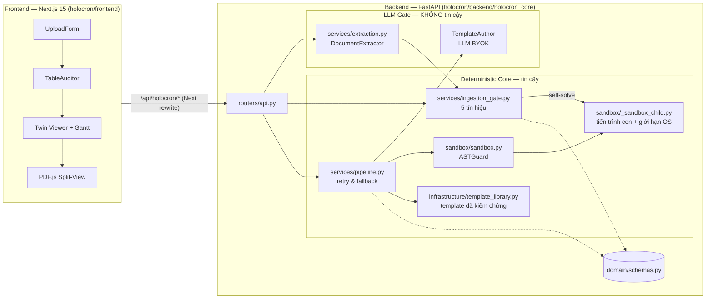

# Holocron — Technical Specification & PRD

| Trường | Giá trị |
|---|---|
| Trạng thái | **v0.3 — CHỐT cho Tuần 2** (Tuần 2 / Ngày 2). Thay đổi contract sau mốc này PHẢI qua PR sửa tài liệu này trước. |
| Phạm vi | Golden Path MVP: Hệ điều hành — CPU Scheduling (Round Robin, SJF) · Ingestion Gate · Deterministic Core · Frontend Ingestion UI |
| Nguồn chân lý code | `holocron/backend/holocron_core/` (Pydantic v2) · `holocron/frontend/src/types/holocron.ts` (TypeScript, khớp 1:1) |
| Tài liệu liên quan | `docs/adr/`, `.claude/CLAUDE.md`, `holocron/backend/examples/*.json` |
| Quy ước | **PHẢI / KHÔNG ĐƯỢC / NÊN / CÓ THỂ** theo nghĩa RFC 2119 (MUST / MUST NOT / SHOULD / MAY) |

## Mục lục

0. [Tóm tắt & bất biến](#0-tóm-tắt--bất-biến)
1. [Bài toán, mục tiêu & phạm vi](#1-bài-toán-mục-tiêu--phạm-vi)
2. [Thuật ngữ](#2-thuật-ngữ)
3. [Kiến trúc](#3-kiến-trúc)
4. [User Flow Frontend ↔ Backend](#4-user-flow-frontend--backend)
5. [Data Contracts](#5-data-contracts)
6. [API Contracts](#6-api-contracts)
7. [Ingestion Gate](#7-ingestion-gate)
8. [Executable Template Contract](#8-executable-template-contract)
9. [Sandbox Runtime](#9-sandbox-runtime)
10. [Retry Budget & Fallback](#10-retry-budget--fallback)
11. [LLM Gate & cấu hình BYOK](#11-llm-gate--cấu-hình-byok)
12. [Knowledge Vault & trích dẫn 1-chạm](#12-knowledge-vault--trích-dẫn-1-chạm)
13. [Bảo mật & Threat Model](#13-bảo-mật--threat-model)
14. [Quan sát hệ thống](#14-quan-sát-hệ-thống)
15. [Kiểm thử & Định nghĩa "Done"](#15-kiểm-thử--định-nghĩa-done)
16. [Lộ trình](#16-lộ-trình)
17. [Rủi ro & quyết định](#17-rủi-ro--quyết-định)
18. [Phụ lục](#18-phụ-lục)

---

## 0. Tóm tắt & bất biến

Holocron sinh **đề song sinh (Twin Questions)** cho các bài tính toán môn Hệ điều hành từ ảnh đề thi cũ. Kiến trúc tách hai tầng: **Deterministic Core** (mọi con số do code chạy trong sandbox cô lập tính ra) và **Knowledge Vault UI + Ingestion Gate** (con người xác nhận dữ liệu đọc từ ảnh trước khi tính, và kiểm chứng lời giải bằng trích dẫn slide 1-chạm).

Năm bất biến sau PHẢI đúng ở mọi phiên bản; vi phạm bất kỳ bất biến nào là lỗi chặn release:

| ID | Bất biến | Cơ chế cưỡng chế |
|---|---|---|
| **I1** | Không con số nào do LLM tự viết. Đáp án đúng, mọi phương án nhiễu và sơ đồ Gantt đến từ `solve()` / `make_distractors()` chạy trong Sandbox. | LLM chỉ được sinh *mã template*; `TwinQuestion` chỉ được dựng từ `SandboxResult` (§9, §10). |
| **I2** | Mỗi phương án sai của MCQ4 ánh xạ đúng một `misconception_code` đã khai báo trong template. | Validator `TwinQuestion._format_rules`; `build_twin` ném `ValueError` khi gặp mã lạ → retry (§10). |
| **I3** | Mọi câu hỏi có `Citation` với `verbatim_quote` là chuỗi con (chuẩn hoá khoảng trắng) của `raw_text` chunk gốc. | Validator `KnowledgeChunk._consistency`; `Citation` sinh từ `KnowledgeChunk.to_citation()`. |
| **I4** | `(template_sha256, seed)` ⇒ cùng đề, cùng đáp án, cùng thứ tự phương án, cùng Gantt. | `random.Random(seed)` trong template; trộn phương án bằng `random.Random(f"{sha256}:{seed}")`; walkthrough sinh `examples/*.json` giống từng byte. |
| **I5** | Không đề nào vào pipeline tính toán khi Gate còn issue `BLOCKING` chưa được con người xử lý. | `POST …/approve` trả 409; Frontend vô hiệu nút duyệt (`canApprove`); `POST /v1/blueprints` chỉ nhận item `approved=true`. |

## 1. Bài toán, mục tiêu & phạm vi

### 1.1 Bài toán
- Sinh viên hỏi chatbot bài tập CPU Scheduling thường nhận đáp số sai vì LLM tính nhẩm (Waiting Time, Turnaround Time…).
- Đề cũ truyền tay là ảnh chụp mờ; OCR/VLM đọc sai một chữ số là sai toàn bộ lời giải mà không ai phát hiện.

### 1.2 Mục tiêu MVP (Tuần 3)
- **G1.** Golden Flow chạy end-to-end trên máy người dùng: upload ảnh → Gate dual-pass → sửa ô → approve → sandbox → Gantt + 3 Twin Questions + trích dẫn slide.
- **G2.** Thuật toán: **Round Robin** (`os.cpu_sched.rr.avg_waiting_time`) và **SJF non-preemptive** (`os.cpu_sched.sjf.avg_waiting_time`).
- **G3.** Hiệu năng: sinh một Twin p95 ≤ 3 s không tính thời gian LLM viết template; Gate phản hồi sau mỗi lần sửa ô p95 ≤ 500 ms.
- **G4.** Tái lập: chạy lại cùng `(template_sha256, seed)` cho kết quả giống từng byte (trừ `twin_id`, `generated_at`, `sandbox_duration_ms`).

### 1.3 Phi mục tiêu (MVP)
- Môn khác ngoài Hệ điều hành; topic khác ngoài RR/SJF (Paging, Banker thuộc Tuần 4).
- Tự luận, chấm tự luận; câu phụ thuộc hình vẽ (gắn `non_cloneable`).
- Trích dẫn bằng bounding-box pixel (dùng `page_number` + `verbatim_quote`, ADR-002).
- Đa người dùng, đăng nhập, đồng bộ đám mây.

### 1.4 Ràng buộc
- **Local-first:** Backend FastAPI + Pydantic v2 (Python ≥ 3.12) và Frontend Next.js 15 (App Router) chạy trên máy người dùng; sẵn sàng đóng gói Tauri. Không phụ thuộc dịch vụ trả phí ngoài API LLM do người dùng tự cấp (BYOK).
- **Lưu trữ:** in-memory (Tuần 2–3) → SQLite qua SQLAlchemy (Tuần 4).
- **Hệ điều hành dev:** Windows và Linux đều là nền tảng hạng nhất; mọi test PHẢI xanh trên cả hai.

## 2. Thuật ngữ

| Thuật ngữ | Định nghĩa |
|---|---|
| Ingestion Item | Một câu hỏi đọc từ trang đề, gồm stem, 4 phương án, bảng dữ liệu (2 lượt đọc) và `GateReport` |
| Dual-pass | Hai lượt trích xuất độc lập trên cùng trang (khác prompt hoặc nhiệt độ); lệch nhau ở ô nào thì ô đó nghi đọc sai |
| Gate Issue | Phát hiện của Ingestion Gate; gắn toạ độ `(row, col)` khi thuộc một ô |
| CPUSchedulingProblem | Đề CPU Scheduling đã chuẩn hoá từ bảng qua Gate — đầu vào duy nhất cho `solve()` |
| Exam Blueprint | Ma trận đề: danh sách slot (dạng câu, topic, archetype phương án nhiễu) dựng từ các item đã duyệt |
| Executable Template | Script Python tuân thủ hợp đồng §8, do LLM sinh hoặc pre-computed đã kiểm chứng |
| Twin Question | Câu hỏi đẳng cấu sinh từ template + seed |
| Misconception | Lỗi nhận thức có mã (`RR_TREATED_AS_FCFS`…); mỗi phương án nhiễu hiện thành *badge* trên UI |
| Gantt Segment | Một đoạn CPU chạy một tiến trình trong `[start, end)`; do sandbox sinh |
| BYOK | Bring Your Own Key: người dùng tự cấp API key cho LLM tương thích OpenAI |

## 3. Kiến trúc

### 3.1 Sơ đồ thành phần



### 3.2 Phân tầng & quy tắc phụ thuộc

| Tầng | Package | Được import | KHÔNG ĐƯỢC import |
|---|---|---|---|
| Domain | `domain/` | thư viện chuẩn, `pydantic` | mọi tầng khác |
| Sandbox | `sandbox/` | `domain/` (gián tiếp qua kiểu), thư viện chuẩn | `services/`, `routers/`, mạng |
| Services | `services/` | `domain/`, `sandbox/`, `infrastructure/` | `routers/`, `fastapi` |
| Infrastructure | `infrastructure/` | `domain/` | `services/`, `routers/` |
| Routers | `routers/` | tất cả tầng dưới | — |

Phụ thuộc bên ngoài (VLM, LLM, storage) PHẢI đi qua `Protocol` (`DocumentExtractor`, `TemplateAuthor`, `TemplateRegistry`) và được cấp qua `Depends` hoặc tham số, để test thay được mà không gọi mạng.

### 3.3 Ranh giới tin cậy
- **Không tin cậy:** file người dùng tải lên; mọi output VLM (bảng, stem, phương án); mọi output LLM, kể cả mã template.
- **Tin cậy:** `domain/schemas.py`, ASTGuard, sandbox runner, template `precomputed_verified`, dữ liệu ô có `verified_by_human=true`.
- Dữ liệu không tin cậy PHẢI đi qua ít nhất một cổng tin cậy trước khi ảnh hưởng tới con số hiển thị: bảng → Ingestion Gate; mã template → ASTGuard + sandbox + validator `TwinQuestion`.

## 4. User Flow Frontend ↔ Backend

```mermaid
sequenceDiagram
  actor U as Sinh viên
  participant FE as Frontend (Next.js)
  participant API as FastAPI
  participant EX as DocumentExtractor
  participant G as Ingestion Gate
  participant SB as Sandbox
  U->>FE: Chọn ảnh/PDF đề + dạng bài (+ quantum)
  FE->>API: POST /v1/ingestion/upload (multipart)
  API->>API: sniff magic bytes, sha256 → document_id
  API->>EX: extract() — lượt A & lượt B
  EX-->>API: DualPassExtraction
  API->>G: table → CPUSchedulingProblem
  G->>SB: self-solve (params_override)
  SB-->>G: SandboxResult
  G-->>API: GateReport (5 tín hiệu)
  API-->>FE: 201 UploadResponse
  FE->>U: Bảng; ô BLOCKING viền đỏ nhấp nháy
  loop đến khi không còn BLOCKING
    U->>FE: Click ô, sửa hoặc chọn giá trị từ lượt đọc kia
    FE->>API: PATCH /v1/ingestion/items/{id}/table (expected_version)
    API->>G: apply_patches + chạy lại Gate & self-solve
    API-->>FE: 200 IngestionItem (version+1)
  end
  U->>FE: Approve & Run Simulation
  FE->>API: POST /v1/ingestion/items/{id}/approve
  API-->>FE: 200 (approved=true)
  FE->>API: POST /v1/blueprints {item_ids}
  API-->>FE: 201 ExamBlueprint
  FE->>API: POST /v1/blueprints/{id}/twins {count: 3}
  API->>SB: template × seed (retry & fallback)
  API-->>FE: 201 TwinBatch (TwinQuestion[] kèm gantt)
  FE->>U: Gantt + 3 Twin + badge misconception + trích dẫn 1-chạm
```

| Bước | Màn hình / hành động | Endpoint | Trạng thái UI khi thành công | Xử lý lỗi trên UI |
|---|---|---|---|---|
| 1 | `/` — chọn file, dạng bài, quantum tuỳ chọn | `POST /v1/ingestion/upload` | Chuyển tới `/ingestion/{item_id}` | 400/413/415/422 hiện ngay dưới form, giữ nguyên lựa chọn |
| 2 | `/ingestion/{item_id}` — tải item | `GET /v1/ingestion/items/{id}` | Hiện stem, phương án, kết quả tự giải, `TableAuditor` | 404 → thông báo + link về trang tải lên |
| 3 | Sửa ô (Enter lưu, Esc huỷ, hoặc chọn giá trị từ `alternatives`) | `PATCH …/table` | Bảng cập nhật, issue tính lại, `version` tăng | 409 → tải lại item mới nhất và báo người dùng sửa lại; 422 → hiện lỗi tại ô |
| 4 | Nút **Approve & Run Simulation** (chỉ bật khi không còn BLOCKING) | `POST …/approve` | Nhãn "Đã duyệt", khoá sửa bảng | 400 (non-cloneable) / 409 (còn BLOCKING) → hiện chi tiết |
| 5 | Tạo blueprint từ item đã duyệt | `POST /v1/blueprints` | Lưu `blueprint_id` | 409 nếu có item chưa duyệt |
| 6 | Sinh 3 Twin | `POST /v1/blueprints/{id}/twins` | Gantt + câu hỏi + badge | `review_tickets` không rỗng → hiện slot cần xem lại thủ công |
| 7 | Click trích dẫn | — (client PDF.js) | Mở slide đúng trang, highlight `verbatim_quote` | Không tìm thấy → tìm theo 8 từ đầu (§12.2) |

Bước 1–4 đã triển khai ở Tuần 2. Bước 5–7 là contract chốt, triển khai ở Tuần 2 Ngày 3–4 (§16).

## 5. Data Contracts

Nguồn chân lý là Pydantic; khối mã dưới đây phản ánh đúng code ở commit chốt spec. Kiểu TypeScript tương ứng nằm trong `holocron/frontend/src/types/holocron.ts` với tên field snake_case giữ nguyên. Field Python `X | None` có default `None` luôn có mặt trong JSON response với giá trị `null`.

### 5.1 `ProcessItem` & `CPUSchedulingProblem` (`domain/schemas.py`)

```python
class SchedulingAlgorithm(str, Enum):
    RR = "RR"
    SJF = "SJF"

class ProcessItem(StrictModel):            # extra="forbid", strip whitespace
    name: str = Field(min_length=1, max_length=32)
    arrival_time: int = Field(ge=0, le=200)
    burst_time: int = Field(ge=1, le=100)

class CPUSchedulingProblem(StrictModel):
    algorithm: SchedulingAlgorithm
    processes: list[ProcessItem] = Field(min_length=1, max_length=10)
    quantum: int | None = Field(default=None, ge=1, le=20)
    def to_template_params(self) -> dict[str, list[str] | list[int] | int]: ...
```

- RR PHẢI có `quantum`; SJF KHÔNG ĐƯỢC có `quantum`.
- Tên tiến trình PHẢI duy nhất (so sánh không phân biệt hoa thường, đã chuẩn hoá khoảng trắng).
- `to_template_params()` trả `{"names", "arrivals", "bursts"}` và thêm `"quantum"` khi có — đúng dạng `params` mà template §8 nhận.

### 5.2 Bảng trích xuất (`services/ingestion_gate.py`)

```python
class ExtractedCell(BaseModel):
    row: int = Field(ge=0)
    col: int = Field(ge=0)
    text: str
    confidence: float = Field(ge=0.0, le=1.0)
    verified_by_human: bool = False

class ExtractedTable(BaseModel):
    table_id: str
    page_number: int = Field(ge=1)
    version: int = Field(default=1, ge=1)     # tăng 1 sau mỗi PATCH
    headers: list[str]
    cells: list[ExtractedCell]                # toạ độ duy nhất, col < len(headers)
```

### 5.3 `GateIssue` (vai trò *CellIssue*) & `GateReport`

Model mang tên `GateIssue` vì không phải issue nào cũng thuộc một ô: `LATEX_UNBALANCED` và `SELF_SOLVE_MISMATCH` có `row = col = null`. Issue cấp ô (vai trò *CellIssue*) là issue có cả `row` và `col` khác `null`; Frontend PHẢI dùng cặp này để tô ô.

```python
class Severity(str, Enum):
    INFO = "info"; WARNING = "warning"; BLOCKING = "blocking"

class GateIssue(BaseModel):
    code: Literal["DUAL_PASS_MISMATCH", "LOW_CONFIDENCE", "HEADER_MISMATCH", "NOT_A_NUMBER",
                  "OUT_OF_RANGE", "DUPLICATE_LABEL", "MISSING_CELL", "NOT_IN_TEXT_LAYER",
                  "SELF_SOLVE_MISMATCH", "LATEX_UNBALANCED"]
    severity: Severity
    message_vi: str
    row: int | None = None
    col: int | None = None
    alternatives: list[str] = []              # các giá trị hai lượt đọc ra (DUAL_PASS_MISMATCH)

class GateStatus(str, Enum):
    AUTO_PASS = "AUTO_PASS"; NEEDS_REVIEW = "NEEDS_REVIEW"; BLOCKED = "BLOCKED"

class GateReport(BaseModel):
    table_id: str
    table_version: int                        # = ExtractedTable.version tại thời điểm tính
    status: GateStatus                        # BLOCKED nếu có ≥1 BLOCKING; NEEDS_REVIEW nếu chỉ có WARNING
    issues: list[GateIssue]
```

### 5.4 Tài liệu tải lên & Ingestion Item

```python
MediaType = Literal["image/png", "image/jpeg", "image/webp", "application/pdf"]

class UploadedDocument(BaseModel):           # frozen
    document_id: str                         # "doc_" + sha256[:16] — cùng nội dung ⇒ cùng id
    sha256: str
    filename: str
    media_type: MediaType                    # xác định bằng magic bytes, không theo Content-Type
    size_bytes: int
    uploaded_at: datetime

class SolverInputs(BaseModel):               # extra="allow"
    quantum: int | None = None               # gt=0; gửi null tường minh ⇒ 422

class IngestionItem(BaseModel):
    item_id: str
    source_doc_id: str
    page_number: int
    topic_key: str
    stem_latex: str
    options: dict[OptionKey, str]
    table_primary: ExtractedTable            # lượt A; mọi PATCH áp lên bảng này
    table_secondary: ExtractedTable | None   # lượt B; dùng cho DUAL_PASS_MISMATCH
    page_text_layer: str | None
    solver_inputs: SolverInputs
    non_cloneable: bool
    non_cloneable_reason: str | None
    problem: CPUSchedulingProblem | None     # null khi bảng chưa chuẩn hoá được
    self_solve: SelfSolveResult | None
    report: GateReport | None
    audits: list[PatchAudit]
    approved: bool

class UploadResponse(BaseModel):
    document: UploadedDocument
    item: IngestionItem                      # item.report là GateReport của lần quét đầu
```

### 5.5 `TwinQuestion` (`domain/schemas.py`)

```python
class TwinQuestion(StrictModel):
    twin_id: str
    blueprint_id: str
    slot_index: int
    template_id: str
    topic_key: str
    seed: int                                # 0 ≤ seed < 2**63
    format: QuestionFormat                   # MCQ4 | NUMERICAL
    stem: str                                # Markdown + LaTeX do render_stem() sinh
    options: dict[OptionKey, str] | None     # MCQ4: đủ A–D, 4 nội dung khác nhau
    correct_key: OptionKey | None
    numerical_answer: NumericalAnswer | None # NUMERICAL: bắt buộc
    distractor_to_misconception_map: dict[OptionKey, MisconceptionRef]   # badge trên UI
    solution_explanation_vi: str
    citation: Citation
    trace: GenerationTrace                   # sandbox_duration_ms, llm_attempts, seed_rerolls, template_sha256, provenance
    review_status: ReviewStatus
    generated_at: datetime
    gantt: list[GanttSegment]                # BỔ SUNG T2-N3 — xem §5.6
```

Quy tắc MCQ4: `correct_key ∉ distractor_to_misconception_map` và map phủ đúng 3 phương án còn lại (I2). NUMERICAL: không có `options`/`correct_key`, bắt buộc `numerical_answer.tolerance_abs`.

### 5.6 Bổ sung chốt cho Tuần 2 Ngày 3 (`GanttSegment`, `TwinQuestion.gantt`, `TwinBatchRequest` và `TwinBatch` đã có trong code; `BlueprintCreate` chưa)

```python
class GanttSegment(StrictModel):
    process: str = Field(min_length=1, max_length=32)   # trùng ProcessItem.name
    start: int = Field(ge=0)
    end: int                                            # PHẢI > start

class BlueprintCreate(BaseModel):
    item_ids: list[str] = Field(min_length=1, max_length=50)   # mọi item PHẢI approved=true

class TwinBatchRequest(BaseModel):
    count: int = Field(default=3, ge=1, le=10)
    format: QuestionFormat = QuestionFormat.MCQ4
    base_seed: int | None = Field(default=None, ge=0, lt=2**63)

class TwinBatch(BaseModel):
    blueprint_id: str
    base_seed: int
    twins: list[TwinQuestion]
    review_tickets: list[ReviewTicket]       # slot không sinh được (services/pipeline.py)
```

- `TwinQuestion.gantt` có default `[]`; với topic CPU Scheduling PHẢI không rỗng. Các segment PHẢI sắp theo `start`, không chồng lấn; khoảng CPU rảnh không có segment.
- `gantt` PHẢI lấy từ khoá `"gantt"` của `solve()` (§8.1), KHÔNG ĐƯỢC tính lại ngoài sandbox (I1).
- Khi thêm vào code, `holocron/frontend/src/types/holocron.ts` PHẢI cập nhật trong cùng PR.

## 6. API Contracts

### 6.0 Quy ước chung
- Base URL backend: `http://127.0.0.1:8000`. Frontend gọi `/api/holocron/*`, được Next.js rewrite sang backend (cùng origin, không cần CORS).
- Payload JSON UTF-8, field snake_case. Thời gian ISO-8601 UTC.
- Lỗi luôn có dạng FastAPI `{"detail": ...}`, trong đó `detail` là một trong: chuỗi tiếng Việt; danh sách lỗi validate `[{loc, msg, type}]` (422); hoặc `{"message", "issues": [...]}` (409 khi approve còn BLOCKING).

| Mã | Nghĩa trong Holocron |
|---|---|
| 200 / 201 | Thành công / tạo mới |
| 400 | Yêu cầu hợp lệ về cú pháp nhưng vi phạm trạng thái nghiệp vụ (file rỗng; approve item non-cloneable; gắn non-cloneable cho item đã duyệt) |
| 404 | Không tìm thấy item / blueprint |
| 409 | Xung đột trạng thái: `expected_version` lệch; sửa item đã duyệt; approve khi còn BLOCKING; blueprint chứa item chưa duyệt |
| 413 | File vượt 10 MiB |
| 415 | Định dạng file không hỗ trợ, hoặc `Content-Type` khai báo không khớp nội dung |
| 422 | Lỗi validate dữ liệu (kể cả `quantum` null/ngoài miền, topic chưa hỗ trợ) |

### 6.1 `POST /v1/ingestion/upload` — đã triển khai

Nhận file đề, chạy trích xuất dual-pass và Ingestion Gate, trả `document_id` cùng `GateReport`.

**Request** `multipart/form-data`:

| Field | Kiểu | Bắt buộc | Ràng buộc |
|---|---|---|---|
| `file` | file | có | PNG, JPEG, WebP hoặc PDF (nhận diện bằng magic bytes); 1 byte – 10 MiB |
| `topic_key` | string | có | khớp `^[a-z0-9_]+(\.[a-z0-9_]+){2,}$`; extractor phải hỗ trợ |
| `quantum` | int | không | 1–20; nếu có thì ghi đè quantum đọc được từ đề |

**Xử lý (PHẢI theo đúng thứ tự):**
1. Đọc tối đa 10 MiB + 1 byte; vượt → 413. Rỗng → 400.
2. Xác định `media_type` bằng magic bytes; không nhận diện được → 415. `Content-Type` khai báo khác `media_type` (trừ rỗng hoặc `application/octet-stream`) → 415.
3. `document_id = "doc_" + sha256(content)[:16]`; lưu idempotent (tải lại cùng file giữ bản ghi đầu).
4. `DocumentExtractor.extract()` trả hai lượt đọc; topic chưa hỗ trợ → 422.
5. Tạo `IngestionItem` mới (mỗi lần upload một `item_id`), chuẩn hoá bảng thành `CPUSchedulingProblem`, self-solve bằng template đã kiểm chứng, tính `GateReport`.

**Response** `201 UploadResponse` (rút gọn):

```json
{
  "document": {"document_id": "doc_5158ccdeb93a5397", "media_type": "image/png", "size_bytes": 72, "...": "..."},
  "item": {
    "item_id": "ing_2b96221bc584",
    "problem": {"algorithm": "RR", "quantum": 4, "processes": [{"name": "P1", "arrival_time": 0, "burst_time": 2}]},
    "self_solve": {"status": "NO_MATCH", "solved_answer_display": "4.60 ms", "...": "..."},
    "report": {
      "table_id": "tbl_5158ccdeb93a", "table_version": 1, "status": "BLOCKED",
      "issues": [
        {"code": "LOW_CONFIDENCE", "severity": "warning", "row": 1, "col": 2, "alternatives": [], "message_vi": "Độ tin cậy 0.61 < 0.85."},
        {"code": "DUAL_PASS_MISMATCH", "severity": "blocking", "row": 1, "col": 2, "alternatives": ["8", "9"], "message_vi": "Hai lượt đọc VLM cho kết quả khác nhau."},
        {"code": "SELF_SOLVE_MISMATCH", "severity": "blocking", "row": null, "col": null, "alternatives": [], "message_vi": "AI tự giải ra … không khớp đúng một phương án …"}
      ]
    },
    "approved": false
  }
}
```

**Extractor:** Tuần 2 dùng `MockDualPassExtractor` — tất định, không gọi mạng, trả đề RR mẫu với lượt A đọc nhầm burst của P2 (`"8"`, confidence 0.61) và lượt B đọc đúng (`"9"`). Tuần 3 thay bằng adapter VLM (§11) qua `app.dependency_overrides[get_extractor]` / cấu hình, router không đổi.

### 6.2 `PATCH /v1/ingestion/items/{item_id}/table` — đã triển khai

Người dùng sửa ô bảng, có optimistic locking.

**Request** `application/json`:

```json
{"editor_id": "local_user", "expected_version": 1, "patches": [{"row": 1, "col": 2, "new_text": "9"}]}
```

| Field | Ràng buộc |
|---|---|
| `editor_id` | chuỗi, ghi vào `PatchAudit` |
| `expected_version` | ≥ 1; PHẢI bằng `table_primary.version` hiện tại |
| `patches` | ≥ 1 phần tử; `new_text` ≤ 64 ký tự; `col` < số header |

**Ngữ nghĩa:**
- Ô được sửa nhận `confidence = 1.0`, `verified_by_human = true`; ô đã xác nhận được bỏ qua kiểm tra `LOW_CONFIDENCE` và `DUAL_PASS_MISMATCH`, nhưng vẫn qua kiểm tra schema (`NOT_A_NUMBER`, `OUT_OF_RANGE`…).
- `table_primary.version` tăng đúng 1 cho mỗi request (không phụ thuộc số ô).
- Ghi một `PatchAudit {from_version, to_version, editor_id, changes: [{row, col, old, new}], at}`.
- Chuẩn hoá lại `problem`, chạy lại self-solve và `GateReport` trước khi trả về.

**Response:** `200 IngestionItem`. **Lỗi:** 404; 409 khi item đã duyệt hoặc `expected_version` lệch (body nêu version hiện tại — client PHẢI tải lại item rồi mới sửa tiếp); 422 khi body sai hoặc cột không tồn tại.

**Giới hạn đã biết:** store in-memory không đảm bảo nguyên tử giữa bước so version và bước ghi. Khi chuyển sang SQLite (Tuần 4) PHẢI dùng `version_id_col` của SQLAlchemy để so-và-ghi trong một câu `UPDATE … WHERE version = :expected`.

### 6.3 `POST /v1/blueprints/{blueprint_id}/twins` — contract chốt, triển khai T2-N3

Kích hoạt sandbox sinh bộ Twin Questions cho mọi slot của blueprint.

**Tiền đề:** `POST /v1/blueprints` với `BlueprintCreate {item_ids}` → `201 ExamBlueprint`. Mọi item PHẢI `approved=true` và không `non_cloneable` (ngược lại 409). Mỗi item thành một `BlueprintSlot` với `topic_key`, `format`, `distractor_archetypes` lấy từ self-solve.

**Request** `application/json` — `TwinBatchRequest`:

```json
{"count": 3, "format": "MCQ4", "base_seed": 20260419}
```

- `count` 1–10, mặc định 3 (số Twin cho mỗi slot).
- `base_seed` không gửi ⇒ server dùng `int(sha256(blueprint_id)[:15], 16)` để kết quả tái lập được (I4).
- Header `Idempotency-Key` (tuỳ chọn): cùng key + cùng body trong 24 h PHẢI trả lại đúng `TwinBatch` đã sinh, không chạy lại sandbox.

**Xử lý:** với mỗi slot và mỗi `k ∈ [0, count)`, gọi `produce_twin(base_seed = base_seed + k·7919)` (§10). Mỗi twin nhận `gantt` từ `solve()`; `distractor_to_misconception_map` là nguồn duy nhất cho badge misconception trên UI. Slot không sinh được ⇒ một `ReviewTicket` trong `review_tickets`, không làm hỏng cả batch.

**Response:** `201 TwinBatch`:

```json
{
  "blueprint_id": "bp_os_midterm_2025_de2",
  "base_seed": 20260419,
  "twins": [{
    "twin_id": "twin_…", "slot_index": 1, "format": "MCQ4", "seed": 20268338,
    "stem": "Cho các tiến trình sau … $q = 3$ ms …",
    "options": {"A": "11.25 ms", "B": "6.25 ms", "C": "2.25 ms", "D": "4.50 ms"},
    "correct_key": "B",
    "distractor_to_misconception_map": {
      "A": {"misconception_code": "WAIT_CONFUSED_WITH_TURNAROUND", "label_vi": "…", "rationale_vi": "…"},
      "C": {"misconception_code": "WAIT_EQUALS_FIRST_RESPONSE", "label_vi": "…", "rationale_vi": "…"},
      "D": {"misconception_code": "RR_TREATED_AS_FCFS", "label_vi": "…", "rationale_vi": "…"}
    },
    "gantt": [{"process": "P1", "start": 0, "end": 3}, {"process": "P2", "start": 3, "end": 6}],
    "solution_explanation_vi": "Gantt: … WT trung bình = 25/4 = 6.25 ms.",
    "citation": {"doc_id": "doc_os_lecture05_cpu_scheduling", "page_number": 14, "verbatim_quote": "…", "chunk_id": "chk_os05_rr_definition"},
    "trace": {"sandbox_duration_ms": 42, "llm_attempts": 1, "seed_rerolls": 1, "template_sha256": "8aa7…", "provenance": "llm_generated"},
    "review_status": "AUTO_PASS"
  }],
  "review_tickets": []
}
```

**Lỗi:** 404 blueprint; 409 blueprint chứa item mất trạng thái duyệt; 422 body sai. Lỗi template/sandbox KHÔNG trả 5xx — chúng đi vào `review_tickets`.

**Trạng thái triển khai (`routers/api.py`, `services/twin_batch.py`):**
- `POST /v1/blueprints/{id}/twins` đã triển khai theo đúng các điểm trên. `POST /v1/blueprints` CHƯA: `ExamBlueprint`/`BlueprintSlot` có field bắt buộc (`subject_code`, `chapter_code`, `cognitive_level`, `mapping_confidence`, `distractor_archetypes`) mà `IngestionItem` không có nguồn, và spec chưa định nghĩa nguồn đó. Hiện blueprint chỉ nạp được qua `IngestionStore.save_blueprint(blueprint, item_ids)` (dùng trong test).
- 409 kiểm mọi item gắn với blueprint (`item_ids` lưu ở store): thiếu, chưa `approved` hoặc `non_cloneable` đều là 409 (I5).
- `Idempotency-Key` có phạm vi theo `blueprint_id`; cùng key và cùng body (so sánh sau khi áp giá trị mặc định) trong 24 h trả lại đúng batch cũ, không chạy lại sandbox. Cùng key nhưng khác body được coi là request mới và không ghi đè bản ghi cũ (spec chưa định nghĩa trường hợp này).
- `format` của request ghi đè `format` của slot cho cả batch (spec chưa nói rõ).
- Mỗi slot không sinh được cho ra tối đa một `ReviewTicket`. Phụ thuộc ngoài đi qua `Protocol`: `CitationProvider` (mặc định `NoCitationProvider`, chưa có Knowledge Vault ⇒ mọi slot vào `review_tickets` với lý do thiếu nguồn trích dẫn) và `TemplateAuthor` (mặc định `UnconfiguredTemplateAuthor`, chưa có adapter LLM ⇒ pipeline rơi về template pre-computed, twin `AUTO_FALLBACK`).
- **Vấn đề đã biết:** bước giữa các twin (`k·7919`) trùng bước re-roll seed (`7919`, §10), nên các twin trong cùng batch thường trùng seed và trùng đề (đo trên 30 batch × 3 twin của template RR: 27 batch có seed trùng, 46/90 twin bị nhân đôi). Xem R6 ở §17.

### 6.4 Các endpoint khác (đã triển khai)

| Method | Path | Mô tả | Lỗi chính |
|---|---|---|---|
| POST | `/v1/ingestion/items` | Tạo item từ JSON kết quả VLM (dùng cho tích hợp/test) | 422 |
| GET | `/v1/ingestion/items/{id}` | Lấy item | 404 |
| PATCH | `/v1/ingestion/items/{id}/stem` | Sửa LaTeX stem (≥ 10 ký tự), chạy lại Gate | 404, 409 (đã duyệt) |
| POST | `/v1/ingestion/items/{id}/non-cloneable` | Gắn cờ câu phụ thuộc hình vẽ (`reason` 5–300 ký tự) | 400 (đã duyệt), 404 |
| POST | `/v1/ingestion/items/{id}/approve` | Duyệt | 400 (non-cloneable), 409 (còn BLOCKING), 404 |
| GET | `/v1/runtime` | Trạng thái chạy cho UI: `{"demo_mode", "llm_configured", "vlm_configured"}` (chỉ boolean; không lộ khoá API, tên model hay endpoint). `demo_mode` đúng theo extractor đang chạy | — |

## 7. Ingestion Gate

### 7.1 Trích xuất dual-pass
- Hai lượt PHẢI độc lập: khác prompt hệ thống hoặc khác nhiệt độ (lượt A `temperature=0`, lượt B `temperature=0.4` với prompt diễn đạt lại). Mỗi ô có `confidence` ∈ [0, 1].
- Hai lượt PHẢI dùng cùng lưới `(row, col)`; ô một lượt không đọc được thì vắng mặt (sinh `MISSING_CELL` hoặc `DUAL_PASS_MISMATCH`).

### 7.2 Năm tín hiệu

| Tín hiệu | Mã issue | Điều kiện | Mức |
|---|---|---|---|
| S1 Dual-pass | `DUAL_PASS_MISMATCH` | Hai lượt khác nhau sau chuẩn hoá (trim, gộp khoảng trắng, lower) và ô chưa được con người xác nhận | BLOCKING |
| S2 Confidence | `LOW_CONFIDENCE` | `confidence < 0.85` và ô chưa xác nhận | WARNING |
| S3 Schema | `HEADER_MISMATCH` | Số cột sai (BLOCKING) / tên header không khớp alias (WARNING) | BLOCKING / WARNING |
| S3 Schema | `NOT_A_NUMBER`, `OUT_OF_RANGE`, `DUPLICATE_LABEL`, `MISSING_CELL` | Ô số không parse được (chấp nhận nhầm `O`→`0`); ngoài miền (arrival 0–200, burst 1–100); trùng tên tiến trình; thiếu ô | BLOCKING |
| S4 Text layer | `NOT_IN_TEXT_LAYER` | PDF có text layer nhưng số trong ô không xuất hiện trong text của trang | WARNING |
| S5 Self-solve | `SELF_SOLVE_MISMATCH` | Kết quả `solve()` trên bảng hiện tại khớp 0 hoặc ≥ 2 phương án (dung sai `max(tolerance_abs, 10^-decimals/2)`) | BLOCKING |
| Stem | `LATEX_UNBALANCED` | Số `$` không thoát bị lẻ, hoặc `{}` lệch | BLOCKING |

Ngoài ra, bảng chưa chuẩn hoá được thành `CPUSchedulingProblem` (thiếu quantum, vi phạm miền…) sinh issue BLOCKING "Chưa thể tự giải" và `self_solve.status = SKIPPED`. Tương tự, `self_solve.status = SKIPPED` do sandbox lỗi/timeout/sai hợp đồng, hoặc topic chưa có template đã kiểm chứng, sinh issue BLOCKING dùng mã `SELF_SOLVE_MISMATCH` (không có mã mới) ⇒ không thể AUTO_PASS (I5). `POST /v1/ingestion/items` trả 422 với topic chưa hỗ trợ.

### 7.3 Trạng thái & hành động
- `BLOCKED` khi có ≥ 1 BLOCKING; `NEEDS_REVIEW` khi chỉ có WARNING; ngược lại `AUTO_PASS`.
- Approve được phép khi status khác `BLOCKED` và item không `non_cloneable` (I5). WARNING không chặn approve nhưng PHẢI hiển thị.
- Frontend: ô có issue BLOCKING PHẢI viền đỏ nhấp nháy (tắt animation khi `prefers-reduced-motion`, thay bằng viền nét đứt); ô WARNING viền cam; ô đã xác nhận viền xanh. Ô có `alternatives` PHẢI cho chọn nhanh một trong các giá trị.

## 8. Executable Template Contract

### 8.1 Entry points (top-level, bắt buộc)

```python
def generate_params(seed: int) -> Params           # chỉ dùng random.Random(seed)
def validate(params: Params) -> None               # chỉ gồm assert có nhãn
def solve(params: Params) -> dict                  # {"value", "display", "explanation_vi", "exact"?, "gantt"?}
def make_distractors(params: Params, solution: dict) -> list[dict]   # đúng 3 phần tử
def render_stem(params: Params) -> str             # Markdown + LaTeX
```

- Với topic CPU Scheduling, `params` có dạng `CPUSchedulingProblem.to_template_params()` và `solve()` PHẢI trả thêm `"gantt": [{"process": str, "start": int, "end": int}, …]` (bổ sung T2-N3).
- Mỗi distractor là `{"misconception_code", "value", "display", "rationale_vi"}`; `misconception_code` PHẢI thuộc 3 mã khai báo trong `QuestionTemplate.misconceptions`.
- Template chạy trong sandbox nên chỉ được import whitelist (§9.1) và chỉ dùng kiểu builtin trong annotation.

### 8.2 Quy tắc assert
- Mỗi `assert` PHẢI có nhãn thuộc một trong bốn nhóm: `VALIDITY_*`, `TIE_*`, `NONDEG_*`, `DISTINCT_*`.
- `TIE_*` loại trường hợp đáp án phụ thuộc quy ước. RR: tiến trình đến đúng lúc tiến trình khác hết quantum (`TIE_ARRIVAL_AT_PREEMPTION`). SJF: hai tiến trình sẵn sàng có cùng burst (`TIE_EQUAL_BURST_READY`).
- `DISTINCT_*` đảm bảo 4 giá trị sau làm tròn đôi một cách nhau ≥ `min_option_gap`.

### 8.3 Số học
- Mọi phép chia dùng `fractions.Fraction`; chỉ làm tròn ở bước hiển thị (`decimals`).

### 8.4 Template chuẩn
- RR: `infrastructure/templates/os_rr_avg_waiting.py` — misconception `RR_TREATED_AS_FCFS`, `WAIT_EQUALS_FIRST_RESPONSE`, `WAIT_CONFUSED_WITH_TURNAROUND`.
- SJF non-preemptive (T2-N3): `infrastructure/templates/os_sjf_avg_waiting.py` — misconception `SJF_IGNORES_ARRIVAL`, `SJF_COMPUTED_AS_SRTF`, `WAIT_CONFUSED_WITH_TURNAROUND`.
- Mỗi template PHẢI có bộ giải tham chiếu độc lập viết trong test và property test ≥ 100 seed (§15).

## 9. Sandbox Runtime

### 9.1 Phòng thủ nhiều lớp

| Lớp | Cơ chế | Chặn |
|---|---|---|
| L1 ASTGuard | Whitelist import `random, math, fractions, itertools, functools, collections, statistics`; cấm builtins nguy hiểm, thuộc tính `_*`, `gi_/cr_/ag_/f_/tb_/co_*`, `.format/.format_map/.mro`; cấm `class/try/with/raise/global/delete/async`; số mũ hằng 0–64; literal ≤ 2 000 ký tự; ≤ 6 000 node; mã ≤ 20 000 byte | `os`, `sys`, `subprocess`, socket, file I/O, introspection escape |
| L2 Runtime | Tiến trình con `python -S -s -P`; builtins rút gọn; `__import__` chỉ trả proxy module đã nạp sẵn, không lộ module con | Escape qua module graph |
| L3 OS limits | Unix: `RLIMIT_AS` 256 MiB, `RLIMIT_CPU` 2 s, `RLIMIT_FSIZE` 0, `RLIMIT_CORE` 0. Windows: Job Object giới hạn bộ nhớ tiến trình + CPU user-time, `KILL_ON_JOB_CLOSE`. Cả hai: wall-clock ≤ 2 s ở tiến trình cha, env tối thiểu (`PYTHONHASHSEED=0`, `PYTHONIOENCODING=utf-8`, `SYSTEMROOT` trên Windows), cwd tạm | Vòng lặp vô hạn, memory bomb, ghi file |
| L4 (Tuần 4, đóng gói desktop) | nsjail/seccomp trên Linux; AppContainer trên Windows; không mạng | Phần còn lại |

`resource`/`RLIMIT_*` chỉ được dùng sau kiểm tra `sys.platform != "win32"`. Dòng `exec` duy nhất trong `_sandbox_child.py` mang `# noqa: S102` đã được duyệt.

### 9.2 Kết quả
`ok | ast_rejected | assertion_failed | runtime_error | contract_error | timeout | memory_exceeded | crashed`. Chỉ `assertion_failed` là lỗi của bộ số (re-roll seed); còn lại là lỗi của mã.

### 9.3 Hiệu năng
Mỗi lần chạy spawn một tiến trình (~40–60 ms Linux, ~120–150 ms Windows). Tuần 3 NÊN dùng pool tiến trình dựng sẵn và chạy song song các seed để đạt G3.

## 10. Retry Budget & Fallback

| Ngân sách | Giá trị | Bị trừ khi |
|---|---|---|
| Seed re-roll / template | 40 | `assertion_failed` (không gọi LLM) |
| Lượt LLM / slot | 3 | lỗi mã; 0/40 seed hợp lệ (`ill_posed`); dựng `TwinQuestion` thất bại (`twin_assembly_failed`, ví dụ misconception lạ) |

Cây quyết định:
1. Slot `non_cloneable` ⇒ `ReviewTicket` ngay.
2. ≤ 3 lượt LLM; mỗi lượt re-roll ≤ 40 seed theo dãy tất định `base_seed + k·7919`.
3. Hết lượt ⇒ template `precomputed_verified` cùng `topic_key` ⇒ twin `AUTO_FALLBACK`. Fallback cũng dựng twin lỗi ⇒ `ReviewTicket`, không crash.
4. Không có fallback ⇒ `ReviewTicket`, slot `NEEDS_REVIEW`.

Feedback gửi LLM (một dòng mỗi lỗi): `AST_REJECTED: dòng N: …`, `RUNTIME_ERROR (stage=…, line=…): …`, `ILL_POSED: 0/40 seed … Assert hay vi phạm nhất: …`, `TWIN_ASSEMBLY_FAILED: …`, `SCHEMA_INVALID: …`. LLM PHẢI được yêu cầu nới miền sinh biến, KHÔNG ĐƯỢC xoá assert.

## 11. LLM Gate & cấu hình BYOK

### 11.1 LLM được và không được làm gì

| Việc | LLM | Ghi chú |
|---|---|---|
| Đọc bảng/stem từ ảnh (VLM) | Được — output không tin cậy | Luôn qua Ingestion Gate |
| Viết mã Executable Template | Được — output không tin cậy | Luôn qua ASTGuard + sandbox + validator |
| Phân loại `topic_key`, gợi ý archetype phương án nhiễu | Được | Chỉ là nhãn, không phải số |
| Tính bất kỳ con số nào hiển thị cho người dùng | **KHÔNG ĐƯỢC** | I1 |
| Viết lời giải chứa số | **KHÔNG ĐƯỢC** | Lời giải là `explanation_vi` do `solve()` sinh |

### 11.2 Cấu hình (module `infrastructure/llm_config.py`, T2-N3)

| Biến môi trường | Mặc định | Ý nghĩa |
|---|---|---|
| `HOLOCRON_LLM_BASE_URL` | `https://api.deepseek.com/v1` | Endpoint tương thích OpenAI Chat Completions |
| `HOLOCRON_LLM_API_KEY` | — (bắt buộc khi dùng LLM) | Key do người dùng cấp; KHÔNG ĐƯỢC ghi log, KHÔNG ĐƯỢC trả về client |
| `HOLOCRON_LLM_MODEL_EXTRACT` | `deepseek-chat` | Prompting, phân loại topic |
| `HOLOCRON_LLM_MODEL_AUTHOR` | `deepseek-chat` | Viết template; CÓ THỂ đặt `deepseek-coder` nếu nhà cung cấp còn phục vụ model này |
| `HOLOCRON_VLM_BASE_URL` / `HOLOCRON_VLM_API_KEY` / `HOLOCRON_VLM_MODEL` | — | Model **có thị giác** cho dual-pass (tương thích OpenAI, nhận `image_url`) |
| `HOLOCRON_LLM_TIMEOUT_S` | `60` | Timeout mỗi request |

- Tên model là cấu hình, KHÔNG ĐƯỢC hard-code trong service.
- Khi thiếu cấu hình VLM (cần đủ ba biến `HOLOCRON_VLM_*`), hệ thống PHẢI dùng `MockDualPassExtractor` và hiển thị rõ trên UI rằng đang ở chế độ demo; UI đọc cờ `demo_mode` từ `GET /v1/runtime` (§6.4). Biến đặt giá trị rỗng hoặc toàn khoảng trắng coi như chưa đặt; `HOLOCRON_LLM_TIMEOUT_S` không phải số dương hữu hạn là lỗi cấu hình (`ConfigError`, thông điệp chỉ nêu tên biến).

### 11.3 Hợp đồng prompt viết template
System prompt gồm, theo thứ tự: (1) hợp đồng §8 nguyên văn; (2) danh sách import/builtin bị cấm của ASTGuard; (3) một ví dụ đầy đủ — chính file template RR; (4) slot cần sinh (`topic_key`, format, 3 `misconception_code` mục tiêu); (5) feedback lỗi của lượt trước theo định dạng §10. Output PHẢI là JSON khớp `QuestionTemplate` (không có trường `created_at`, `template_id`); JSON sai ⇒ `SCHEMA_INVALID` và trừ một lượt.

## 12. Knowledge Vault & trích dẫn 1-chạm

### 12.1 Bóc tách chunk
- Cắt theo heading của slide/giáo trình; chunk dài hơn 450 token được tách tại ranh giới đoạn, chồng lấn 1 câu.
- Phân loại `THEORY` khi chunk chứa định nghĩa/định lý/công thức; `PRACTICE` khi chứa bảng số liệu hoặc lời giải ví dụ. Tag `#theory` / `#practice_example` gắn tự động theo category (validator cưỡng chế).
- `linked_chunk_ids`: chunk `PRACTICE` liên kết tới chunk `THEORY` có cùng `topic_keys` gần nhất về trang.

### 12.2 Trích dẫn 1-chạm
- Client gọi PDF.js `PDFFindController` với `query = verbatim_quote` trên đúng `page_number`; highlight trong Split-View.
- Không tìm thấy (ligature, gạch nối cuối dòng) ⇒ tìm theo 8 từ đầu của quote; vẫn không thấy ⇒ mở đúng trang và hiện quote dạng trích dẫn.

## 13. Bảo mật & Threat Model

| STRIDE | Mối đe doạ | Biện pháp |
|---|---|---|
| Spoofing | File giả định dạng (đổi đuôi, sai `Content-Type`) | Nhận diện bằng magic bytes; khai báo lệch ⇒ 415 |
| Tampering | Prompt injection trong ảnh/PDF khiến LLM sinh template độc hại | ASTGuard + sandbox L1–L3; template không bao giờ chạy ngoài sandbox |
| Tampering | VLM bị lừa bởi chữ ẩn trong ảnh, đọc sai số | Dual-pass + self-solve mismatch + con người xác nhận (I5) |
| Repudiation | Không biết ai sửa ô nào | `PatchAudit` cho mọi PATCH |
| Information disclosure | Lộ API key BYOK | Key chỉ ở biến môi trường backend; không log; không trả về client; Frontend không bao giờ giữ key |
| Denial of service | File lớn; template vòng lặp vô hạn/memory bomb | Giới hạn 10 MiB; wall-clock 2 s; RLIMIT/Job Object |
| Elevation of privilege | Escape sandbox qua introspection/module graph | Cấm thuộc tính `_*` và các tiền tố frame; proxy module không lộ module con; test bảo mật bắt buộc khi nới whitelist |

Backend PHẢI chỉ lắng nghe `127.0.0.1` trong bản local-first.

## 14. Quan sát hệ thống
- Log có cấu trúc cho mỗi lần sandbox: `template_sha256, seed, status, duration_ms, stage`.
- Log cho mỗi upload: `document_id, media_type, size_bytes, gate_status, số issue theo mã` (không log nội dung file).
- Metrics: tỉ lệ chấp nhận seed theo template; phân bố `assertion_histogram`; tỉ lệ `AUTO_FALLBACK`; tỉ lệ Gate `BLOCKED` theo mã issue; số lần 409 version.

## 15. Kiểm thử & Định nghĩa "Done"

| Loại | Nội dung | File |
|---|---|---|
| Security | Payload escape bị ASTGuard chặn; proxy module; timeout; memory bomb | `tests/test_sandbox_security.py` |
| Correctness | `solve()` so với bộ giải tham chiếu độc lập trên ≥ 100 seed; tính tất định | `tests/test_rr_template.py` |
| Gate E2E | Đọc sai ô → BLOCKED → sửa → AUTO_PASS → approve; 409 version | `tests/test_schemas_and_gate.py` |
| Upload | Dual-pass mock → BLOCKED đúng ô; 400/413/415/422; `document_id` tất định | `tests/test_upload.py` |
| Trạng thái item | 422 quantum null; 400 approve/non-cloneable | `tests/test_api_item_state.py` |
| Pipeline | Misconception lạ ⇒ retry, không crash | `tests/test_pipeline_twin_assembly.py` |
| Frontend | `tsc --noEmit` và `next build` sạch | `holocron/frontend` |

"Done" cho một thay đổi: `pytest`, `ruff check .`, `ruff format --check .`, `mypy --strict holocron_core` xanh; frontend `npm run typecheck` và `npm run build` xanh khi chạm `frontend/`; walkthrough sinh lại `examples/*.json` khi đổi đầu ra pipeline.

"Done" cho một topic mới: template + bộ giải tham chiếu độc lập + property test ≥ 100 seed + tỉ lệ chấp nhận seed ≥ 10 % + bảng schema trong `TABLE_SCHEMAS` + `TOPIC_ALGORITHMS`.

## 16. Lộ trình

| Mốc | Hạng mục | Trạng thái |
|---|---|---|
| T2-N1 | Schemas, sandbox, template RR, Gate API | Xong |
| T2-N2 | Spec v0.3; upload + mock dual-pass; `CPUSchedulingProblem`; Frontend Ingestion (upload, Table Auditor) | Xong |
| T2-N3 | `solve()` của template RR trả `gantt` đúng dạng §8.1; `GanttSegment` và `TwinQuestion.gantt` (§5.6) | Xong |
| T2-N3 | Template SJF; `llm_config.py` | Kế hoạch |
| T2-N3 | `POST /v1/blueprints` | Kế hoạch (chưa đủ chi tiết về nguồn dữ liệu của slot, xem §6.3) |
| T2-N4 | `POST /v1/blueprints/{id}/twins` | Xong, với nguồn trích dẫn và author mặc định chưa cấu hình (§6.3) |
| T2-N4 | Twin Viewer + Gantt chart trên Frontend | Xong: trang `/blueprints/[blueprintId]` gọi `POST …/twins` và hiển thị 3 twin, badge misconception, trích dẫn, `review_tickets`; chưa nối từ luồng ingestion vì `POST /v1/blueprints` chưa có (§6.3) |
| T2-N5 | Adapter VLM thật cho dual-pass; pool tiến trình sandbox | Kế hoạch |
| Tuần 3 | Golden Flow end-to-end trên 5 đề thật; đo p95 (G3) | Kế hoạch |
| Tuần 4 | SQLite + optimistic locking nguyên tử; Paging FIFO/LRU, Banker; Vault đa môn; đóng gói Tauri | Kế hoạch |

## 17. Rủi ro & quyết định

| ID | Rủi ro / câu hỏi | Giảm thiểu / quyết định |
|---|---|---|
| R1 | Tỉ lệ chấp nhận seed thấp (RR ≈ 20 %) làm chậm sinh đề | Pool + song song; LLM nhận histogram assert |
| R2 | Quy ước RR/SJF khác nhau giữa giảng viên | Assert `TIE_*` loại trường hợp mơ hồ |
| R3 | VLM đọc sai chữ số viết tay | Dual-pass + self-solve mismatch + người dùng xác nhận |
| R4 | Nhà cung cấp LLM mặc định không có model thị giác | Cấu hình VLM tách riêng (§11.2); fallback mock có nhãn demo |
| R5 | Tên model của nhà cung cấp thay đổi/ngừng phục vụ | Tên model là cấu hình, không hard-code |
| R6 | Các twin trong cùng batch trùng seed (bước `k·7919` trùng bước re-roll `7919`) ⇒ đề trùng nhau | Chưa quyết định cách sửa (ví dụ bước giữa các twin lớn hơn `7919 × 40`); cần quyết định trước khi UI hiển thị batch |
| D1 | Người dùng có được sửa template không? | **Không** trong MVP; chỉ sửa dữ liệu đề qua Gate |
| D2 | Mã HTTP cho xung đột trạng thái | 409 cho xung đột version/duyệt; 400 cho vi phạm luật non-cloneable (đã chốt ở Tuần 2) |

## 18. Phụ lục

### A. Danh mục misconception

| Topic | Mã | Ý nghĩa |
|---|---|---|
| RR | `RR_TREATED_AS_FCFS` | Bỏ qua quantum, chạy hết burst theo thứ tự đến |
| RR | `WAIT_EQUALS_FIRST_RESPONSE` | Lấy response time thay cho waiting time |
| RR, SJF | `WAIT_CONFUSED_WITH_TURNAROUND` | Lấy turnaround mà quên trừ burst |
| SJF | `SJF_IGNORES_ARRIVAL` | Sắp theo burst mà bỏ qua thời điểm đến |
| SJF | `SJF_COMPUTED_AS_SRTF` | Cho phép ngắt (SRTF) trong khi đề là non-preemptive |

### B. JSON Schema
Sinh bằng `Model.model_json_schema()` cho mọi model ở §5; Frontend PHẢI đồng bộ `types/holocron.ts` trong cùng PR khi model đổi.

### C. ADR
- `docs/adr/001-architecture-core.md` — Kiến trúc hai tầng và phân tầng package.
- `docs/adr/002-sandbox-security.md` — Sandbox tiến trình con thay vì WASM; Job Object trên Windows.
- `docs/adr/003-data-pipeline.md` — Dual-pass + Ingestion Gate; trích dẫn bằng `verbatim_quote` thay vì bounding box.
